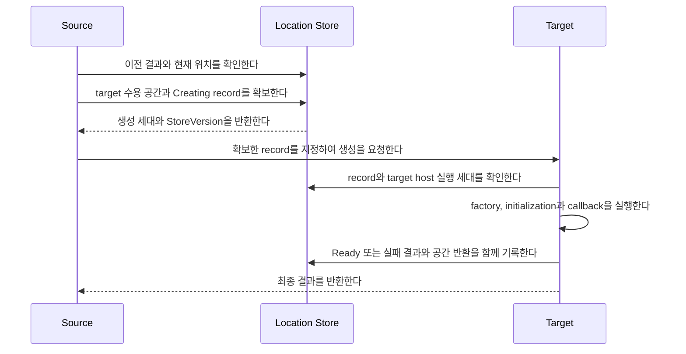
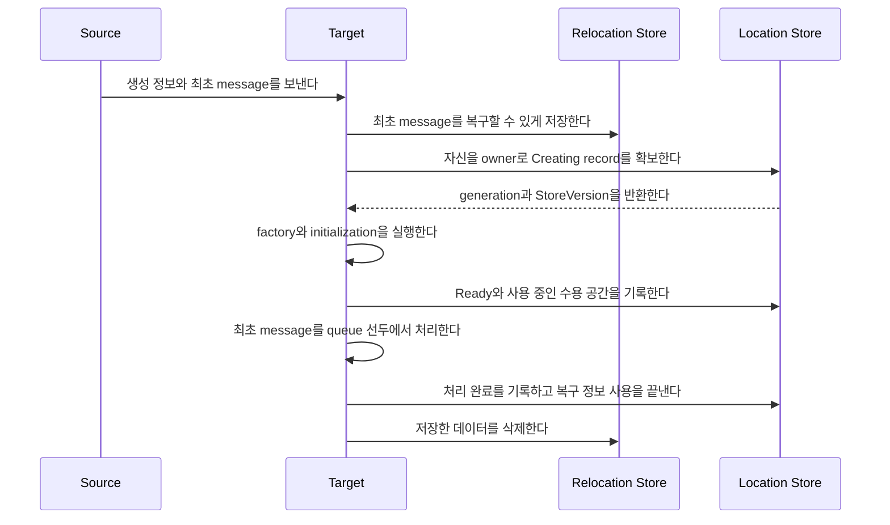
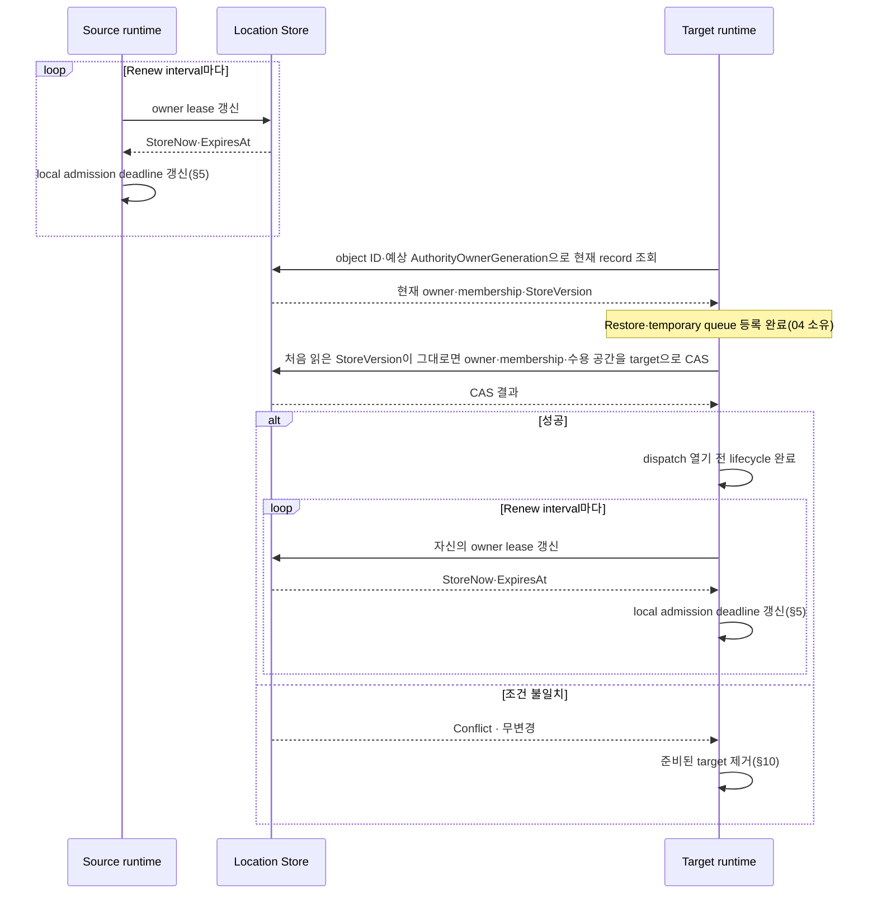

# Location runtime

[Location·Relocation 주제 목차](README.ko.md) · [스펙 목차](../README.ko.md) · [다음: 02. Location Store (Redis)](02-location-store-redis.ko.md)

> Framework가 application object의 현재 위치를 찾고 다른 node로 옮기는 방법을 정의한다.

## 1. Location 개요 — 두 Store의 책임

Message handler와 Actor를 실행하는 단위를 [Spot](../00-foundation/02-glossary.ko.md#spot)이라고 한다.
Actor는 Entry Spot이나 User Spot에 속할 수 있다. Framework 시작과 함께 server 진입점으로
만드는 Spot을 [Entry Spot](../00-foundation/02-glossary.ko.md#entry-spot-user-spot과-instance-spot)이라고
한다. Application이 명시적으로 생성하고 관리하는 Spot은
[User Spot](../00-foundation/02-glossary.ko.md#entry-spot-user-spot과-instance-spot)이다. 별도 create call
없이 최초 message로 만드는 Spot은
[Instance Spot](../00-foundation/02-glossary.ko.md#entry-spot-user-spot과-instance-spot)이다.

Actor·Spot 하나를 현재 처리하는 node를 [owner](../00-foundation/02-glossary.ko.md#owner)라고 한다.
**Framework는 owner가 동시에 둘이 되지 않도록 관리한다.** 현재 owner와 위치를 여러 node가
함께 확인하도록 보관하는 저장소를 [Location Store](../00-foundation/02-glossary.ko.md#location-store)라고
한다. Instance Spot이 없을 때 최초 message로 새로 만들고 초기화하는 과정을
[cold activation](../00-foundation/02-glossary.ko.md#cold-activation)이라고 한다. 이 cold activation의
생성 기록과 relocation 뒤 완료되는 request의 완료 기록을 보관하는 저장소는
[Relocation Store](../00-foundation/02-glossary.ko.md#relocation-store)라고 한다. Actor·Spot relocation의
application state·queue·timer handoff payload는 어느 Store도 거치지 않고 source가 target에 직접
전송한다.

저장소 구현자가 지켜야 하는 정확한 SPI는 [Location Store provider](02-location-store-redis.ko.md)와
[Relocation Store provider](03-relocation-store-redis.ko.md) 문서가 정의한다. 이 문서는
Framework가 두 Store를 사용하는 순서와 실패했을 때 유지해야 하는 상태를 설명한다.

### 1.1 Framework가 보장하는 결과

Framework는 다음 결과를 보장한다.

- 현재 요청을 처리할 수 있는 service와 연결 주소를 찾는다.
- Actor·Spot마다 현재 owner를 하나만 인정한다.
- Actor·Spot을 만들거나 옮길 node에 필요한 수용 공간을 미리 확보한다.
- 같은 Actor·Spot을 동시에 두 번 만들지 않는다.
- 이전 owner가 뒤늦게 위치를 변경하지 못하게 한다.
- Host 교체 중 application state와 아직 실행하지 않은 작업을 다른 node에서 복원한다.

**Relocation은 source와 선택한 target process가 실행되는 동안에만 진행한다.** Process가
종료된 뒤 다른 runtime이 relocation을 이어받거나 다른 target으로 자동으로 넘어가지
않는다 — automatic failover를 만들면 이전 process가 뒤늦게 살아났을 때 owner가 둘이 되는
경로를 새로 여는 것이기 때문이다. Location Store 응답이 유실됐을 때 실제 owner를 다시
확인하는 동작은 이 이유로 failover가 아니라 owner를 둘로 만들지 않기 위한 필수 확인이다.

Core transport는 byte를 전달할 뿐 Actor·Spot의 위치, 생성과 relocation 상태를 해석하지
않는다.

### 1.2 두 Store가 나누어 저장하는 정보

Framework는 위치를 판단하는 정보와 복구용 payload를 서로 다른 Store에 저장한다.

| Store | 저장하는 정보 | Framework가 사용하는 방법 |
|---|---|---|
| Location Store | 현재 owner와 위치, 세대 번호, Spot membership, 확보한 수용 공간과 relocation 진행 상태 | 어떤 node를 현재 owner로 인정할지 최종 결정한다. |
| Relocation Store | Instance Spot cold activation의 생성 정보와 최초 message, relocation 뒤 완료되는 pending request의 reply payload와 완료 결과 | Cold activation 복구와 이전 owner를 통한 reply 전달에 필요한 데이터를 제공한다. |

Actor·Spot relocation에서 새 owner가 복원할 application state, 실행하지 않은 queue와
timer는 어느 Store에도 저장하지 않는다. Source가 memory에 유지하다가 target에 직접
전송한다(§8).

어떤 Actor가 User Spot에 속하는 관계를
[Actor membership](../00-foundation/02-glossary.ko.md#actor-membership)이라고 한다. Location Store에
저장한 이동 대상 목록이 membership의 기준이다. Restore 대화가 전달하는 payload는 이
관계를 바꾸지 못한다.

**Actor가 많아도 이동 대상 목록 전체를 record 하나에 넣지 않는다.** Framework는 이 목록을
여러 페이지로 나누어 저장한다.

| 제한 대상 | 값 |
|---|---|
| 시스템 전체 Actor·Spot 수 | 이 계약에서 고정 상한을 두지 않는다. |
| User Spot 하나에 속한 Actor 총수 | 이 계약에서 고정 상한을 두지 않는다. |
| 이동 대상 목록 한 페이지 | Actor·Spot 항목 최대 1,024개, 저장 크기 최대 1 MiB. |

목록의 항목 하나는 "어떤 object를 옮겨야 하는가"만 나타낸다. Object identity, generation,
membership과 relocation 때 적용할 변경 정보를 기록한다. 여기서 generation은 같은 ID로 다시
만든 object나 이전 owner의 늦은 요청을 구분하는 세대 번호다(§3). Actor state나 message
payload는 넣지 않는다 — 실제 application state와 실행하지 않은 작업은 source가 memory에
유지하다가 Restore 대화로 target에 직접 전송한다(§8).

예를 들어 User Spot에 Actor가 10,000개 있으면 약 10개의 목록 페이지를 만든다. 마지막
페이지에는 남은 항목만 들어간다.

```text
User Spot object list
|
+-- Page 1  : User Spot + Actor 1..1023
+-- Page 2  : Actor 1024..2047
+-- ...
+-- Page 10 : Remaining Actors
```

페이지가 많으면 페이지를 찾는 상위 목록도 여러 페이지로 나눈다. **Location Store는 전체
목록의 시작 위치, 전체 항목 수와 내용 확인값을 보관한다.** Framework는 이 세 값으로
페이지가 빠지거나 바뀌지 않았는지 확인하기 때문이다.

복원 데이터 자체는 저장소를 거치지 않는다. Target은 Restore 요청이 선언한 전체 길이, chunk
수와 checksum으로 직접 전송받은 payload를 검증하고, 이동 대상 목록은 Location Store의
전체 항목 수와 내용 확인값으로 검증한다. **두 검증이 모두 성공해야 복원을 시작한다.**
Actor용 Store와 Spot용 Store를 따로 만들지 않는다.

**외부 Store provider는 Location Store SPI와 Relocation Store SPI만 구현하며, Framework의
Actor·Spot 규칙을 provider가 직접 구현하지 않는다.**

| 책임 | 담당 |
|---|---|
| 의미를 해석하지 않는 key와 bytes를 읽고, 지정한 버전이 그대로일 때만 함께 변경한다. | Location Store provider |
| 한 번 저장하면 바꾸지 않는 payload를 저장하고 읽고 삭제한다. | Relocation Store provider |
| 실행 중인 node 정보, owner 사용 기한과 현재 위치 record의 의미를 해석한다. | Framework |
| 남은 수용 공간을 계산하고 여러 object를 함께 옮기며 실패 결과를 정리한다. | Framework |

예를 들어 Location Store provider는 저장할 bytes가 Actor owner인지 capacity인지 알 필요가
없다. Framework가 필요한 record를 만들고 provider에는 읽기와 "전부 성공하거나 전혀 변경하지
않는 쓰기"만 요청한다.

여러 runtime node가 참여하는 연결 그룹에서 message를 보내거나 받는 runtime node를
[MeshNode](../00-foundation/02-glossary.ko.md#meshnode)라고 한다. Host가 자신의 network 주소와
실행 상태를 Location Store에 게시하는 등록 정보 중, MeshNode 자신의 것은
[MeshNode descriptor](../00-foundation/02-glossary.ko.md#meshnode-descriptor)이고 classic fanout
publisher가 게시하는 것은
[fanout publisher descriptor](../00-foundation/02-glossary.ko.md#fanout-publisher-descriptor)다.

**MeshNode descriptor, owner lease, ClientServer descriptor, fanout publisher descriptor와
authority record의 Redis key·byte 표현은 이 계약에서 provider가 자유롭게 고르는 내부
구현이 아니라, [Location Store provider의 공식 Redis 구현](02-location-store-redis.ko.md#8-공식-redis-provider--counter-발급)이
정하는 공개 계약이다.** 서로 다른 언어의 runtime이 같은 논리 record를 읽고 써야 하므로,
언어마다 다른 provider 구현이 저장해도 같은 Redis key와 같은 byte 표현을 만들어야 상호
운용이 성립하기 때문이다. §3.4가 이 형식을 요약한다. Relocation Store가 보관하는 payload의
Redis key·저장 형식도 별도로 버전을 매긴 공개 계약이며
[Relocation Store의 공식 Redis 구현](03-relocation-store-redis.ko.md#8-공식-redis-provider)이
정한다. Provider가 언어 전용으로 추가하는 보조 색인은 이 공개 계약에 포함되지 않는다.

Redis provider는 이 공개 계약을 넘어서는 범위에서 Lua script나 변경 감지 기능을 내부적으로
사용할 수 있다. Framework는 Redis 구현체로 변환하여 이런 기능을 직접 호출하지 않는다.
따라서 다른 database provider도 같은 두 Store SPI와 §3.4가 요약하는 record 형식을 구현할
수 있다.

Application이 사용하는 위치 조회와 readiness API는 Store 구현 API가 아니다. Application은
Framework runtime API를 사용하며 Store provider를 직접 호출하지 않는다.

### 1.3 정상 이동 순서 — 개요

Actor나 Spot을 다른 node로 이전할 때는 다음 순서를 따른다. 각 단계의 상세 mechanics —
payload chunk 전송, temporary queue, ingress hold, backlog 병합 순서 — 는
[Actor와 Spot relocation 전체 흐름](04-relocation-flow.ko.md)이 정의한다. 이 문서는 그중
Location Store가 기록하는 record와 조건만 §8~§9에서 다시 구체화한다.

1. Framework가 현재 실행 중인 node 정보, owner의 사용 기한과 위치 record를 확인한다.
2. Location Store에서 target node가 사용할 수용 공간을 확보한다.
3. Source는 현재 application turn을 끝낸 뒤 application state와 아직 실행하지 않은
   작업을 capture하여 memory에 유지한다. Location Store에는 capture 완료를 `Captured`로
   기록한다.
4. Source가 Target에 Restore 요청을 보낸다. 요청에는 payload의 전체 길이, chunk 수와
   checksum이 들어가고, source는 같은 ordered connection으로 payload를 chunk로 나눠 직접
   전송한다.
5. Target은 요청을 받으면 relocation temporary queue를 먼저 등록하고, 전송받은 chunk를
   조립해 checksum을 확인한 뒤 외부에 아직 공개하지 않은 instance에 복원한다. Restore가
   끝나면 source에 relay 수신 준비를 알린다. Source는 이 통지 뒤 ingress hold를 relay하고
   같은 ordered connection으로 cutover를 one-way로 보낸다.
6. Target은 [공통 relocation §4.4](04-relocation-flow.ko.md#44-ordered-relay와-one-way-cutover)의
   완전한 relay batch와 cutover를 검증한 뒤, Location Store의 처음 읽은 version이 그대로일
   때만 owner, membership과 수용 공간을 한 번에 변경한다. 이 방식을 compare-and-set,
   줄여서 [CAS](../00-foundation/02-glossary.ko.md#compare-and-set)라고 한다.
7. Owner 변경 뒤 저장된 기존 작업, cutover 전 relay와 나머지 temporary 작업을 실제 object
   queue에 순서대로 넣는다. Temporary queue 등록을 제거하고 regular route로 전환하되
   dispatch는 닫아 둔다. 필요한 lifecycle callback을 끝낸 뒤 application message 처리를
   시작한다.
8. Source는 cutover를 보낸 뒤 완료 reply를 기다리지 않고 Message Follow를 유지한다(§10의 연속 이동 예외 제외).
   Memory에 유지한 payload와 relay batch는 [공통 relocation §4.4](04-relocation-flow.ko.md#44-ordered-relay와-one-way-cutover)의 authority 판정 또는 source lease 만료 terminal까지 유지한다.

**Handoff payload와 owner 변경은 하나의 distributed transaction이나 2PC로 묶지 않는다.**
Restore 요청, 각 chunk와 target의 owner CAS는 같은 `RelocationId`, target attempt와 source
fence로 결합되고, Location Store의 owner CAS 한 번으로 새 owner를 공개한다 — 두 시스템을
동기화하는 대신, 하나의 CAS만이 owner를 확정하는 유일한 지점이 되도록 설계했기 때문이다.

Relocation Store 사용 여부는 이동 종류에 따라 다르다. Actor·Spot relocation의 handoff
payload는 이 Store를 거치지 않는다.

| 작업 | Framework 동작 |
|---|---|
| Same-node Actor join | Location Store에서 membership만 변경하며 payload를 만들지 않는다. |
| `DisableRelocation` cross-node 이동 | Capture 전에 거부한다. |
| `RecreateOnRelocation` cross-node Actor·Spot 이동 | Application state 없이 실행 전 queue·timer를 capture하여 target에 직접 전송한다. Relocation Store에는 저장하지 않는다. |
| `PreserveStateWith` cross-node Actor·Spot 이동 | Application state와 실행 전 queue·timer를 capture하여 target에 직접 전송한다. Relocation Store에는 저장하지 않는다. |
| Host maintenance의 Actor·User Spot 이동 | 이동 대상별 state와 완료되지 않은 작업을 target에 직접 전송한다. Relocation 뒤 완료되는 pending request의 완료 기록만 Relocation Store에 저장한다(§9.3). |
| Cross-node Actor `JoinSpot`·`JoinEntrySpot` | 이동하는 Actor의 policy에 맞는 payload를 target에 직접 전송한다. |
| Instance Spot을 처음 만들면서 message 처리 | 생성 정보와 최초 message를 Relocation Store에 함께 저장한다. Policy가 `DisableRelocation`이어도 사용한다. |

실행 중인 node를 알리는 정보는 해당 host의 owner 사용 기한이 끝나면 더 이상 사용하지
않는다. Actor·Spot의 현재 위치 record는 정해진 조건으로 삭제할 때까지 유지한다. Transport가
message를 보낼 준비가 된 상태, node 정보의 존재와 Actor·Spot의 현재 owner는 서로 다른
조건이다. Framework는 요청을 보내거나 새 object를 배치하기 전에 필요한 조건을 모두
확인한다.

## 2. 역할과 책임 — provider vs Framework

Location Store와 Relocation Store는 Framework 설정에 각각 정확히 한 번 등록한다.
**두 Store를 하나의 interface나 Redis 전용 등록 함수로 묶지 않는다.**

여러 runtime node가 message를 주고받는 연결 그룹을
[RouteMesh](../00-foundation/02-glossary.ko.md#routemesh)라고 한다. MeshNode는 RouteMesh에 참여하여
message를 보내거나 받는다.
[Object Client role](../00-foundation/02-glossary.ko.md#object-client와-object-server-role)은 Spot
생성·조회와 message를 요청할 수 있다.
[Object Server role](../00-foundation/02-glossary.ko.md#object-client와-object-server-role)은 이 기능에
더해 Spot을 만드는 함수와 lifecycle을 제공한다. Application이 등록하고 Framework가 object를
만들 때 호출하는 이 함수를 [factory](../00-foundation/02-glossary.ko.md#factory)라고 한다.

**Object role이 `Client` 또는 `Server`인 MeshNode는 Location Store가 필수다.** Store가
없으면 network socket을 열기 전에 startup configuration error로 끝난다. Framework는 대신
사용할 process 내부 Store를 만들지 않는다. Role이 `None`인 MeshNode는 object create, find,
message와 factory를 제공하지 않는다.

Object를 다른 node로 옮길 때 application state를 어떻게 복원할지 정하는 방식을
[relocation policy](../00-foundation/02-glossary.ko.md#relocation-policy)라고 한다. `RecreateOnRelocation`은
application state 없이 새 instance를 만들고,
[PreserveStateWith](../00-foundation/02-glossary.ko.md#preserve-state-relocation-policy)는 저장한
application state를 복원한다.

**Object Server factory에 `RecreateOnRelocation` 또는 `PreserveStateWith` policy를 하나라도
등록했거나 Instance Spot factory를 하나라도 등록한 Framework 설정에는 Relocation Store를
정확히 하나 등록해야 한다.** 누락되거나 둘 이상이면 socket bind 전에 startup configuration
error다. Instance Spot factory가 없고 모든 factory가 `DisableRelocation`일 때만 Relocation
Store가 필요하지 않다.

등록에 성공하면 Framework가 Store instance를 종료할 책임을 가진다. Store를 사용하는 작업을
먼저 끝낸 뒤 instance를 정확히 한 번 정리한다. 두 Store가 같은 database connection을
공유한다면 provider가 connection을 언제 닫을지 결정한다.

다음 .NET 예제는 두 Store를 별도로 등록한다. 다른 언어도 같은 등록 규칙을 따른다.

```csharp
services.AddZLinkFramework(options =>
{
    options.AddLocationStore(locationStore);     // 현재 owner와 위치를 최종 결정한다.
    options.AddRelocationStore(relocationStore); // 복원할 실제 데이터를 저장한다.
});
```

### 2.1 두 SPI가 공유하는 provider package 원칙

Location Store SPI와 Relocation Store SPI 각각의 정확한 operation 목록은
[02](02-location-store-redis.ko.md#2-공개-spi의-책임)와
[03](03-relocation-store-redis.ko.md#2-공개-spi와-책임-경계)이 정의한다. 두 SPI가 공통으로
따르는 package 경계는 다음과 같다.

- **SPI type과 interface는 기본 Framework API와 분리된 provider abstraction package 또는
  module이 소유한다.** 기본 Framework package는 이 abstraction에 의존하지만 Store operation을
  application API로 다시 노출하지 않는다.
- **외부 provider는 application·Actor·Spot package에 의존하지 않고 abstraction만 구현할 수
  있어야 한다.** Provider 개발자가 Framework의 Actor·Spot 구현 전체를 끌어오지 않고도 SPI를
  만족하는 provider를 작성할 수 있게 하기 위해서다.
- Host가 게시하는 등록 정보(§4)나 authority, reservation, capacity, aggregate, lease와 change-stamp별 public
  method나 DTO는 SPI에 추가하지 않는다. Redis command, key layout, script와 private record
  encoding도 SPI에 노출하지 않는다 — 이 경계가 §1.2가 말하는 "provider는 의미를 해석하지
  않는다"를 만드는 지점이다.

## 3. 같은 ID의 재생성과 owner 변경을 구분하는 값

### 3.1 Host process가 다시 시작됐는지 구분한다

Host process 하나가 실행되는 동안 Framework는 `(OwnerId, LeaseGeneration)` 조합을 사용한다.
**Process가 다시 시작되면 이전 값과 다른 조합을 발급한다.**

| 값 | 발급과 용도 |
|---|---|
| `OwnerId` | Framework가 만드는 재사용 불가능한 값이다. |
| [LeaseGeneration](../00-foundation/02-glossary.ko.md#ownerleasegeneration) | Location Store에 유지하는 counter를 조건부로 증가시켜 발급한다. 0은 사용하지 않는다. 이전 process의 늦은 요청을 거부할 때 사용하며 object owner 변경 횟수와는 관계없다. |

Host가 현재 유효한지는 Store에 기록한 만료 시각으로 판단한다. 이 유효 기간을
[owner lease](../00-foundation/02-glossary.ko.md#owner-lease)라고 한다. 모든 MeshNode, ClientServer,
fanout publisher와 Actor·Spot 위치 record가 같은 host 실행 조합과 owner lease를 사용한다.

Framework는 필요한 `OwnerId` record를 직접 읽는다. Store 전체의 owner lease를 열거한
결과만으로 변경 권한을 판단하지 않는다.

새 host가 owner 자격을 얻거나 만료된 자격을 인계받을 때만 새 `LeaseGeneration`을 발급한다.
사용 기한 연장과 정상 해제는 값을 바꾸지 않는다. Counter가 `2^63-1`이면
`GenerationExhausted`다. 이 결과는 다시 시도해도 성공하지 않으며 Store record와 counter를
변경하지 않는다.

Owner lease를 연장할 때 SPI value bytes는 유지하고 만료 시각과 provider version을 갱신한다.
Framework가 owner lease 자체를 변경하지 않는 Store batch에서 host의 자격을 조건으로 검사할
때는, source·target을 구분하지 않고 검사하는 각 lease에 해당 host 실행 조합의 canonical SPI
value bytes를 기대값으로 하는
[`Value` 조건](02-location-store-redis.ko.md#4-conditional-atomic-batch)을 사용한다.

### 3.2 Object 재생성과 owner 변경은 다른 세대 번호를 사용한다

Location Store에서 Actor·Spot의 현재 owner와 변경 세대를 결정하는 공식 record를
[authority](../00-foundation/02-glossary.ko.md#authority)라고 한다. Authority는 다음 값을 서로 다른
목적으로 사용한다.

같은 ID를 삭제한 뒤 다시 만든 object와 이전 object를 구분하는 번호를
[ObjectGeneration](../00-foundation/02-glossary.ko.md#objectgeneration)이라고 한다. Object를 다른 node로
옮길 때는 같은 object가 계속 처리되므로 이 번호를 바꾸지 않는다.

| 값 | 의미 |
|---|---|
| `ObjectGeneration` | 같은 ID로 object를 삭제한 뒤 다시 만들었는지 구분한다. Relocation은 같은 object를 옮기는 작업이므로 값을 유지한다. |
| [AuthorityOwnerGeneration](../00-foundation/02-glossary.ko.md#authorityownergeneration) | 같은 object의 owner가 바뀐 순서를 나타낸다. |
| `StoreVersion` | 처음 읽은 뒤 다른 caller가 record를 바꿨는지 CAS에서 확인하는 provider 발급 값이다. Framework는 내부 구성을 해석하지 않는다. |
| `OwnerLeaseGeneration` | 현재 owner host가 어느 process 실행에 속하는지 나타낸다. |

**Framework가 object와 owner의 generation을 증가하는 counter로 발급한다. `StoreVersion`만
provider가 발급한다.** ActorRef와 SpotRef는 ObjectGeneration을 사용한다.

저장하는 generation 범위는 `1..2^63-1`이며 `2^63-1`은 소진 sentinel로 저장만 하고 발급하지
않는다. 따라서 발급 범위는 `1..2^63-2`다. 저장한 counter가 sentinel이면 다음 발급은
`GenerationExhausted`이며 Store를 변경하지 않는다. 반복 호출도 같은 결과다. Framework는 해당
authority를 오류 상태로 기록하고 network command를 보내지 않는다. Counter를 0으로 되돌리거나
범위를 넘어 다시 사용하지 않는다.

### 3.3 현재 위치 record에 저장하는 값

같은 이름으로 등록한 node가 하나의 RouteMesh 연결 그룹에 참여한다. 이 그룹 이름을
[MeshName](../00-foundation/02-glossary.ko.md#meshname)이라고 한다. Object를 처음 배치할 Mesh를 고를 때
사용하지만 SpotId의 일부는 아니다.

Spot을 system 전체에서 찾을 때 사용하는 전역 문자열 주소를
[Spot ID](../00-foundation/02-glossary.ko.md#spot-id)라고 한다. Public interface에서는 `SpotId`로
표기한다.

**Authority의 key는 전역 ActorId 또는 SpotId다.** 두 ID는 UTF-8 `1..255` bytes이며 대소문자까지
같아야 같은 ID다. Unicode normalization과 대소문자 변환은 하지 않는다. Spot 종류는
`Entry | User | Instance` 중 하나다. MeshName은 현재 배치 위치이며 identity key의 일부가
아니다.

Factory를 등록할 때 언어와 관계없이 같은 object type을 가리키도록 정한 문자열을
[stable type](../00-foundation/02-glossary.ko.md#stable-type)이라고 한다.

| 저장 항목 | 계약 |
|---|---|
| 변경 충돌을 막는 값 | `StoreVersion`, `ObjectGeneration`, `AuthorityOwnerGeneration`, 현재 `OwnerId`와 `OwnerLeaseGeneration` |
| 배치 정보 | `Reserved \| Active`, object 종류, stable type, target node 실행 세대와 종류별 수용 공간 |
| Store가 읽은 시각 | `StoreNow` |
| Framework 내부 데이터 | 최초 배치 요청, 생성 요청과 relocation 진행 상태 |

Key와 배치 정보는 Framework 내부 데이터에 다시 넣지 않는다. Provider는 저장한 bytes의
의미를 해석하지 않는다.

| Object | 필요한 수용 공간(범위 `0..2^31-1`인 slot) |
|---|---|
| Actor | Actor slot 1 |
| User·Instance Spot | Spot slot 1과 해당 Spot 종류·stable type slot 1 |
| User Spot과 member Actor의 relocation | Spot slot 1, 해당 Spot type slot 1과 member Actor 수만큼의 Actor slot |

한 번에 확보하는 묶음에는 하나 이상의 양수 slot이 있어야 한다. 생성과 relocation에서 확보한
수용 공간, 현재 사용량과 Store counter는 같은 종류 구분을 사용한다.

**Authority record에는 자동 만료 시간을 두지 않는다.** Owner lease가 끝난 뒤에도 record를
유지한다. Owner 교체와 record 삭제는 [§6.1](#61-read와-cas)의 명시적 작업(`NewOwner`·`Delete`)이나
조건부 해제로만 하며, 처음 읽은 `StoreVersion`을 조건으로 삼는다. Record가 없으면 Store가 읽은 시각만 반환한다. 없는 record를
위해 임시 `StoreVersion`이나 generation을 만들지 않는다.

### 3.4 여러 언어가 같은 Redis record를 읽고 쓰는 방법

MeshNode descriptor, owner lease, ClientServer server descriptor, fanout publisher
descriptor, authority record(§4, §3.2, §3.3)와 creation terminal(§7)은 언어가 달라도 같은
저장 방식을 통해 Redis에 기록해야 다른 언어의 runtime이 그 record를 읽을 수 있다. 이 저장 방식을
[Location Store provider의 공식 Redis 구현](02-location-store-redis.ko.md#8-공식-redis-provider--counter-발급)이
정의하며, Framework는 이를 "opaque record"라고 부른다. 각 record마다 byte 그대로 고정한
문자열("logical key preimage")을 만들고, 이 preimage의 SHA-256 hash를 소문자 16진수로
표기한 값을 Redis key의 마지막 segment로 사용한다. ClientServer server descriptor와 fanout
publisher descriptor의 key가 참조하는, message를 보낼 Channel 범위를 식별하는 이름을
[ChannelName](../00-foundation/02-glossary.ko.md#channelname)이라고 한다.

| Record | Logical key preimage(UTF-8, `\0`으로 값을 구분) |
|---|---|
| MeshNode descriptor | `mesh-node\0{MeshName}\0{hex(RoutingId)}` |
| Owner lease | `owner-lease\0{OwnerId}` |
| ClientServer server descriptor | `client-server\0{ChannelName}\0{hex(RoutingId)}` |
| Fanout publisher descriptor | `fanout-publisher\0{ChannelName}\0{hex(RoutingId)}` |
| Authority | `authority\0{actor \| spot}\0{Id}` |
| Creation terminal | `creation-terminal\0{hex(SourceNodeRid)}\0{SourceHostGeneration}\0{hex(OperationId)}` |

`{hex(RoutingId)}`와 `{hex(SourceNodeRid)}`는 각 식별자의 raw bytes를 소문자 16진수로 표기한
값이다. `{SourceHostGeneration}`은 부호와 선행 0이 없는 10진수이고, `{hex(OperationId)}`는
128-bit `OperationId`를 big-endian 16 bytes로 두고 같은 방식으로 표기한 32자리다. `{MeshName}`,
`{ChannelName}`, `{OwnerId}`와 authority의 `{Id}`(전역 ActorId 또는 SpotId, §3.3)는 UTF-8
bytes를 그대로 이어 붙이며 길이 접두사를 붙이지 않는다 — preimage 안의 `\0` byte만으로 값의
경계를 고정하므로, `MeshName`·`ChannelName`·`Id` 자체에는 `\0` byte를 허용하지 않는다(§3.3이
이미 ActorId·SpotId에 이 제약을 둔다). Authority preimage의 두 번째 segment는 object 종류를
그대로 적은 literal `actor` 또는 `spot`이다 — 같은 문자열 Id라도 actor와 spot은 다른 key이며
(예: `authority\0actor\0user:42`와 `authority\0spot\0user:42`는 다른 key다), Spot 종류
(`Entry | User | Instance`)는 이 segment를 공유해 한 Id당 하나의 authority row만
존재한다(§3.3). [Store record golden fixture](../../../../../../runtime/protocol/golden/store-record-v1.json)가
이 preimage 구조의 key 파생 벡터를 고정한다.

각 record의 value는 provider가 의미를 해석하지 않고 bytes로만 저장·비교한다. Creation
terminal의 value는 `creation-operation-terminal-v1` bytes 그대로다(§7). 나머지 record의 value는
canonical JSON 값이며 최소한 다음 field를 포함한다.

| Field | 의미 |
|---|---|
| `recordVersion` | 이 record의 JSON 구조 버전이다. 현재 값은 `1`이다. Provider가 아니라 Framework가 이 값을 확인하며, 인식하지 못하는 값을 만나면 명시적으로 실패시키고 추측해서 읽지 않는다. |
| `ownerId`, `leaseGeneration` | 이 record를 게시한 host의 `(OwnerId, LeaseGeneration)`(§3.1)이다. Authority record는 대신 `ownerId`·`ownerLeaseGeneration`이라는 이름을 사용한다(아래 표). |
| `descriptorRevision` | §4의 Revision이다. Owner lease record와 authority record에는 없다. |
| `descriptor` | MeshNode·ClientServer·fanout publisher 각각의 descriptor 내용(§4)이다. Owner lease record와 authority record에는 없다. |

`descriptor`의 정확한 field 목록은 이 문서 §3.3·§4의 계약과
[glossary](../00-foundation/02-glossary.ko.md#meshnode-descriptor)가 이미 고정한 .NET 표기를 기준으로
정한다. generation·revision류 정수 field는 다른 record의 generation field와 마찬가지로
JSON number가 아닌 JSON string으로 사용한다. 반면 weight·limit·capacity count류의 크기 값은
JSON number로 사용한다 — golden fixture가 고정한 형태가 기준이다. RoutingId는 소문자 16진수
문자열로, timestamp는 Unix epoch millisecond를 담은 문자열로 사용한다. 세 record 모두
`descriptor` 안에 자신의 `ownerId`·`leaseGeneration`·`descriptorRevision`을 다시 담는다 —
이 값은 record 최상위 field와 같은 publish 작업이 사용하는 같은 값이므로 항상 같아야 한다(최상위와
`descriptor` 안 두 곳에 각각 사용하지만 CAS는 record 전체를 하나의 opaque bytes로 다루므로 두
값이 어긋나는 중간 상태는 없다). 언어별 provider가 내부적으로 관리하는 storage-row 버전
counter(예: 일부 구현이 `generation`이라는 이름으로 descriptor 안에 넣던 값)는 이 opaque
record의 cmsgpack `version` member([02 §8](02-location-store-redis.ko.md#8-공식-redis-provider--counter-발급))가
이미 그 역할을 하므로 canonical JSON에 다시 넣지 않는다 — 두 곳에 store 버전을 중복해서
두면 어느 쪽이 진짜인지 다시 정의해야 하기 때문이다.

**MeshNode descriptor** — [glossary](../00-foundation/02-glossary.ko.md#meshnode-descriptor)의
`ZLinkMeshNodeDescriptor`에서 파생한다.

| Field | 의미 |
|---|---|
| `meshName` | RouteMesh 그룹 이름이다. |
| `routingIdHex` | RoutingId의 raw bytes를 소문자 16진수로 표기한 값이다. |
| `lifecycleGeneration` | 현재 MeshNode 실행을 구분하는 값이다. |
| `descriptorRevision` | 위 최상위 field와 같은 값이다. |
| `endpoint` | 실제로 연결할 advertised ROUTER endpoint다. |
| `entrySpotId` | Object Server lifecycle의 Entry Spot ID다. `Server` role이 아니면 `null`이다. |
| `channelWeights` | ClientServer ChannelName마다의 선택 비중이다. Key는 ChannelName, value는 `0..10000` 정수다. |
| `applicationVersion` | Application 배포 순번이다. |
| `objectCapabilities` | 등록한 object 종류별 배치 능력 목록이다. 각 원소는 `objectKind`(`actor \| userSpot \| instanceSpot`), `stableType`, `policy`(`unspecified \| disabled \| recreate \| snapshot`), `hasSnapshotAdapter`(boolean), `limit`(정수, `0`은 무제한)와 `entryAccepted`(boolean)를 포함한다. `entryAccepted`는 `objectKind`가 `actor`이고 그 node에 등록한 Entry Spot type이 그 Actor stable type을 받을 때만 `true`이며, 새 Actor 생성 후보 판정([Actor model §6.3](../03-spot-actor/04-actor-model.ko.md#63-mesh와-placement-target-선택))에 쓴다. 최대 1,024개다. |
| `objectRole` | `none \| client \| server` 중 하나다. |
| `placementWeight` | `0..10000`, 기본값 100이다(§4). |
| `capacity` | §4의 "Descriptor의 count는 운영자가 상태를 확인하기 위한 복사본" 투영이다. `actors`와 `spots`는 각각 `{active, reserved, limit}`이다. `spotTypes`는 `{objectKind, stableType, active, reserved, limit}` 배열이다. Entry Spot은 포함하지 않는다(§4). |
| `activationConcurrency` | 동시 생성 중인 Instance Spot factory 실행 수 제한이다. `{active, limit}`이다. |
| `maintenanceWave` | Optional maintenance wave stable ID다. 없으면 `null`이다. |
| `state` | `preparing \| serving \| relocating \| relocated \| draining \| stopped \| error` 중 하나다. |
| `securityIdentity` | 연결 상대를 검증하는 identity다. |
| `ownerId`, `leaseGeneration` | 위 최상위 field와 같은 값이다. |
| `updatedAtEpochMs` | Store에 기록한 갱신 시각이다. |

**ClientServer server descriptor** — [glossary](../00-foundation/02-glossary.ko.md#clientserver-server-descriptor)의
`ZLinkClientServerServerDescriptor`에서 파생한다.

| Field | 의미 |
|---|---|
| `channelName` | Client가 조회할 service Channel 이름이다. |
| `serverRoutingIdHex` | Server RoutingId를 소문자 16진수로 표기한 값이다. |
| `lifecycleGeneration` | 현재 Server 실행을 구분하는 값이다. |
| `descriptorRevision` | 위 최상위 field와 같은 값이다. |
| `endpoint` | 실제로 연결할 advertised endpoint다. |
| `weight` | `0..10000`, 기본값 100이다. 새 request와 send의 상대 선택 비중이다. |
| `state` | MeshNode descriptor와 같은 값 집합이다. |
| `securityIdentity` | Transport admission identity다. |
| `ownerId`, `leaseGeneration` | 위 최상위 field와 같은 값이다. |
| `updatedAtEpochMs` | Store에 기록한 갱신 시각이다. |

**Fanout publisher descriptor** — [glossary](../00-foundation/02-glossary.ko.md#fanout-publisher-descriptor)의
`ZLinkFanoutPublisherDescriptor`에서 파생한다. ClientServer server descriptor와 같은
field에서 `weight`만 뺀 형태다.

| Field | 의미 |
|---|---|
| `channelName` | Fanout Channel 이름이다. |
| `publisherRoutingIdHex` | Publisher RoutingId를 소문자 16진수로 표기한 값이다. |
| `lifecycleGeneration` | 현재 publisher 실행을 구분하는 값이다. |
| `descriptorRevision` | 위 최상위 field와 같은 값이다. |
| `endpoint` | Subscriber가 연결할 advertised PUB endpoint다. |
| `state` | MeshNode descriptor와 같은 값 집합이다. |
| `securityIdentity` | 연결 admission identity다. |
| `ownerId`, `leaseGeneration` | 위 최상위 field와 같은 값이다. |
| `updatedAtEpochMs` | Store에 기록한 갱신 시각이다. |

**Authority record**(§3.2, §3.3)는 네 언어 모두 하나의 logical key가 가리키는 하나의
opaque-record 행으로 저장한다. `objectGeneration`은 Store 전역 단조 sequence에서 발급하며,
이 방식은 identity별 단조성도 보장한다. 이 sequence의 counter key와 발급 계약은
[02 §8](02-location-store-redis.ko.md#8-공식-redis-provider--counter-발급)이 정한다.

Authority record의 canonical JSON은 최소한 다음 field를 포함한다. `payload`를 제외한 정수
field는 다른 record의 generation field와 마찬가지로 JSON number가 아닌 JSON string으로 사용한다
(64-bit 값이 JSON number 정밀도를 넘을 수 있으므로).

| Field | 의미 |
|---|---|
| `recordVersion` | 위와 같다. 현재 값은 `1`이다. |
| `payload` | Framework가 의미를 해석하지 않는 application 정의 opaque bytes다. 네 언어 모두 JSON 안에서 base64로 인코딩한다. |
| `objectGeneration` | 이 object(§3.2)의 현재 generation이다. 위에서 정한 Store 전역 단조 sequence에서 발급한다. |
| `authorityOwnerGeneration` | Owner 변경을 구분하는 값이다(§3.2). |
| `ownerId`, `ownerLeaseGeneration` | 현재 owner의 `(OwnerId, LeaseGeneration)`이다(§3.1). |
| `allocation` | 배치 정보(§3.3)다. dotnet `ZLinkPlacementAllocation`(내부 구현)에서 파생한다. `state`(`reserved \| active`), `objectKind`(`actor \| userSpot \| instanceSpot` — Entry Spot은 없다. Entry Spot의 Actor는 `actor`로 집계한다, §4), `stableType`, `descriptor`(`{meshName, routingIdHex}` — MeshNode descriptor key와 같은 모양), `descriptorLifecycleGeneration`(target MeshNode의 `lifecycleGeneration`과 CAS로 맞춰야 하는 값)과 `capacity`를 포함한다. `capacity`는 `{actors, spots, spotType}`이며 `actors`·`spots`는 이번 allocation이 확보한 정수 slot 수, `spotType`은 Spot이 아니면 `null`이고 Spot이면 `{objectKind, stableType, count}`다(§3.3의 "Spot slot 1과 해당 Spot 종류·stable type slot 1" — flat counter 하나로는 어떤 `(spotKind, stableType)` 조합을 확보했는지 표현할 수 없다). |
| `pendingCreation` | 생성 진행 상태다(§7). 없으면 `null`이다. 있으면 `reservationId`, `requestContentReference`, `requestSha256`(hex, 64자)과 `requestEncodedSize`(정수)를 포함한다. `requestContentReference`의 형식은 `inline-v1:{base64url}`이며, `{base64url}`은 생성 요청 bytes를 `A-Z a-z 0-9 - _` 알파벳으로 인코딩한 값으로 padding `=`을 붙이지 않는다. 다른 형식은 인식하지 않는다. |

생성을 실행하는 node는 `requestContentReference`를 decode한 뒤 그 bytes의 길이가
`requestEncodedSize`와 같고 SHA-256이 `requestSha256`과 같은지 확인한다. 어느 하나라도
다르면 factory를 실행하지 않고 그 생성을 실패로 기록한다. 이 두 값이 요청 내용의 무결성을
판정하므로 reference 문자열에는 별도의 checksum 구간을 두지 않는다.

예약은 별도의 record가 아니라 이 record의 상태다. `allocation.state`가 `reserved`이고
`pendingCreation`이 있는 구간이 하나의 예약이며, `pendingCreation.reservationId`가 그
예약의 식별자다. 예약 전용 logical key를 두지 않으며, 다른 node가 만든 예약의 완료와
취소도 이 record와 §7의 최종 결과 record만으로 판정한다. 예약 상태를 위 표의 field 밖에
두지 않는다 — 한 언어만 읽는 field에 예약 정보를 담으면 다른 언어가 그 record를 갱신할 때
그 정보가 남지 않는다.

Relocation Store가 보관하는 payload(cold activation envelope, 완료 기록)는 이 opaque
record를 사용하지 않는다. 별도로 버전을 매긴 key 공간과 raw bytes 저장 형식을
[Relocation Store의 공식 Redis 구현](03-relocation-store-redis.ko.md#8-공식-redis-provider)이
정한다.

각 언어 구현은 opaque record의 key 파생과 value byte 표현을 확인하는 공용 golden fixture
대상 conformance test를 실행해야 한다(§12).

## 4. 실행 중인 node와 제공 기능을 찾는다

Host는 자신의 network 주소, 실행 상태와 제공 기능을 Store에 게시한다. 이 정보를
[descriptor](../00-foundation/02-glossary.ko.md#descriptor)라고 한다. MeshNode, ClientServer server와
fanout publisher가 각각 자신의 descriptor를 게시하며 현재 host 실행 조합을 포함한다.

Framework가 Store에서 이 정보를 읽어 필요한 connection을 자동으로 구성하는 기능을
[automatic discovery](../00-foundation/02-glossary.ko.md#automatic-discovery)라고 한다. Framework는
descriptor 페이지를 읽은 뒤 그 host를 대상으로 삼기 전에 owner lease가 살아 있는지
확인한다. 판정 기준은 §4.1이 정한다.

| Descriptor 항목 | 계약 |
|---|---|
| Revision | Host가 descriptor마다 발급하는 0이 아닌 증가 값이다. Provider 전체에서 공유하는 counter가 아니다. 다음 값이 `2^63-1`을 넘으면 host를 `Error`로 바꾸고 게시를 중단한다. |
| Page | 항목은 `1..1000`개이며 저장 크기는 최대 4 MiB다. 다음 페이지를 읽는 값은 provider가 발급하고 Framework는 해석하지 않는다. |
| Descriptor 하나 | 저장 크기는 최대 1 MiB다. 등록 type 목록과 state adapter 지원 목록은 각각 최대 1,024개다. |

Framework는 목록을 읽기 전과 후에 변경 번호를 확인한다. 두 번호가 같을 때만 전체 페이지를
사용한다. Provider는 전체 목록을 Lua memory에 한꺼번에 만들거나 Redis `SCAN` cursor를
Framework에 노출하지 않는다.

**Publisher가 이미 저장된 것과 같은 Revision으로 보낸 `RENEW`는 무해한 no-op이다.** Store는
이를 ignored/stale로 보고하고 descriptor를 다시 저장하지 않는다. Publisher는 게시 내용을
바꾸려면 반드시 Revision을 증가시켜야 한다 — Revision이 바뀌지 않은 `RENEW`는 여러 번
반복되더라도 error가 되지 않고 저장된 descriptor를 덮어쓰지도 않는다.

**Descriptor 내용을 바꾸는 runtime 호출은 그 변경을 반영한 다음 Revision의 게시를 그
호출에서 시작한다.** Host는 게시를 automatic discovery polling 주기까지 미루지 않는다 — 그
주기는 다른 host가 게시한 descriptor를 읽는 간격이며, 자신의 변경을 게시하는 시점을 정하지
않는다. 게시가 끝나는 시점은 host의 실행 모델을 따른다. 호출자는 호출이 반환한 시점에 새
Revision이 Store에 저장되어 있다고 가정하지 않는다.

**Automatic discovery coordinator는 자기 descriptor 게시를 실행 자원을 붙잡지 않고
기다린다.** Store 복구 뒤 재게시처럼 coordinator가 게시 완료를 확인해야 하는 경우에도
thread를 막는 동기 대기를 하지 않고, 게시 완료를 continuation으로 받는다. 같은
coordinator는 현재 게시가 끝난 뒤에 다음 snapshot을 처리해도 된다 — snapshot 처리 순서는
유지한다. 게시 대기 하나는 renew timeout 안에 끝난다. Renew timeout까지 확인되지 않은
게시는 그 회차의 게시 실패로 처리하고, 다음 갱신이 다시 게시한다. **Stop은 진행 중인 게시
대기를 취소하고, Store가 응답하지 않아도 renew timeout 안에 끝난다.** 취소 뒤 늦게 끝난
Store 요청은 coordinator가 다음 snapshot을 처리하거나 다시 게시하게 만들지 않는다.

`capacity`의 count와 `activationConcurrency.active`는 후보 선택과 운영 조회에 쓰는 복사본이며,
수락을 보장하지 않는다. 수용 공간은 Location Store의 atomic reservation이 확보하고, activation
수락은 target MeshNode가 자신의 admission으로 정한다. **이 count가 바뀐 것만으로 descriptor 게시나
Revision 증가를 시작하지 않는다.**

Host는 startup 중 descriptor 전체를 먼저 만든다. 크기 제한을 넘으면 일부를 자르거나 나누어
게시하지 않고 startup 전체를 실패시킨다. Application state의 format과 version은 descriptor에
넣지 않는다.

Descriptor가 있다는 사실만으로 message를 보낼 수 있는 것은 아니다. RouteMesh와 ClientServer는
실제 connection의 handshake와 사용 승인까지 끝나야 한다. 이 상태를
[ready](../00-foundation/02-glossary.ko.md#ready)라고 한다. Fanout subscriber는 publisher별 connection에서
첫 정상 application record 또는 형식이 올바른
[liveness beacon](../00-foundation/02-glossary.ko.md#liveness와-liveness-beacon)을 받은 뒤 ready다.
Liveness beacon은 publisher가 연결 상태를 확인하려고 보내는 전용 record이며 application
message가 아니다.

### 4.1 대상 descriptor의 owner lease 검증

Host가 정상 종료할 때 자신이 게시한 descriptor를 직접 지운다. Process가 그 전에 멈추면
descriptor를 지울 주체가 없고 기록은 Store에 남는다 — descriptor의 수명은 §11이 정한다.

Automatic RID를 쓰는 node의 routing ID는 host process마다 새로 만든다. 그래서 같은 설정으로 다시 시작한 host는
새 routing ID로 자신의 descriptor를 추가하며, 멈춘 host의 descriptor는 같은 endpoint를
가리킨 채 남는다. Store에는 한 endpoint를 가리키는 descriptor가 둘이 된다.

동일 endpoint를 가리킨다는 이유로 다른 RID의 descriptor를 self 또는 만료된 host로 판정하지
않는다. Self 식별은 node RID를 사용하며, 게시 host의 생존 여부는 이 절의 owner lease 검증으로
판정한다.

**Framework는 Store에서 읽은 descriptor를 대상으로 삼기 전에 그 descriptor를 게시한 host의
owner lease가 살아 있는지 확인한다.** 이 규칙은 Store descriptor로 연결 상대나 operation
대상을 정하는 **모든 경로**에 적용한다. 아래 표는 그중 자주 쓰이는 경로와 확인하지 않았을
때의 결과를 보이는 것이며, 여기 없는 경로를 규칙에서 빼지 않는다.

| 대상 선택 | 확인하지 않으면 생기는 결과 |
|---|---|
| Automatic discovery의 connection 구성 | 멈춘 host의 routing ID로 연결을 맺고, 그리로 보낸 message가 모두 전달되지 않는다. |
| 새 Actor·Spot의 배치 후보 | 멈춘 host를 골라 object를 만들 수 없고, 한 번도 사용하지 않은 ID까지 실패한다. |
| Instance Spot **cold activation**의 target | 멈춘 host를 골라 activation이 전달되지 않는다. |
| Relocation의 **최초** 이동 target 선택 | 멈춘 host로 옮기려다 실패하고, source의 상태 정리가 함께 막힌다. |
| RouteMesh·ClientServer의 select-one target | 멈춘 host를 골라 request가 전달되지 않는다. |
| 수동 object peer endpoint를 Store descriptor와 결합하는 경로 | 멈춘 host의 routing ID를 connection intent에 넣는다. |

Framework는 descriptor를 후보 집합이나 connection intent에 반영할 때, descriptor가 기록한
owner ID로 owner lease를 **exact read**한다. 그 read는 lease record의 bytes와 version,
만료 시각과 `StoreNow`를 함께 돌려준다. **Framework는 그 read가 돌려준 두 시각을 비교하고,
§5 방식으로 local deadline을 계산한다.** Descriptor 페이지를 읽을 때의 시각과 비교하지
않는다 — 두 읽기는 서로 다른 시점을 관측하므로 같은 lease를 구현마다 다르게 판정한다.

같은 descriptor revision과 같은 owner token(owner ID와 lease generation)을 사용하는
select-one은 Store를 다시 읽지 않는다. 그 deadline을 지나지 않은 ready target만 후보로
사용한다. **Store를 읽지 않으므로 select-one은 손상된 read 결과를 만나지 않는다** — 손상
판정은 후보 집합을 만들 때 이미 끝나 있다.

Lease가 살아 있다는 판정은 다음 세 조건을 모두 만족하는 것이다.

1. Lease record의 owner ID가 descriptor가 기록한 owner ID와 같다.
2. Lease record의 lease generation이 descriptor가 기록한 lease generation과 같다.
3. Read가 돌려준 만료 시각이 같은 read의 `StoreNow`보다 뒤다.

이 세 조건을 만족하는 owner lease를 가진 descriptor의 목록이 live host descriptor 목록이다.
기록만 남은 descriptor는 live 목록에 포함하지 않는다.

Store의 시각을 기준으로 하는 이유는 host마다 지역 시계가 어긋나기 때문이다. 지역 시계로
비교하면 같은 lease를 host마다 다르게 판정한다.

이 검증은 새 target 선택과 connect·재연결 후보에 적용한다. 이미 admitted된 물리 연결에서
확정된 bound route를 사용하는 동안에는 lease 만료만으로 그 연결의 intent를 제거하지 않는다.
그 사용은 §5.1의 보존 실행과 §6.1의 해제 경계 안에서만 허용하며, 물리 연결의 liveness 규칙은
그대로 적용한다. 새 route를 조회하거나 만료 descriptor로 새 연결을 admission하는 근거가 아니다.

**세 조건 중 하나라도 어긋나면 그 descriptor를 후보에서 제외한다.** Owner lease read가
`Missing`을 돌려준 경우도 제외한다. 제외는 그 descriptor 하나에만 적용하며, 남은 후보로
대상 선택을 계속한다.

**Owner lease exact read가 만료 시각이 없는 `Found`를 돌려주면 만료가 아니라 손상으로
판정한다.** Lease는 언제나 양수 TTL과 함께 기록하므로 만료 시각이 없는 read 결과는 정상
경로에서 만들어지지 않는다. 없는 값을 만료로 해석하면 유효한 host의 descriptor를 후보에서
잘못 제외하고, 손상을 조용히 지나치면 그 다음 판정도 같은 record 위에서 이루어진다.

**한 번의 대상 선택이 읽은 descriptor 전부를 검증하기 전에는 target 선택, reservation과
connection intent 변경을 적용하지 않는다.** 여기서 "전부"는 그 operation이 후보로 고려한
descriptor를 말한다 — 후보에서 이미 제외된 것과 읽지 않은 것은 포함하지 않는다. 만료 시각이 없는 `Found`를 하나라도 받으면
다음과 같이 끝낸다.

| 호출 형태 | 처리 |
|---|---|
| Application 호출이 기다리는 create·activation·relocation | `InternalFailure`로 끝낸다. 남은 후보로 계속하지 않는다. |
| Background로 도는 discovery reconciliation과 수동 peer 결합 | 그 snapshot의 변경을 하나도 적용하지 않는다. 이미 맺은 connection은 그대로 둔다. |

§4.1 첫 표의 대상 선택 경로는 **대상 후보에서 죽은 host를 빼는 규칙**을 따른다. 남은 후보가 message를 받을 수
있는 상태인지는 앞 절의 ready 판정으로 따로 확인한다.

이 규칙은 **descriptor를 후보 집합이나 connection intent에 처음 넣는 단계에만** 적용한다. 이미 정해진 owner나 확정한 target을
lease 만료를 근거로 교체하지 않는다 — 선택 후의 장애 처리는
[장애와 failover 정책](06-failure-failover-policy.ko.md)이 소유한다. Store 장애 유예 중
connection intent를 어떻게 유지하는지는 §10이 소유한다. 그 유예 동안에도 **마지막 owner
lease read에서 얻은 만료 시각이 지난 descriptor는 새 target 선택에 사용하지 않는다** —
select-one의 후보 갱신도 여기에 포함한다.

Object Server descriptor에는 `Server` role, node-wide placement weight, node별 Actor·Spot
count와 limit, 지원하는 Spot stable type, Entry Spot ID가 있다.

여러 target 후보에 새 object를 배정할 상대 비중을
[weight](../00-foundation/02-glossary.ko.md#weight)라고 한다. 값이 클수록 다른 조건이 같은 후보보다 자주
선택하며, 처리 가능한 동시 작업 수를 뜻하지 않는다.

| 설정 | 범위와 의미 |
|---|---|
| Weight | `0..10000`, 기본값 100이다. 0이면 새 object를 배치하거나 relocation할 node를 선택할 때 제외한다. |
| Actor·Spot 전체 limit | 기본값 0은 제한 없음이다. 양수는 `1..2^31-1`이다. |
| User·Instance Spot type limit | 기본값 0은 제한 없음이다. 양수는 `1..2^31-1`이다. |
| 음수 limit | Startup configuration error다. |

Entry Spot은 Spot 수에 포함하지 않는다. Entry Spot의 Actor는 Actor 전체 사용량에 포함한다.
Actor type별 limit은 없다. Location Store에 기록한 현재 사용량과 확보한 수용 공간이 최종
기준이다. Descriptor의 count는 운영자가 상태를 확인하기 위한 복사본이다.

Actor를 배치하거나 Entry Spot으로 보낼 때는 target descriptor, host 실행 세대와 Entry Spot
ID를 함께 고정한다. SpotId 문자열을 분석하여 이 관계를 계산하지 않는다.

Framework는 §4.1이 정한 owner lease 생존, `Serving` 상태와 남은 수용 공간을 확인한다. Location Store에서
현재 사용량과 다른 작업이 확보한 양을 한 번에 검사한 뒤 weight 비율로 target을 고른다.
Weight 0으로 바뀌어도 이미 Ready인 object나 완료된 reservation을 취소하지 않는다.

Topology 열거는 MeshNode descriptor만 대상으로 한다. ClientServer channel과 fanout channel의
상태는 [Runtime 상태와 운영 진단 §5](../06-observability/01-runtime-monitoring.ko.md#5-topology-상태--routemeshclientserverautomatic-fanout)로
확인한다(§7.4에서 다시 인용한다).

<a id="5-store-연결이-끊기면-이전-owner의-새-작업을-막는다"></a>
## 5. Store 장애 중 실행권과 새 작업 수용

**§5.1의 시계 진행·process 정지 한계 안에서 같은 객체를 두 owner에서 동시에 실행하지 않는다.**
Store 통신 실패 중 짧은 장애에서는 장애 전에 steady `Ready`였던 객체의 bound Actor·Spot 메시징과 Spot timer를 마지막 확정 상태와 route로
계속 처리한다. Location runtime이 실행권을 결정하고 기존 execution gate가 적용한다.
다른 모듈에 별도 admission 판정이나 transport 연결 상태를 추가하지 않는다.

Store 응답 시각으로 계산하는 일반 새 작업 수용 기한을
[local admission deadline](../00-foundation/02-glossary.ko.md#deadline)이라고 한다.
아래 기본값의 기한은 마지막 성공 갱신 요청 시작 시각에서 25초 이하다. Store 장애 중 보존 가능한
실행과 해제 대기는 §5.1·§6.1을 함께 따른다.

**Location Store를 사용하는 모든 host는 startup에서 다음 관계를 검증한다.** 각 node의 접속
식별자를 자동으로 만들었는지 수동으로 지정했는지와는 관계없다.

```text
max(renew interval, renew timeout) + renew timeout < owner lease TTL - owner lease fencing margin
```

| 설정(host 하나 기준) | 기본값 |
|---|---:|
| Renew interval | 5초 |
| Owner lease TTL | 30초 |
| Renew timeout | 3초 |
| Owner lease fencing margin | 5초 |

기본값은 `max(5, 3) + 3 = 8 < 30 - 5 = 25`로 startup 검증식을 만족한다.
장애 전환·요금제 변경 같은 Store 노드 교체에서 관측한 5~9초를 견디는 것을 기준으로 한다.

모든 값은 양수여야 한다. 위 관계를 위반하면 startup error다. 다음 갱신은 직전 갱신을 시작한 시각에서 renew interval 뒤에 시작하며, 직전 갱신이 아직 끝나지 않았으면 끝난 뒤에 시작한다. Automatic RID descriptor 등록도
같은 host 실행 조합과 deadline을 사용한다.

Framework는 성공한 등록·읽기·갱신 결과의 `StoreNow`와 `ExpiresAt`으로 남은 시간을 계산한다.
Deadline은 `요청 시작 local monotonic + (ExpiresAt − StoreNow) − margin`으로 계산한다.
Store 요청 전후의 local monotonic 시각을 함께 사용하여 응답 지연이 기한을 연장하지 않게 한다. **Owner
lease 갱신 한 번이 host 전체의 local admission deadline을 갱신한다. Object별 deadline은 이
시각을 연장할 수 없다.**

Deadline을 넘거나 현재 host 실행 조합이 Store 값과 다름을 확정하면 다음 표의 일반 새 작업을
받지 않는다. 실행 조합 불일치는 deadline 전에도 차단한다. Bound Actor·Spot message와
Spot timer는 §5.1의 보존 실행 조건을 만족할 때만 계속 처리하며, 불일치가 확정되면
§5.1의 실행권 상실 규칙에 따라 중단한다. 현재 host 실행 조합과
Store 값의 불일치는 정상 만료 뒤 새 claim과 구분하며, 그 자체로 보존 객체의 실행권을 부여하지 않는다.

| 차단 대상 |
|---|
| Descriptor 게시와 automatic RID owner 변경 |
| Actor·Spot·Instance message와 timer callback 시작 |
| Factory·restore 결과를 Store에 확정하는 작업 |
| Relocation source·target 상태 변경과 수용 공간 확보 |

이미 local queue가 받은 작업의 결과 처리와 정리는 별도 deadline 안에서 진행할 수 있다.
하지만 만료된 owner 자격으로 새 Store 변경을 만들지 않는다.

Startup의 최초 owner lease claim도 갱신과 같은 Store 요청이며 renew timeout 안에 끝낸다.
요청을 시작한 뒤 timeout이나 provider error를 받으면 §10대로 같은 key를 다시 읽어 결과를
확인하되, 이 확인도 같은 renew timeout 안에서 한다. Renew timeout까지 lease를 확인하지
못한 host는 deadline이 없는 host로 startup을 마친다 — 위 차단 대상을 모두 막은 채 renew
interval마다 claim을 계속하고, 확보한 뒤에는 첫 갱신과 같이 deadline을 계산하고 descriptor를
게시한다. Descriptor 게시 확인은 `Serving` 전이의 필수조건이다 — host는 게시를 확인하기 전까지
[`Preparing`](05-host-relocation-flow.ko.md#3-host-state와-완료-결과)이고, `Serving` 전이는 그 절의 준비 완료
조건을 따른다. Lease를 확보한 뒤 timeout이나 provider error로 게시 결과를 받지 못하면 §10대로 다시 확인하고,
그래도 확인하지 못하면 host는 `Preparing`으로 startup을 마치고 renew interval마다 게시를 다시 시도한다.
다른 owner의 점유로 인한 확정 거절은 startup error다.
Fixed RID 재claim의 무효 관찰 뒤 대기와 유효 lease의 `Conflict` 처리는
[MeshNode §3.3](../03-spot-actor/03-mesh-node.ko.md#33-fixed-rid)을 따른다.
그 밖의 claim 결과 `Conflict`와 `GenerationExhausted`는 startup 오류다. Caller가 startup을
cancellation하면 startup은 취소로 끝나며 이 규칙으로 성공이 되지 않는다. 이미 시작한 claim은
§10대로 같은 key를 다시 읽어 확인하고, 확인된 lease는 정상 해제하며 heartbeat를 시작하지 않는다.

### 5.1 짧은 장애의 보존과 재참여

보존 한도 **`T = TTL + 2·margin`**은 독립 설정이 아니라 유도값이다. 기본값 예시는
`30 + 2·5 = 40초`다. 마지막 성공 lease 갱신 요청을 시작한 시각부터 owner 자신의
local monotonic으로 잰다. 첫 갱신 전에는 성공한 최초 claim 요청의 시작 시각을 쓴다.
응답 지연이나 새 claim만으로 이전 장애의 보존 시간이 늘어나지 않는다. Store 시각은 lease
만료 판정에만 사용하고, 보존·폐기·해제 대기는 각 node의 local monotonic으로 잰다.

여기서 domain은 같은 Location Store namespace의 전역 authority를 읽거나 해제·재생성할 수
있는 모든 host다. MeshName이 다른 host, object client, 재시작·증설 후보 host도 포함한다.
Store 통신 실패는 renew/read의 timeout 또는 provider error다. `Conflict`·`Missing` 등 Store의
확정 응답은 통신 실패가 아니며 보존 실행을 열지 않는다. 같은 domain의 모든 host는 fencing
margin을 동일하게 설정해야 한다. 해제자의 margin이 옛 owner보다 작으면 해제 대기가 보존 기한보다
짧아져 배타성이 깨질 수 있다. Domain 전체의 동일 margin은 운영 요구이며 Framework는
Store·descriptor·wire로 설정을 교환하여 검증하지 않는다. TTL은 host마다 달라도 해제 대기의
안전성에 영향을 주지 않지만 운영 단순성을 위해 같은 값을 권장한다. Admission 기한은 §5,
`T`는 위 식으로 계산한다. 기본값 예시는 TTL·margin·admission·`T`가 각각 30·5·25·40초이고
renew interval/timeout은 5/3초다.

**Admission 기한 이후 보존은 domain의 모든 host가 이 절과 §6.1의 시간 기반 해제를
지원할 때만 켠다.** Startup-only Location option `StoreOutageRetention`(bool, 기본 `false`)으로
설정한다. Host가 자기 설정에서 읽으며 Store·descriptor·wire로 전파하지 않는다. `false`면
실제 실행 보존의 `T`를 admission 기한과 같게 취급한다. Descriptor의 `objectCapabilities`는
object 종류·type별 배치 능력이지 host의 프로토콜 버전이 아니므로 지원 판정에 사용하지 않는다.
운영자는 domain의 모든 host가 0.33.0 이상 규칙을 지원함을 확인한 뒤 동일한 보존 설정을 배포한다.
지원하지 않는 host가 있거나 지원을 확인하지 못했으면 option을 `false`로 둔다. 0.32 이하 host는
lease 무효를 보면 즉시 해제하므로 그런 host와 admission 기한 이후 실행을 함께 허용할 수 없다.
Downgrade나 이전 버전 host 추가 전에는 보존을 끄고 기존 `T` 보존 구간(기본값 예시 40초)이
모두 끝난 뒤 진행한다. 이 판정은 Location runtime의 기존 실행권 정책에만 적용하며 각 호출부에서
다시 판정하지 않는다. 보존을 꺼도 §6.1 해제 대기는 단축하지 않는다.

- 장애 전은 그 host가 Store 통신 실패를 처음 관측한 시각을 기준으로 한다. 그 시각 전에
  Store CAS 성공을 확인하여 steady `Ready`로 확정된 객체만 보존 대상이다.
  Admission 기한 전에는 기존 실행권 규칙을 따른다. 기한 뒤 Store 통신 실패 상태에서는
  장애 전에 steady `Ready`였던 객체의 bound Actor·Spot 메시징과 Spot timer를 `T` 미만에서
  cache로 계속 처리한다. Mesh peer의 수·연결 여부는 실행권 조건이 아니다. 보존 객체끼리의
  같은 node 내 메시징도 포함한다. 새 route 조회, 객체 생성, factory·restore 확정, 새 relocation과
  수용 공간 변경은 제외한다. 기존 queue·timer·binding·지연 completion을 그대로 유지한다.
- `T` 시각에는 mesh 상태나 turn 유무와 관계없이 폐기를 즉시 기록(latch)한다. 다음 turn 시작까지
  판정을 미루지 않는다. 기존 execution gate는 이 기록으로 이전 객체의 새 실행을 막는다.
  Queue·timer·binding·지연 completion을 정리하고 보존 메모리 상태를 버린 뒤 빈 상태로
  재참여한다. Peer가 복구되거나 새 claim이 성공해도 폐기한 상태를 다시 열거나 복원하지 않는다.
  Store 후퇴를 감지하면 `T`와 관계없이 같은 정리를 수행한다. 다른 owner의 Store record 삭제나
  namespace flush를 허용하는 뜻은 아니다.
- 다른 owner·incarnation으로의 변경이나 local 실행권 상실이 확정되면 mesh 연결과 `T`에 관계없이
  해당 객체의 새 실행을 중단한다. Store에서 유효하지 않은 token으로 변경하지 않는다.
- User Spot incarnation과 그 host에 있는 해당 incarnation의 local member Actor는 폐기 방향으로만
  함께 묶는다. Spot이 폐기되면 그 local member도 함께 폐기한다. Local member가 폐기되어도 Spot과
  다른 member는 각자의 보존·복구 확인 결과를 따른다. Local member의 실행(PerActor는 자기 gate,
  SpotWide는 공유 Spot gate에서 그 member의 record)은 그 Spot의 gate가 다시 열린 뒤에만 다시 연다.
  폐기한 member의 record는 공유 gate에서도 폐기 기록으로 막는다. 장애 시작 때 relocation 진행 중인
  객체(source와 target 모두)는 이 묶음과 §5.1 보존 대상 밖이며 Relocation flow §9의 실패 표와 §10을
  따른다. Settle 뒤 source가 owner로 남으면 위 복구 규칙으로 gate를 다시 열고, local member이면 그
  Spot의 gate가 열린 뒤에만 연다. 그 사이 Spot이 폐기됐으면 그 member도 그때 폐기하고 정리 규칙을
  적용한다. `Creating`·`Closing` 객체는 §7과 각자의 lifecycle 절차를 따른다.
  다른 host의 member Actor는 이 묶음에 포함하지 않는다. 그 Actor의 authority와 실행권은 해당
  owner가 소유하므로 [Spot·Actor membership §1·§3](../03-spot-actor/05-spot-actor-membership.ko.md#1-identity와-authority)의
  기존 membership 계약과 §6.1의 해제 조건을 따른다.
- Store 복구를 확인하면 객체의 기존 gate를 닫고, 연속성과 각 보존 객체의 authority·
  `ObjectGeneration`·`AuthorityOwnerGeneration`·owner token·node lifecycle 및 미폐기 상태를 확인한다.
  기존 token이 아직 유효하면 같은 token의 renew로 admission 기한을 갱신하고 token 교체 CAS 없이
  기존 gate를 다시 연다. 정상 만료된 경우에만 새 claim으로 새 `LeaseGeneration`을 발급하고
  객체별 token 교체 CAS를 수행한다. 새 claim이 성공하면 §5의 첫 갱신과 같이 admission 기한을
  다시 계산하고, 객체별 교체 CAS 제출 전에 새 `LeaseGeneration`을 기록한 descriptor를 §5의
  게시 규칙(`Renew` intent)으로 다시 게시한다. 게시가 Store에 반영됐다는 확인은 기존 비동기
  continuation으로 받는다. 게시 결과가 불확정이면 §10으로 재확인한다. 교체 CAS는 게시 확인을
  기다리지 않지만 gate 재개에는 그 확인이 필요하다. 재게시가 확정 거절되면 실행권 상실로
  판정하고 복구하지 않으며 기존 폐기·정리 규칙을 적용한다.
  만료 token 갱신은 거절한다.
  폐기되지 않은 객체에 한하여 같은 incarnation의 자기 옛 token과 보존 시점의 `StoreVersion`·
  `ObjectGeneration`·`AuthorityOwnerGeneration`이 Store에 그대로 있을 때만 현재 유효한 새 token으로
  교체한다. Owner identity와 node lifecycle은 유지한다. 이 전이는 §6.1의 `Preserve`이며 다른
  generation과 수용 공간을 바꾸지 않는다. 교체 CAS는 그 요청 시작 시각에 renew timeout을 더한
  시각이 원래 보존 기한 `T` 이하일 때만 제출한다. 각 객체는 `T` 전에 자기 교체 CAS 성공과 새
  descriptor의 Store 반영을 모두 확인한 경우에만 기존 gate를 다시 연다(local member는 위 묶음 규칙도
  따른다). 원래 `T` 안에 두 확인을 모두 받지 못했거나 이미 폐기된 객체는 버리고, User Spot이면 그
  local member도 버린 뒤 아래 폐기 후 authority 정리 규칙을 따른다.
  `T` 이상 시각의 성공 응답이나 §10 재확인으로 교체 성공을 알게 되면 아래 폐기 후 authority
  정리 규칙을 따른다.
  `Missing`이나 다른 incarnation·owner record를 local memory로 복원하지 않는다. 성공 객체의
  pending message·timer·binding·지연 completion은 재생성하거나 재전송하지 않는다.
  늦은 복구에서도 새 claim·descriptor 게시 확인·자기 CAS를 원래 `T` 안에 모두 끝낸 객체만 보존된다.
  Binding identity와 Session sequence는 유지하되 lease fence 사본은
  [Session binding §5](../04-session/02-session-actor-binding.ko.md#5-bind와-relay)의 갱신 규칙을 따른다.
- 폐기한 각 객체는 Store 복구 뒤 authority 정리까지 수행한다. 정리는 Location repository가 객체
  하나씩 수행한다. Actor 하나의 정리 batch는 그 Actor 하나만 다루며, 다른 Actor의 authority·수용
  공간·membership row를 같은 batch에 묶지 않는다. 그 batch에는 §6.1이 요구하는 condition(authority
  `StoreVersion`, owner lease, descriptor, 수용 공간)과 그 Actor의 조회용 index 변경, member Actor면 그
  Actor의 membership row 제거를 기존 계약대로 포함한다. 정리 자격은 §6.1에 따라 Location repository
  한 곳이 판정한다. 객체마다 Store exact read 결과로 다음 중 하나를 적용한다.
  - Authority가 같은 자기 owner·node lifecycle·`ObjectGeneration`·`AuthorityOwnerGeneration`이고
    현재 자기의 유효 lease token을 가리키면, token 유지·교체와 관계없이 현재 읽은 `StoreVersion`을
    조건으로 §6.1의 `Delete`를 수행한다. 확인하지 못한 renew가 나중에 확인된 경우도 포함한다.
  - Authority가 같은 incarnation이지만 무효가 된 자기 옛 token을 가리키면, 애플리케이션의 생성
    호출 없이 이 정리가 §6.1의 해제를 시작한다. 그 token의 무효를 처음 관찰한 뒤 `3·margin`을
    기다리고, authority `StoreVersion`·owner lease 무효·descriptor·수용 공간을 한 batch의 조건으로
    검사해 authority와 수용 공간을 해제한다. 새 incarnation을 만들지 않으므로 생성 경로의 type
    relocation 정책 조건은 적용하지 않는다. 무효 token으로 `Delete`하지 않는다.
  - 다른 owner·incarnation으로 바뀌었거나 authority가 `Missing`이면 그 객체의 정리를 끝낸다.
- 폐기한 User Spot은 폐기한 local member Actor의 정리 완료를 모두 확인한 뒤 정리한다. Spot 자신도 위
  세 경우를 따른다. Spot 정리는 그 Spot이 폐기 전에 수락한 incoming target Join attempt가 모두
  [Relocation flow §4.4](04-relocation-flow.ko.md#44-ordered-relay와-one-way-cutover)의 pre-cutover 종료 규칙(폐기
  기록 포함), Relocation flow §9와 이 문서 §10으로 settle된 것을 확인한 뒤 시작한다. 이 확인은 기존 attempt의 continuation으로
  받으며 handler turn에서 기다리거나 새 gate·queue를 만들지 않는다. Target commit이 확인된 Actor는 그
  Spot의 local member가 된 것이므로 위 폐기·정리 규칙을 적용하고 row 제거를 확인한다. Source가 owner로
  확정되면 그 attempt는 더 이상 row를 추가하지 않는다. 그 뒤 §6.1 해제와 같은 방식으로 그
  SpotId·`ObjectGeneration`의 membership snapshot을 끝까지 읽어 row가 하나도 없음을 확인한 뒤에만
  `Delete`나 해제 batch를 제출한다. Batch
  조건은 §6.1이 요구하는 것(authority `StoreVersion`, owner lease, descriptor, 수용 공간)이다. 폐기한
  incarnation의 gate가 닫혀 새 가입을 수락하지 않고, 이미 수락한 attempt는 snapshot 전에 settle되므로
  snapshot 뒤에 새 row가 commit되지 않는다. Store failure나 끝까지 읽지 못한 scan은 빈 membership으로 보지 않는다. 살아 있는
  owner의 Actor가 `Missing` Spot을 가리키지 않게 하기 위해서다. 다른 host member의 row가 남아 있으면
  Spot authority를 바꾸지 않고 기존 renew interval마다 재확인한다. 그 row는 해당 owner의 leave·destroy,
  그 ActorId의 생성 operation이 시작하는 §6.1 Actor 해제, 또는 이 Spot의 lease도 무효가 된 뒤 생성
  operation이 시작하는 §6.1 Spot 해제로만 줄어든다. Owner가 끝난 remote member가 남고 생성 호출이
  없으면 이 Spot record는 남는다. §11의 owner 정리는 종료 token과 일치하는 record만 회수하므로, 폐기
  record가 옛 token을 가리키면 정상 종료 뒤에도 남을 수 있으며 해제는 §6.1의 조건을 만족하는 생성
  operation을 따른다. Local 폐기만으로 다른 owner의 Actor나 그 row를 지우지 않는다. 이 대기는 §5.1
  정리에만 적용하며 §11의 동작을 바꾸지 않는다. 그동안 Spot authority record는 폐기한 incarnation을 가리킨 채 남는다.
  폐기한 incarnation의 gate는 다시 열지 않으며, 폐기한 Spot의 token을 새로 교체하지 않는다. 이 record를
  읽은 `GetOrCreate`는 그 owner lease가 유효하면 §7 표의 `Ready` 결과를, 무효이면 §6.1과 §7의 무효 lease
  결과를 따른다. Local member의 row는 각 Actor batch가 이미 지웠으므로 local member 수는
  Spot batch 크기에 들어가지 않는다.
- 정리 요청의 응답이 불확정이면 §10으로 재확인한다. 대상 record가 남아 있는 동안 기존 renew
  interval마다 재확인하고 필요한 요청을 다시 제출한다. 삭제·해제 확인 또는 다른 owner·incarnation으로의
  변경 확인으로 정리를 끝낸다. 폐기한 incarnation의 gate는 다시 열지 않으며, 다른 owner·incarnation의
  record는 삭제하지 않는다.

Process 재개 때도 새 turn gate에서 같은 검사를 수행한다. 다만 host suspend 중 monotonic이
정지하면 실제 경과를 이 clock으로 알 수 없다. Callback 도중 장기 정지한 process가 같은 callback의
다음 instruction부터 재개하는 것도 gate로 막지 못한다. 새 turn 차단은 이미 시작한 callback의
종료를 보장하지 않는다. Margin보다 오래 실행되는 정상 callback이 `T`를 넘는 경우도
같은 한계에 속한다. 이는 Orleans·Akka의 lease/fencing에서도 남는 정지·재개 한계이며,
최종 방어는 Store CAS의 token·generation·version 검증이다. Store 밖 application 부작용의
배타성까지 보장하지 않는다. Clock과 suspend의 운영 한계는
[Location Store §1](02-location-store-redis.ko.md#1-범위와-독자)이 소유한다.

Store에 닿지 않는 동안 host는 local admission deadline 전이라도 새 relocation을 시작하지 않는다.
진행 중인 relocation은 [Relocation flow §9](04-relocation-flow.ko.md#9-timeout-failure와-cancellation)의
실패 표를 따른다. 연속성의 운영 요구는 [Location Store §1](02-location-store-redis.ko.md#1-범위와-독자)이
소유하고, 해제 허용 조건은 §6.1이 소유한다.

## 6. 현재 위치 record를 읽고 변경한다

`Reserve`, `Preserve`, `NewOwner`, `Commit`과 `Abort`는 Framework 내부에서 위치 record를
바꾸는 작업 이름이다. Store provider의 public method가 아니다. Framework는 필요한 조건과
변경 내용을 만들어 전부 성공하거나 전혀 변경하지 않는 Store 요청으로 실행한다.

### 6.1 Read와 CAS

Authority를 읽으면 record가 없는 `Missing(StoreNow)` 또는 현재 값이 있는
`Found(currentRecord, StoreNow)`를 반환한다. 기존 record를 바꿀 때는 처음 읽은
`StoreVersion`이 그대로인지 CAS로 확인한다.

| 작업 | 허용하는 변경 |
|---|---|
| `Reserve` | `Missing → Reserved`. ObjectGeneration, 첫 AuthorityOwnerGeneration과 수용 공간을 발급한다. |
| `Commit` | 그 reservation의 `Reserved → Active`다. |
| `Abort` | 그 reservation의 `Reserved → Missing`이다. |
| `Preserve` | Active owner, ObjectGeneration·AuthorityOwnerGeneration과 사용 중인 수용 공간은 유지하고 `StoreVersion`과 Framework 내부 데이터만 바꾼다. §5.1의 보존 복구에서는 같은 owner·incarnation의 lease token만 새 token으로 바꿀 수 있다. 일반 사용에는 target 정보가 없어야 한다. Relocation 정리에서는 같은 `RelocationId`의 target 정보를 제거할 수 있다. |
| `NewOwner` | Active record를 target owner로 바꾼다. ObjectGeneration은 유지하고 AuthorityOwnerGeneration을 증가시킨다. 미리 확보한 target 수용 공간을 사용한다. |
| `Delete` | Active record와 조회용 index를 제거하고 사용 중인 수용 공간을 같은 요청에서 감소시킨다. |
| `Reincarnate` | Explicit Close 중인 Active record를 같은 owner의 새 incarnation으로 바꾼다. 새 ObjectGeneration과 첫 AuthorityOwnerGeneration을 발급하고 owner·lease와 사용 중인 수용 공간을 유지한다. [Spot 주소 메시징 §7](../03-spot-actor/06-spot-address-messaging.ko.md#7-close와-generation-경계) 3단계에서만 쓴다. |

Reserved record에 `Preserve`, `NewOwner`, `Reincarnate` 또는 `Delete`를 적용하면 `Conflict`이며 아무것도
변경하지 않는다. Active owner 변경은 `NewOwner` 또는 User Spot 전체 이동의 최종 변경으로만
수행한다. 별도의 create 작업 이름은 없다.

Framework는 예상 version, counter, record와 조회용 index 변경을 한 Store 요청에 넣는다.
`Preserve`, `Reincarnate`와 `Delete`는 현재 owner lease를 검증한다. §5.1의 token 교체에서는
교체할 새 owner lease의 유효성을 검증한다. `NewOwner`는 target lease와 해당
relocation이 미리 확보한 수용 공간을 검증한다. 생성 전이(`Reserve`, `Commit`, `Abort`)는 target owner
lease(owner ID와 lease generation)와 처음 읽은 target MeshNode descriptor record의 `StoreVersion`을 함께
검증한다. `descriptorLifecycleGeneration`의 CAS는 descriptor 조건이 맡는다 — owner lease는 같은 process의
MeshNode lifecycle 재시작에서 바뀌지 않을 수 있기 때문이다. Record가 없거나 lease가 오래됐으면
`Conflict`이며 아무것도 변경하지 않는다. Target 정보 조합 자체가 잘못됐으면 Store를
호출하기 전에 Framework 내부 오류로 끝낸다.

**다른 node가 소유한 steady `Ready` record의 해제·재생성과 Fixed RID 재claim은 시간만으로
해제 대기를 판정한다.** 아래의 target lifecycle이 끝난 reservation 해제에는 이 대기를 적용하지
않고 기존 조건만 검사한다. 해제자는 해당 authority record에 기록된 owner token이 Store exact
read에서 무효 — 그 token의 owner lease record가 `Missing`, 다른 `LeaseGeneration`, 또는
`ExpiresAt ≤ StoreNow`인 만료 record — 인 것을 처음 관찰한 순간을 자기 local monotonic의 `t0`로
기록한다. User Spot member 해제에도 각 owner token에 같은 규칙을 적용한다. 다른 authority
token으로 관찰을 넘겨 쓰지 않는다. Authority record 자체가 `Missing`이면 해제할 record가 없으므로
이 대기를 적용하지 않고 §7의 생성 절차를 그대로 따른다.

해제 CAS는 **`t0 + 3·margin`** 이후에만 허용한다. 대기 산식은 보존 활성 시의
`T = TTL + 2·margin`에서 `T − TTL + margin = 3·margin`으로 유도한다. 보존을 꺼서 실행 `T`를
admission 기한으로 제한해도 해제 대기는 줄이지 않는다. 기본값 예시는 `3·5 = 15초`다.
대기 중에는 `Unavailable`이며, 해제자가 재시작해 `t0`를 잃으면 무효를 다시 관찰하여 전체 대기를
처음부터 잰다. 늦어지는 방향이므로 안전하다. Mesh 질의·응답·연결 상태는 해제 조건에 사용하지
않는다. 만료 lease의 `ExpiresAt`이나 owner의 마지막 갱신 시각을 복원할 필요도 없다.

같은 경과 시간축에서 Store 적용 지연은 해제를 늦춘다. Local monotonic 진행 차이와 Store
시계 전진의 총 오차를 `ε ≤ margin`으로 두면, 해제 시각은 마지막 성공 갱신 요청 시작 + 옛 owner의
TTL + 3·margin − ε 이상이다. 이는 옛 owner의 폐기 경계인 마지막 성공 갱신 요청 시작 +
`T = TTL + 2·margin` 이상이다. Margin의 기본값 예시는 5초다.
이 관계는 서로 다른 clock의 절대값을 비교하는 식이 아니며,
[Location Store §1](02-location-store-redis.ko.md#1-범위와-독자)의 시계 진행·suspend 운영 한계 안에서
적용한다. 다른 token 관찰도 이전 token의 정상 TTL 수명과 Store 연속성을 전제로 하며, 강제 token
교체나 삭제로 대기를 앞당기는 운영은 허용하지 않는다.

서버 다운 뒤 재생성 가능 시점은 마지막 성공 갱신 요청 시작 + TTL + 3·margin이다. 기본값 예시는
30 + 15 = 45초이며, 다운이 마지막 갱신 뒤 0~5초 사이면 대략 다운 뒤 40~45초부터 가능하다.
관찰 지연이나 해제자 재시작은 더 늦출 수 있다. 대기 경과 자체가 해제 성공은 아니며 최종 CAS는
아래 authority version·lease 무효·descriptor·수용 공간 조건을 모두 검사한다. CAS 시점에도 같은
authority token의 lease가 무효여야 하며, 복구 owner의 token 교체 CAS와 해제 CAS는 같은
`StoreVersion`으로 경쟁한다.

**Target lifecycle이 끝난 reservation은 해제한다.** `Reserved` record의 target owner lease가 없거나,
다른 `LeaseGeneration`이거나, 만료됐으면, 또는 target MeshNode descriptor record가 없거나 다른
`descriptorLifecycleGeneration`을 가지면 그 reservation의 target lifecycle은 끝난 것이다. 이때
Framework는 그 reservation을 만든 자격 없이 `Reserved → Missing`으로 바꾸고 pending 수용 공간을
반납한다. 요청은 처음 읽은 authority `StoreVersion`, 읽은 owner lease record의 상태(version 또는
없음), 읽은 descriptor record의 상태와 수용 공간 record를 조건으로 함께 검사한다. 수용 공간
record가 없으면 authority만 바꾼다. 수용 공간 record는 Mesh 이름과 RID마다 하나이고 MeshNode
lifecycle이 바뀌어도 이어진다 — 해제하지 않은 모든 allocation을 집계하며 descriptor를 다시
게시해도 초기화하지 않는다. 따라서 이전 lifecycle의 reservation을 해제할 때 같은 record에서
반납한다. 반납 결과가 0보다 작아지면 Store 데이터 손상으로 판정하고
아무것도 변경하지 않는다. 이 판정은 Location repository 한 곳이 내린다 — `Reserve`가 기존
`Reserved`를 읽었을 때와 startup scan이 이전 lifecycle의 `Creating`을 넘겼을 때 같은 판정을 쓴다.
Target owner lease가 유효하고 descriptor가 같은 lifecycle이면 해제하지 않는다.

**Owner가 끝난 object의 steady `Ready` record도 다시 만들 때 해제한다.** 같은 ID의 새 incarnation을
만드는 operation은 Actor `Create`·`GetOrCreate`, User Spot `GetOrCreate`, [Instance intent](../00-foundation/02-glossary.ko.md#instance-intent)가 있는 새
message다. 이 operation이 steady `Ready` record를 읽었고, 그 record의 owner lease가 없거나 다른
`LeaseGeneration`이거나 만료됐으며, 새 incarnation을 `Reserve`하는 node에 등록된 그 type의 relocation
정책이 `Disabled`이면 Location repository가 그 record를 해제한다. `Closing`이나 미완료 최초 activation은
allocation이 `Active`라는 이유로 이 대상이 되지 않으며 각자의 lifecycle·recovery 절차를 따른다. `Reserve`하는 node는 Actor와 User Spot에서는 생성을 요청한
node이고, Instance Spot에서는 activation envelope를 받은 target이다. 그 node에 type이 등록되어 있지
않으면 `Disabled`로 보지 않는다. User Spot은 그 SpotId와 `ObjectGeneration`에 남은 Actor membership이
모두 **owner가 끝난 member**일 때만 해제한다. Membership이 없으면 이 조건을 만족한다. Owner가 끝난
member는 membership이 가리키는 Actor authority가 같은 SpotId·`ObjectGeneration`을 가리키는 steady
`Ready`이고, 그 authority에 기록된 owner lease가 없거나 다른 `LeaseGeneration`이거나 만료된 Actor다.
Owner lease가 유효한 member, relocation 진행 정보나 aggregate에 속한 member, 최초 activation을 끝내지
않은 member가 하나라도 있으면 아무것도 바꾸지 않는다. 살아 있는 owner의 Actor가 없는 Spot을 가리키게
되거나 진행 중인 이동을 끊지 않기 위해서다. Repository는 old Spot authority에 기록된 owner lease가
무효임을 exact read로 확인한 뒤 새 snapshot을 시작해 membership을 끝까지 읽고, 각 member의 Actor
authority를 같은 snapshot에서 읽는다. Membership을 추가하는
transaction의 commit 조건은 [Spot·Actor membership §1](../03-spot-actor/05-spot-actor-membership.ko.md#1-identity와-authority)을 따르므로, lease가 무효인
뒤에는 그 incarnation에 membership이 새로 commit되지 않는다. Snapshot이 만료되면 앞 page의 결과를 버리고
다시 읽으며, Store failure나 끝까지 읽지 못한 scan을 빈 membership으로 보지 않는다. process 안의 목록으로도
판정하지 않는다. Relocation 진행 정보나
aggregate에 속한 record, activation recovery pointer가 남은 Instance Spot은 이 해제 대상이 아니며 각자의
복구 절차를 따른다. 해제는 위 reservation 해제와 같은 조건(authority `StoreVersion`, owner lease 상태,
descriptor 상태, 수용 공간 record)을 한 batch로 검사하고, authority와 그 incarnation의 membership을
함께 지우며 active 수용 공간을 반납한다. Owner가 끝난 member가 있으면 같은 batch에서 각 member Actor
authority의 `StoreVersion`과 owner lease 무효를 함께 조건으로 걸고, 그 Actor authority와 수용 공간도
같은 방식으로 해제한다. 해제된 member Actor는 `Missing`이 되며, 이후 같은 ActorId의 생성은 새
incarnation으로 시작한다. 이 batch가 provider의 한 batch 상한을 넘으면 일부만 지우지 않고 아무것도
바꾸지 않은 채 `Unavailable`을 반환한다. 해제가 commit된 뒤에만 `Missing`에서 새 incarnation을
만든다 — 이전 incarnation의 상태, 수락된 operation과 recovery 정보는 이어받지 않는다. 해제 판정 전에
kind와 stable type이 같은지 확인한다(다르면 기존 `TypeMismatch`). Owner lease가 유효하면 type과
operation에 따른 기존 결과를 반환한다. Owner lease가 무효이고 해제 조건을 만족하지 않으면
`Unavailable`을 반환한다. 일반 message와 `Find`는 이 해제를 시작하지 않는다. 이 해제는 유효한 owner
lease를 요구하는 `Delete`와 다른, repository의 조건부 batch다. 생성 operation 외에는 §5.1의 폐기 후
정리만 이 해제를 시작한다. Owner 자신의 같은 incarnation record가 자기 옛 무효 token을 가리킬 때다.
조건은 같지만 새 incarnation을 만들지 않으므로 type의 relocation 정책 조건은 적용하지 않는다.

**`Conflict`를 받은 작업은 작업 자격을 다시 확인해 이어 간다.** Provider `Conflict`는 아무것도 변경하지
않았지만 어느 조건이 맞지 않았는지는 알려 주지 않는다. Framework는 authority record를 다시 읽어, 처음
읽은 상태(처음에 `Missing`이었으면 여전히 `Missing`, 아니면 처음 읽은 `StoreVersion`)와 그 작업에 있는
reservation identity가 그대로이고 그 작업의 §6.1 자격이 유지되는지 Location repository가 다시 판정한다. 그대로면 요청 계산에 필요한 수용 공간·
counter·descriptor record를 다시 읽어 조건과 변경 전체를 다시 구성해 요청한다. 그렇지 않으면 그 작업의
기존 결과 분류를 따른다. Factory와 application callback은 다시 실행하지 않는다. 이 반복은 그 operation의
deadline 안에서 하며 별도 횟수 상한을 두지 않는다. 다만 relocation target의 `NewOwner`와 `SpotWide`
whole-unit batch의 반복이 끝나는 조건은 [§10](#10-store-응답을-받지-못했을-때)이 정한다.

일반 `Preserve`에는 relocation reservation 정보가 없다. Standalone relocation에서 완료 기록
payload의 위치를 갱신하거나 target 준비 완료를 기록할 때만 미리 확보한 reservation 정보를
함께 전달할 수 있다. Framework는 authority key, 처음 읽은 `StoreVersion`, source·target
owner와 현재 수용 공간을 모두 확인한다. 성공하면 reservation이 기대하는 `StoreVersion`도
같은 요청에서 갱신한다. Owner, 수용 공간과 reservation 상태는 유지한다. Relocation 정리의 `Preserve`도 기존 작업이다. `SpotWide` unit에서는 source `Preserve`와 target의 전체-unit 조건부 batch가 같은 Spot aggregate authority record의 `StoreVersion`을 조건으로 검사하고, 성공한 요청이 그 version을 변경한다. 따라서 둘 다 commit할 수 없다. Source가 target `NewOwner`가 기대하는 `StoreVersion`을 조건으로 이를 먼저 commit하면
owner와 generation은 그대로 두고 version을 바꾸므로 늦은 target CAS는 실패한다. Source는
현재 owner lease를 확인하고 같은 `RelocationId`의 target 정보를 정리한다. 반대로 target
`NewOwner`가 먼저 commit했으면 source `Preserve`는 성공하지 않는다. 응답이 불명확하면
[§10](#10-when-a-store-response-isnt-received)에 따라 같은 key와 version으로 확인한다.

### 6.2 여러 페이지를 같은 시점의 목록으로 읽는다

복구 작업은 Store record를 여러 페이지로 읽는다. **첫 페이지를 읽기 시작한 시점의 목록을
마지막 페이지까지 유지해야 한다.** 한 페이지는 `1..1000`개이며 저장 크기는 최대 4 MiB다.

첫 요청에는 다음 페이지 값이 없다. 이후 값은 비어 있지 않은 최대 4,096 bytes이며 Framework는
내용을 해석하거나 조합하지 않는다. 만료됐거나 다른 목록 읽기에 사용한 값이면
`ScanExpired`다.

Provider는 key byte 순서로 record를 반환한다. 페이지에서 찾은 record는 변경 후보일 뿐이다.
Framework는 해당 key를 다시 읽고 처음 읽은 version이 그대로일 때만 변경한다. Provider가
같은 시점의 목록, 삭제 표시와 오래된 데이터를 정리하는 방법은 공개 계약이 아니다.

## 7. Actor와 User Spot을 만든다

Actor와 User Spot은 Manager의 `Create` 또는 `GetOrCreate`로 만든다. Instance Spot은 별도
생성 API를 사용하지 않는다. Instance Spot이 없을 때 최초 message를 받은 node가 Spot을
만들고 같은 message를 처리한다. 이 동작은 §7.1에서 설명한다.

| Object | ID 결정 방법 |
|---|---|
| Actor | Caller가 전역 ActorId를 지정한다. |
| User Spot `Create` | Framework가 소문자 표준 UUID v4 문자열을 SpotId로 발급한다. |
| User Spot `GetOrCreate` | Caller가 전역 SpotId와 stable type을 지정한다. |
| Entry Spot | Framework만 ID를 발급한다. |

`InMesh`를 지정하면 해당 Mesh에서 node를 고른다. 생략했을 때 Object role Mesh가 하나면 그
Mesh를 사용한다. 후보가 없으면 `NotConfigured`, 둘 이상이면 `InvalidOperation`, 지정한
Mesh가 없으면 `NotFound`다.

Create call은 한 번만 제출할 수 있다. 제출할 때 위치 조회부터 `Ready` 확정까지 하나의
deadline을 사용한다. 같은 option을 중복 지정하거나 같은 call을 다시 제출하면
`InvalidOperation`이다.

생성 요청의 저장 크기는 최대 1 MiB다. Actor와 User Spot 요청은 Location Store의 생성 중인
record에 저장한다. Relocation Store에는 저장하지 않는다.



Target은 `Serving` 상태이고 요청한 stable type을 등록했으며 owner lease와 남은 수용 공간이
유효해야 한다. 새 Actor 생성의 Entry Spot 조건은 [Actor model §6.3](../03-spot-actor/04-actor-model.ko.md#63-mesh와-placement-target-선택)이 정한다. Framework는 weight가 0보다 큰 후보 중 하나를 고른다.

Location Store의 `Reserve`는 record가 없을 때만 `Creating` record와 사용할 수용 공간을 함께
기록한다. 이때 `ObjectGeneration`과 `AuthorityOwnerGeneration`도 발급한다. Target 상태나
수용 공간이 바뀌어 실패하면 그 host 실행 세대를 제외하고 deadline까지 다른 후보를 고를 수
있다. 다른 요청이 먼저 record를 만들었다면 현재 record의 결과를 따르며 factory를 하나 더
실행하지 않는다.

Remote User Spot 생성은 command 47, Actor 생성은 command 49를 사용한다. Target은 source와
target의 host 실행 세대, ID, type, 처음 확보한 record와 `StoreVersion`이 모두 같은지
확인한다.

| Callback 결과 | Location Store에 함께 기록하는 결과 |
|---|---|
| 승인 | `Creating → Ready`, 확보한 공간을 사용 중으로 바꾸고 `Created`를 기록한다. |
| Application 거절 | `Creating`을 삭제하고 공간을 반환하며 `Rejected`를 기록한다. |
| Exception | `Creating`을 삭제하고 공간을 반환하며 typed `Failed`를 기록한다. |
| Callback 전에 Framework 처리 실패 | 정확히 같은 생성 record를 취소하고 공간을 반환한다. 최종 application 결과는 만들지 않는다. |

Actor 생성은 Entry Spot callback, User Spot 생성은 해당 User Spot callback이 결정한다.
Application이 반환한 `Rejected`와 callback exception은 다른 결과다. Process가 중간에
종료되면 같은 ID와 같은 generation에 대해 factory가 다시 실행될 수 있다. 따라서 factory는
같은 요청을 다시 실행해도 상태가 깨지지 않아야 한다.

기존 record의 owner lease가 무효이면 [§6.1](#61-read와-cas)의 결과로 끝내고, 해제가 commit된 경우에만
`Missing`의 생성 절차로 진행한다. 아래 표의 `Ready` 행은 owner lease가 유효한 record에만 적용한다.

| 현재 record | `Create` | `GetOrCreate` |
|---|---|---|
| 같은 type의 `Ready` | `AlreadyExists` | 기존 ref |
| 같은 type의 `Creating` | `AlreadyExists` | 진행 중인 생성 결과를 기다린다. |
| 같은 type의 `Closing` | `AlreadyExists` | User Spot은 [Spot 주소 메시징 §3.2](../03-spot-actor/06-spot-address-messaging.ko.md#32-동시-요청의-수렴)의 authority 변경 대기와 후속 절차를 따른다. |
| 다른 Actor type | `TypeMismatch` | `TypeMismatch` |
| 다른 Spot 종류 또는 type | `TypeMismatch` | `TypeMismatch` |

기다리는 동안 생성 완료 조건을 만족하지 못한 채 deadline을 넘으면
[`DeadlineExceeded`](../00-foundation/02-glossary.ko.md#deadlineexceeded)다. 다음 call은 Location Store를
다시 읽는다.

응답이 유실되어도 같은 요청의 결과를 다시 확인할 수 있어야 한다. Framework는 source Node
RID, source host 실행 세대와 128-bit `OperationId`를 요청 식별자로 사용한다. 생성 전에 같은
식별자의 저장된 결과가 있는지 먼저 확인한다.

| 저장한 최종 결과 | 계약 |
|---|---|
| 형식 | `creation-operation-terminal-v1`이다. Network correlation과 reply route는 저장하지 않는다. |
| 저장 위치 | §3.4의 opaque record `creation-terminal` 하나에 둔다. meta·payload를 나눈 보조 key를 두지 않는다. |
| 크기 | 최대 1,048,576 bytes다. |
| 보관 기한 | 최초 deadline에서 5분 뒤까지다. Provider가 반환한 Store 시각을 사용한다. |
| 재응답 | 같은 요청만 읽을 수 있다. 현재 connection의 correlation과 reply route로 응답을 새로 만든다. |

Location Store는 `Ready` 변경과 최종 결과 기록을 한 번에 처리한다. 충돌이 발생하면 저장된
결과를 다시 읽는다. **취소, timeout 또는 response loss만으로 생성이 실패했다고 판단하지
않는다.** 현재 record와 같은 `OperationId`의 저장 결과를 다시 읽어 확인하며 원래 Create·GetOrCreate 요청을 다른 owner에게 제출하지 않는다. Remote 생성은 command 20의 `Existing | Created | Rejected`, 정확한 ref와 선택적인
application reply를 받아야 완료된다. Create·GetOrCreate가 `Rejected` terminal을 받으면 같은 operation을 다른 owner에게 재제출하지 않는다.

### 7.1 Message를 받은 node에서 Instance Spot을 처음 만든다

Spot 주소로 보내는 일반 message는 이미 `Ready`인 Spot만 대상으로 한다. Instance Spot
요청임을 표시했고 Spot이 없을 때만, message를 받은 target node가 cold activation으로 Spot을
만든다.

| 현재 위치와 option | 동작 |
|---|---|
| `Ready` record가 있음 | 저장된 Spot 종류, type과 Mesh를 사용한다. Request option으로 현재 owner를 바꾸지 않는다. |
| Record가 없고 `InMesh` 지정 | 해당 Mesh에서 target node를 고른다. |
| Record가 없고 `InMesh` 생략 | Object role Mesh가 없으면 `NotConfigured`, 둘 이상이면 `InvalidOperation`이다. |
| Type 생략 | 사용 가능한 Instance Spot type이 하나면 선택한다. 0개면 `NotFound`, 둘 이상이면 `InvalidOperation`이다. |

같은 type을 여러 node가 등록해도 type 하나와 여러 target 후보로 처리한다.



Request와 reply를 같은 호출로 연결하는 식별 정보를
[reply correlation](../00-foundation/02-glossary.ko.md#reply-correlation)이라고 한다.

Source가 보내는 생성 정보에는 type, Mesh, target descriptor, SpotId, source Node RID와
host 실행 세대, 선택적인 source SpotId, operation ID, reply correlation, deadline, command
39 정보와 최초 message가 들어간다. Source는 owner나 generation을 미리 만들지 않는다.

Target은 Location Store와 process 내부 Instance Spot 목록을 함께 확인한다. 자신이 같은
generation의 `Ready` owner이면 기존 queue를 사용한다. Record가 없을 때만 최초 message를
Relocation Store에 저장하고 `Creating` record와 수용 공간을 함께 확보한다. 동시에 여러
target이 시도해도 성공한 하나만 factory를 실행한다.

`Ready`를 기록한 뒤에도 최초 message의 실행 완료를 기록할 때까지 저장 데이터를 유지한다.
Framework는 최초 message를 queue 선두에 복원한 뒤 새 message를 받는다. Queue에 넣었다는
사실만으로 저장 데이터를 삭제하지 않는다. Handler 완료 기록까지 저장한 뒤 Location Store에서
사용 종료를 기록하고 payload를 삭제한다. Source는 최초 message를 다시 보내지 않는다.

이 복구 정보는 `Ready` Instance Spot을 처음 만들 때만 남길 수 있다. Actor, 다른 Spot 종류,
`Creating`, `Closing`, `Relocating` 또는 host relocation에는 사용하지 않는다.

| Process가 종료된 시점 | 다시 시작한 Framework의 처리 |
|---|---|
| Payload 저장 뒤 `Creating` 기록 전 | 어느 위치 record도 가리키지 않는 데이터이므로 보관 기한이 끝나면 삭제한다. |
| `Creating` 기록 뒤 `Ready` 전 | [§6.1](#61-read와-cas)의 reservation 해제 판정을 따른다. |
| `Ready` 뒤 최초 message 복원 전 | 저장 데이터로 최초 message부터 복원한다. 그 전에는 새 message를 받지 않는다. |

Owner lease가 무효인 steady `Ready` authority는 먼저 [§6.1](#61-read와-cas)의 해제를 요청하고, 해제가 commit되면
`Missing`에서 `Reserve`한다. 이미 `Ready`인 authority가 유효한 다른 owner를 가리키거나 `Creating`이거나
해제되지 않았으면, 수신 target은
[Spot 주소 메시징 §4.2](../03-spot-actor/06-spot-address-messaging.ko.md#42-여러-node가-동시에-첫-message를-받는-경우)의
`Reserve` 패배 결과를 따른다. 이전 generation의 process 내부 instance에서는 message를 실행하지 않는다. User
Spot이거나 type이 다르면 `TypeMismatch`다. 위치 확인과 message 전달 사이에 별도의 owner
변경을 허용하지 않는다.

### 7.2 현재 object를 찾고 정확한 generation만 변경한다

Manager의 `Find(global ID)`는 현재 `Ready`인 object만 반환하며 새 object를 만들지 않는다.
ActorRef와 SpotRef에는 전역 ID, `ObjectGeneration`, `MeshName`과 `NodeRid`가 들어간다.
`ObjectGeneration`은 0이 아닌 63-bit unsigned 값이며 JSON에서는 decimal string이다.
`MeshName`과 `NodeRid`는 조회 당시 위치를 보여 주며 일반 message target 또는 새 배치
조건으로 사용하지 않는다. Bound session accessor가 반환하는 ActorRef snapshot은 relocation의
route switch 뒤 target MeshName·NodeRid로 갱신되지만, binding route 자체는 Location
Store가 저장하거나 선택하지 않는다.

`Destroy`와 `Close`는 caller가 넘긴 ref의 generation만 대상으로 한다. 해당 generation이
없으면 `false`, 같은 ID의 다른 generation이 있으면 stale-generation error, 이동 중이면
typed moving error다. Framework는 최신 ref를 임의로 찾아 새로 만든 object를 종료하지 않는다.

Remote User Spot 종료는 command 48 `userSpotClose`를 사용한다. Source와 target의 host 실행
세대, operation ID, `SpotRef`, `AuthorityOwnerGeneration`, `StoreVersion`과 deadline을
고정한다. Target은 현재 record, Actor membership과 이동 상태가 모두 같을 때만 `Closing`으로
변경한다. Command 20은 `closed` 결과를 한 번만 반환한다. 별도의 Store 조회나 application
packet으로 이 결과를 대신하지 않는다.

### 7.3 이전 owner로 도착한 message를 새 owner에게 전달한다

Framework는 `Ready` 위치를 잠시 캐시에 둘 수 있다. Cache에는 ID, `ObjectGeneration`,
`AuthorityOwnerGeneration`, `StoreVersion`, owner lease, node 실행 세대와 route를 저장한다.
`RouteCacheMaxAge` 기본값은 15초이며 owner가 새 작업을 받을 수 있는 마지막 시각을 넘지
못한다. `Missing`, `Creating`과 Store 오류는 캐시에 두지 않는다. 더 높은 `StoreVersion`이나
owner lease 만료를 확인하면 즉시 제거한다. 실행 중 변경한 `RouteCacheMaxAge`는 새 cache entry부터 적용하며 기존 entry의 수명을 연장하지 않는다.
기본 lease TTL 30초·일반 admission 기한 25초에서도 cache 상한은 15초다. §5.1의 보존 실행은
이미 확정된 binding·local authority를 사용하며 만료 cache entry를 갱신하거나 새 route로 바꾸지 않는다.
Cache miss를 Store 장애만으로 `Missing`으로 해석하지 않는다.

이동 직후 이전 owner로 들어온 message는 새 owner에게 전달할 수 있다. 이 기능을 Message
Follow라고 하며, 기간인 `MessageFollowDuration`의 기본값은 30초다. 값이 0이면 각각 cache 또는
전달을 끈다. 두 기능을 모두 사용하면 cache 보관 시간은 전달 기간보다 최소 5초 짧아야 한다.
기본값은 `15 <= 30 - 5`를 만족한다. 기본값 예시인 Message Follow 30초와 보존 한도 `T` 40초는
각각 relocation 전달 기간과 장애 중 메모리 보존 한도이며 서로를 연장하지 않는다.
잘못된 설정은 configuration error다. Message Follow 기간은 relocation commit에서 시작한다.
이전 owner는 새 owner의 `ActorRef` 또는 Spot 위치와 만료 시각을 보관하고, 만료 뒤 route를 제거한다.

**이전 owner는 commit된 source→target Message Follow route만 사용하며 Store를 새로 읽거나
application handler를 실행하지 않는다.** Route는 global object ID, `ObjectGeneration`,
source·target `AuthorityOwnerGeneration`과 owner fence를 검증한다. Owner generation은 hop마다
증가해야 하며 최대 8번까지만 이어서 전달한다. Route 하나의 queue에는 message 수와 저장
크기 상한을 두지 않지만 각 message의 negotiated message bound는 지킨다. 기존 operation ID,
`ObjectGeneration`, payload와 reply route를 그대로 유지한다. Route가 없거나 만료됐거나 순환하면
`Unavailable`, generation 불일치는 `InvalidOperation`이다. Message Follow route는 이전 `ObjectGeneration`의 packet과 reply를 거부한다. 이 generation 검사는 일반 message의
target 제한이 아니라 같은 incarnation의 이동인지 확인한다. 실행 중 변경한
`MessageFollowDuration`은 새 relocation부터 적용한다.

### 7.4 운영 도구에서 현재 위치를 조회한다

운영 도구는 ActorId 또는 SpotId로 현재 위치를 조회할 수 있다. Object 종류와 stable type별
목록도 페이지로 읽을 수 있다. 이 결과는 운영 상태를 확인하기 위한 것이며 application
message의 target 목록이나 배치 조건으로 사용하지 않는다.

- ID별 조회는 Actor와 Spot을 구분한다. Record가 없으면 empty를 반환하며 `Missing` entry를
  만들지 않는다.
- Paged list는 object kind를 필수 filter로 받고 stable type과 MeshName을 선택 filter로
  받는다.
- 한 페이지에는 `1..1000`개를 반환한다. 호출자가 크기를 정하지 않으면 100개다.
- Encoding된 한 page의 크기는 최대 4 MiB다. 다음 항목을 더하면 상한을 넘는 경우 그 항목부터
  다음 continuation page로 넘긴다. Entry field의 기존 길이 제한은 단일 항목이 이 상한 안에
  들어오도록 유지한다.
- 각 항목에는 전역 ID, `ObjectGeneration`, `MeshName`, Node RID, 상태와 stable type이
  들어간다.
- Continuation token은 opaque이며 application이 해석하거나 수정하지 않는다. 같은 page
  cycle에서는 ID를 중복해서 반환하지 않고, cycle 중 끝난 변경은 다음 cycle부터 보일 수 있다.
- 전체를 제한 없이 한 번에 반환하는 함수는 제공하지 않는다.
- `Missing`, `Creating`과 Store 오류를 "없는 object"로 캐시에 두지 않는다.

조회 결과는 다음 상태를 사용한다.

| 저장 상태 | ID별 조회 | Paged list |
|---|---|---|
| Record 없음 | empty | 항목 없음 |
| `Creating` | `Creating` entry | `Creating` entry 포함 |
| `Ready` | `Ready` entry | `Ready` entry 포함 |
| Commit 뒤 current owner를 사용할 수 없음 | `Unavailable` entry | `Unavailable` entry 포함 |
| Store 조회 실패 | `Unavailable` Framework error | Page 전체를 error로 끝내고 일부 항목을 성공으로 반환하지 않음 |

Topology 열거는 MeshNode descriptor만 대상으로 한다. ClientServer channel과 classic fanout
channel은 MeshNode가 아니므로 이 목록에 나타나지 않으며, 그것들의 상태는
[Runtime 상태와 운영 진단 §5](../06-observability/01-runtime-monitoring.ko.md#5-topology-상태--routemeshclientserverautomatic-fanout)로
확인한다(§4). Object 위치 조회는 이 열거와 별개이며 ActorId·SpotId 기준으로만 답한다.

MeshName별 service summary는 같은 열거의 descriptor를 센다. [§4.1](#41-대상-descriptor의-owner-lease-검증)의 owner lease
검증을 통과한 descriptor는 ready, 통과하지 못한 descriptor는 stopped로 세며, 전체 수는 둘의 합이다.
Error 수는 이 열거에서 쓰지 않으므로 0이다. Owner lease 조회가 실패하거나 §4.1이 손상으로 판정한 lease를
읽으면 summary를 반환하지 않고 query 전체를 오류로 끝낸다. 조회 실패는 `Unavailable`, 손상은
`InternalFailure`다.

## 8. Actor·Spot을 다른 node로 옮길 때 이 Store가 하는 일

Actor와 Spot이 공통으로 따르는 source·target handoff와 queue 순서의 단일 기준은
[Actor와 Spot relocation 전체 흐름](04-relocation-flow.ko.md)이다. 이 절은 그중 Location
Store가 소유하는 record, generation과 target-only CAS 조건만 구체화한다. Entry Spot Actor,
`PerActor` User Spot의 Actor, `SpotWide` User Spot aggregate를 source node에서 target
node로 옮기는 이동이 대상이다.

Runtime이 종료를 진행하여 새 작업을 받지 않는 상태를
[`Shutdown`](../00-foundation/02-glossary.ko.md#shutdown)이라고 한다. Host 전체의 target 선택과
`Relocate`, `Shutdown` 완료 조건은 [Host relocation와 shutdown](05-host-relocation-flow.ko.md)이
정의한다.

**Location Store의 owner를 source에서 target으로 바꾸는 CAS는 준비를 마친 target만
실행한다.** Source와 Session owner는 target 선택 결과나 timeout을 근거로 Location Store를
사용하지 않는다. Target의 authority CAS는 [공통 relocation §4.4](04-relocation-flow.ko.md#44-ordered-relay와-one-way-cutover)의 완전성 검증 뒤에만 시작한다. CAS가 실패하면 application dispatch를 열지 않는다.

다음 그림은 §5의 owner lease 갱신이 §3.1의 host 실행 조합을 유지하는 동안, target이 현재
record를 읽고 CAS로 owner를 바꾸는 흐름을 보여준다 — Location Store가 소유하는 부분만
그리며, payload chunk 전송과 backlog 병합은 [04](04-relocation-flow.ko.md)가 정의한다.



### 8.1 같은 이동과 target 요청을 구분하는 값

| 값 | 용도 |
|---|---|
| `RelocationId` | 이동 하나를 식별하는 0이 아닌 128-bit 난수다. Runtime만 사용한다. |
| `TargetAttemptGeneration` | 같은 target에 보낸 중복 또는 이전 Restore 요청을 구분하는 0이 아닌 값이다. 다른 target 선택에 사용하지 않는다. 언제나 정확 equality로만 대조하며 숫자 크기 순서로 판정하지 않는다([51 §9](../02-channel-transport/06-wire-protocol.ko.md#9-maintenance-capture와-relocation-envelope)). Target node의 lifecycle generation에서 유도해서는 안 된다 — 그 값으로는 같은 target node로 보낸 두 번째 시도를 첫 번째와 구분할 수 없다. |
| [Reservation ID](../00-foundation/02-glossary.ko.md#reservation-id) | Target 수용 공간을 확보한 요청을 식별하는 0이 아닌 128-bit 값이다. 생성용 ID와 별개다. |

Location Store의 object별 위치 record는 최대 1 MiB다. 큰 목록은 여러 record로 나누고,
완료 기록 payload는 Relocation Store에 저장한다.

| 저장 위치 | 저장 내용 |
|---|---|
| Object별 위치 record | Source와 target, 현재 단계, application version, 완료 기록 payload의 위치와 확인값, 완료 수 |
| Location Store의 이동 대상 목록 | 정렬된 object ID, generation, membership과 이동할 때 적용할 변경 |
| `SpotWide` User Spot 전체 이동 record | Owner, 전체 변경 세대, 전체 항목 수, 목록 시작 위치와 내용 확인값 |
| `PerActor` User Spot 이동 record | Spot authority source·target, relocation operation ID, 전체 Actor 수와 source·target Actor 수 |
| Relocation Store | Relocation 뒤 완료되는 pending request의 reply payload와 object별 완료 결과 |

복원할 application state·queue·timer는 source memory에만 있으며 어느 Store에도 저장하지
않는다. 어떤 Actor가 User Spot에 속하는지는 Location Store의 전체 항목 수와 목록 내용
확인값으로 판단한다.

Target 공간을 확보할 때는 object ID, `StoreVersion`, 종류와 stable type, source와 target의
host 실행 세대, owner 정보와 필요한 공간을 모두 고정한다.

| 확인 결과 | 처리 |
|---|---|
| 현재 owner와 사용 중인 공간이 요청과 같음 | Target 검사를 계속한다. |
| Source descriptor가 없거나 그 owner lease가 만료됨 | Relocation을 자동으로 이어받지 않는다. 남은 staging record와 payload는 정리 대상으로 둔다. |
| Target host 실행 세대, owner lease, 제공 type과 남은 공간이 모두 유효함 | Target 공간을 같은 Store 요청에서 확보한다. |
| 같은 Reservation ID와 같은 내용 | 앞서 발급한 값을 다시 반환한다. |
| 같은 ID의 내용이 다르거나 target이 만료됨 | `Conflict`이며 아무것도 변경하지 않는다. |

공간을 확보했다는 사실만으로 owner를 바꾸거나 source의 새 작업을 허용하지 않는다. 시간이
지났다는 이유만으로 공간을 반환하지 않는다. 실행 중인 source와 target이 Location Store의
정확한 record를 확인한 뒤에만 계속하거나 취소할 수 있다.

`SpotWide` User Spot 전체를 옮길 때는 두 종류의 Store 변경만 허용한다.

| 변경 목적 | 허용 내용 |
|---|---|
| 새 owner로 이동 | 하나 이상의 object owner를 바꾸며, 필요한 target 공간을 모두 합산해 확보한다. |
| Source fence 또는 이동 완료 뒤 불필요한 진행 정보 제거 | Spot aggregate authority record의 `StoreVersion`을 조건으로 확인하고 변경한다. 모든 object owner, generation, membership과 사용 중인 공간을 유지하며 같은 이동의 진행 정보만 지운다. |

두 목적에 맞지 않는 공간 또는 membership 변경이 있으면 `Conflict`이며 아무것도 바꾸지
않는다. 준비에 성공하면 `(AggregateId, AggregateGeneration)`과 `Prepared` 상태를 기록한다.
같은 요청은 `AlreadyPrepared`, 다른 요청은 `Conflict`다.

`SpotWide`의 마지막 변경은 이동 대상 목록의 시작 위치, 전체 항목 수와 내용 확인값을 다시
검사한다. Owner를 바꾸는 경우 확보한 target 공간을 사용 중으로 전환한다. 이 한 번의 CAS가
성공해야 User Spot과 모든 Actor가 새 owner를 따른다. 취소할 때는 User Spot 전체용으로
확보한 공간만 반환한다.

`PerActor` User Spot은 Spot authority와 Actor owner를 분리해 바꾼다. Target에
runtime-private Spot shell과 수용 공간을 준비한 뒤 Spot queue의 current turn과 진행 중인
Create·Join을 끝낸다. 그다음 같은 public SpotId와 ObjectGeneration을 유지한 채 Spot
authority만 target으로 CAS한다. 이 CAS 뒤 새 `ToSpot`, Create와 Join은 target이 처리한다.

Member Actor는 각자 현재 owner를 유지한다. Framework는 source에 남은 Actor를 독립된
relocation unit으로 준비하고 Actor별 owner CAS를 실행한다. Location Store는 relocation
operation ID와 source·target Actor 수를 함께 갱신하여 합계가 전체 membership 수와 같은지
확인한다. 마지막 Actor와 source relay가 끝나야 PerActor User Spot relocation을
`Completed`로 기록한다.

### 8.2 단계마다 어느 node가 owner인지

Source와 Session owner는 target 선택 결과나 timeout을 근거로 Location Store를 사용하지 않는다.

| 단계 | 인정하는 owner와 target 조건 |
|---|---|
| `Preparing`, `Captured` | Source가 owner다. 최초 `Captured`에는 target 정보가 없다. Capture를 마친 뒤에는 normal host admission을 통과한 target 정보를 같은 이동에 연결할 수 있다. |
| `Prepared` | Source가 owner다. Target 시도 번호, target owner lease와 target node가 모두 있어야 한다. 별도 relocation capacity reservation은 기록하지 않는다. |
| `Committed`부터 `Completed`까지 | 정확히 기록된 target이 owner다. 같은 target 시도 번호를 유지한다. |

User Spot membership을 바꾸지 않는 Actor 이동은 `NewOwner` CAS 한 번으로 owner를 바꾼다.
같은 target process에서 준비를 다시 하면 target 시도 번호와 준비 정보만 교체한다. 다른
target으로 교체하지 않는다. 이전 시도는 owner를 바꿀 수 없다.

| 이동 종류 | Location Store에서 함께 바꾸는 값 |
|---|---|
| Actor 하나의 host relocation | Actor owner와 `AuthorityOwnerGeneration`. Entry Spot member라면 source와 target Entry membership도 바꾼다. |
| Cross-node `JoinSpot`·`JoinEntrySpot` | Actor owner, source·target membership, 수용 공간과 전체 변경 세대 |
| `SpotWide` User Spot host relocation | Spot과 모든 member Actor의 owner, membership과 수용 공간 |
| `PerActor` User Spot authority 전환 | Spot owner와 generation, target Spot 수용 공간, relocation operation ID |
| `PerActor` member Actor 이전 | Actor owner와 generation, source·target Actor 수, Actor 수용 공간 |

Relocation은 `ObjectGeneration`을 유지하고 `AuthorityOwnerGeneration`만 증가시킨다.
`SpotWide` owner 변경이 완료되기 전에는 일부 object만 target owner로 조회되지 않는다.
`PerActor` relocation에서는 Spot authority 전환 뒤 Actor별 current owner를 조회하므로 일부
Actor가 source에 있고 일부가 target에 있는 상태를 허용한다. 이 상태는 해당 relocation
operation 안에서만 유효하다.

`SpotWide` User Spot의 이동 대상 수에는 고정 상한을 두지 않는다. §1.2에서 설명한 것처럼
목록 한 페이지에는 최대 1,024개와 최대 1 MiB 제한을 적용하고, 페이지가 많으면 상위 목록을
만든다. Actor 하나라도 relocation policy, adapter 또는 target 지원 조건을 만족하지 못하면
state를 저장하기 전에 User Spot 전체 이동을 거부한다.

Target factory와 `Restore`는 `Prepared`를 기록하기 전에 끝낸다. Queue 병합, regular route
전환, callback과 dispatch 개방의 정확한 순서는
[04 「4. 정상 처리 순서」](04-relocation-flow.ko.md)가 정의한다.

## 9. Restore·완료 기록과 Store의 관계

Queue 중지, 동시 이동 수, payload 구성, timer와 Session 처리는
[05 「7. Relocation unit과 batch 순서」](05-host-relocation-flow.ko.md)가 정의한다. Payload의
chunk 분할, 전송 예산과 전송 실패 규칙은
[Actor와 Spot relocation 전체 흐름](04-relocation-flow.ko.md)이 정의한다. 이 절은 Location
Store가 어느 데이터를 복원 근거로 인정하는지만 정의한다.

### 9.1 복원 데이터가 공식 데이터가 되는 시점

"이 bytes가 이 이동의 공식 snapshot"임은 Restore 대화가 확정한다. Restore 요청은 payload의
전체 길이, chunk 수와 CRC-32C checksum을 선언하고, 이 요청과 각 chunk, target의 Location
Store CAS는 같은 `RelocationId`, target attempt와 source fence로 결합된다. Target은 이
값들이 정확히 같지 않은 Restore와 chunk를 조립에 연결하지 않고 폐기하므로, 늦게 도착한 이전
attempt의 payload가 현재 이동에 섞이지 않는다. Location Store는 payload의 위치나 checksum을
가리키지 않는다.

| 단계 | Location Store에 기록하는 값 | 다음 단계 조건 |
|---|---|---|
| `Preparing` | Source owner 정보와 이동 대상 목록의 내용 확인값 | 현재 source와 모두 같아야 한다. |
| `Captured` | Capture 완료와 목록 내용 확인값. Payload 위치는 기록하지 않는다. | Source가 payload 전체를 memory에 유지하고 있어야 한다. |
| `Prepared` | Target 시도 번호와 target owner 정보 | Target이 payload 조립과 checksum 확인, Restore와 relocation temporary queue 등록을 끝내야 한다. |
| Owner 변경 | Target owner와 membership | Restore를 끝내고 Object 하나 또는 User Spot 전체의 CAS가 성공해야 한다. 일반 host capacity accounting은 같은 authority CAS가 소유하지만 relocation 전용 reservation handshake는 없다. |
| `Completed` | Target dispatch와 필요한 lifecycle을 열고 필요한 Session route update를 보냈다는 상태 | 별도 target completion reply는 없으며 이전 주소를 통한 모든 relay 종료를 기다리지 않는다. 늦은 relay는 Message Follow가 처리한다(§7.3). 기록 조건에는 [§9.3](#93-source가-바뀐-뒤-끝난-request를-처리한다)의 수락 request 완료 결과 저장과 전달 대기 0이 포함된다. |

Target은 Restore 요청과 결합 값이 같은 chunk만 조립에 넣는다. 조립한 payload의 checksum이
선언한 값과 다르거나 이동 대상 목록의 내용 확인값이 다르면 복원과 owner 변경을 시작하지
않고 명시적 실패로 응답하며, 부분 조립 payload로 복원하지 않는다. 같은 `RelocationId`라도
target attempt가 다르면 이전 attempt의 temporary queue와 조립 상태를 사용하지 않는다. 결합
값이 같은 Restore 재전송은 선언한 길이와 checksum이 처음 값과 같을 때만 기존 조립 상태를
재사용한다. 같은 결합 값에 다른 길이나 checksum이 도착하면 기존 조립 상태를 재사용하지도
덮어쓰지도 않고 명시적 conflict 실패로 끝낸다.

**Authority commit(위 "Owner 변경" 행의 CAS)은 authority row 자신의 identity — reservation
id와 이 CAS가 어느 이동에 속하는지 식별하는 generation(`AuthorityOwnerGeneration`, target
attempt) — 만 fence한다.** Target node의 liveness나 target의 lifecycle generation 검증은
여기서 하지 않으며, 그 검증은 Restore 이전에 실행된 admission/join 경로(§7)의 책임이지 Store
commit 자체의 책임이 아니다. 일치하는 identity fence 아래 성공한 Store commit은 그 순간
가리키는 target node가 실제로 살아 있는지와 무관하게 authoritative하다.

| 실패 시점 | 처리 |
|---|---|
| `Preparing` 또는 capture 중 source 종료 | 현재 source owner를 확인한 뒤 이동을 취소한다. |
| `Captured` 뒤 relay-ready reply가 accepted되기 전 target의 명시 실패 | 이동을 취소하고 source owner를 유지한다. Source는 memory에 유지한 payload로 source queue를 복원한다. 다른 target을 자동 선택하지 않는다. |
| 조립한 payload의 checksum 불일치 | Target은 복원을 시작하지 않고 명시적 실패로 응답한다. 재시도하지 않으며, source는 위와 같이 복원한다. |
| `Captured` 또는 `Prepared` 직전에 필수 정보가 사라짐 | Owner를 바꾸지 않고 이동을 취소한다. |

`Captured` 전의 요청 실패는 일반 connection failure, timeout 또는 cancellation으로 처리한다.
이미 받았던 작업을 다른 node에서 자동 실행한다고 보장하지 않는다. `Captured` 뒤에는 source
memory의 payload를 현재 source와 target process가 정상 handoff를 계속하는 근거로 사용한다.
Process 재시작 뒤 자동 복구에는 사용하지 않는다.

Target은 object ID와 예상 `AuthorityOwnerGeneration`으로 현재 위치를 직접 읽는다. 여기서
종류, stable type, membership, 수용 공간과 `StoreVersion`을 얻는다. Record가 없거나
generation이 다르면 factory와 복원 준비를 시작하지 않는다. Network command에 이 위치 정보
전체를 복사하여 보내지 않는다.

### 9.2 Target이 새 message를 받기 시작하는 시점

Target은 factory와 `Restore`를 실행하는 동안 새 message를 relocation temporary queue에
보관하고 application handler에는 전달하지 않는다. 같은 target process 안에서 Restore를
다시 시도하면 실패한 instance를 버리고 새 instance를 만든다. Application callback은 같은
입력을 다시 받아도 상태가 깨지지 않아야 한다. Framework는 callback이 외부 system에 만든
변경을 정확히 한 번만 실행했다고 보장하지 않는다. Target process가 종료되면 다른 runtime이
같은 payload로 Restore를 자동 재개하지 않는다.

**Target은 다음 조건을 모두 만족한 뒤에만 `Ready`가 된다.**

- Owner와 membership 변경을 완료했다.
- 미완료 작업과 timer 복원을 완료했다.
- Saved work, boundary 전 relay와 나머지 temporary work를 실제 execution queue에 순서대로
  넣었다.
- Temporary queue 등록을 제거하고 regular route로 atomic하게 전환했다.
- 필요한 lifecycle callback을 끝내고 application dispatch를 열었다.

Source ingress hold 원본 제거, 위치 record의 `Completed` 변경과 Session Actor command 44
route update 적용은 target application message 처리를 막지 않는다. 실행 중인 source와
target runtime이 이 후속 작업을 각자 계속한다.

Resolver는 위 `Ready` 조건을 모두 만족하기 전에는 이동 중인 object를 `Ready`로 반환하지
않는다. Target dispatch 전환 뒤 이전 owner를 통한 reply 전달과 `Completed` 기록을 위해 완료
기록 payload 위치를 유지하는 것은 `Ready`를 막지 않는다.

`PerActor` User Spot의 target shell은 Spot authority CAS, source Spot queue relay와 target
Spot admission 준비가 끝나면 `ToSpot`, Create와 Join에 대해 Ready가 된다. Member Actor
전체의 이전을 기다리지 않는다. Actor direct resolve는 각 Actor의 current owner와 Ready
상태를 사용하며 아직 source에 있는 Actor를 target으로 추측하지 않는다.

### 9.3 Source가 바뀐 뒤 끝난 request를 처리한다

| 값 | 용도 |
|---|---|
| `OperationId` | 이미 수락한 request를 중복 처리하지 않게 구분한다. |
| Source request 정보 | Source `OwnerId`, `LeaseGeneration`, Node RID와 node 실행 세대를 함께 기록한다. |
| `ReplyRouteId` | 원래 request의 reply를 보낼 route를 구분한다. Send와 event에는 없다. |
| 저장한 완료 결과의 key | `RelocationId`, source request 정보와 `OperationId`를 함께 사용한다. |

`OperationId`와 `ReplyRouteId`는 같은 source host 실행 중에 0이 아니며 재사용하지 않는다.
값을 모두 사용하면 runtime이 더 진행할 수 없는 오류다.

**Source request 정보의 `OwnerId`와 `LeaseGeneration`은 request를 보낸 admitted peer의 MeshNode descriptor에서
얻는다. Descriptor를 고르는 규칙과 찾지 못했을 때의 결과는 bind의 Session owner identity와 같다([Session·Actor
binding §4](../04-session/02-session-actor-binding.ko.md#4-binding이-잇는-값과-보관하는-정보)).** Request를 처음 수락하는
owner가 수락할 때 이 값을 한 번 읽어 기록한다. Relay나 relocation으로 넘겨받은 request는 기록한 값을 그대로 쓰고
Store를 다시 읽지 않는다. Peer admission은 Store에서 이 descriptor를 읽을 때까지 기다리지 않는다.

Framework는 각 object의 완료 결과를 object 순서로 저장한다. 같은 source request 정보와
`OperationId`를 중복해서 넣지 않는다. **새 완료 결과와 payload를 Relocation Store에 먼저
저장한 뒤 Location Store의 payload 위치, checksum, 완료 수와 전달 대기 수를 CAS 한 번으로
바꾼다.**

수락한 request 수와 완료 결과 수가 같고 전달 대기 수가 0일 때만 `Completed`를 기록한다.
다르면 복구 오류다.

| 상태 | 완료를 확인하는 근거 |
|---|---|
| `TerminalReceived` | 원래 request를 보낸 source가 첫 완료 결과를 받았다고 응답했다. |
| `AlreadyTerminal` | Source가 같은 완료 결과를 이미 받았다고 응답했다. |
| `SourceLeaseExpired` | Location Store에서 source owner lease가 끝났음을 확인했다. |

Connection 종료나 재연결만으로 완료 결과를 받았다고 판단하지 않는다. Target은 현재 route로
전달을 계속한다. Source owner lease가 유효한 상태에서 `Relocate` deadline을 넘으면
`ForceStopped`다. 이 경우 relocation root와 payload, reply bytes를 24시간 보관한다.

### 9.4 Relay-ready accepted 전 취소

Relay-ready reply가 accepted 상태가 되기 전 명시적으로 취소할 때는 다음 순서를 지킨다.

1. Source가 새 작업을 받지 않는 상태를 유지한다.
2. Target temporary queue의 작업을 실행하지 않고 폐기한다. Source ingress hold 원본과
   저장해 둔 기존 작업은 원래 순서대로 source queue에 되돌린다.
3. Bound Session이 있으면 command 44 abort를 one-way로 보낸다. Session owner가 이 abort에서
   하는 일 — matching seal 해제와 held message 제출 순서 — 은
   [session/02 「8. Actor relocation 중 Session의 책임」](../04-session/02-session-actor-binding.ko.md#8-actor-relocation-중-session의-책임)이
   정의한다. 여기서는 적용 reply를 기다리지 않는다는 사실만 필요하다.
4. 확보한 target 공간과 target의 조립 중인 chunk staging을 정리한다.
5. Location Store를 읽거나 쓰지 않고 source owner, generation과 사용 중인 공간을 유지하며
   이동 진행 정보만 제거한다.
6. Source가 새 작업을 다시 받는다.

위 정리가 끝나기 전에 source가 새 작업을 받으면 안 된다.

Relay-ready 뒤의 source 재개는 [공통 relocation §4.4](04-relocation-flow.ko.md#44-ordered-relay와-one-way-cutover)의 `Preserve` fence 성공으로 결정한다. Target CAS가 실패하면 target staging을 정리한다.

## 10. Store 응답을 받지 못했을 때

Framework가 Store 요청의 결과를 받지 못하면 성공이나 실패를 추측하지 않는다. 같은 key와
처음 읽은 version으로 Store를 다시 확인한다. 이 규칙은 target이 실행한 Location Store
CAS에 적용한다. Cutover와 Session route update는 one-way이므로 target이 source에 보내는
completion reply가 없으며, source는 Location Store를 대신 갱신하지 않는다. Provider 함수의
정확한 반환값과 입력 제한은 [Location Store](02-location-store-redis.ko.md)와
[Relocation Store](03-relocation-store-redis.ko.md)가 정의한다.

일시적 오류나 불확정 응답의 target CAS는 같은 expected source fence, `RelocationId`와 expected `StoreVersion`으로 원래 `NewOwner` CAS(`SpotWide`에는 §8.1의 whole-unit batch)를 다시 제출한다. Target은 이 재제출에 deadline이나 별도 timeout을 두지 않는다. 재제출은 같은 `RelocationId`의 target commit 확인, 이 target commit을 배제하는 definitive `Conflict`, source `Preserve` 확인, commit 확인 전 target lease 만료 중 하나로 끝난다. Target commit이 확인되면 target dispatch를 열고, 나머지 경우에는 staging을 폐기한다. Commit 확인 전에는 dispatch를 열지 않는다.

Restore 유효시간(relocation을 시작한 operation의 deadline)은 source가 판정한다. Source는 이 시각에 target `NewOwner` CAS가 기대하는 `StoreVersion`을 조건으로 §6.1의
`Preserve`를 실행한다. Source `Preserve` 성공이 확인되면 target의 늦은 CAS는 commit할 수
없다. Source는 owner로 남아 [공통 relocation §4.4](04-relocation-flow.ko.md#44-ordered-relay와-one-way-cutover)의
보관 작업을 다시 처리한다. 같은 `RelocationId`의 target owner가 이미 확인되면 source는
target route를 채택한다.

**이후 이동이 이어진 경우.** Target이 commit한 뒤 authority를 steady로 정규화하거나 같은 object를 다시
이동하면, source가 다시 읽은 authority에는 이 `RelocationId`도 첫 target owner도 남지 않는다. Source는
다시 읽은 authority가 다음 세 조건을 모두 만족하면 이 relocation의 target commit이 확인된 것으로
판정한다.

- `ObjectGeneration`이 source가 이동한 object와 같다.
- `AuthorityOwnerGeneration`이 source가 relocation을 시작할 때의 값보다 크다.
- Owner가 source가 아니다.

근거는 §6.1의 owner 변경 종류다. `ObjectGeneration`을 유지하고 `AuthorityOwnerGeneration`을 올리는
것은 `NewOwner`와 `SpotWide`의 whole-unit batch(§8.1)뿐이다. Owner lease 만료 뒤의 재생성과
`Reincarnate`는 새 `ObjectGeneration`을 만든다. Source가 owner인 동안 source에서 owner를 옮기는 이
두 변경은 진행 중인 이 relocation의 target CAS뿐이다. Source는 한 object에 relocation을 하나만 진행하며,
이는 그 object가 속한 aggregate relocation에도 같다. 이전 relocation의 늦은 CAS는 source `Preserve`가
배제한다. 따라서 세 조건이 성립하면 이 relocation의 target CAS가 먼저 commit됐고, 그 뒤의 owner 변경은
그 target에서 이어진 이동이다. 이 판정은 별도 commit 기록을 추가하지 않는다.

이 경우 source는 보관 사본을 해제하고 source 정리를 한 번 수행한다. Message Follow route는 다시 읽은
owner에 따라 다르다.

- **Owner가 첫 target이면** source는 다시 읽은 authority의 현재 `AuthorityOwnerGeneration`으로 §7.3의
  route를 설치한다. 첫 target이 정규화만 했다면 이 값은 첫 commit 값과 같고(§6.1의 `Preserve`는 owner와
  generation을 유지한다), 다른 node를 거쳐 첫 target으로 돌아왔다면 첫 target이 지금 보유한 authority의
  값이다. 어느 경우든 route가 전달하는 message는 그 값을 가진 현재 owner가 받는다.
- **Owner가 첫 target도 source도 아니면**(첫 target에서 다음 이동이 이어졌다) 다시 읽은 authority에는
  첫 target의 commit 값이 남지 않고, Store는 generation을 전역 counter로 발급하므로 source는 그 값을
  알 수 없다. Source는 §7.3의 route를 설치하지 않는다. 이 **연속 이동 예외**에서 이후 source로 도착한
  message는 §7.3의 route 없음 결과(`Unavailable`)로 끝난다. Source는 다시 읽은 현재 owner로 직접 가는
  route를 만들거나 첫 target의 generation을 추측하지 않는다. Bound Session의 route는 각 target의 command 44와 이후
  이동의 seal·route 전환([Session과 Actor binding §8](../04-session/02-session-actor-binding.ko.md#8-actor-relocation-중-session의-책임))이
  옮기며, source의 Message Follow route에 의존하지 않는다. `ObjectGeneration`이
다르거나 `AuthorityOwnerGeneration`이 커지지 않았는데 owner가 source도 첫 target도 아니면 기존대로
실패(`DataLost`)로 판정한다. `Preserve` 응답이 불확정이면 source lease가 유효한 동안 새 timer 없이 이 절의 Store-failure 정책으로 반복한다. Source lease 만료 또는 source가 다시 읽은 authority가 없음(`Missing`)은 source의 작업을 [공통 relocation §4.4](04-relocation-flow.ko.md#44-ordered-relay와-one-way-cutover)의 expired-owner terminal로 끝낸다. `Missing`이면 source fence가 성립하지 않으므로 source는 `Preserve`를 시도하지 않는다. Source는 owner lease가
§5에 따라 유효할 때만 dispatch를 재개한다.

`StoreFailureGrace` 동안에는 마지막으로 완전히 읽은 descriptor 목록을 유지한다. 그 목록의
target에 대한 connection intent(아직 연결되지 않은 target 포함)를 유지하고 기존 connection의 연결
상태 판단을 계속하되, 그 목록 밖의 새 target에는 connect하지 않는다. Grace가 끝난 뒤에도 descriptor
전체를 같은 시점의 목록으로 다시 읽기 전에는 이 목록을 바꾸지 않는다.
Grace 종료는 보존 실행이나 admitted 연결을 바꾸지 않으며, grace는 새 target 연결 범위만 정한다.

이 유예 시간은 owner lease나 relocation deadline을 연장하지 않는다. 일반 새 작업 차단과
steady `Ready` 객체의 보존 실행은 §5 한 곳에서 결정한다. Relocation 진행 중인 객체에는
§5.1의 보존 실행을 적용하지 않는다. Store 연결이 복구되면 owner 정보와 descriptor 전체 목록을 다시 확인한 뒤 필요한
connection 변경만 적용한다.

복구 뒤 처음 다시 읽은 전체 목록에서 빠진 target의 connection intent는 곧바로 제거하지 않는다.
Store가 비거나 lease가 만료된 동안에는 살아 있는 owner도 아직 descriptor를 다시 게시하지 않았을 수
있기 때문이다. 제거는 복구 시점부터 owner lease TTL([§5](#5-store-연결이-끊기면-이전-owner의-새-작업을-막는다))이
지난 뒤 다시 읽은 전체 목록에도 그 target이 없을 때 한다. 새로 보인 target의 connect는 복구 직후
적용한다.

Provider 요청을 시작하기 전에 cancellation되면 Store를 호출하지 않을 수 있다. 요청을 시작한
뒤 cancellation, timeout 또는 provider error가 발생하면 Store 변경 여부를 알 수 없다. 이때
Framework는 같은 key와 예상 `StoreVersion`을 다시 읽어 결과를 확인한 뒤 필요한 경우에만
재시도한다.
MeshNode descriptor 쓰기를 다시 보냈을 때 저장된 record가 보낸 descriptor와 갱신 시각(`updatedAtEpochMs`)만
다르면 앞선 쓰기가 이미 반영된 것이므로, intent(`NewClaim`·`Renew`)와 관계없이 `Stored`로 끝난다.

Relocation Store 쓰기는 Framework가 미리 정한 같은 reference로 다시 읽거나 다시 저장할 수
있어야 한다. 이 재확인은 별도 기한을 두지 않고 그 쓰기를 시작한 operation의 deadline 안에서 한다. 같은 bytes가 저장된 것을 확인하면 성공으로 끝난다. 다시 읽은 결과가 없으면 같은 reference에 같은 bytes를 다시 저장한다. 저장이 `Conflict`를 반환하거나 다시 읽은 결과가 다른 bytes이면 같은 충돌로 보고 새 reference로 저장을 다시 시작한다. 재시도 횟수 상한이나 별도 기한 없이 그 operation의 deadline 안에서 진행한다. Location Store가 이미 가리키는 payload가 없거나 checksum이 다르면 이 규칙이 아니라 아래의 `DataLost` 처리를 따른다. Location Store가 가리키지 않는 payload는 보관 기한 뒤 삭제한다. Provider가
비동기 요청이 끝난 뒤에도 입력 bytes를 보관하면 복사본을 만들어야 한다. 성공 결과로 반환한
bytes는 이후 바뀌지 않아야 한다.

**Relocation Store에 저장하는 payload — Instance Spot cold activation 기록과 pending
request 완료 기록 — 는 먼저 저장하고 다시 확인한다. 그 뒤에만 Location Store가 해당
reference를 가리키도록 CAS한다.** Payload를 교체할 때도 새 payload를 먼저 저장하고 확인한
뒤 reference, checksum과 항목 수를 함께 바꾼다. 삭제할 때는 Location Store에서 reference
사용 종료를 먼저 기록하고 payload를 삭제한다. 두 Store를 distributed transaction이나 2PC로
묶을 필요는 없으며 서로 다른 Redis에 둘 수 있다.

Location Store가 가리키는 payload가 일시적으로 보이지 않으면 제한된 횟수만 다시 읽고 현재
위치 record도 다시 확인한다. Payload가 영구적으로 없거나 checksum이 다르면 `DataLost`다.
Runtime은 오류를 현재 위치 record에 기록한다. 이미 변경한 owner와 membership을 source로
되돌리거나 다른 payload를 추측해서 사용하지 않는다.

## 11. Host가 종료될 때 Store record를 정리한다

Host 명령의 상태와 최종 결과는 [Host relocation와 shutdown](05-host-relocation-flow.ko.md)이
정의한다. 이 절은 Location runtime이 Store record와 process 내부 resource를 정리하는 순서만
정의한다.

Actor·Spot의 현재 위치 record는 [§6.1](#61-read와-cas)의 명시적 `Delete`나 조건부 해제로만 제거한다. `Delete`는 `StoreVersion`,
현재 owner와 사용 중인 수용 공간을 확인한다. Host descriptor가 사라졌다는 이유만으로
object의 위치 record를 삭제하지 않는다.

**Owner cleanup sweep(`removeAllByOwner`)은 authority row만 회수한다** — shutdown하는 host의
owner id와 lease generation이 일치하는 row만 대상이다. Descriptor는 host가 정상 종료할 때
자신이 직접 삭제한다. **Descriptor에는 만료를 걸지 않는다.** Automatic RID를 쓰는 replacement lifecycle은
새 routing ID로 새 descriptor를 게시하므로 이전 descriptor를 대체하거나 삭제하지 않는다 —
descriptor key에 routing ID가 들어가기 때문이다. 따라서 automatic RID를 쓰는 host가 정상 종료 전에
멈추면 이전 descriptor를 지울 주체가 없다. Owner lease는 갱신이 끊겨 만료되지만 그 descriptor는
Store에 남는다. 이를 대상으로 삼지 않는 규칙은 §4.1이 정한다. Fixed RID의 lifecycle 규칙은
[MeshNode §3.3](../03-spot-actor/03-mesh-node.ko.md#33-fixed-rid)이 정한다. 두 정리 경로는
서로 독립적이며 서로 다른 lifetime으로 동작한다.

Owner lease는 종료 lifecycle이 보유한 동일 token으로 해제한다. 다른 lifecycle의 lease를
다시 읽어 해제하지 않는다. Store 정리의 시간 범위와 `ForceStopped` 반환 경계는
[Host shutdown §14](05-host-relocation-flow.ko.md#14-shutdown과-relocate의-경쟁)를 따른다.

## 12. 구현 및 contract test 검증 요구

공개 표면 — host startup의 결과(성공·startup error·취소), Location Store
SPI(`ReadAsync`·`WriteAsync`·`ScanAsync`)와 Relocation Store SPI
([03 §2](03-relocation-store-redis.ko.md#2-공개-spi와-책임-경계))의 결과, Manager의 `Create`·
`GetOrCreate`·`Find`·`Destroy`·`Close` 결과, remote command 20·47·48·49의 응답, 그리고
provider conformance test가 store record golden fixture로 관찰하는 key·value byte — 만으로
다음을 확인한다. 각 항목은 test 하나로 이어진다.

**Generation과 owner lease**

- Object 재생성, owner 변경과 host 재시작을 구분하는 값(`ObjectGeneration`,
  `AuthorityOwnerGeneration`, `OwnerLeaseGeneration`)은 서로 바뀌지 않는다.
- `2^63-1` 다음 세대 발급은 항상 `GenerationExhausted`이며 Store를 변경하지 않는다.
- 모든 Location host가 startup에서 §5의 시간 관계를 검사하며, 위반하면 startup error다.
- Admission 기한 뒤 descriptor 게시·새 객체·relocation 변경은 막힌다. Store 통신 실패 중
  보존 message·timer만 `T` 미만에서 허용한다. `T` 시각에 turn 없이도 폐기를 기록하며 peer만
  복구되어도 다시 열지 않는다. 미지원 host가 있는 domain은 보존을 admission 기한으로 제한한다.
- Domain은 같은 namespace의 전역 authority에 접근하는 모든 host를 포함한다. `StoreOutageRetention`은
  기본 `false`이며 `T`는 독립 설정이 아니다. Domain 전체의 동일 margin은 운영 요구로서
  Framework 검증 항목이 아니다. 동일 margin에서 host별 TTL이 달라도 해제는 옛 owner의 `T`보다 이르지 않다.
- 만료 전 복구는 검증·renew 뒤 같은 token으로 gate를 다시 열고, 정상 만료 뒤에만 교체 CAS를 한다.
  교체 CAS의 요청 시작 + renew timeout은 원래 `T` 이하여야 한다. 새 claim은 admission 기한을
  다시 계산하고, gate 재개는 교체 CAS 성공과 새 descriptor의 Store 반영을 원래 `T` 전에 모두
  확인해야 한다. 게시 지연·불확정·확정 거절에서도 기존 폐기·정리 규칙을 검사한다.
  `T` 이상 시각에 성공을 확인하면
  §5.1의 폐기 후 authority 정리 규칙을 따른다. 동일 token renew 적용 뒤 응답·재확인이 실패하고
  `T`에 폐기한 다음 lease 만료 전에 복구하여 정상 heartbeat를 계속하는 경우도, 해당 authority를
  정리하여 새 incarnation을 만들 수 있어야 한다. Delete 응답 불확정 시 §10의 재확인과 정리 종료
  조건을 검사한다. User Spot의 local member 교체 CAS 성공은 `T` 전에 확인했지만 Spot 성공은
  `T` 뒤에만 확인되고, membership을 포함한 batch가 2,048-key를 초과하며 heartbeat가 계속되는
  조합과, Spot과 일부 member만 새 token으로 교체되고 나머지 member는 무효가 된 옛 token에 남으며
  local member 수가 2,048-key를 넘고 heartbeat가 계속되며 Actor 생성 호출이 없는 조합도 검사한다.
  첫 조합에서는 Spot이 확인되지 않았으므로 어떤 gate도 먼저 열리지 않고 Spot과 local member를
  모두 폐기한다. Relocation 진행 중인 local member가 있는 Spot이 `T`에 폐기되면 그 member는 §9·§10의
  settle까지 정리 대상이 아니며, target commit 확인 뒤에는 정리를 끝내고 source `Preserve` 승리 뒤에는
  폐기·정리한다. 둘째 조합에서는 확인된 Spot과 member는 유지하고 확인되지 않은 member만 폐기한다.
  어느 경우든 폐기된 member 중 유효 token member는 `Delete`, 옛 token member는 무효 첫 관찰 뒤 `3·margin`의
  해제로 각자의 row와 함께 정리돼야 하고, 폐기한 Spot은 그 뒤 정리가 끝나야 한다. 둘째 조합에서 유지한
  Spot과 member의 authority·row·binding은 그대로 남아야 한다. 원격 row 대기 중 다시 장애가 나 owner lease가
  만료되고 새 lease를 claim해도 폐기한 Spot은 복원되지 않으며, 적어도 한 remote member의 owner lease가 계속
  유효한 동안 그 `GetOrCreate`는 `Unavailable`이어야 한다(모든 member owner가 끝난 경우는 §6.1 생성 검증을
  따른다). 폐기 전에 수락한 incoming Join의 target CAS가 폐기 뒤 commit되는 순서에서는 그 Actor를
  local member로 정리한 뒤에만 Spot을 정리하고, source가 owner로 확정된 attempt는 row를 추가하지 않아야
  한다. Cutover 전에 source process가 끝나 cutover가 오지 않는 attempt는 폐기 기록으로 staging이 끝나고,
  빈 snapshot 뒤 Spot `Delete`와 새 incarnation 생성까지 진행할 수 있어야 한다. 폐기 뒤 도착한 옛
  cutover는 row를 만들지 않는다. Cutover 검증이 폐기보다 먼저면 CAS 결과는 §10 settlement를 끝까지 따른다. 같은 token으로 정상 종료하면 §11이 그 record를 회수하고, 새 token claim
  뒤 종료하면 옛 token record는 남아야 한다. 다른 host member 1개가 남은
  Spot을 폐기하면 local member 정리 뒤 Spot 정리는 row가 남아 있는 동안 변경 없이 기다리고, 그
  member가 leave하면 다음 renew interval에 끝나야 한다. 각 batch에
  §6.1의 필수 condition과 index 변경이 포함되며, condition이 달라진 batch는 변경 없이 `Conflict`여야 한다. 모든
  교체가 적용된 경우도 같은 순서로 정리가 끝나야 한다. 다른 host member에는 기존
  membership·해제 조건을 유지한다. `T` 전 동일 token 복구는 기존 객체를 유지하며, 폐기 객체는 복원하지 않는다.
- 해제는 해당 authority owner token의 무효 첫 관찰 뒤 local monotonic `3·margin`(기본값 예시 15초)을 요구한다.
  Lease `Missing`·다른 token·만료 record를 같은 무효로 취급한다. Authority 자체가 `Missing`인
  최초 생성과 target lifecycle이 끝난 reservation 해제에는 이 대기를 적용하지 않는다.
  Mesh 질의 없이 최종 CAS 조건을 검사한다. 재시작한 해제자는 관찰과 대기를 다시 시작한다.
- 정상 record의 과거 generation과 병렬 발급 응답 역전은 후퇴가 아니다. 이전 counter 현재값
  관측 뒤에 수행한 더 작은 현재값 관측만 후퇴로 판정한다.
- Lease 교체 뒤 binding fence 갱신은 identity·sequence를 유지하고 relay·seal·replacement·close를
  허용한다. 기존 descriptor polling과 Store exact read가 fence 사본 갱신을 진행하며 새 wire나
  재전송을 추가하지 않는다. 새 claim 뒤 descriptor 재게시는 객체별 교체 CAS 제출보다 앞선다.
  Session owner 자신의 lease 교체 직후 바로 이전 generation을 실은 command 42·51·54는
  Session binding §5의 같은 binding 조건에서 Store read 없이 수락하고 사본을 갱신한다.
  다른 lifecycle·binding·그 밖의 generation은 거부한다. Command 42의 Actor owner 값은
  Session binding §8.3을, command 51의 source fence는 같은 문서 §6의 기존 판정을 따른다.
  반복 생성 호출은 같은 token의 최초 무효 관찰 시각을 유지한다.
- 최초 owner lease claim이 renew timeout까지 lease를 확인하지 못하면 startup은 성공하고 위
  네 대상이 막힌다.
- Lease 없이 startup을 마친 host는 renew interval마다 claim하며, 확보한 뒤에야 descriptor를
  게시한다.
- Lease를 확보한 뒤 descriptor 게시 결과를 확인하지 못한 host는 startup에 성공하고 `Preparing`으로
  남으며 renew interval마다 게시를 다시 시도한다. 다른 owner의 점유로 인한 확정 거절은 startup error다.
- Claim 오류 분류와 Fixed RID 재claim 보류는 §5와
  [MeshNode §3.3](../03-spot-actor/03-mesh-node.ko.md#33-fixed-rid)을 따른다.
- Startup을 cancellation하면 결과는 취소이며, 이미 commit된 claim은 해제되고 heartbeat가
  시작되지 않는다.

**Descriptor와 위치 조회**

- Descriptor 개수나 크기 제한을 넘으면 일부만 게시하지 않고 startup을 실패시킨다.
- 없는 record를 읽으면 generation을 만들지 않고 `Missing`을 반환하며, 위치 record는 자동
  만료하지 않는다.
- 전역 ID로 조회한 위치는 MeshName과 독립적으로 같은 결과를 반환한다.
- 목록 읽기의 다음 페이지 값은 최대 4,096 bytes이고, 한 페이지는 최대 1,000개·4 MiB이며
  모든 페이지가 같은 시점의 목록이다.
- Polling 주기를 길게 설정한 host에서도 runtime descriptor 변경이 그 주기 전에 새 Revision
  으로 Store에서 관찰되며, 변경이 없으면 같은 대기가 관찰에 실패한다.

**생성**

- 동시에 같은 ID를 요청해도 `Creating`이 하나만 생기고 하나의 target만 factory를 실행한다.
- [§6.1](#61-read와-cas)의 owner가 끝난 record 해제는 provider와 in-memory repository, 네 구현에 같은 입력을
  적용한다. 해제되는 입력(Disabled Actor, member가 없거나 owner가 끝난 member만 남은 User Spot, steady `Ready` Instance Spot의 새 Instance
  intent)은 새 `ObjectGeneration`, 이전 allocation의 공간 반환과 factory 실행 한 번을 확인한다. 해제 조건을
  하나씩 어긴 입력(유효한 lease, `Disabled`가 아니거나 등록되지 않은 type, owner lease가 유효하거나 이동 중인 member가 남은 User Spot, provider 한 batch 상한을 넘는 member, recovery
  pointer, `Closing`, aggregate·relocation 진행, 일반 message·`Find`)은 authority·membership·수용 공간과
  factory 실행 수가 바뀌지 않음을 확인한다. 생성을 요청한 node와 factory target(Instance는 source와 수신
  target)의 등록 정책이 다른 입력으로 정책의 출처를 확인한다. Owner가 끝난 member가 남은 User Spot의 해제는 그 member
  Actor authority와 수용 공간도 같은 batch에서 해제되고, 이후 같은 ActorId 생성이 새 incarnation으로 시작함을 확인한다.
- 첫 page 뒤에 member가 있는 scan, snapshot 만료, Store failure를 빈 membership으로 처리하지 않는다. Old
  Spot의 lease 무효화와 늦은 Join commit을 경합시키고, 두 재생성 요청을 경합시켜 old version으로 새
  authority를 지우거나 수용 공간을 두 번 반환하지 않음을 확인한다.
- 생성이 끝나면 `Ready`, 수용 공간과 최종 결과를 한 번에 기록하거나, record 삭제와 공간
  반환과 실패 결과를 한 번에 기록한다.
- 같은 요청은 최초 deadline에서 5분 동안 저장한 최종 결과를 다시 읽을 수 있다.
- 한 언어가 확보한 예약을 다른 언어의 target이 완료하거나 취소할 수 있으며, 그 사이 Store에는
  authority record와 최종 결과 record 외의 예약 record가 생기지 않는다.
- `requestContentReference`가 정한 형식을 벗어나거나 decode한 bytes의 길이·SHA-256이 record의
  값과 다르면 factory를 실행하지 않고 생성을 실패로 기록하며, 값이 모두 맞으면 실행한다.
- Command 47·48은 source와 target 실행 세대, `OperationId`, 생성 record, `StoreVersion`과
  object generation을 확인하고, command 20 결과는 한 번만 반환된다.
- `Creating` record와 공간 확보·사용·반환은 각각 하나의 Store 요청으로 처리되며, 같은 공간
  정보를 Framework 내부 bytes에 중복 저장하지 않는다.
- Instance Spot 최초 생성에서 source는 owner를 미리 만들지 않고, 하나의 target만 factory를
  실행하며, 최초 message와 복구 정보는 `Ready` 전에 저장된다(§7.1).

**Relocation 공간과 단계**

- Source descriptor가 없거나 그 owner lease가 만료돼도 Location Store의 정확한 owner와 사용
  중인 공간으로 복구할 수 있다. Owner lease가 만료된 target은 Store를 변경하지 않고 거부한다.
- User Spot 전체 이동에서 owner를 바꿀 때는 새 owner가 사용할 공간만 확보하고, 완료 정보를
  지울 때는 owner, generation, membership과 공간을 유지한다. 잘못된 조합은 Store를 변경하지
  않는다.
- 삭제는 현재 owner lease와 사용 중인 공간을 확인하고 위치 record 삭제와 공간 감소를 함께
  처리한다.
- §8.2의 owner 규칙과 target 시도 번호를 지킨다 — 이전 target 시도는 owner를 바꾸거나 새
  message를 받을 수 없다.
- Target이 현재 target attempt의 temporary queue를 등록한 뒤에도 source message를 계속
  받는다. Temporary queue의 폐기는 relay-ready accepted 전 취소에서는 §9.4, 검증된 cutover 전
  staging 종료에서는 [공통 relocation §4.4](04-relocation-flow.ko.md#44-ordered-relay와-one-way-cutover),
  검증 뒤 CAS settlement에서는 §10을 따른다. Source 원본의 보관·해제·재개는 공통 relocation
  §4.4를 따른다.
- Entry Spot member Actor와 User Spot 전체 이동은 각각 필요한 owner와 membership을 한 번에
  바꾼다.

**위치 cache와 완료 결과**

- `Missing`, `Creating`과 Store 오류는 위치 cache에 남지 않는다. Cache는 owner의 새 작업
  허용 시각을 넘지 않는다. 이전 owner를 통한 전달은 최대 8번이며 보관량에는 상한이 없다
  (§7.3).
- 완료 결과는 `OperationId`와 `ReplyRouteId`로 구분되고, 저장한 항목 수가 Location Store의
  항목 수와 같아야 하며, 이전 owner를 통한 reply 전달 또는 owner lease 종료 전에는 payload
  사용을 끝내지 않는다(§9.3).
- Relocation Store에 저장하는 payload는 저장과 확인이 Location Store CAS보다 먼저 관찰되고,
  Location Store의 reference 사용 종료가 payload 삭제보다 먼저 관찰된다(§10).
- Relocation Store에 저장한 payload가 영구적으로 없거나 checksum이 다르면 `DataLost`가
  관찰된다. 직접 전송한 handoff payload의 checksum 불일치는 복원 전 명시적 실패로 관찰되며
  부분 조립 payload로 복원되지 않는다. 이미 변경한 owner는 source로 되돌아가지 않는다.
- Relay-ready reply가 accepted 상태가 되기 전 명시적 취소에서는 Location Store가 바뀌지
  않고 target temporary queue만 폐기된다. Bound Session이 있으면 command 44 abort가
  one-way로 전송된 뒤 source queue가 다시 열리며 적용 reply는 기다리지 않는다. 그 뒤에도 cutover submit 결과만으로 source queue를 열지 않는다. §10의 source `Preserve` 성공은 다시 연다.

**Store 장애와 상호 운용**

- Store 장애 유예 시간에는 새 discovery connection만 막히고 owner deadline은 연장되지
  않는다. Relocation CAS 재제출의 종료와 staging terminal은 §10을 따른다. Target commit 확인 전에는 Session update를 보내지 않는다.
- Owner lease exact read가 `Missing`을 돌려주거나, owner ID·lease generation이 descriptor와
  다르거나, 같은 read의 `StoreNow` 기준으로 owner lease가 만료된 descriptor는 automatic discovery, 새
  object 배치, Instance Spot cold activation, relocation의 최초 target 선택, select-one
  target 선택과 수동 object peer 결합에서 후보로 사용되지 않는다.
- Owner lease exact read가 만료 시각 없는 `Found`를 돌려주면 application 호출이 기다리는
  대상 선택은 `InternalFailure`로 끝나고, background discovery reconciliation과 수동 object peer 결합은 그 snapshot의
  connection intent 변경을 하나도 적용하지 않는다.
- MeshNode descriptor, owner lease, ClientServer server descriptor, fanout publisher
  descriptor와 authority record는 언어별 구현이 같은 logical key preimage로 같은 Redis
  key를 만들고, 같은 canonical JSON value를 만든다. Authority의 `objectGeneration`은 Store
  전역 단조 sequence에서 발급된 값으로 관찰된다.
- 각 언어는 store record golden fixture가 정하는 key 파생 벡터와 value byte 벡터를 그대로
  소비하는 conformance test로 검증하며, 인식하지 못하는 `recordVersion`은 명시적으로
  실패한다.

Permit, queue, timer, Session handoff와 host 최종 결과 검증은
[05 「17. 구현 및 contract test 검증 요구」](05-host-relocation-flow.ko.md)가 정의한다.

---

[Location·Relocation 주제 목차](README.ko.md) · [스펙 목차](../README.ko.md) · [다음: 02. Location Store (Redis)](02-location-store-redis.ko.md)
