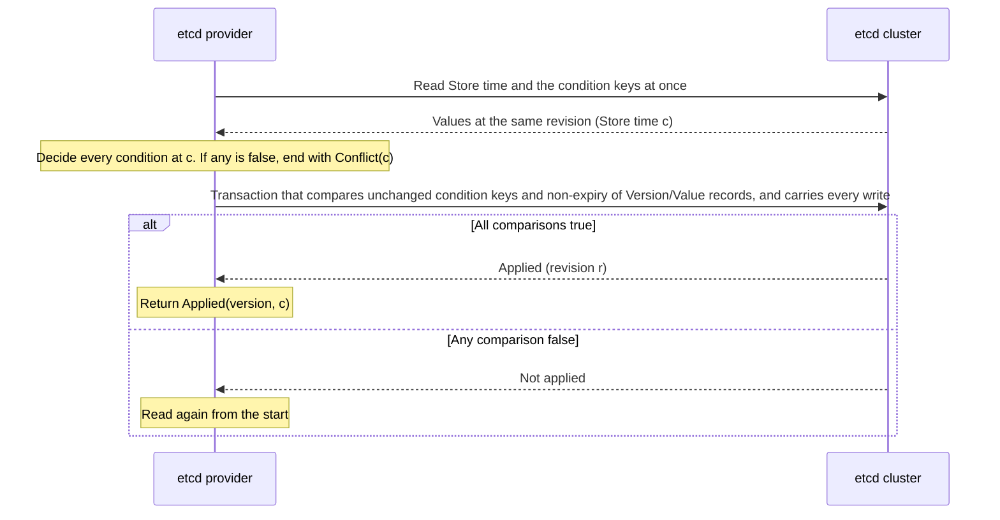

# Official etcd Location Store Provider

[Location·Relocation Topic Table of Contents](README.en.md) · [Spec Table of Contents](../README.en.md) · [Previous: 06. Failure Handling And Failover Scope](06-failure-failover-policy.en.md)

> Defines what the official provider that keeps the Location Store in an etcd cluster replicated by
> consensus (Raft) must follow: the deployment, the key and byte format providers in different
> languages must read from each other, how Store time is produced, and the implementation rules
> for each SPI operation.

## 1. etcd Provider Overview

The [Location Store](../00-foundation/02-glossary.en.md#location-store), the store that several nodes
use together to confirm the current owner and state, must not lose successful mutations after a
failover ([Location Store SPI §1](02-location-store-redis.en.md#1-scope-and-audience)). Redis and
Valkey with asynchronous replication can lose writes that already returned success when the
primary changes, so a deployment that also handles failover automatically doesn't meet this
requirement.

A member of an etcd cluster that votes and confirms records is called a voter. etcd returns
success for a write only after a majority of voters confirm the record. As long as a majority of
voters operate normally, successful mutations and generation counters therefore remain even when
the leader changes. This provider implements the SPI on top of that property.

The following documents own what this document doesn't define.

| Content | Owning document |
|---|---|
| Common results and size limits of the three operations (exact read, conditional atomic batch, snapshot scan) | [Location Store SPI §2~§6](02-location-store-redis.en.md#2-responsibilities-of-the-public-spi) |
| Owner lease, execution rights, retention and release wait | [Location runtime §5~§6](01-location-runtime.en.md#5-execution-rights-and-admission-during-a-store-outage) |
| Operational limits on Store clock error and host suspend | The clock and suspend operational limits in [Location Store SPI §1](02-location-store-redis.en.md#1-scope-and-audience) |

The Framework passes this provider the same keys and bytes as any other provider, and Framework
behavior doesn't depend on the provider kind. The official extension of each language (C++,
.NET, Java, Node.js) provides this provider, and Kotlin uses the Java provider. So that providers
in different languages can share the same cluster, the format in §3 is a **MUST-level public
contract**; if the code disagrees, the code is fixed.

Responsibilities divide as follows.

| Actor | What it decides or does |
|---|---|
| Application | Creates the provider and registers it with the Framework. Doesn't call SPI operations directly. |
| Framework | Calls the SPI with keys, bytes, conditions, and retention. Owns generation issuance and execution-right decisions. |
| etcd provider | Stores in the §3 format, decides expiry by the Store time in §4, and builds SPI results. |
| Store maintenance process | Advances the Store time key and deletes expired records (§4, §8). Doesn't decide owners or execution rights. |
| Operator | Follows the cluster deployment and recovery procedures in §2 and initializes new namespaces (§4.3). |

## 2. Deployment Requirements

If the requirements in this section aren't met, the store can roll back even while the provider
behaves correctly. The Framework and the provider don't check these requirements; meeting them is
the operator's responsibility.

- **Run 3 or 5 voters, placed on different physical hosts.** If a majority of voters stops at the
  same time, writes stop and no record is lost. If voters share a physical host, one host failure
  becomes a majority failure.
- **Keep the data directory on persistent storage where fsync works.** Don't use the setting that
  disables fsync (`--unsafe-no-fsync`). A change that a majority confirmed could otherwise be lost
  together in a power failure.
- **Replace members one at a time with etcd runtime reconfiguration.** Remove the member to be
  replaced from the cluster, add it as a new member, start it with an empty data directory, and
  proceed to the next replacement only after catch-up finishes. Don't rejoin a member that lost its
  data under its previous member ID. If a member that lost records counts toward the majority under
  its previous ID, an already confirmed record can drop out of the majority.
- **Use a cluster restored from a backup snapshot as a recovery of the same namespace only when the
  snapshot contains the last successful mutation.** A snapshot taken after all writers stopped, with
  no writes resumed afterward, qualifies. Use any other snapshot only for investigation and data
  extraction. `--bump-revision` raises only etcd's internal revision and doesn't restore counter or
  authority values, so it doesn't replace this condition.
- **When restoring, use an `--initial-cluster-token` that has never been used, and confirm that the
  restored cluster's cluster ID differs from the previous cluster's.** etcd derives the cluster ID
  from the member configuration and the token, so restoring with the same inputs can produce the
  same ID again. The property in §3.4 that versions don't match another cluster's versions depends
  on this procedure. While restoring, block access to the previous cluster and its writers.
- **The provider connects only to the configured cluster endpoints and uses only linearizable
  reads.** A serializable read returns the connected member's local state, so a member separated
  from the majority can return an old value as success.
- **Run one Store maintenance process on each voter VM, and configure and confirm that the local
  monotonic rate of that host is at most 1.0005 (§4.1).**
- **etcd settings follow the lower bounds in §9.2.**

## 3. Storage Format

The format in this section is a MUST-level contract that providers in different languages must
follow to read each other's records in the same cluster. The Redis provider's key layout and
record format ([§8~§9](02-location-store-redis.en.md#8-official-redis-provider--counter-issuance))
don't apply to this provider. Keys and value bytes passed by the Framework are stored as-is; the
provider doesn't interpret or change them.

### 3.1 Key Layout

One Framework key is stored as two etcd keys. The small metadata key holds the expiry time and
payload length, and the payload key holds the value bytes. This lets condition decisions read only
the information they need: even if 2,048 Version conditions each point at a 1 MiB value, the
decision step doesn't read those payloads.

| etcd key | Byte composition | Value |
|---|---|---|
| Metadata | `namespace` · `0x00` · `m` · `0x00` · Framework key | 14 bytes per §3.2 |
| Payload | `namespace` · `0x00` · `p` · `0x00` · Framework key | Value bytes passed by the Framework |
| Store time | `namespace` · `0x00` · `c` | 8 bytes per §3.3 |

`namespace` is UTF-8 `1..64` bytes received as a provider creation option and doesn't contain
`0x00`. The Framework key is appended as-is without escaping. Because the leading part has a fixed
length for each namespace, keys can be told apart. The longest etcd key is `64 + 3 + 1024 = 1091`
bytes.

The metadata key and payload key are always created, changed, and deleted together in the same
transaction, so their `mod_revision` is always the same. If only one of them exists, or their
`mod_revision` values differ, the storage format is damaged and the provider returns a Store
failure. It doesn't return this as `Missing`.

### 3.2 Metadata Format

```text
offset 0   u8      formatTag     // 0x01. Any other value is a Store failure
offset 1   u8      flags         // bit 0: has expiry. Other bits are 0
offset 2   u64 BE  expiresAtMs   // Expiry time in milliseconds of Store time. 0 if no expiry
offset 10  u32 BE  payloadLength // Byte length of the payload key (0..1,048,576)
```

`expiresAtMs` is the Store time of the commit that wrote the record plus the retention, rounded up
to milliseconds. If `payloadLength` differs from the actual payload length, it is a Store failure.

### 3.3 Store Time Key Format

The value of the Store time key holds the time in milliseconds as an **8-byte big-endian unsigned
integer**. §4 defines what the value means.

### 3.4 `StoreVersion` Format

The version the provider returns is the following ASCII string.

```text
e1:<cluster id>:<mod revision>
// cluster id   : cluster_id from the etcd response header, as 16 lowercase hex digits
// mod revision : the key's metadata mod_revision in decimal without leading zeros
```

Because etcd revisions keep increasing within a cluster, a previous version doesn't reappear even
when the same key is deleted and recreated. If the restore procedure in §2 is followed, it also
doesn't match another cluster's versions. The Framework doesn't interpret this string. Providers in
other languages must produce the same string from the same record to judge each other's
conditions, so the format is fixed as above.

## 4. Store Time

etcd has no provider wall clock (`StoreNow`) as the SPI requires. This provider uses the value of
the Store time key stored in etcd as `StoreNow`. The `StoreNow` of every read, commit, and scan page,
and every expiry decision, is based only on this value. The clock of the host running the provider
instance isn't used in its place.

**Expiry isn't implemented with etcd leases (TTLs whose remaining time the server manages).** An etcd
lease doesn't return the `StoreNow` and the per-record expiry time that the SPI requires as one
observation, and it extends the remaining time when the leader changes.

### 4.1 Properties of Store Time

**The increase of Store time has an upper bound relative to real elapsed time.** If the local
monotonic clock of the host running the Store maintenance process advances at no more than `ρ`
times the rate of real time, then over any real time interval `L` Store time increases by at most
`1.01 × ρ × L + 1.01 s`. The 1% is an allowance for catching up when Store time falls behind, and
1.01 s is the most a single write can add (§4.2). This document takes `ρ` as 1.0005. This value is
an operational upper bound. The local monotonic clock is subject to rate correction by the time
synchronization tool, and the default correction limits of the operating system and tool can be
larger (for example, chrony's default maximum slew rate is larger than 0.05%). The operator
configures and confirms that the rate of the Store maintenance process hosts, combining the time
correction limit and hardware clock error, is at most 1.0005. A
lease expires by Store time while the owner measures its
execution deadline with its own local monotonic clock, so if Store time runs faster than real time,
the lease can expire before the owner's deadline and another owner can release an object that is
still running. Conversely, if Store time runs slowly or stops, the lease only expires late and
executions don't overlap.

So Store time doesn't copy the host's wall clock value. The Store maintenance process adds only the
elapsed time it measured itself, and no more than a fixed amount at a time. Even if all Store
maintenance processes stop and restart, or one process pauses for a long time after reading and
then writes, Store time doesn't jump forward at once.

[Location Store SPI §1](02-location-store-redis.en.md#1-scope-and-audience) requires the sum of
the amount the Store clock jumps forward and the difference in progress of node local monotonic
clocks to stay within the fencing margin. The longest interval involved in deciding one lease is
the retention limit `TTL + 2·margin` plus the release wait `3·margin`, that is `TTL + 5·margin`. A
domain that uses this provider must satisfy the following for every owner lease TTL.

```text
(1.01 × ρ − 1) × (TTL + 5·margin) + 1.01 s + D ≤ margin
// ρ : upper bound on the local monotonic rate of Store maintenance process hosts (1.0005)
// D : difference in local monotonic progress between owner and releaser nodes over that interval
```

With the default settings (TTL 30 s, margin 5 s), the first two terms add up to about 1.59 s, so
`D` may be up to 3.4 s. Settings with a longer TTL or a smaller margin are checked again with this
formula. For example, TTL 1,000 s with margin 5 s can't be used with this provider, because the
first term alone exceeds 10 s.

**If Store time stops, leases don't expire.** Even if all Store maintenance processes stop,
provider operations keep succeeding, but meanwhile the lease of a dead owner doesn't expire, so the
release wait, re-creation on another node, and relocation cleanup that depends on expiry don't
start. Executions don't overlap; only availability drops. Successful reads and writes aren't
evidence that Store time is advancing, so the operator monitors that the Store maintenance
processes are running and that the Store time key is updated.

### 4.2 Update Procedure of the Store Maintenance Process

The Store maintenance process runs separately from provider instances, one on each voter VM. Its
official implementation is a single command-line tool in the Node.js etcd extension package; the
other languages' extensions don't include it.

- **Store time isn't updated inside provider instances.** Running the same procedure in provider
  instances would still satisfy the bound in §4.1. But then every host running the application
  would have to meet the `ρ` and wall clock conditions, and the Store time key would be read every
  second as many times as there are hosts. Updates are limited to a few hosts the operator manages,
  and initialization (§4.3) and expiry cleanup (§8) live in the same tool.

Each Store maintenance process repeats the following.

1. Read the Store time key with a linearizable read. Call the local monotonic time when the response
   arrived `a`, the value read `C`, and its `mod_revision` `v`.
2. After 1 second, read it again. If the `mod_revision` differs from `v`, another process updated it;
   start again from step 1 with this value.
3. If it is the same, compute the amount to add `e = min(b − a, 1000)` (milliseconds, rounded down),
   where `b` is the local monotonic time just before sending the write. If the host's wall clock `W`
   is greater than `C + e`, change `e` to `min(e + 10, W − C)`.
4. Write `C + e` to the Store time key on the condition that its `mod_revision` is still `v`. If the
   condition is false, start again from step 1.

The procedure produces the bound in §4.1 for the following reasons.

- `a` is a time after `C` was written and `b` is a time before the new value is written, so `b − a`
  measured by the local monotonic clock doesn't exceed `ρ` times the real time elapsed between the
  two writes.
- One write adds at most 1,010 milliseconds. Because a write requires seeing the value unchanged for
  1 second of local monotonic time in step 2, two consecutive writes, by whichever process, are at
  least `1/ρ` seconds apart in real time. So an interval `L` contains at most `ρ × L + 1` writes, and
  the increase is at most `1.01 × ρ × L + 1.01 s`.
- If `b − a` is longer than 1 second (the process paused after reading), only 1 second is added, so
  Store time only falls behind. The shortfall is caught up 10 milliseconds per write by the
  correction in step 3, and the catch-up never overtakes the host wall clock. If the host wall clock
  goes backward, there is simply no correction, and Store time keeps advancing by elapsed time.

When several Store maintenance processes run together, the conditions in steps 2 and 4 make only
one of them write, about once per second.

The Store maintenance process only advances Store time and doesn't decide owners, leases, or
generations. The Framework and SPI commits decide execution rights.

### 4.3 Initializing a New Namespace and Loss of the Store Time Key

The operator creates the Store time key only once, with the Store maintenance process's
initialization command, when a new namespace is first used. The initialization command creates the
Store time key with the host wall clock value only if the namespace has no keys at all; if even one
key exists, it writes nothing and fails.

The update procedure (§4.2) doesn't create the Store time key. If the Store time key is missing in a
namespace in operation, the Store maintenance process writes nothing and reports an error, and the
provider returns a Store failure for every operation. Recreating Store time would start it from a
smaller value than before and could change the meaning of expiry times already recorded, so the
same namespace isn't initialized again.

## 5. Exact Read

The provider reads the Store time key, the metadata key, and the payload key together in one
linearizable read-only transaction. The three values are an observation at the same revision. With
the Store time value `c`, the result is as follows.

| Observation | Result |
|---|---|
| No metadata, no payload | `Missing(c)` |
| `expiresAtMs ≤ c` | `Missing(c)` |
| Not expired | `Found(payload bytes, version, expiry, c)` — version per §3.4 |
| No Store time key, only one of the two keys, `mod_revision` mismatch, unknown `formatTag` | Store failure |

## 6. Conditional Atomic Batch

An etcd transaction can apply writes depending on comparison results but can't compute new values
from what it read. So the provider first reads to decide the conditions and compute new expiry
times, then sends a transaction that applies only if the condition keys' metadata is unchanged and
the `Version`/`Value` condition records haven't expired yet.



1. **Read for the decision.** The provider reads the Store time key and the metadata key of every
   condition key in one linearizable read-only transaction. Call the response's revision `R` and the
   Store time value `c`. If any `Value` condition has metadata whose `payloadLength` equals the
   expected byte length, it then reads those keys' payloads at revision `R`. The total of these
   payloads equals the total of the expected bytes, so it doesn't exceed the SPI's encoded 4 MiB
   request limit. If this read fails because of compaction, step 1 is performed again.
2. **Condition decision.** If the `formatTag` in any metadata read in step 1 is unknown, or a payload read in step 1
   is missing or its length or `mod_revision` differs from the metadata, end with a Store failure.
   Then decide by the definitions in [SPI §4](02-location-store-redis.en.md#4-conditional-atomic-batch)
   at `c`.
   - `Missing` is true if there is no metadata or `expiresAtMs ≤ c`.
   - `Version` is true if not expired and the version built from the read metadata equals the
     expected value.
   - `Value` is true if not expired and the payload bytes equal the expected bytes. If
     `payloadLength` differs from the expected byte length, it is false without reading the payload.

   If any is false, return `Conflict(c)` and write nothing. A commit checks §3.1 damage only for keys
   whose payload it read. Damage on other keys is surfaced as a Store failure by that key's exact
   read.
3. **Apply transaction.** The provider sends one transaction that carries all of the following
   comparisons.
   - The Store time key exists (`create_revision > 0`). If not, the comparison is false, and step 1,
     performed again, ends with a Store failure.
   - If any `Version` or `Value` condition key has an expiry time, the Store time key's value is less
     than the earliest of those expiry times written as 8-byte big-endian. Because it is fixed-length
     big-endian, etcd comparing the value byte by byte gives the same result as comparing the
     numbers. If there is no such key, Store time isn't compared.
   - For each condition key, the metadata state is the same as in step 1. A key that didn't exist
     still doesn't (`create_revision = 0`), and a key that existed has the same `mod_revision`.
     Because the two keys always change together, the payload isn't compared separately.

   As the writes to run when every comparison is true, it carries the metadata and payload key
   writes of each `Put` and the deletion of both keys for each `Delete`. A `Put`'s `expiresAtMs` is
   `c` plus the retention rounded up to milliseconds, or no expiry if there is no retention.
4. **Result.** If the transaction is applied, every write has the same revision `r`. Each `Put`'s version is `e1:<cluster id>:r`, and
   `Applied` returns those versions and `StoreNow = c`. If any comparison is false, nothing was
   applied, so step 1 is performed again.

**`Conflict` comes only from the decision in steps 1~2.** A step 3 comparison can be false not only
because a condition key changed but also because a condition key expired in the meantime, so that
alone doesn't show that the caller's condition is false. Steps 1~2, performed again, decide.

**The step 1 decision still holds at the time of application.** So the commit isn't performed again
just because Store time was updated in between, and even a large batch doesn't compete with the
Store time update interval.

- A key for which `Missing` was true is, by the comparison, still absent or the same expired record,
  and an expired record stays expired as Store time increases.
- A key for which `Version` or `Value` was true hasn't expired at the time of application, by the
  Store time comparison.
- The expiry time of a new `Put` is based on `c` at the read, so it is earlier than or equal to one
  based on Store time at the time of application. The `StoreNow = c` that `Applied` returns is the
  same observation as this calculation.

If the operation timeout or cancellation is reached while performing it again, end with a Store
failure. If the result of a sent transaction wasn't received, whether it committed is unknown, and
[SPI §6](02-location-store-redis.en.md#6-cancellation-result-loss-and-errors) applies.

## 7. Snapshot Scan

On the first page, the provider reads the Store time key in one linearizable read-only transaction
and fixes the response's revision as `R` and the Store time as `c0`. This `(R, c0)` is the
snapshot. Every page, including the first, reads metadata keys and payload keys at revision `R`,
returns `StoreNow = c0`, and also decides expiry by `c0`
([SPI §5](02-location-store-redis.en.md#5-size-bounded-snapshot-scan)).

- Metadata keys are read in order from the prefix range, at most 1,000 at a time. Keys with
  `expiresAtMs ≤ c0` are skipped. The items to put in the page are chosen first by the metadata's
  `payloadLength`, and only those payloads are read. If a read payload is missing or its length or
  `mod_revision` differs from the metadata, it is a Store failure. A key with only a payload and no
  metadata isn't found by scan; that key's exact read surfaces it. The page bound is the SPI's
  1,000 items and encoded 4 MiB.
- The cursor holds the last processed Framework key as the progress position. Skipped expired keys
  count as processed, and an item that didn't fit because of page size is processed again on the
  next page. The cursor also holds the cluster id, namespace, prefix, `R`, and `c0`. A cursor from
  another cluster or another namespace is `Expired`.
- The cursor encoding is **implementation discretion**. A cursor comes back only to the provider
  instance that issued it, so it doesn't need to be readable across languages. Its length respects
  the SPI's 4,096-byte limit, and the §12 tests confirm that it fits within the limit while holding
  the fields above.
- A snapshot is valid for 5 minutes, measured by the local monotonic clock of the provider instance
  that sent the first page's read request, starting when it sent that request. `Expired` is returned
  if the five-minute validity has elapsed, or if revision `R` has been removed by compaction (etcd
  `ErrCompacted`). If
  compaction happens after reading metadata and before reading payloads, that page is also discarded
  and `Expired` is returned. It doesn't return only some items as success or read from the latest
  revision instead.

## 8. Cleaning Up Expired Records

An expired record is already `Missing` by Store time but remains in etcd. The Store maintenance
process periodically reads metadata and deletes both the metadata key and the payload key of
records with `expiresAtMs ≤ Store time`. The deletion is conditioned on the read metadata's
`mod_revision` being unchanged; if the lease was written again in the meantime, it isn't deleted.
Records without an expiry time (counters and durable records) aren't cleaned up.

Late cleanup doesn't change results. An expired record that hasn't been deleted stays `Missing` for
reads and commits.

## 9. Size Limits and etcd Settings

### 9.1 SPI Limits and etcd Request Size

The provider doesn't lower the limits in [SPI §3~§5](02-location-store-redis.en.md#3-key-value-version-and-clock)
(1 MiB value, batch of 2,048 unique keys and encoded 4 MiB, page of 1,000 items and 4 MiB). In etcd
requests, one Framework key appears in a metadata read and comparison, a metadata write, and a
payload write. For the largest SPI batch, the read transaction for the decision has at most 2,049
reads (1 Store time, 2,048 metadata), the following payload read has at most 2,048, and the apply
transaction has at most 2,049 comparisons and 4,096 writes, about 11 MiB encoded. These sizes are
calculated and confirmed by the §12 tests.

### 9.2 Lower Bounds for etcd and Client Settings

| Setting | Lower bound | Reason |
|---|---|---|
| `--max-txn-ops` | 4,096 | The longest list among the transactions above (the apply transaction's 4,096 writes). etcd checks the length of a transaction's compare, success, and failure lists separately (the default of 128 isn't enough). |
| `--max-request-bytes` | 16 MiB | The largest batch transaction (the default of 1.5 MiB isn't enough) |
| Provider client send limit | 16 MiB | Same reason |
| Provider client receive limit | 8 MiB | 1 MiB reads and 4 MiB scan pages |
| `--auto-compaction-mode`·`--auto-compaction-retention` | `periodic`, `10m` | Keeps revisions longer than the 5-minute snapshot validity. A periodic value without a unit is read as hours, so the unit is written. |
| `--quota-backend-bytes` | Sized to the operating data | When space runs out (`NOSPACE`), writes return errors (§10). |

etcd notes that large requests can increase the latency of other requests. The §12 tests confirm
that owner lease renewals still finish within the renew timeout (3 s by default) while the largest
batch is processed.

## 10. Result Loss and Errors

| Situation | Provider result |
|---|---|
| A majority of voters can't be reached, leader election in progress, request timeout | Store failure. If the result of a sent write wasn't received, whether it committed is unknown ([SPI §6](02-location-store-redis.en.md#6-cancellation-result-loss-and-errors)) |
| etcd returns an error for a write, including `NOSPACE` | Store failure. etcd can return an error after applying the write, so it isn't assumed unapplied; whether it committed is treated as unknown. |
| No Store time key, damaged storage format (§3.1, §3.2) | Store failure |
| Compaction during a scan, snapshot validity exceeded, cursor from another cluster | `Expired` |

These errors aren't returned as `Missing`, `Conflict`, or an empty page. etcd error codes and
endpoint information aren't exposed in the application public API.

## 11. Public Options

The public options of the official etcd extension are limited to the following values needed to
create an instance. Each language's interface document sets the per-language names.

```text
endpoints         // List of etcd client endpoints (required, at least one)
tls / credentials // Client certificate and authentication (optional)
namespace         // Namespace from §3.1, UTF-8 1..64 bytes, no 0x00 (required)
operationTimeout  // Upper bound on the total time of one operation, including retries (optional)
```

The Store time update interval and catch-up rate, and the snapshot validity, aren't options.

## 12. Verification Requirements

Confirm the following using only the public surface — the return values of the three SPI
operations of the four language etcd providers, the key and value bytes stored in etcd in the §3
format, and running, stopping, and the initialization command of the Store maintenance process.
Each item leads to one test. Every provider-common item in
[SPI §10](02-location-store-redis.en.md#10-verification-requirements) must also pass with this
provider.

**Cross-language format**

- A record written by one language's provider is read with the same bytes, version, and expiry by the other three languages' providers (4×4).
- A `Version` condition set by another language with the version read by one language is true, and is false after that record changes.
- If an unknown `formatTag`, only one of the two keys, or a `payloadLength` mismatch is stored, that key's exact read returns a Store failure. For a key that has metadata but no payload, or whose payload length or `mod_revision` differs, snapshot scan also returns a Store failure when that key goes into a page. An unknown `formatTag` also makes a write that uses that key as a condition return a Store failure.

**Store time**

- Even if the provider host's clock is set differently from Store time, `StoreNow` and expiry results of read, commit, and scan are the same.
- Even if all Store maintenance processes stop for 60 seconds and restart, the difference between the Store time read while stopped and the Store time at any point after the restart doesn't exceed `1.01 × ρ × L + 1.01 s` for the real elapsed time `L` in between.
- Even if a Store maintenance process pauses for 20 seconds right after reading Store time and then writes, Store time doesn't increase by more than 1.01 s at once.
- Even if the wall clock of a Store maintenance process host is set backward or far forward, Store time doesn't decrease and doesn't increase by more than `1.01 × ρ × L + 1.01 s` over any interval `L`.
- With three Store maintenance processes running, the Store time key is written about once per second.
- The initialization command creates the Store time key only in an empty namespace and fails in a namespace that has keys.
- In a namespace whose Store time key was deleted, provider operations return a Store failure and the Store maintenance process doesn't recreate the key.

**Commit**

- If the bytes of a `Value` condition differ from the stored value, the result is `Conflict` and the mutation is zero, both when the length is the same and the content differs and when the length differs.
- A `Version` condition on an expired key with the version from the read is `Conflict`.
- If a key that hadn't expired at the read expires before the apply because of a Store time update, a `Version` condition on that key becomes `Conflict`.
- If a condition key changes between the read and the apply, the result is `Applied` or `Conflict` according to the condition decided again, and if `Conflict`, the mutation is zero.
- A batch of 2,048 unique keys and encoded 4 MiB applies as one commit with the §9.2 settings while three Store maintenance processes update normally, and meanwhile another provider's owner lease renewal finishes within 3 s.
- Even if Store time is updated several times between the read and the apply, if the condition keys are unchanged and haven't expired, the commit is `Applied` and the returned `StoreNow` is the Store time at the read.

**Failure**

- Even if the leader is stopped right after a commit, a change that received `Applied` is read with the same version from the new leader.
- If the leader is stopped before the result is received, the operation ends with commit status unknown, and whether it applied can be decided with a direct read and the version.
- If the provider reaches only a member separated from the majority, read and commit return a Store failure and don't return an old value as success.
- In a cluster whose quota is full, a write ends as a Store failure and isn't returned as `Conflict` or `Applied`.

**Snapshot and cleanup**

- Even after changes, deletions, and expiries after the first page, and a leader change, pages of the same snapshot return the same items and `StoreNow`.
- A prefix with more than 1,000 consecutive expired keys is read to the end with every page within bounds.
- With the longest prefix and key, the cursor doesn't exceed 4,096 bytes.
- A page request after the snapshot revision is compacted is `Expired`.
- An expired record disappears from etcd after cleanup, and a record written again just before cleanup remains.

---

[Location·Relocation Topic Table of Contents](README.en.md) · [Spec Table of Contents](../README.en.md) · [Previous: 06. Failure Handling And Failover Scope](06-failure-failover-policy.en.md)
