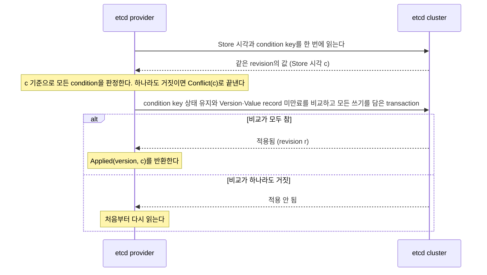

# 공식 etcd Location Store provider

[Location·Relocation 주제 목차](README.ko.md) · [스펙 목차](../README.ko.md) · [이전: 06. 장애 대응과 failover 범위](06-failure-failover-policy.ko.md)

> 합의(Raft)로 복제하는 etcd cluster에 Location Store를 두는 공식 provider가 지켜야 하는 운영 구성,
> 언어 간에 상호 읽어야 하는 key·byte 형식, Store 시각을 만드는 방법과 각 SPI operation의 구현 규칙을 정의한다.

## 1. etcd provider 개요

현재 owner와 상태를 여러 node가 함께 확인하는 저장소인
[Location Store](../00-foundation/02-glossary.ko.md#location-store)는 장애 전환 뒤에도 성공한 변경을
잃지 않아야 한다([Location Store SPI §1](02-location-store-redis.ko.md#1-범위와-독자)). 비동기 복제를
쓰는 Redis·Valkey는 primary가 바뀔 때 이미 성공을 반환한 쓰기를 잃을 수 있어, 장애 전환까지
자동으로 처리하는 구성에서는 이 요구를 만족하지 못한다.

etcd cluster에서 투표권을 갖고 기록을 확인하는 member를 voter라고 한다. etcd는 voter 과반수가 기록을
확인한 뒤에만 쓰기 성공을 반환한다. 따라서 voter 과반수가 정상 동작하는 동안 leader가 바뀌어도 성공한
변경과 generation counter가 그대로 남는다. 이 provider는 그 성질 위에서 SPI를 구현한다.

이 문서가 정의하지 않는 것은 다음 문서가 소유한다.

| 내용 | 소유 문서 |
|---|---|
| 세 operation(exact read, conditional atomic batch, snapshot scan)의 공통 결과와 크기 한도 | [Location Store SPI §2~§6](02-location-store-redis.ko.md#2-공개-spi의-책임) |
| Owner lease, 실행권, 보존과 해제 대기 | [Location runtime §5~§6](01-location-runtime.ko.md#5-store-장애-중-실행권과-새-작업-수용) |
| Store 시계 오차와 host suspend의 운영 한계 | [Location Store SPI §1](02-location-store-redis.ko.md#1-범위와-독자)의 시계·suspend 운영 한계 |

Framework는 이 provider에도 다른 provider와 같은 key와 bytes를 넘기며, Framework의 동작은 provider
종류에 따라 달라지지 않는다. 각 언어(C++, .NET, Java, Node.js)의 공식 extension이 이 provider를
제공하고, Kotlin은 Java provider를 사용한다. 서로 다른 언어의 provider가 같은 cluster를 함께 쓸 수
있도록 §3의 형식은 **MUST-level 공개 계약**이며 코드가 이와 다르면 코드를 고친다.

책임은 다음과 같이 나뉜다.

| 주체 | 결정·수행하는 것 |
|---|---|
| Application | Provider를 생성해 Framework에 등록한다. SPI operation을 직접 호출하지 않는다. |
| Framework | Key와 bytes, condition과 retention을 정해 SPI를 호출한다. Generation 발급과 실행권 판정을 소유한다. |
| etcd provider | §3 형식으로 저장하고, §4의 Store 시각으로 만료를 판정하며, SPI 결과를 만든다. |
| Store 관리 process | Store 시각 key를 앞으로 갱신하고, 만료된 record를 지운다(§4, §8). Owner나 실행권을 결정하지 않는다. |
| 운영자 | §2의 cluster 구성과 복구 절차를 지키고, 새 namespace를 초기화한다(§4.3). |

## 2. 운영 구성 요구

이 절의 요구를 지키지 않으면 provider가 정상으로 동작해도 저장소가 되돌아갈 수 있다. Framework와
provider는 이 요구를 검사하지 않으며, 지키는 책임은 운영자에게 있다.

- **Voter는 3대 또는 5대로 두고, 서로 다른 물리 host에 배치한다.** Voter 과반수가 동시에 멈추면
  쓰기가 멈추는 것으로 끝나고 기록은 잃지 않는다. 같은 물리 host에 voter가 몰리면 host 하나의 장애가
  과반수 장애가 된다.
- **Data directory는 fsync가 동작하는 영구 저장장치에 둔다.** fsync를 끄는 설정(`--unsafe-no-fsync`)은
  사용하지 않는다. 과반수가 기록했다고 확인한 변경이 전원 장애로 함께 사라질 수 있기 때문이다.
- **Member 교체는 etcd runtime reconfiguration으로 한 번에 한 대씩 한다.** 교체할 member는 cluster에서
  제거한 뒤 새 member로 추가하고 빈 data directory로 시작하며, catch-up이 끝난 뒤 다음 교체를 진행한다.
  Data를 잃은 member를 이전 member ID로 다시 참여시키지 않는다. 기록을 잃은 member가 이전 ID로
  과반수 계산에 들어가면 이미 확인된 기록이 과반수에서 빠질 수 있다.
- **백업 snapshot으로 cluster를 복원하는 것은, 그 snapshot이 마지막 성공 변경까지 담고 있을 때만 같은
  namespace의 복구로 사용한다.** 모든 writer를 멈춘 뒤 만들고 그 뒤로 쓰기를 재개하지 않은 snapshot이
  여기에 해당한다. 그 밖의 snapshot은 조사와 데이터 추출에만 쓴다. `--bump-revision`은 etcd 내부
  revision만 올리며 counter와 authority 값을 복원하지 않으므로 이 조건을 대신하지 않는다.
- **복원할 때는 이전에 쓴 적 없는 `--initial-cluster-token`을 사용하고, 복원한 cluster의 cluster ID가
  이전 cluster와 다른지 확인한다.** etcd는 member 구성과 token으로 cluster ID를 만들므로 같은 입력으로
  복원하면 같은 ID가 다시 나올 수 있다. §3.4의 version이 다른 cluster의 version과 일치하지 않는다는
  성질은 이 절차에 의존한다. 복원하는 동안 이전 cluster와 그 writer는 접속할 수 없게 막는다.
- **Provider는 설정된 cluster endpoint에만 접속하고 linearizable read만 사용한다.** Serializable read는
  연결된 member의 로컬 상태를 반환해, 과반수에서 떨어진 member가 오래된 값을 성공으로 돌려줄 수 있다.
- **Store 관리 process를 voter VM마다 하나씩 실행하고, 그 host의 local monotonic 진행률을 1.0005 이하로
  설정·확인한다(§4.1).**
- **etcd 설정은 §9.2의 하한을 지킨다.**

## 3. 저장 형식

이 절의 형식은 서로 다른 언어의 provider가 같은 cluster에서 서로의 record를 읽기 위해 따라야 하는
MUST-level 계약이다. Redis provider의 key 배치·record 형식([§8~§9](02-location-store-redis.ko.md#8-공식-redis-provider--counter-발급))은
이 provider에 적용하지 않는다. Framework가 넘긴 key와 value bytes는 그대로 저장하며 provider가
해석하거나 바꾸지 않는다.

### 3.1 Key 배치

Framework의 key 하나는 etcd key 두 개로 저장한다. 작은 metadata key에는 만료 시각과 payload 길이를,
payload key에는 value bytes를 둔다. Condition 판정에 필요한 정보만 읽기 위해서다. Version 조건
2,048개가 각각 1 MiB value를 가리켜도 판정 단계에서 그 payload를 읽지 않는다.

| etcd key | Bytes 구성 | Value |
|---|---|---|
| Metadata | `namespace` · `0x00` · `m` · `0x00` · Framework key | §3.2의 14 bytes |
| Payload | `namespace` · `0x00` · `p` · `0x00` · Framework key | Framework가 넘긴 value bytes |
| Store 시각 | `namespace` · `0x00` · `c` | §3.3의 8 bytes |

`namespace`는 provider 생성 option으로 받는 UTF-8 `1..64` bytes이며 `0x00`을 포함하지 않는다.
Framework key는 escape 없이 bytes 그대로 붙인다. 앞부분 길이가 namespace마다 고정되므로 key를
구분할 수 있다. 가장 긴 etcd key는 `64 + 3 + 1024 = 1091` bytes다.

Metadata key와 payload key는 항상 같은 transaction에서 함께 만들고, 바꾸고, 지운다. 따라서 두 key의
`mod_revision`은 항상 같다. 어느 한쪽만 있거나 두 `mod_revision`이 다르면 저장 형식이 손상된
것이며 provider는 Store failure를 반환한다. 이를 `Missing`으로 반환하지 않는다.

### 3.2 Metadata 형식

```text
offset 0   u8      formatTag     // 0x01. 다른 값이면 Store failure
offset 1   u8      flags         // bit 0: 만료 시각 있음. 나머지 bit는 0
offset 2   u64 BE  expiresAtMs   // Store 시각 기준 밀리초 만료 시각. 만료 없음이면 0
offset 10  u32 BE  payloadLength // payload key의 bytes 길이 (0..1,048,576)
```

`expiresAtMs`는 그 record를 쓴 commit의 Store 시각에 retention을 밀리초 단위로 올림해 더한 값이다.
`payloadLength`가 실제 payload 길이와 다르면 Store failure다.

**저장하는 시각은 9,223,372,036,854(2262-04-11T23:47:16.854Z) 이하다.** 네 언어의 공개 시각 타입 중 가장
좁은 C++ `std::chrono::system_clock::time_point`가 signed 64-bit nanosecond로 표현될 때의 최대 밀리초
시각이다. `Put`의 `expiresAtMs`가 이 값을 넘으면
provider는 그 batch를 caller 입력 오류로 거부하고 아무것도 쓰지 않는다. 읽은 `expiresAtMs`나 Store 시각이
이 값을 넘으면 저장 형식 손상으로 보고 Store failure를 반환한다.

### 3.3 Store 시각 key 형식

Store 시각 key의 value는 밀리초 단위 시각을 **8-byte big-endian unsigned 정수**로 담는다. 값의 의미는
§4가 정한다.

### 3.4 `StoreVersion` 형식

Provider가 반환하는 version은 다음 ASCII 문자열이다.

```text
e1:<cluster id>:<mod revision>
// cluster id   : etcd 응답 header의 cluster_id를 16자리 소문자 hex로 쓴 값
// mod revision : 그 key의 metadata mod_revision을 앞자리 0 없는 10진수로 쓴 값
```

etcd revision은 cluster 안에서 계속 증가하므로, 같은 key를 지운 뒤 다시 만들어도 이전 version이
다시 나오지 않는다. §2의 복원 절차를 지키면 다른 cluster의 version과도 일치하지 않는다. Framework는
이 문자열을 해석하지 않는다. 다른 언어 provider가 같은 record에서 같은 문자열을 만들어야 condition을
서로 판정할 수 있으므로 형식은 위와 같이 고정한다.

## 4. Store 시각

etcd에는 SPI가 요구하는 provider wall clock(`StoreNow`)이 없다. 이 provider는 etcd에 저장한 Store
시각 key의 값을 `StoreNow`로 사용한다. 모든 read, commit과 scan page의 `StoreNow`와 만료 판정은 이 값만
기준으로 한다. Provider instance가 실행되는 host의 clock으로 대신하지 않는다.

**etcd의 lease(서버가 남은 시간을 관리하는 TTL)로 만료를 구현하지 않는다.** etcd lease는 SPI가 요구하는
`StoreNow`와 record별 만료 시각을 같은 관측으로 반환하지 않고, leader가 바뀌면 남은 시간을 연장한다.

### 4.1 Store 시각이 지키는 성질

**Store 시각의 증가량에는 실제 경과 시간에 대한 상한이 있다.** Store 관리 process가 실행되는 host의
local monotonic이 실제 시간보다 최대 `ρ`배 빠르게 간다고 하면, 어떤 실제 시간 구간 `L`에서도 Store
시각이 늘어나는 양은 `1.01 × ρ × L + 1.01초` 이하다. 1%는 뒤처진 Store 시각을 따라잡게 하는 허용분이고
1.01초는 한 번의 기록이 늘릴 수 있는 최대량이다(§4.2). 이 문서는 `ρ`를 1.0005로 둔다. 이 값은 운영
상한이다. Local monotonic은 시각 동기 도구의 속도 보정을 받으며, 운영체제와 도구의 기본 보정 한도는
이보다 클 수 있다(예: chrony의 기본 최대 보정률은 0.05%보다 크다). 운영자는 Store 관리 process host의
시각 보정 한도와 하드웨어 시계 오차를 합한 진행률이 1.0005 이하가 되도록 설정하고 확인한다. Lease는 Store 시각으로
만료되고 owner는 자기 local monotonic으로 실행 기한을 재므로, Store 시각이 실제보다 빨리 가면 lease가
owner의 기한보다 먼저 만료되어 다른 owner가 아직 실행 중인 객체를 해제할 수 있다. 반대로 Store 시각이
느리게 가거나 멈추면 lease가 늦게 만료될 뿐 실행이 겹치지 않는다.

그래서 Store 시각은 host의 wall clock 값을 그대로 옮겨 적지 않는다. Store 관리 process가 직접 잰 경과
시간만큼만, 그리고 한 번에 정해진 양 이하로만 값을 더한다. Store 관리 process가 모두 멈췄다가 다시
시작하거나, 한 process가 읽은 뒤 오래 멈췄다가 기록해도 Store 시각은 한 번에 앞으로 뛰지 않는다.

[Location Store SPI §1](02-location-store-redis.ko.md#1-범위와-독자)은 Store 시계가 앞으로 뛰는 양과
node local monotonic의 진행 차이를 합한 오차가 fencing margin 안에 있도록 요구한다. Lease 하나의 판정에
관여하는 가장 긴 구간은 보존 한도 `TTL + 2·margin`에 해제 대기 `3·margin`을 더한 `TTL + 5·margin`이다.
이 provider를 쓰는 domain은 owner lease TTL마다 다음을 만족해야 한다.

```text
(1.01 × ρ − 1) × (TTL + 5·margin) + 1.01초 + D ≤ margin
// ρ : Store 관리 process host의 local monotonic 진행률 상한 (1.0005)
// D : 그 구간에서 owner·해제자 node의 local monotonic 진행 차이
```

기본 설정(TTL 30초, margin 5초)에서 앞의 두 항의 합은 약 1.59초이므로 `D`는 3.4초까지 허용된다. TTL을
길게 하거나 margin을 줄인 설정은 이 식으로 다시 확인한다. 예를 들어 TTL 1,000초·margin 5초는 첫 항만
10초를 넘으므로 이 provider와 함께 쓸 수 없다.

**Store 시각이 멈추면 lease가 만료되지 않는다.** Store 관리 process가 모두 멈춰도 provider operation은
계속 성공하지만, 그동안 죽은 owner의 lease가 만료되지 않아 해제 대기, 다른 node에서의 재생성과 만료에
의존하는 relocation 정리가 시작되지 않는다. 실행은 겹치지 않으며 가용성만 줄어든다. Read와 write의
성공은 Store 시각이 진행하고 있다는 증거가 아니므로, 운영자는 Store 관리 process의 실행과 Store 시각
key의 갱신을 감시한다.

### 4.2 Store 관리 process의 갱신 절차

Store 관리 process는 provider instance와 따로, voter VM마다 하나씩 실행하는 process다. 공식 구현은 Node.js
etcd extension package에 들어 있는 명령줄 도구 하나이며, 다른 언어의 extension에는 넣지 않는다.

- **Store 시각 갱신을 provider instance 안에서 하지 않는다.** 같은 절차를 provider instance에서 실행해도
  §4.1의 상한은 성립한다. 그러나 그러면 `ρ`와 wall clock 조건을 application을 실행하는 모든 host가
  지켜야 하고, host 수만큼 Store 시각 key를 1초마다 읽게 된다. 갱신을 운영자가 관리하는 소수의 host로
  한정하고, 초기화(§4.3)와 만료 정리(§8)도 같은 도구에 둔다.

각 Store 관리 process는 다음을 반복한다.

1. Store 시각 key를 linearizable read로 읽는다. 응답을 받은 local monotonic 시각을 `a`, 읽은 값을 `C`,
   `mod_revision`을 `v`라 한다.
2. 1초가 지난 뒤 다시 읽는다. `mod_revision`이 `v`와 다르면 다른 process가 갱신한 것이므로 이 값으로
   1단계부터 다시 시작한다.
3. 같으면 쓰기를 보내기 직전의 local monotonic 시각 `b`로 더할 값 `e = min(b − a, 1000)`(밀리초, 내림)을
   구한다. 자기 host의 wall clock `W`가 `C + e`보다 크면 `e`를 `min(e + 10, W − C)`로 바꾼다.
4. `mod_revision`이 아직 `v`인 조건으로 Store 시각 key에 `C + e`를 기록한다. 조건이 거짓이면 1단계부터
   다시 시작한다.

이 절차가 §4.1의 상한을 만드는 근거는 다음과 같다.

- `a`는 `C`가 기록된 뒤의 시각이고 `b`는 새 값이 기록되기 전의 시각이므로, local monotonic으로 잰
  `b − a`는 두 기록 사이 실제 경과 시간의 `ρ`배를 넘지 않는다.
- 한 번의 기록은 최대 1,010밀리초를 더한다. 2단계에서 local monotonic 1초 동안 값이 그대로인 것을
  확인해야 기록하므로, 어느 process가 기록하든 연속된 두 기록은 실제 시간으로 `1/ρ`초 이상 떨어져 있다.
  따라서 구간 `L`의 기록은 `ρ × L + 1`번 이하이고, 늘어나는 양은 `1.01 × ρ × L + 1.01초` 이하다.
- `b − a`가 1초보다 길면(process가 읽은 뒤 멈춘 경우) 1초만 더하므로 Store 시각이 뒤처질 뿐이다.
  뒤처진 만큼은 3단계의 보정으로 기록마다 10밀리초씩 따라잡으며, host wall clock을 앞질러 따라잡지
  않는다. Host wall clock이 뒤로 가면 보정이 없을 뿐 Store 시각은 계속 경과 시간만큼 진행한다.

여러 Store 관리 process가 함께 실행되면 2단계와 4단계의 조건 때문에 1초에 한 번 정도 하나만 기록한다.

Store 관리 process는 Store 시각만 진행시키며 owner, lease나 generation을 결정하지 않는다. 실행권은
Framework와 SPI commit이 결정한다.

### 4.3 새 namespace의 초기화와 Store 시각 key 소실

Store 시각 key는 운영자가 새 namespace를 처음 사용할 때 Store 관리 process의 초기화 명령으로 한 번만
만든다. 초기화 명령은 그 namespace에 key가 하나도 없을 때만 Store 시각 key를 host wall clock 값으로
만들며, key가 하나라도 있으면 아무것도 쓰지 않고 실패한다. 명령의 형태는 §4.4가 정한다.

갱신 절차(§4.2)는 Store 시각 key를 만들지 않는다. 운영 중인 namespace에서 Store 시각 key가 없으면
Store 관리 process는 기록하지 않고 오류를 보고하며, provider는 모든 operation에 Store failure를
반환한다. Store 시각을 다시 만들면 이전보다 작은 값에서 시작해 이미 기록된 만료 시각의 의미가 바뀔 수
있으므로 같은 namespace에서 다시 초기화하지 않는다.

### 4.4 Store 관리 도구 명령

Store 관리 도구는 Node.js etcd extension package가 제공하는 `zlink-location-etcd-admin` 명령 하나다. 세
하위 명령은 모두 `--config <파일>`로 같은 설정 파일을 받는다.

```text
zlink-location-etcd-admin init    --config <파일>  // §4.3 초기화를 한 번 수행하고 끝난다
zlink-location-etcd-admin run     --config <파일>  // §4.2 갱신과 §8 정리를 멈출 때까지 계속 수행한다
zlink-location-etcd-admin cleanup --config <파일>  // §8 정리를 한 번 수행하고 끝난다
```

설정 파일은 UTF-8 JSON이며 provider option(§11)과 같은 값을 같은 조건으로 담는다. 인증서와 비밀번호는
파일 경로로 받아 설정 파일에 비밀 값을 직접 쓰지 않게 한다.

```json
{
  "endpoints": ["https://10.0.0.1:2379"],
  "namespace": "zlink-game",
  "tls": {
    "trustedCaPemFile": "ca.pem",
    "clientIdentity": {
      "certificatePemFile": "client.pem",
      "keyPemFile": "client-key.pem"
    }
  },
  "credentials": {
    "user": "zlink-admin",
    "passwordFile": "password.txt"
  },
  "operationTimeoutMs": 5000
}
```

| 필드 | 대응하는 §11 option |
|---|---|
| `endpoints`, `namespace` | 같은 이름의 option(필수) |
| `tls.trustedCaPemFile`, `tls.clientIdentity` | `tls`의 `trustedCa`, `clientIdentity`. 값 대신 PEM 파일 경로 |
| `credentials.user`, `credentials.passwordFile` | `credentials`. password는 파일 경로 |
| `operationTimeoutMs` | `operationTimeout`(밀리초) |

- **`init`은 namespace에 key가 없다는 비교와 Store 시각 key 생성을 하나의 transaction으로 보낸다.** 여러
  운영자가 동시에 실행해도 하나만 성공한다. 먼저 조회한 뒤 따로 쓰면 그 사이에 다른 초기화나 쓰기가
  끼어들 수 있기 때문이다.
- **`run`은 etcd에 닿지 않는 동안 오류를 보고하고 다음 주기에 다시 시도하며 종료하지 않는다.** Store 시각
  key가 없으면 기록하지 않고 종료한다(§4.3). `SIGINT`·`SIGTERM`을 받으면 새 요청을 시작하지 않고, 보낸
  요청의 응답을 operation timeout 안에서 기다린 뒤 종료한다.
- `run`의 만료 정리 주기와 절차는 §8을 따른다.
- 오류 메시지는 표준 오류로 쓰며 비밀번호, 인증서 내용과 etcd 응답 본문을 담지 않는다.

| 종료 코드 | 뜻 |
|---|---|
| 0 | 성공. `run`은 `SIGINT`·`SIGTERM`으로 멈춘 경우 |
| 1 | 설정 파일이나 명령 인자가 잘못됨. etcd에 접속하기 전에 판정한다 |
| 2 | `init`: namespace에 key가 있어 초기화하지 않음 |
| 3 | `run`·`cleanup`: Store 시각 key가 없음 |
| 4 | `init`·`cleanup`: etcd에 닿지 않거나 요청이 timeout·오류로 끝남 |

## 5. Exact read

Provider는 linearizable read-only transaction 하나에서 Store 시각 key, metadata key와 payload key를
함께 읽는다. 세 값은 같은 revision의 관측이다. Store 시각 값을 `c`라 하면 결과는 다음과 같다.

| 관측 | 결과 |
|---|---|
| Metadata 없음, payload 없음 | `Missing(c)` |
| `expiresAtMs ≤ c` | `Missing(c)` |
| 만료되지 않음 | `Found(payload bytes, version, expiry, c)` — version은 §3.4 |
| Store 시각 key 없음, 한쪽 key만 있음, `mod_revision` 불일치, 알 수 없는 `formatTag` | Store failure |

## 6. Conditional atomic batch

etcd transaction은 비교 결과에 따라 쓰기를 적용할 수 있지만, 읽은 값으로 새 값을 계산하지는 못한다.
그래서 provider는 먼저 읽어서 condition을 판정하고 새 만료 시각을 계산한 뒤, condition key의 metadata가
그대로이고 `Version`·`Value` 조건 record가 아직 만료되지 않았을 때만 적용하는 transaction을 보낸다.



1. **판정을 위한 읽기.** Provider는 linearizable read-only transaction 하나로 Store 시각 key와 모든
   condition key의 metadata key를 읽는다. 그 응답의 revision을 `R`, Store 시각 값을 `c`라 한다. `Value`
   조건 중 metadata가 있고 `payloadLength`가 기대 bytes 길이와 같은 key가 있으면, 그 key들의 payload를
   revision `R`로 이어서 읽는다. 이 payload의 합계는 기대 bytes의 합계이므로 SPI의 encoded 4 MiB 요청
   한도를 넘지 않는다. 이 읽기가 compaction으로 실패하면 1단계부터 다시 수행한다.
2. **Condition 판정.** 읽은 metadata의 `formatTag`가 알 수 없는 값이거나, 1단계에서 읽은 payload가 없거나
   길이·`mod_revision`이 metadata와 다르면 Store failure로 끝낸다. 그다음
   [SPI §4](02-location-store-redis.ko.md#4-conditional-atomic-batch)의 정의를 `c` 기준으로 판정한다.
   - `Missing`은 metadata가 없거나 `expiresAtMs ≤ c`일 때 참이다.
   - `Version`은 만료되지 않았고 읽은 metadata로 만든 version이 기대값과 같을 때 참이다.
   - `Value`는 만료되지 않았고 payload bytes가 기대 bytes와 같을 때 참이다. `payloadLength`가 기대
     bytes 길이와 다르면 payload를 읽지 않고 거짓이다.

   하나라도 거짓이면 `Conflict(c)`를 반환하고 아무것도 쓰지 않는다. Commit은 payload를 읽은 key에 대해서만
   §3.1의 손상을 확인한다. 나머지 key의 손상은 그 key의 exact read가 Store failure로 드러낸다.
3. **적용 transaction.** Provider는 다음 비교를 모두 담은 transaction 하나를 보낸다.
   - Store 시각 key가 있다(`create_revision > 0`). 없으면 비교가 거짓이 되고, 다시 수행한 1단계가 Store
     failure로 끝낸다.
   - `Version`·`Value` 조건 key 중 만료 시각이 있는 key가 있으면, Store 시각 key의 value가 그 만료 시각 중
     가장 이른 값을 8-byte big-endian으로 쓴 값보다 작다. 길이가 고정된 big-endian이므로 etcd가 value를
     bytes 순서로 비교한 결과가 숫자 크기 비교와 같다. 그런 key가 없으면 Store 시각은 비교하지 않는다.
   - Condition key마다 metadata 상태가 1단계와 같다. 없던 key는 여전히 없고(`create_revision = 0`),
     있던 key는 `mod_revision`이 같다. 두 key는 항상 함께 바뀌므로 payload는 따로 비교하지 않는다.

   비교가 모두 참일 때 실행할 쓰기로 각 `Put`의 metadata·payload key 기록과 각 `Delete`의 두 key
   삭제를 담는다. `Put`의 `expiresAtMs`는 `c`에 retention을 밀리초 단위로 올림해 더한 값이며,
   retention이 없으면 만료 없음이다.
4. **결과.** Transaction이 적용되면 모든 쓰기가 같은 revision `r`을 가진다. 각 `Put`의 version은 `e1:<cluster id>:r`이며 `Applied`는 그 version들과 `StoreNow = c`를
   반환한다. 비교가 하나라도 거짓이면 아무것도 적용되지 않았으므로 1단계부터 다시 수행한다.

**`Conflict`는 1~2단계의 판정에서만 나온다.** 3단계 비교가 거짓인 이유는 condition key의 변경뿐 아니라
그 사이 condition key가 만료된 것일 수도 있으므로, 그것만으로는 caller의 condition이 거짓이라고 말할 수
없다. 다시 수행한 1~2단계가 판정한다.

**적용 시점에도 1단계의 판정이 그대로 성립한다.** 그래서 Store 시각이 그 사이 갱신돼도 다시 수행하지
않으며, 큰 batch도 Store 시각 갱신 주기와 경쟁하지 않는다.

- `Missing`이 참이던 key는 비교로 여전히 없거나 같은 만료 record이며, 만료된 record는 Store 시각이 늘어도
  만료 상태다.
- `Version`·`Value`가 참이던 key는 Store 시각 비교로 적용 시점에도 만료되지 않았다.
- 새 `Put`의 만료 시각은 읽을 때의 `c`를 기준으로 하므로, 적용 시점의 Store 시각을 기준으로 할 때보다
  이르거나 같다. `Applied`가 반환하는 `StoreNow = c`도 이 계산과 같은 관측이다.

다시 수행하는 동안 operation timeout이나 cancellation에 도달하면 Store failure로 끝낸다. 보낸
transaction의 결과를 받지 못한 경우에는 commit 여부가 불명확하며
[SPI §6](02-location-store-redis.ko.md#6-cancellation-결과-유실과-오류)을 따른다.

## 7. Snapshot scan

첫 page에서 provider는 linearizable read-only transaction 하나로 Store 시각 key를 읽고, 그 응답의
revision을 `R`, Store 시각을 `c0`로 고정한다. 이 `(R, c0)`가 snapshot이다. 첫 page를 포함한 모든 page는
metadata key와 payload key를 revision `R`로 읽고, `StoreNow = c0`를 반환하며 만료 판정도 `c0`로
한다([SPI §5](02-location-store-redis.ko.md#5-크기를-제한한-snapshot-scan)).

- Metadata key는 prefix 범위에서 한 번에 최대 1,000개씩 순서대로 읽는다. `expiresAtMs ≤ c0`인 key는
  건너뛴다. Metadata의 `payloadLength`로 page에 넣을 item을 먼저 고르고 그 payload만 읽는다. 읽은
  payload가 없거나 길이·`mod_revision`이 metadata와 다르면 Store failure다. Metadata 없이 payload만 남은
  key는 scan이 찾지 않으며 그 key의 exact read가 드러낸다. Page bound는 SPI의 1,000 item·encoded 4 MiB다.
- Cursor는 마지막으로 처리한 Framework key를 진행 위치로 담는다. 건너뛴 만료 key도 처리한 것으로 보고,
  page 크기 때문에 넣지 못한 item은 다음 page에서 다시 처리한다. Cursor에는 cluster id, namespace,
  prefix, `R`, `c0`도 함께 담는다. 다른 cluster나 다른 namespace의 cursor는 `Expired`다.
- Cursor encoding은 **구현별 재량**이다. Cursor는 그 cursor를 받은 provider instance에만 되돌아오므로
  언어 간에 읽을 필요가 없다. 길이는 SPI의 4,096 bytes 한도를 지키며, 위 필드를 담고도 한도 안에 드는지
  §12의 시험으로 확인한다.
- Snapshot은 첫 page의 읽기 요청을 보낸 시각부터 그 요청을 보낸 provider instance의 local monotonic으로
  5분 동안 유효하다. 그 뒤의
  cursor와, revision `R`이 compaction으로 사라진 경우(etcd `ErrCompacted`)는 `Expired`를 반환한다.
  Metadata를 읽은 뒤 payload를 읽기 전에 compaction이 일어나도 그 page를 버리고 `Expired`를 반환한다.
  일부 item만 성공으로 반환하거나 최신 revision으로 대신 읽지 않는다.

## 8. 만료 record 정리

만료된 record는 Store 시각 기준으로 이미 `Missing`이지만 etcd에는 남아 있다. Store 관리 process는 정리를
회차 단위로 수행한다. 한 회차는 namespace의 metadata를 최대 1,000개씩 page로 나눠 끝까지 읽고,
`expiresAtMs ≤ Store 시각`인 record의 metadata key와 payload key를 함께 지운다. 한 회차가 끝나고 60초가
지나면 다음 회차를 시작한다. 지울 때는 읽은 metadata의 `mod_revision`이 그대로인 조건을 건다. 그 사이 lease가 다시
기록됐다면 지우지 않는다. 만료 시각이 없는 record(counter와 durable record)는 정리 대상이 아니다.

정리가 늦어도 결과는 바뀌지 않는다. 지우지 않은 만료 record는 read와 commit에서 계속 `Missing`이다.

## 9. 크기 한도와 etcd 설정

### 9.1 SPI 한도와 etcd 요청 크기

Provider는 [SPI §3~§5](02-location-store-redis.ko.md#3-key-value-version과-clock)의 한도(value 1 MiB,
batch 2,048 unique key·encoded 4 MiB, page 1,000 item·4 MiB)를 낮추지 않는다. etcd 요청에서는 Framework
key 하나가 metadata 읽기·비교, metadata 쓰기와 payload 쓰기에 나온다. 가장 큰 SPI batch에서 판정을 위한
읽기 transaction은 읽기 최대 2,049개(Store 시각 1개, metadata 2,048개), 이어지는 payload 읽기는 최대
2,048개, 적용 transaction은 비교 최대 2,050개(Store 시각 존재·값 2개, metadata 2,048개)와 쓰기 최대 4,096개이며 encoded 약 11 MiB다. 이 크기는
계산값이며 §12의 시험으로 확인한다.

### 9.2 etcd와 client 설정의 하한

| 설정 | 하한 | 이유 |
|---|---|---|
| `--max-txn-ops` | 4,096 | 위 transaction 중 가장 긴 목록(적용 transaction의 쓰기 4,096개). etcd는 transaction의 비교·성공·실패 목록 길이를 각각 검사한다(기본값 128로는 부족). |
| `--max-request-bytes` | 16 MiB | 가장 큰 batch transaction(기본값 1.5 MiB로는 부족) |
| Provider client 송신 한도 | 16 MiB | 같은 이유 |
| Provider client 수신 한도 | 8 MiB | 1 MiB read와 4 MiB scan page |
| `--auto-compaction-mode`·`--auto-compaction-retention` | `periodic`, `10m` | Snapshot 유효 시간 5분보다 길게 revision을 남긴다. 단위 없는 periodic 값은 시간 단위로 해석되므로 단위를 붙인다. |
| `--quota-backend-bytes` | 운영 데이터 크기에 맞춤 | 공간이 차면(`NOSPACE`) 쓰기가 오류가 된다(§10). |

etcd는 큰 요청이 다른 요청의 지연을 늘릴 수 있다고 안내한다. 가장 큰 batch를 처리하는 동안에도 owner
lease 갱신이 renew timeout(기본 3초) 안에 끝나는지 §12의 시험으로 확인한다.

## 10. 결과 유실과 오류

| 상황 | Provider 결과 |
|---|---|
| Voter 과반수에 닿지 않음, leader 선출 중, 요청 timeout | Store failure. 보낸 쓰기의 결과를 받지 못했으면 commit 여부 불명([SPI §6](02-location-store-redis.ko.md#6-cancellation-결과-유실과-오류)) |
| `NOSPACE`를 포함해 etcd가 쓰기에 오류를 반환 | Store failure. etcd는 오류를 반환하면서 쓰기를 적용했을 수 있으므로 미적용으로 추정하지 않고 commit 여부 불명으로 처리한다. |
| Store 시각 key 없음, 저장 형식 손상(§3.1, §3.2) | Store failure |
| Scan 중 compaction, snapshot 유효 시간 초과, 다른 cluster의 cursor | `Expired` |

이 오류들을 `Missing`, `Conflict`나 빈 page로 반환하지 않는다. etcd 오류 code와 endpoint 정보는
application 공개 API에 노출하지 않는다.

## 11. 공개 option

공식 etcd extension의 공개 option은 instance 생성에 필요한 다음 값으로 제한한다. 언어별 이름은 각
언어 interface 문서가 정한다.

```text
endpoints         // etcd client endpoint URL 목록 (필수, 1개 이상). 모두 http:// 이거나 모두 https://
tls               // 선택. https endpoint에만 사용
  trustedCa       //   선택. 신뢰할 CA 인증서(PEM). 없으면 운영체제 신뢰 저장소
  clientIdentity  //   선택. client 인증서 chain과 개인 key(PEM)를 함께 담는 값. 둘 다 필수
credentials       // 선택. etcd 사용자 인증의 user와 password. 둘 다 필수
namespace         // §3.1의 namespace, UTF-8 1..64 bytes, 0x00 불가 (필수)
operationTimeout  // operation 하나의 전체 시간 상한, 다시 수행하는 시간 포함 (선택, 기본 5초, 0보다 큼)
```

Provider는 생성할 때 위 조건을 검사하고, 어긋나면 etcd에 접속하기 전에 언어별 argument 오류로 거부한다.
http와 https endpoint를 섞은 목록, http endpoint에 준 `tls`, 비어 있는 인증서·key·user·password가
여기에 해당한다. Store 시각의 갱신 주기·따라잡기 비율과 snapshot 유효 시간은 option이
아니다.

## 12. 검증 요구

공개 표면 — 네 언어 etcd provider의 SPI 세 operation 반환값, §3 형식으로 etcd에 저장된 key·value
bytes와 Store 관리 process의 실행·중지·초기화 명령 — 만으로 다음을 확인한다. 각 항목은 test 하나로
이어진다. [SPI §10](02-location-store-redis.ko.md#10-검증-요구)의 모든 provider 공통 항목도 이 provider로
통과해야 한다.

**언어 간 형식**

- 한 언어 provider가 쓴 record를 다른 세 언어 provider가 같은 bytes, version, expiry로 읽는다(4×4).
- 한 언어가 읽은 version으로 다른 언어가 건 `Version` 조건이 참이고, 그 record를 바꾼 뒤에는 거짓이다.
- 알 수 없는 `formatTag`, 한쪽만 있는 key, `payloadLength` 불일치를 저장해 두면 그 key의 exact read가 Store failure를 반환한다. Metadata는 있고 payload가 없거나 길이·`mod_revision`이 다른 key는 그 key가 page에 들어갈 때 snapshot scan도 Store failure를 반환한다. 알 수 없는 `formatTag`는 그 key를 condition으로 건 write도 Store failure를 반환한다.

**Store 시각**

- Provider host의 clock을 Store 시각과 다르게 맞춰도 read·commit·scan의 `StoreNow`와 만료 결과가 같다.
- Store 관리 process를 모두 60초 멈췄다가 다시 시작해도, 멈춘 동안 읽은 Store 시각과 재시작 뒤 어느 시점의 Store 시각의 차이가 그 사이 실제 경과 시간 `L`에 대해 `1.01 × ρ × L + 1.01초`를 넘지 않는다.
- Store 관리 process가 Store 시각을 읽은 직후 20초 멈췄다가 기록하게 해도, Store 시각은 한 번에 1.01초보다 많이 늘지 않는다.
- Store 관리 process host의 wall clock을 뒤로 돌리거나 크게 앞으로 돌려도 Store 시각이 줄어들지 않고, 어느 구간 `L`에서도 `1.01 × ρ × L + 1.01초`보다 많이 늘지 않는다.
- Store 관리 process를 세 개 실행해도 Store 시각 key의 기록 빈도가 1초에 약 한 번이다.
- 초기화 명령은 빈 namespace에서만 Store 시각 key를 만들고, key가 있는 namespace에서는 실패한다.
- Store 시각 key를 지운 namespace에서 provider operation이 Store failure를 반환하고 Store 관리 process가 key를 다시 만들지 않는다.

**Commit**

- `Value` 조건의 bytes가 저장된 값과 다르면 `Conflict`이며 mutation은 0이다. 길이가 같고 내용이 다른 경우와 길이가 다른 경우 모두 그렇다.
- 만료된 key에 읽기 때의 version으로 `Version` 조건을 걸면 `Conflict`다.
- 읽기 때는 만료되지 않았던 key가 적용 전에 Store 시각 갱신으로 만료되면, 그 key에 건 `Version` 조건은 `Conflict`가 된다.
- Condition key가 읽기와 적용 사이에 바뀌면 결과는 다시 판정한 condition에 따라 `Applied` 또는 `Conflict`이며, `Conflict`이면 mutation은 0이다.
- 2,048 unique key와 encoded 4 MiB인 batch가 §9.2 설정과 Store 관리 process 세 개가 정상 갱신하는 상태에서 하나의 commit으로 적용되고, 그동안 다른 provider의 owner lease 갱신이 3초 안에 끝난다.
- 읽기와 적용 사이에 Store 시각이 여러 번 갱신돼도, condition key가 그대로이고 만료되지 않았으면 commit은 `Applied`이며 반환된 `StoreNow`는 읽기 때의 Store 시각이다.

**장애**

- Leader를 commit 직후 종료해도 `Applied`를 받은 변경이 새 leader에서 같은 version으로 읽힌다.
- 결과를 받기 전에 leader를 종료하면 commit 여부 불명으로 끝나고, 직접 읽기와 version으로 적용 여부를 판정할 수 있다.
- Provider가 과반수에서 떨어진 member에만 닿으면 read와 commit이 Store failure를 반환하고 오래된 값을 성공으로 반환하지 않는다.
- Quota를 채운 cluster에서 쓰기가 Store failure로 끝나고 `Conflict`나 `Applied`로 반환되지 않는다.

**Snapshot과 정리**

- 첫 page 뒤의 변경·삭제·만료와 leader 교체에도 같은 snapshot의 page가 같은 item과 `StoreNow`를 반환한다.
- 만료 key가 1,000개 넘게 연속된 prefix도 page마다 bound를 지키며 끝까지 읽힌다.
- 가장 긴 prefix와 key에서 cursor가 4,096 bytes를 넘지 않는다.
- Snapshot revision이 compaction된 뒤의 page 요청은 `Expired`다.
- 만료된 record는 정리 뒤 etcd에서 사라지고, 정리 직전에 다시 기록된 record는 남는다.

---

[Location·Relocation 주제 목차](README.ko.md) · [스펙 목차](../README.ko.md) · [이전: 06. 장애 대응과 failover 범위](06-failure-failover-policy.ko.md)
