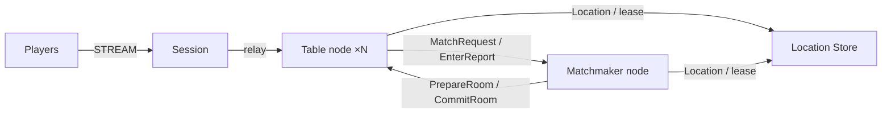

# MyGame 보드 테이블

[English](README.md)

이 C++ 템플릿은 Table 노드 두 개에서 4인용 카드 테이블을 실행합니다. Session은 플레이어를 상태를 유지하는 Player Actor에 바인딩하고 typed packet을 전달합니다. 각 Table User Spot은 좌석, 칩, 섞은 덱, 비공개 카드, 차례와 pot을 관리합니다. Matchmaker는 플레이어를 짝짓고 매치마다 새 Table을 준비합니다.



## 실행 환경

Docker Compose v2와 Linux 컨테이너를 실행하는 Docker 데몬이 필요합니다. Linux에서는 Bash, Windows에서는 PowerShell 7을 사용합니다. 기본 Docker 실행은 이미지에 C++ 도구와 CMake를 설치합니다.

`bootstrap.cmake`는 공개 Framework 0.34.0을 지정합니다. `cmake -P bootstrap.cmake`는 GitHub Release의 `framework-cpp/v0.34.0`에서 플랫폼에 맞는 prebuilt를 내려받고, 함께 게시된 SHA-256 체크섬을 검증한 뒤 `.zlink/install`에 풉니다. 패키지에는 Core, C++ binding, Framework 라이브러리, Boost 헤더와 nlohmann_json이 포함됩니다. Docker 빌드와 로컬 실행은 같은 스크립트를 사용합니다. 공개 패키지의 라이선스 조건을 준수합니다.

## 클라이언트 연결

### 주소와 첫 패킷

`run-server`를 실행하고 `Server ready:` 줄에 출력되는 WebSocket 주소로 연결합니다. Session이 `players` STREAM 리스너를 엽니다. `server/config/session.json`의 `StreamEndpoint`는 `ws://127.0.0.1:0`이며 운영체제가 loopback 포트를 배정합니다. 실행기가 출력한 주소나 `.logs/server.json`의 `sessionEndpoint`를 사용합니다.

브라우저, Unity WebGL, Cocos Creator 웹 클라이언트는 이 호스트에서 리스너에 연결할 수 있습니다. 다른 호스트에서 접속하려면 접근 가능한 WebSocket 주소를 설정하고, 컨테이너를 사용할 때는 포트를 공개합니다. Mesh와 Redis 주소는 내부 통신에 사용합니다.

고정 테이블을 선택하려면 `JoinTableRequest`에 `playerId`와 `tableId`를 보냅니다. 서버가 배정한 플레이어 ID로 매치 대기열에 들어가려면 빈 객체로 `FindMatch`를 보냅니다. 좌석에 입장하면 `TableView`로 테이블, 좌석, 핸드와 공개 플레이어 상태를 받습니다. 거부된 동작은 `ActionRejected`로 확인합니다. `TableView`를 받은 뒤 게임 패킷을 보냅니다. 이 흐름은 `send(...).submit()`으로 전송하고 서버 push로 결과를 받습니다. 운영 게임에서는 바인딩 전에 플레이어의 신원을 검증합니다.

### 매치메이킹

`FindMatch`를 보낸 뒤 `MatchQueued`의 `ticketId`를 저장합니다. 대기열에서 나가려면 같은 ID로 `CancelMatch`를 보냅니다. 두 플레이어가 예약된 방에 입장하면 서버는 티켓 ID, 방 ID, 좌석이 담긴 `MatchFound`를 보내고 이어서 `TableView`를 보냅니다. 매칭된 방에서도 기존 게임 패킷을 사용합니다.

Matchmaker 노드는 메모리에 SpotWide Pool `pool-board`를 유지합니다. Pool은 `server/matchmaker/domain.hpp`의 FIFO `MatchRule`을 적용해 Table을 준비하고, 두 Actor가 10초 안에 입장을 보고하면 확정합니다. 대기 티켓은 120초 후 만료되며 연결이 끊긴 클라이언트의 티켓은 취소됩니다. 예약에 실패하면 Pool이 방을 철회하고 남은 플레이어를 대기열 맨 앞으로 돌려보냅니다. 짝짓기 정책은 `MatchRule`에서 확장합니다.

### 커넥터 설치

`<version>`에는 `bootstrap.cmake`의 `ZLINK_FRAMEWORK_CPP_VERSION`과 같은 버전을 사용합니다. 링크된 가이드가 다른 버전을 설명할 수 있습니다. 위 주소로 연결하고 이 템플릿의 패킷 이름을 사용합니다.

| 클라이언트 | 설치 | 가이드 |
| --- | --- | --- |
| Unity | Native/Editor는 NuGetForUnity로 `Zlink.Stream.Connector`를 복원합니다. WebGL은 `com.zlink.stream-connector.webgl` UPM Git 패키지를 추가합니다. 선택한 타깃용 어셈블리만 포함합니다. [Unity README](https://github.com/zlink-systems/zlink/blob/main/framework/languages/engines/Unity/README.md) | [.NET 엔진 연동](https://docs.zlink.systems/dotnet/guide/stream-connector/12-engine-integration/) |
| Unreal | `framework/languages/cpp/connector/engines/unreal`을 `Plugins/ZLinkStreamConnector`에 복사하고 native 커넥터를 `ThirdParty/ZLink` 아래에 패키징합니다. [Unreal README](https://github.com/zlink-systems/zlink/blob/main/framework/languages/engines/Unreal/README.md) | [C++ 엔진 연동](https://docs.zlink.systems/cpp/guide/stream-connector/12-engine-integration/) |
| Godot | .NET은 `Zlink.Stream.Connector` NuGet을 추가하고 `dotnet restore`를 실행합니다. GDExtension은 Framework prebuilt와 호환 `godot-cpp`로 C++ 어댑터를 빌드합니다. .NET 예제는 Web 내보내기를 지원하지 않습니다. [C# README](https://github.com/zlink-systems/zlink/blob/main/framework/languages/engines/Godot/csharp/README.md), [C++ README](https://github.com/zlink-systems/zlink/blob/main/framework/languages/engines/Godot/cpp/README.md) | [.NET](https://docs.zlink.systems/dotnet/guide/stream-connector/12-engine-integration/), [C++](https://docs.zlink.systems/cpp/guide/stream-connector/12-engine-integration/) |
| Cocos Creator | 웹 타깃은 `npm install @zlink-systems/stream-connector@<version>`을 실행합니다. 이 패키지는 Creator native 어댑터를 제공하지 않습니다. [Cocos Creator README](https://github.com/zlink-systems/zlink/blob/main/framework/languages/engines/CocosCreator/README.md) | [TypeScript 엔진 연동](https://docs.zlink.systems/node/guide/stream-connector/12-engine-integration/) |
| Axmol | `framework/languages/cpp/connector/engines/axmol`을 복사하고 설치된 C++ Framework의 `zlink::stream_connector`를 링크합니다. [Axmol README](https://github.com/zlink-systems/zlink/blob/main/framework/languages/engines/Axmol/README.md) | [C++ 엔진 연동](https://docs.zlink.systems/cpp/guide/stream-connector/12-engine-integration/) |
| 웹 브라우저 | `npm install @zlink-systems/stream-connector@<version>`을 실행하고 브라우저 빌드에서 패키지 루트를 import합니다. 페이지 보안 정책에 맞게 `ws://` 또는 `wss://`로 연결합니다. | [TypeScript 커넥터](https://docs.zlink.systems/node/guide/stream-connector/) |
| C++ | 커넥터가 포함된 Framework prebuilt를 설치합니다. `find_package(zlink_stream_connector_cpp CONFIG REQUIRED)`와 `zlink::stream_connector`를 사용합니다. | [C++ 커넥터](https://docs.zlink.systems/cpp/guide/stream-connector/) |
| C#/.NET | `dotnet add package Zlink.Stream.Connector --version <version>`을 실행합니다. | [.NET 커넥터](https://docs.zlink.systems/dotnet/guide/stream-connector/) |
| Java | Maven 또는 Gradle에 `systems.zlink:zlink-stream-connector:<version>`을 추가합니다. | [Java 커넥터](https://docs.zlink.systems/java/guide/stream-connector/) |
| Kotlin | `systems.zlink:zlink-stream-connector:<version>`을 추가하고, coroutine 래퍼에는 `systems.zlink:zlink-framework-kotlin:<version>`을 추가합니다. | [Kotlin 커넥터](https://docs.zlink.systems/kotlin/guide/stream-connector/) |
| Node | Node.js 22 이상에서 `npm install @zlink-systems/stream-connector@<version>`을 실행하고 패키지 루트를 사용합니다. | [Node 커넥터](https://docs.zlink.systems/node/guide/stream-connector/) |

### 클라이언트 연결 예제

템플릿을 복사한 디렉터리에 아래 코드를 `connect-once.cpp`로 저장합니다. 이 디렉터리를 include 경로에 추가하고 설치된 패키지의 `zlink::stream_connector`를 링크해 C++20 실행 파일을 빌드합니다. 패키지 설정은 기존 e2e 타깃을 참고합니다. 실행 시 실제 Session 주소, 새 플레이어 ID, 테이블 ID 순서로 전달합니다. 전송 전에 수신 대기를 등록하고 커넥터에 설정된 기한을 사용합니다. 전체 흐름은 `e2e/client.hpp`와 `e2e/scenarios.hpp`에 있습니다.

```cpp
#include <zlink/stream_connector.hpp>
#include "server/shared/contracts.hpp"
#include <future>
#include <iostream>
#include <memory>
#include <stdexcept>
namespace sc = zlink::stream_connector;

void checked (sc::result_t<void> result)
{
    if (!result) throw std::runtime_error (result.error ()->message);
}

int main (int argc, char **argv)
{
    if (argc != 4) return 2;
    sc::connector_options_t options;
    options.endpoint = argv[1];
    options.reconnect.enabled = false;
    options.dispatch_mode = sc::dispatch_mode_t::immediate;
    auto connector = sc::connector_factory_t::create (options);
    auto errors = connector.on_error ([] (const auto &error) {
        std::cerr << error.message << '\n';
    });
    checked (connector.connect ());
    try {
        using Reply = MyGame::TableView;
        auto completion = std::make_shared<std::promise<sc::result_t<sc::message_t<Reply>>>> ();
        auto received = completion->get_future ();
        connector.wait_for<Reply> ().submit ([completion] (auto result) {
            completion->set_value (std::move (result));
        });
        connector.send (MyGame::JoinTableRequest{argv[2], argv[3]}).submit ();
        const auto result = received.get ();
        if (!result) throw std::runtime_error (result.error ()->message);
        std::cout << "Received TableView\n";
    } catch (...) {
        checked (connector.close ());
        throw;
    }
    checked (connector.close ());
}
```

## 빌드

템플릿 디렉터리에서 노드와 runner 이미지를 빌드합니다.

```sh
./run-e2e.sh --build-only
```

스크립트가 빌드를 확인한 뒤 이 실행의 이미지 태그를 제거합니다. Docker는 다음 실행을 위해 빌드 레이어를 보존합니다.

Windows에서는 PowerShell 7을 사용합니다.

```powershell
pwsh -NoProfile -File ./run-e2e.ps1 -BuildOnly
```

`Dockerfile`의 `UBUNTU_IMAGE`에서 Ubuntu 24.04 빌드 및 실행 이미지를 정합니다. 모든 노드 역할이 같은 multi-stage 이미지를 사용합니다. runner는 같은 실행 이미지에 Docker CLI 28.5.1을 더합니다. 배포 이미지가 정해지면 이 빌드 인자를 바꿀 수 있습니다.

## 서버 실행과 e2e

한 터미널에서 서버를 실행합니다. 실행기는 로컬 C++ 바이너리를 빌드하고 Redis 컨테이너와 Table A, Table B, Matchmaker, Session을 시작한 뒤 Session WebSocket 주소를 출력합니다. Ctrl+C를 누르면 각 노드가 종료되고 Redis Compose 프로젝트가 제거됩니다.

| 셸 | 서버 터미널 | 시험 터미널 |
| --- | --- | --- |
| Bash | `./run-server.sh` | `./run-e2e.sh` |
| PowerShell 7 | `./run-server.ps1` | `./run-e2e.ps1` |
| Windows 명령 프롬프트 | `run-server.cmd` | `run-e2e.cmd` |

e2e 실행기는 `.logs/server.json`에 기록된 실행 중인 서버에 연결합니다. `update` 시나리오는 연결한 서버의 Table 프로세스를 드레인하고 교체합니다. 이 시나리오는 개발 서버에서 실행합니다. 실행 중인 서버에만 연결하려면 `--attach` 또는 `-Attach`를 사용합니다. 실행 중인 서버가 없으면 기본 명령이 Docker에서 격리 실행합니다. 콘솔은 시나리오별 이름과 결과를 출력하고 마지막에 통과, 실패, 미실행 수를 표시합니다.

```bash
./run-e2e.sh --scenario match,match-cancel
./run-e2e.sh --check-structure
```

```powershell
./run-e2e.ps1 -Scenario match,match-cancel
./run-e2e.ps1 -CheckStructure
```

### Docker 격리 실행

runner와 노드는 컨테이너에서 실행됩니다. 스크립트는 Redis를 시작하기 전에 구조를 확인하며, 실행별 Compose 네트워크, 프로젝트, 컨테이너 이름과 Redis 키 접두사를 사용합니다. 노드가 runner의 네트워크 namespace를 공유하므로 loopback 리스너와 운영체제가 배정한 포트를 사용할 수 있습니다. 스크립트가 설정을 노드에 복사하고 표준 입력과 출력을 연결합니다. `drain`, `shutdown`과 수명 주기 출력은 같은 제어 프로토콜을 사용합니다.

runner는 노드 컨테이너를 제거합니다. 스크립트는 이 실행의 라벨을 가진 컨테이너와 Compose 리소스, 이미지 태그를 정리합니다. 정리 실패 시 종료 코드는 1입니다. 빌드와 실행 제어 로그는 `.logs/docker-<project>/`, 노드 로그와 생성한 설정은 `.logs/run-<id>/`에 남습니다. Unix에서는 호출자 UID와 Docker 소켓 그룹을 사용하므로 호출자가 파일을 소유합니다.

시나리오는 정해진 순서로 실행됩니다. 시나리오나 정리가 실패하면 종료 코드는 1입니다. Windows에서 하위 프로세스에는 콘솔 창이 열리지 않습니다.

| 시나리오 | 확인 항목 |
| --- | --- |
| `table` | 좌석, 칩과 비공개 카드, 서버 발신용 패킷 거부, 순서가 잘못된 베팅, 범위 초과 값(`integer-out-of-range`)과 칩 부족을 검증합니다. 각 거부 응답의 `retryAfterMs`는 0이며 상태를 보존합니다. 정산 시 모든 `cardCount`는 0이며 비공개 카드 조회 결과는 비어 있습니다. |
| `reconnect` | 연결을 즉시 교체해도 Actor의 ID, generation, 좌석, 칩, 카드와 차례가 유지됩니다. 다른 플레이어의 연결도 유지됩니다. 정산 후 비공개 카드 조회 결과는 비어 있습니다. |
| `match` | 두 대기 클라이언트가 같은 방 ID, 서로 다른 좌석과 테이블 뷰를 받고 한 판을 정산합니다. |
| `match-cancel` | 한 클라이언트가 대기 티켓을 취소해 `cancelled`를 받고, 이후 들어온 두 클라이언트가 매칭되어 한 판을 정산합니다. |
| `update` | 실제 Table 호스트를 드레인해 relocation과 SafeToShutdown을 확인합니다. 두 Session ID와 게임 상태를 유지한 채 핸드를 정산하고 카드를 비웁니다. 원래 호스트를 교체한 뒤 새 테이블에서 한 판을 완료합니다. |

`ActionRejected.retryAfterMs`는 같은 이름으로 직렬화하는 부호 있는 32비트 JSON 정수입니다. 칩 잔액, pot, 핸드 번호는 부호 있는 64비트 정수입니다.

교체 후 새 테이블에 입장한 두 플레이어가 교체된 노드 ID를 확인한 다음 핸드를 완료합니다. 격리 실행은 공개 Table stable-type capacity로 배치를 제한합니다.

구조 검사만 실행하려면 `./run-e2e.sh --check-structure`를 사용합니다. 검사기는 유효한 구성 확장이나 edge 순서 변경을 허용하며, 잘못된 참조, 설정 경로, stable type과 시나리오 순서를 거부합니다.

## 로컬 디버깅

`run-server` 또는 로컬 디버깅에는 C++20 컴파일러(GCC 13 이상 또는 Visual Studio 2022 17.4 이상), CMake 3.24 이상, Ninja가 필요합니다. Windows에서는 Visual Studio 2022 개발자 셸을 사용합니다. Framework prebuilt를 내려받으므로 ZLink 체크아웃이나 패키지 관리자는 필요하지 않습니다.

템플릿 디렉터리에서 로컬 프로세스를 빌드하고 실행합니다.

```sh
./run-e2e.sh --local
```

스크립트는 `cmake -P bootstrap.cmake`, `cmake --preset default`, `cmake --build --preset default`를 실행하고 `build/bin/my-game-e2e`를 시작합니다. Redis는 격리된 Compose 프로젝트에서 실행됩니다.

Windows에서는 다음 명령을 사용합니다.

```powershell
pwsh -NoProfile -File ./run-e2e.ps1 -Local
```

로컬 모드에서 `--no-build` 또는 `-NoBuild`로 디버거 빌드를 재사용할 수 있습니다. 두 모드에서 모두 시나리오를 선택할 수 있습니다. 로컬 빌드만 하려면 `--local --build-only` 또는 `-Local -BuildOnly`를 사용합니다.

## Framework 동작

- **handler에서 DB나 파일 I/O 대기**. 일반 async terminal은 현재 turn을 유지합니다. `Yield`는 같은 Spot에서 다른 handler가 실행되도록 합니다. [가이드](https://docs.zlink.systems/cpp/guide/server/32-execution-model/#io-worker-wait)
- **생성 기한 초과**. `DeadlineExceeded`와 호출자 취소의 결과가 다릅니다. [가이드](https://docs.zlink.systems/cpp/guide/server/22-actor/#creation-deadline), [Session 소스](server/session/session.hpp)
- **동시 로그인**. 다른 ID를 생성할 때마다 Location Store를 왕복합니다. 생성 기한을 정할 때 예상 부하를 측정합니다. [가이드](https://docs.zlink.systems/cpp/guide/server/25-location/#creation-load)
- **부하가 있는 경로의 전송**. 전송은 여유 용량을 기다리고 애플리케이션은 최종 결과를 받습니다. [가이드](https://docs.zlink.systems/cpp/guide/server/33-backpressure/#send-backpressure), [Table 소스](server/table/table.hpp)
- **중복 로그인**. Actor duplicate-bind 콜백이 없으면 다른 Session의 바인딩을 허용합니다. 이를 거부하려면 해당 콜백에서 거부 응답을 반환합니다. 템플릿은 기본 동작을 사용합니다. [가이드](https://docs.zlink.systems/cpp/guide/server/39-session-binding/#duplicate-session-bind)
- **ObjectGeneration**. `ObjectGeneration`은 같은 ID로 생성된 논리 객체의 인스턴스를 구분합니다. 데이터 버전과 쓰기 권한은 별도 개념입니다. [가이드](https://docs.zlink.systems/cpp/guide/server/34-activation-lifetime/#object-generation), [Session 소스](server/session/session.hpp)
- **READY와 Serving**. Framework 노드는 runtime `Serving`을 관찰한 뒤 `READY`를 출력합니다. [가이드](https://docs.zlink.systems/cpp/guide/server/12-operations/#wait-for-serving), [호스팅 소스](server/shared/hosting.hpp)

## 알려진 문제

템플릿은 `SessionInfoRequest`에 typed `SessionInfo` push로 응답합니다. Framework 0.30.2가 `reply_packet`을 통한 typed Session reply를 추가했으며, 템플릿은 기존 push를 사용합니다. [#1785](https://github.com/zlink-systems/zlink/issues/1785)

지연 join 후 `on_actor_joined`에서 보낸 첫 push가 오류 없이 유실될 수 있습니다. Framework 0.31.0 검증에서는 이 문제가 관찰되지 않았습니다. [#1786](https://github.com/zlink-systems/zlink/issues/1786)

Message Follow는 30초로 설정합니다. `SAFE_TO_SHUTDOWN` 관찰에는 이 기간과 기존 relocation 기한을 합산합니다. Update는 교체 프로세스의 `READY`를 기다리고 새 테이블이 교체 노드에서 핸드를 완료하는지 확인합니다.

## 배포 순서

Redis, Table A, Table B, Matchmaker, Session 순서로 시작합니다. 배포 환경의 Redis 주소와 고유 키 접두사를 모든 설정에 지정합니다. 두 Table 프로세스는 `my-game-tables`에 Entry, Player와 Table 팩터리를 등록합니다. Matchmaker는 Pool 팩터리를 등록합니다. Session은 `players` STREAM 리스너와 mesh object client를 실행합니다.

업데이트할 Table 호스트의 표준 입력에 `drain`을 보냅니다. `RELOCATION_REQUESTED`, `RELOCATED`, `SAFE_TO_SHUTDOWN`을 확인한 뒤 `shutdown`을 보내고 `STOPPED`와 종료 코드 0을 확인합니다. 같은 설정으로 다시 시작합니다. 기존 Table의 ID는 Location Store의 권한 아래 유지됩니다.
