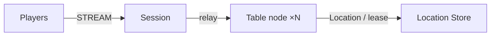

# MyGame board tables

This C++ template hosts four-seat card tables on two Table node processes. The Session node binds each player to a persistent Player Actor and relays typed packets. Each Table User Spot owns its seats, chips, shuffled deck, private hands, turn and pot.



## Prerequisites

- C++20 compiler, CMake 3.24 or later, Ninja, Git and vcpkg. On Windows, use a Visual Studio 2022 developer shell and PowerShell 7.
- Docker with Compose v2 and a running daemon; Bash on Linux.
- Public Framework 0.30.1 and zlink / zlink-cpp 1.19.0, pinned in `vcpkg.json`. Provide a license according to the public package's licensing rules.

Clone the zlink repository at tag `framework-cpp/v0.30.1`. Set `VCPKG_ROOT` to your vcpkg checkout and `VCPKG_OVERLAY_PORTS` to the tagged checkout's `vcpkg/ports` directory. The official overlay supplies the zlink packages; they are not in the default vcpkg registry. This directory is otherwise standalone.

## Build

Run these commands from this directory on Linux or in a Windows developer shell:

```sh
cmake --preset default
cmake --build --preset default
```

The executables are `build/bin/my-game-session`, `my-game-table` and `my-game-e2e` (with `.exe` on Windows). Each server accepts one configuration file argument. The two Table processes share an executable and use distinct configuration files. Listeners bind port zero; `READY` reports the endpoints published by Framework.

## Local e2e

Linux:

```sh
./run-e2e.sh
./run-e2e.sh --scenario table,reconnect,update
```

Windows:

```powershell
pwsh -NoProfile -File ./run-e2e.ps1
pwsh -NoProfile -File ./run-e2e.ps1 -Scenario table,reconnect,update
```

The C++ runner validates actual structure files, starts an isolated Redis Compose project with an ephemeral loopback port, starts Table A, Table B and Session, and runs the selected scenarios in canonical order. Generated configurations and node logs, including message flow, remain in `.logs/run-<id>/`. Scenario and cleanup failures return exit code 1. Windows child processes have no console window.

| Scenario | Assertions |
| --- | --- |
| `table` | Seats 0 and 1, initial chips, distinct private cards, rejection of an out-of-turn bet, revealed cards, winner calculation, split remainder and chip conservation. |
| `reconnect` | Immediate connection replacement preserves Actor identity, generation, seat, chips, cards and turn while the other player stays connected. |
| `update` | Drain the actual Table host, observe relocation and SafeToShutdown, preserve both Session identities and game state, settle, stop and replace the host, then finish a fresh table. |

The fresh-table check follows the .NET and Node references. Placement belongs to Framework; this check does not prove that the replacement physical node receives the fresh table. Deterministic replacement-node placement remains an acceptance gap.

For a structure-only check, run `build/bin/my-game-e2e --check-structure`. The checker accepts valid composition extensions and reordered edges and rejects inconsistent references, configuration paths, stable types and scenario order.

## Known issues

Version 0.30.1 is the required release version. Windows and WSL builds against public 0.30.0 succeed, but runtime acceptance is blocked. After a deferred join to the Table completes, the first TableView pushed from `on_actor_joined` never reaches the client and no error is recorded ([#1786](https://github.com/zlink-systems/zlink/issues/1786)). Node shutdown reports TeardownFailed, and the C++ lifecycle status has no `SafeToShutdown` field ([#1740](https://github.com/zlink-systems/zlink/issues/1740)). A C++ Session cannot yet send a typed reply it creates, so `SessionInfoRequest` is answered with a push ([#1785](https://github.com/zlink-systems/zlink/issues/1785)). The template does not compensate for these Framework failures.

## Deployment sequence

Start Redis, Table A, Table B, then Session. Set deployment-specific Redis endpoints and a unique key prefix in all configurations. Both Table processes register Entry, Player and Table factories in `my-game-tables`; Session hosts only the `players` STREAM listener and mesh object client.

For an update, write `drain` to the affected Table host's standard input. Require `RELOCATION_REQUESTED`, `RELOCATED` and `SAFE_TO_SHUTDOWN`, then send `shutdown` and require `STOPPED` plus exit code zero. Restart with the same configuration. Existing Table identities remain under Location Store authority.

Extend rules in `server/table/domain.hpp` and transport handlers in `server/table/table.hpp`. Player Actors hold no game-state copy. Request replies use the handler Actor's bound session. Other pushes use player IDs through the public Actor client and the Table's typed forwarding handler. Relocation adapters serialize application state only.

## 한국어 실행 안내

C++20 compiler, CMake, Ninja, vcpkg와 Docker Compose를 준비합니다. `framework-cpp/v0.30.1` 태그 저장소의 `vcpkg/ports`를 `VCPKG_OVERLAY_PORTS`로 지정하고 `VCPKG_ROOT`를 설정한 뒤, 이 디렉터리에서 Build 명령을 실행합니다.

Linux에서는 `./run-e2e.sh`, Windows에서는 `pwsh -NoProfile -File ./run-e2e.ps1`을 실행합니다. 로그는 `.logs/run-<id>/`에 보존됩니다. 공개 0.30.0 실행에서 확인된 join·응답 전달·종료 차단 사항과 대체 node 배치 검증의 한계는 Known issues와 Local e2e에 기록되어 있습니다. 0.30.1 후보의 양쪽 환경 검증은 남아 있습니다.
