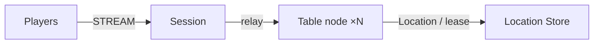

# MyGame board tables

This C++ template hosts four-seat card tables on two Table node containers. The Session node binds each player to a persistent Player Actor and relays typed packets. Each Table User Spot owns its seats, chips, shuffled deck, private hands, turn and pot.



## Prerequisites

Docker with Compose v2 and a running Linux-container daemon is required. Use Bash on Linux or PowerShell 7 on Windows. The Docker build installs the C++ toolchain, CMake and vcpkg; the host does not need them for the default run.

Public Framework 0.30.1 and its binding dependencies are pinned in `vcpkg.json`. The Docker build obtains the official overlay from the corresponding `framework-cpp/v0.30.1` tag. That tag and package must be published before the pinned build can complete. Follow the public package licensing requirements.

## Build

Build the node and runner images from this directory:

```sh
./run-e2e.sh --build-only
```

The script removes its unique image tags after checking the build. Docker retains build layers for subsequent runs.

On Windows, use PowerShell 7:

```powershell
pwsh -NoProfile -File ./run-e2e.ps1 -BuildOnly
```

`Dockerfile` defines the Ubuntu 24.04 build and runtime base once in `UBUNTU_IMAGE`. All node roles share the multi-stage image. The runner adds Docker CLI 28.5.1 to the same runtime. These base arguments can be replaced when the deployment base image becomes available.

## Docker e2e

Linux:

```sh
./run-e2e.sh
./run-e2e.sh --scenario table,reconnect,update
```

Windows:

```powershell
pwsh -NoProfile -File ./run-e2e.ps1
pwsh -NoProfile -File ./run-e2e.ps1 -Scenario table,reconnect,update
```

The runner and nodes execute in containers. The script checks structure before Redis startup, then uses a unique Compose network, project, container names and Redis key prefixes. Nodes share the runner's network namespace, preserving loopback listeners and OS-assigned ports. Configuration is copied into each node before attaching stdin and stdout; `drain`, `shutdown` and lifecycle output retain their existing protocol.

The runner removes its node containers. The script removes remaining containers carrying this run's label, its Compose resources and its image tags. Cleanup failures return exit code 1. Build and orchestration logs remain in `.logs/docker-<project>/`; node logs and generated configurations remain in `.logs/run-<id>/`. Unix runners use the caller UID and Docker socket group so those files remain caller-owned.

The scripts and C++ runner validate actual structure files, start an isolated Redis Compose project with an ephemeral loopback port, start Table A, Table B and Session, and run the selected scenarios in canonical order. Generated configurations and node logs, including message flow, remain in `.logs/run-<id>/`. Scenario and cleanup failures return exit code 1. Windows child processes have no console window.

| Scenario | Assertions |
| --- | --- |
| `table` | Seats 0 and 1, initial chips, distinct private cards, rejection of an out-of-turn bet, revealed cards, winner calculation, split remainder and chip conservation. |
| `reconnect` | Immediate connection replacement preserves Actor identity, generation, seat, chips, cards and turn while the other player stays connected. |
| `update` | Drain the actual Table host, observe relocation and SafeToShutdown, preserve both Session identities and game state, settle, stop and replace the host, then finish a fresh table. |

The fresh-table check requires both new players to observe the replacement node ID before completing a hand. The runner constrains placement through the public Table stable-type capacity.

For a structure-only check, run `./run-e2e.sh --check-structure`. The checker accepts valid composition extensions and reordered edges and rejects inconsistent references, configuration paths, stable types and scenario order.

## Local debugging

Local processes remain available for debugging. Install a C++20 compiler, CMake 3.24+, Ninja, Git and vcpkg. Windows requires a Visual Studio 2022 developer shell. Set `VCPKG_ROOT` to vcpkg and `VCPKG_OVERLAY_PORTS` to `vcpkg/ports` in the ZLink checkout at tag `framework-cpp/v0.30.1`.

Build and run local processes from this directory:

```sh
./run-e2e.sh --local
```

The script runs `cmake --preset default` and `cmake --build --preset default` before executing `build/bin/my-game-e2e`. Redis still runs in an isolated Compose project.

On Windows, run:

```powershell
pwsh -NoProfile -File ./run-e2e.ps1 -Local
```

Use `--no-build` or `-NoBuild` with local mode to reuse a debugger build. Scenario selection works in both modes. Local build-only uses `--local --build-only` or `-Local -BuildOnly`.

## Known issues

Version 0.30.1 is the required release version. Windows and WSL builds against public 0.30.0 succeed, but runtime acceptance is blocked. After a deferred join to the Table completes, the first TableView pushed from `on_actor_joined` never reaches the client and no error is recorded ([#1786](https://github.com/zlink-systems/zlink/issues/1786)). Node shutdown reports TeardownFailed, and the C++ lifecycle status has no `SafeToShutdown` field ([#1740](https://github.com/zlink-systems/zlink/issues/1740)). A C++ Session cannot yet send a typed reply it creates, so `SessionInfoRequest` is answered with a push ([#1785](https://github.com/zlink-systems/zlink/issues/1785)). The template does not compensate for these Framework failures.

Message Follow is explicitly configured for 30 seconds. The `SAFE_TO_SHUTDOWN` observation budget is that period plus the existing relocation budget. Update waits for replacement `READY`, then asserts that the replacement hosts the new table and completes a hand.

## Deployment sequence

Start Redis, Table A, Table B, then Session. Set deployment-specific Redis endpoints and a unique key prefix in all configurations. Both Table processes register Entry, Player and Table factories in `my-game-tables`; Session hosts only the `players` STREAM listener and mesh object client.

For an update, write `drain` to the affected Table host's standard input. Require `RELOCATION_REQUESTED`, `RELOCATED` and `SAFE_TO_SHUTDOWN`, then send `shutdown` and require `STOPPED` plus exit code zero. Restart with the same configuration. Existing Table identities remain under Location Store authority.

Extend rules in `server/table/domain.hpp` and transport handlers in `server/table/table.hpp`. Player Actors hold no game-state copy. Request replies use the handler Actor's bound session. Other pushes use player IDs through the public Actor client and the Table's typed forwarding handler. Relocation adapters serialize application state only.

The e2e runner sets each node's optional `TableCapacity` to the number of selected scenarios through the public Table stable-type limit. Each scenario retains one table. After update drains the source, the surviving node is at capacity, so only the replacement can host the new table. Both new players must observe the replacement node ID. Omitted or zero capacity leaves deployment capacity unlimited. Entry declarations describe the application Entry on Table nodes only; there are no fixed User Spots in this template.

## 한국어 실행 안내

Docker Compose v2와 Linux 컨테이너 데몬을 준비한다. 템플릿 디렉터리에서 Linux는 `./run-e2e.sh`, Windows는 `pwsh -NoProfile -File ./run-e2e.ps1`을 실행한다. 기본 실행은 이미지 빌드부터 runner·node 컨테이너 기동과 정리까지 수행한다. Framework 0.30.1 공개 패키지와 태그가 있어야 고정 버전 빌드를 완료할 수 있다.

로컬 디버깅은 C++ 도구와 공식 vcpkg overlay를 설정한 뒤 `./run-e2e.sh --local` 또는 `pwsh -NoProfile -File ./run-e2e.ps1 -Local`로 실행한다. node 로그와 설정은 `.logs/run-<id>/`, Docker 빌드·정리 로그는 `.logs/docker-<project>/`에 남는다. 공개 패키지에서 확인된 차단 사항은 Known issues를 따른다.
