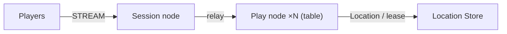

# MyGame board tables

This C++ template hosts four-seat card tables on two play node (table) containers. The Session node binds each player to a persistent Player Actor and relays typed packets. Each Table User Spot owns its seats, chips, shuffled deck, private hands, turn and pot.



## Prerequisites

Docker with Compose v2 and a running Linux-container daemon is required. Use Bash on Linux or PowerShell 7 on Windows. The Docker build installs the C++ toolchain and CMake; the host does not need them for the default run.

Public Framework 0.34.0 is pinned in `bootstrap.cmake`, the only file that names the version. `cmake -P bootstrap.cmake` downloads this platform's prebuilt from the `framework-cpp/v0.34.0` GitHub Release, checks it against the SHA-256 checksum published with it and extracts it into `.zlink/install`. The prebuilt carries Core, the C++ binding, the Framework libraries, Boost headers and nlohmann_json, so no package manager runs. The Docker build and local mode run the same script. Follow the public package licensing requirements.

## Client connection

### Endpoint and first packet

Connect to the Session `players` STREAM listener. `server/config/session.json` pins `StreamEndpoint` to `tcp://127.0.0.1:0`: loopback with an OS-assigned port. Read the Session stdout line `READY {"id":"...","meshEndpoint":"...","streamEndpoint":"..."}` and use its actual `streamEndpoint`, not port `0`. `server/shared/hosting.hpp` emits this value and `e2e/world.hpp` consumes it. Mesh and Redis addresses are internal endpoints.

The listener is reachable from its host/network namespace. Keep a deployment running separately from e2e, which owns and removes its nodes; configure a reachable `StreamEndpoint` interface and port and expose it from containers for external clients. This is a TCP endpoint with no HTTP/WebSocket path. Browsers, Unity WebGL and Cocos Creator web cannot connect to this default listener; those clients require a deployed WebSocket listener.

Send `JoinTableRequest` (`playerId`, `tableId`) first. Successful seating publishes `TableView` with the table, seat, hand and public player state; `ActionRejected` reports rejected actions. Other game packets and `SessionInfoRequest` require joining first. These operations use `send(...).submit()` and server pushes, not a correlated connector `request` reply. This template does not authenticate player identity; validate it before binding in a production game.

Set `reconnect: true` in `JoinTableRequest` when resuming a previously assigned seat. The Actor’s existing Table membership handles the request. Entry responds with `ActionRejected` (`not-seated`) when membership is missing. Discard the previous table ID and return to table selection. Omit `reconnect` or send `false` for first entry.

### Connector installation

Use the same connector release as this template pins in `bootstrap.cmake`, key `ZLINK_FRAMEWORK_CPP_VERSION`. Replace `<version>` below with that pinned value; linked guides may describe other releases. Use this template's packet names with the endpoint described above. Engine installation instructions are in the linked repository READMEs.

| Client                             | Connector installation                                                                                                                                                                                                                                                                                                                                                                                                                                                          | Documentation guide                                                                                                                                                          |
| ---------------------------------- | ------------------------------------------------------------------------------------------------------------------------------------------------------------------------------------------------------------------------------------------------------------------------------------------------------------------------------------------------------------------------------------------------------------------------------------------------------------------------------- | ---------------------------------------------------------------------------------------------------------------------------------------------------------------------------- |
| Unity                              | Native/Editor: restore `Zlink.Stream.Connector` with NuGetForUnity. WebGL: add the `com.zlink.stream-connector.webgl` UPM Git package; include only the connector assembly for the active target. See the [Unity README](https://github.com/zlink-systems/zlink/blob/main/framework/languages/engines/Unity/README.md) and its package manifest.                                                                                                                                | [.NET engine integration](https://docs.zlink.systems/dotnet/guide/stream-connector/12-engine-integration/)                                                                   |
| Unreal                             | Copy `framework/languages/cpp/connector/engines/unreal` into `Plugins/ZLinkStreamConnector`, then package the native connector under `ThirdParty/ZLink` as described in the [Unreal README](https://github.com/zlink-systems/zlink/blob/main/framework/languages/engines/Unreal/README.md).                                                                                                                                                                                     | [C++ engine integration](https://docs.zlink.systems/cpp/guide/stream-connector/12-engine-integration/)                                                                       |
| Godot                              | .NET: add the NuGet package `Zlink.Stream.Connector` and run `dotnet restore`; see the [C# README](https://github.com/zlink-systems/zlink/blob/main/framework/languages/engines/Godot/csharp/README.md). GDExtension: build the C++ Godot adapter against the framework prebuilt and matching `godot-cpp`; see the [C++ README](https://github.com/zlink-systems/zlink/blob/main/framework/languages/engines/Godot/cpp/README.md). The .NET sample does not support Web export. | [.NET](https://docs.zlink.systems/dotnet/guide/stream-connector/12-engine-integration/), [C++](https://docs.zlink.systems/cpp/guide/stream-connector/12-engine-integration/) |
| Cocos Creator                      | Web target: `npm install @zlink-systems/stream-connector@<version>`; see the [Cocos Creator README](https://github.com/zlink-systems/zlink/blob/main/framework/languages/engines/CocosCreator/README.md). This package does not provide a Creator native adapter.                                                                                                                                                                                                                  | [TypeScript engine integration](https://docs.zlink.systems/node/guide/stream-connector/12-engine-integration/)                                                               |
| Axmol                              | Copy `framework/languages/cpp/connector/engines/axmol` into `third_party/zlink_axmol_connector` and link `zlink::stream_connector` from the installed C++ framework package; see the [Axmol README](https://github.com/zlink-systems/zlink/blob/main/framework/languages/engines/Axmol/README.md).                                                                                                                                                                              | [C++ engine integration](https://docs.zlink.systems/cpp/guide/stream-connector/12-engine-integration/)                                                                       |
| Web browser (TypeScript connector) | `npm install @zlink-systems/stream-connector@<version>`; import the package root in the browser build. Use `ws://` or `wss://`, subject to the page's security policy.                                                                                                                                                                                                                                                                                                             | [TypeScript connector](https://docs.zlink.systems/node/guide/stream-connector/)                                                                                              |
| C++                                | Install the C++ framework prebuilt containing the connector; use `find_package(zlink_stream_connector_cpp CONFIG REQUIRED)` and link `zlink::stream_connector`.                                                                                                                                                                                                                                                                                                                 | [C++ connector](https://docs.zlink.systems/cpp/guide/stream-connector/)                                                                                                      |
| C#/.NET                            | `dotnet add package Zlink.Stream.Connector --version <version>`                                                                                                                                                                                                                                                                                                                                                                                                                    | [.NET connector](https://docs.zlink.systems/dotnet/guide/stream-connector/)                                                                                                  |
| Java                               | Add Maven/Gradle dependency `systems.zlink:zlink-stream-connector:<version>`.                                                                                                                                                                                                                                                                                                                                                                                                      | [Java connector](https://docs.zlink.systems/java/guide/stream-connector/)                                                                                                    |
| Kotlin                             | Add `systems.zlink:zlink-stream-connector:<version>` and `systems.zlink:zlink-framework-kotlin:<version>` for the coroutine wrapper.                                                                                                                                                                                                                                                                                                                                                  | [Kotlin connector](https://docs.zlink.systems/kotlin/guide/stream-connector/)                                                                                                |
| Node                               | `npm install @zlink-systems/stream-connector@<version>`; use the package root and Node.js 22 or later.                                                                                                                                                                                                                                                                                                                                                     | [Node connector](https://docs.zlink.systems/node/guide/stream-connector/)                                                                                                    |

### One client connection

Save the following as `connect-once.cpp` in a copy of this template. Build it as a C++20 executable with this directory on the include path and link `zlink::stream_connector` from the installed package (the existing e2e target shows the package setup). Run it with the actual Session endpoint and a fresh player ID, then the table ID. The receive wait is registered before sending and uses the connector's configured wait deadline. See `e2e/client.hpp` and `e2e/scenarios.hpp` for the complete flow.

```cpp
#include <zlink/stream_connector.hpp>
#include "server/shared/contracts.hpp"
#include <future>
#include <iostream>
#include <memory>
#include <stdexcept>
namespace sc = zlink::stream_connector;

void checked (sc::result_t<void> result)
{
    if (!result) throw std::runtime_error (result.error ()->message);
}

int main (int argc, char **argv)
{
    if (argc != 4) return 2;
    sc::connector_options_t options;
    options.endpoint = argv[1];
    options.reconnect.enabled = false;
    options.dispatch_mode = sc::dispatch_mode_t::immediate;
    auto connector = sc::connector_factory_t::create (options);
    auto errors = connector.on_error ([] (const auto &error) {
        std::cerr << error.message << '\n';
    });
    checked (connector.connect ());
    try {
        using Reply = MyGame::TableView;
        auto completion = std::make_shared<std::promise<sc::result_t<sc::message_t<Reply>>>> ();
        auto received = completion->get_future ();
        connector.wait_for<Reply> ().submit ([completion] (auto result) {
            completion->set_value (std::move (result));
        });
        connector.send (MyGame::JoinTableRequest{argv[2], argv[3]}).submit ();
        const auto result = received.get ();
        if (!result) throw std::runtime_error (result.error ()->message);
        std::cout << "Received TableView\n";
    } catch (...) {
        checked (connector.close ());
        throw;
    }
    checked (connector.close ());
}
```

## Build

Build the node and runner images from this directory:

```sh
./run-e2e.sh --build-only
```

The script removes its unique image tags after checking the build. Docker retains build layers for subsequent runs.

On Windows, use PowerShell 7:

```powershell
pwsh -NoProfile -File ./run-e2e.ps1 -BuildOnly
```

`Dockerfile` defines the Ubuntu 24.04 build and runtime base once in `UBUNTU_IMAGE`. All node roles share the multi-stage image. The runner adds Docker CLI 28.5.1 to the same runtime. These base arguments can be replaced when the deployment base image becomes available.

## Docker e2e

Linux:

```sh
./run-e2e.sh
./run-e2e.sh --scenario table,reconnect,update
```

Windows:

```powershell
pwsh -NoProfile -File ./run-e2e.ps1
pwsh -NoProfile -File ./run-e2e.ps1 -Scenario table,reconnect,update
pwsh -NoProfile -File ./run-e2e.ps1 -CheckStructure
```

The runner and nodes execute in containers. The script checks structure before Redis startup, then uses a unique Compose network, project, container names and Redis key prefixes. Nodes share the runner's network namespace, preserving loopback listeners and OS-assigned ports. Configuration is copied into each node before attaching stdin and stdout; `drain`, `shutdown` and lifecycle output retain their existing protocol.

The runner removes its node containers. The script removes remaining containers carrying this run's label, its Compose resources and its image tags. Cleanup failures return exit code 1. Build and orchestration logs remain in `.logs/docker-<project>/`; node logs and generated configurations remain in `.logs/run-<id>/`. Unix runners use the caller UID and Docker socket group so those files remain caller-owned.

The scripts and C++ runner validate actual structure files, start an isolated Redis Compose project with an ephemeral loopback port, start play node A (table), play node B (table) and Session, and run the selected scenarios in canonical order. Generated configurations and node logs, including message flow, remain in `.logs/run-<id>/`. Scenario and cleanup failures return exit code 1. Windows child processes have no console window.

| Scenario | Assertions |
| --- | --- |
| `table` | Seats and chips, private cards, rejection of a server-originated packet, out-of-turn bets, over-limit values (`integer-out-of-range`) and insufficient chips. Each rejection has `retryAfterMs: 0` and leaves table state unchanged. Settlement reports every `cardCount` as zero; a private-hand query returns no cards. |
| `reconnect` | Immediate connection replacement preserves Actor identity, generation, seat, chips, cards and turn while the other player stays connected. Settlement clears every hand, and a later private-hand query returns no cards. In isolation, a fresh deployment rejects reconnecting to the original table ID with `not-seated`. |
| `update` | Drain the actual play node (table), observe relocation and SafeToShutdown, preserve both Session identities and game state, settle on the replacement with empty hands, stop and replace the host, then finish a fresh table. |

`ActionRejected.retryAfterMs` is a signed 32-bit JSON integer serialized with the `retryAfterMs` property name. Chip balances, the pot and hand numbers use signed 64-bit integers.

The fresh-table check requires both new players to observe the replacement node ID before completing a hand. The runner constrains placement through the public Table stable-type capacity.

For a structure-only check, run `./run-e2e.sh --check-structure`. The checker accepts valid composition extensions and reordered edges and rejects inconsistent references, configuration paths, stable types and scenario order.

## Local debugging

Local processes remain available for debugging. Install a C++20 compiler (GCC 13 or later, or Visual Studio 2022 17.4 or later), CMake 3.24+ and Ninja. Windows requires a Visual Studio 2022 developer shell. No ZLink checkout or package manager is needed.

Build and run local processes from this directory:

```sh
./run-e2e.sh --local
```

The script runs `cmake -P bootstrap.cmake`, `cmake --preset default` and `cmake --build --preset default` before executing `build/bin/my-game-e2e`. Redis still runs in an isolated Compose project.

On Windows, run:

```powershell
pwsh -NoProfile -File ./run-e2e.ps1 -Local
```

Use `--no-build` or `-NoBuild` with local mode to reuse a debugger build. Scenario selection works in both modes. Local build-only uses `--local --build-only` or `-Local -BuildOnly`.

## Framework behavior to know

- **Waiting for DB or file I/O in a handler** — An ordinary async terminal holds the turn, while `Yield` lets other handlers on the same Spot proceed. [Guide](https://docs.zlink.systems/cpp/guide/server/32-execution-model/#io-worker-wait).
- **Creation that misses its deadline** — `DeadlineExceeded` and caller cancellation have distinct outcomes. [Guide](https://docs.zlink.systems/cpp/guide/server/22-actor/#creation-deadline). [server/session/session.hpp:50](server/session/session.hpp).
- **Many logins at once** — Each creation for a different ID requires a Location Store round trip, so measure expected load when setting the deadline. [Guide](https://docs.zlink.systems/cpp/guide/server/25-location/#creation-load).
- **Sending under load** — A send waits for capacity and the application observes only its final result. [Guide](https://docs.zlink.systems/cpp/guide/server/33-backpressure/#send-backpressure). [server/table/table.hpp:20](server/table/table.hpp).
- **Duplicate login** — Without a callback, binding a different Session is accepted; reject it in the Actor duplicate-bind callback to prevent it. [Guide](https://docs.zlink.systems/cpp/guide/server/39-session-binding/#duplicate-session-bind). This template keeps the default (accepts the new Session).
- **ObjectGeneration** — `ObjectGeneration` identifies a logical incarnation of the same ID; it is neither a data version nor write authority. [Guide](https://docs.zlink.systems/cpp/guide/server/34-activation-lifetime/#object-generation). [server/session/session.hpp:70](server/session/session.hpp).
- **READY and Serving** — Framework nodes print `READY` after observing runtime `Serving`. [Guide](https://docs.zlink.systems/cpp/guide/server/12-operations/#wait-for-serving). [server/shared/hosting.hpp:44](server/shared/hosting.hpp); [server/shared/hosting.hpp:81](server/shared/hosting.hpp).

## Known issues

Drain confirmation takes about 30 seconds, so a turn clock may expire during the wait. For an update scenario in a game with turn clocks, finish the round before relocating it. Verify that relocation preserves the remaining time in a domain check with a controlled clock.

Validated against the published Framework 0.34.0 packages.

This template answers `SessionInfoRequest` with a typed `SessionInfo` push; Framework 0.30.2 added a typed Session reply through `reply_packet` (#1785), and the template has not switched to it.

- [#1786](https://github.com/zlink-systems/zlink/issues/1786) (open, planned for 0.31.0): the first push sent from `on_actor_joined` after a deferred join can be lost without an error; it was not observed in 0.31.0 validation.

Message Follow is explicitly configured for 30 seconds. The `SAFE_TO_SHUTDOWN` observation budget is that period plus the existing relocation budget. Update waits for replacement `READY`, then asserts that the replacement hosts the new table and completes a hand.

## Deployment sequence

Start Redis, play node A (table), play node B (table), then the session node. Set deployment-specific Redis endpoints and a unique key prefix in all configurations. Both Table processes register Entry, Player and Table factories in `my-game-tables`; Session nodes only the `players` STREAM listener and mesh object client.

For an update, write `drain` to the affected play node's standard input. Require `RELOCATION_REQUESTED`, `RELOCATED` and `SAFE_TO_SHUTDOWN`, then send `shutdown` and require `STOPPED` plus exit code zero. Restart with the same configuration. Existing Table identities remain under Location Store authority.

Extend rules in `server/table/domain.hpp` and transport handlers in `server/table/table.hpp`. Player Actors hold no game-state copy. Request replies use the handler Actor's bound session. Other pushes use player IDs through the public Actor client and the Table's typed forwarding handler. Relocation adapters serialize application state only.

The e2e runner sets each node's optional `TableCapacity` to the number of selected scenarios through the public Table stable-type limit. Each scenario retains one table. After update drains the source, the surviving node is at capacity, so only the replacement can host the new table. Both new players must observe the replacement node ID. Omitted or zero capacity leaves deployment capacity unlimited. Entry declarations describe the application Entry on play nodes (table) only; there are no fixed User Spots in this template.
