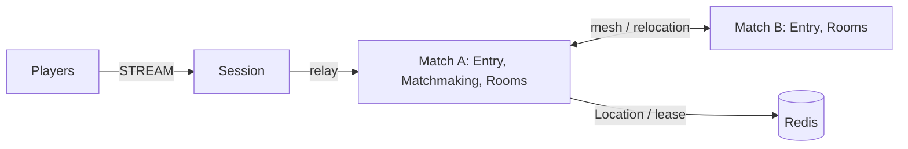

# MyGame FPS entry lobby

This C++20 FPS template pairs players by mode through Entry Spots, a fixed Matchmaking User Spot, and dynamic Room User Spots. Session binds each connection to a Player Actor; RoomState owns movement budgets, ray hit decisions, HP, shared input sequences and match completion. Disconnected players resume the same Actor and Room. Draining a Match host relocates ongoing matches without reconnecting clients.



## Prerequisites

Docker with Compose v2 and a running Linux-container daemon is required. Use Bash on Linux or PowerShell 7 on Windows. The Docker build installs the C++ toolchain and CMake; the host does not need them for the default run.

Public Framework 0.30.2 is pinned in `bootstrap.cmake`, the only file that names the version. `cmake -P bootstrap.cmake` downloads this platform's prebuilt from the `framework-cpp/v0.30.2` GitHub Release, checks it against the SHA-256 checksum published with it and extracts it into `.zlink/install`. The prebuilt carries Core, the C++ binding, the Framework libraries, Boost headers and nlohmann_json, so no package manager runs. The Docker build and local mode run the same script. Follow the public package licensing requirements.

## Build

Build the node and runner images from this directory:

```sh
./run-e2e.sh --build-only
```

The script removes its unique image tags after checking the build. Docker retains build layers for subsequent runs.

On Windows, use PowerShell 7:

```powershell
pwsh -NoProfile -File ./run-e2e.ps1 -BuildOnly
```

`Dockerfile` defines the Ubuntu 24.04 build and runtime base once in `UBUNTU_IMAGE`. All node roles share the multi-stage image. The runner adds Docker CLI 28.5.1 to the same runtime. These base arguments can be replaced when the deployment base image becomes available.

## Docker e2e

Bash:

```sh
./run-e2e.sh
./run-e2e.sh --scenario matchmaking,hit,wall,input,reconnect,update
./run-e2e.sh --check-structure
```

PowerShell:

```powershell
pwsh -NoProfile -File ./run-e2e.ps1
pwsh -NoProfile -File ./run-e2e.ps1 -Scenario matchmaking,hit,wall,input,reconnect,update
pwsh -NoProfile -File ./run-e2e.ps1 -CheckStructure
```

The runner and nodes execute in containers. The script checks structure before Redis startup, then uses a unique Compose network, project, container names and Redis key prefixes. Nodes share the runner's network namespace, preserving loopback listeners and OS-assigned ports. Configuration is copied into each node before attaching stdin and stdout; `drain`, `shutdown` and lifecycle output retain their existing protocol.

The runner removes its node containers. The script removes remaining containers carrying this run's label, its Compose resources and its image tags. Cleanup failures return exit code 1. Build and orchestration logs remain in `.logs/docker-<project>/`; node logs and generated configurations remain in `.logs/run-<id>/`. Unix runners use the caller UID and Docker socket group so those files remain caller-owned.

The scripts and runner check `zlink.structure.json`, start a uniquely named Redis Compose project on an ephemeral loopback port, start Match A before Match B and Session, and save configuration, stdout, stderr message-flow records and typed client observations in `.logs/run-<id>/`. They clean up only their own processes and Compose project. Cleanup failures cause a failing exit code.

| Scenario | Assertions |
| --- | --- |
| `matchmaking` | Interleaved ranked and casual queues pair only players in the same mode, start each Room with full HP and sequence zero, and reject an internal `RoomAssignment` packet. |
| `hit` | An unobstructed shot removes 25 HP; upward and out-of-range rays miss; four hits finish the match and report the winner; later actions are rejected without changing state. |
| `wall` | An intervening wall blocks damage, while a wall behind the target permits a hit. |
| `input` | Shared sequence, movement boundaries, movement budget, fire interval, unchanged rejected state and server-issued retry delays. |
| `reconnect` | A new connection retains the Actor generation, Room, position, HP and last sequence; a finished reconnect retains the winner. |
| `update` | Drain through `RELOCATION_REQUESTED`, `RELOCATED`, `SAFE_TO_SHUTDOWN`; preserve both Sessions and Room state; replace the host; verify that the replacement accepts a new Room. |

The runner executes 45 domain checks before starting scenarios. The separate `my-game-domain-test` target runs the same checks through `ctest --test-dir build --output-on-failure` after a local build.

The wire contracts are in `server/shared/contracts.hpp`; `server/match/domain.hpp` defines `Vec3`, closed slab ray/AABB intersection, the static map, spawn points and player boxes. `RoomViewRequest` asks the authoritative Room for its current view. `SessionInfoRequest` receives a typed request reply. Requests and pushes use the Framework default typed JSON serializer. The runner never retries a failed scenario.

Each scenario uses isolated Redis key prefixes and node containers, with Room capacity set to one per match host. After relocation fills the surviving host, only the replacement has capacity for a new Room. Deployment capacity is configured independently.

Message Follow is configured explicitly to 30 seconds. After `RELOCATED`, the safe shutdown observation budget is the follow duration plus the existing relocation observation budget; the relocation operation deadline is unchanged.

## Local debugging

Local processes remain available for debugging. Install a C++20 compiler (GCC 13 or later, or Visual Studio 2022 17.4 or later), CMake 3.24+ and Ninja. Windows requires a Visual Studio 2022 developer shell. No ZLink checkout or package manager is needed.

Build and run local processes from this directory:

```sh
./run-e2e.sh --local
```

The script runs `cmake -P bootstrap.cmake`, `cmake --preset default` and `cmake --build --preset default` before executing `build/bin/my-game-e2e`. Redis still runs in an isolated Compose project.

On Windows, run:

```powershell
pwsh -NoProfile -File ./run-e2e.ps1 -Local
```

Use `--no-build` or `-NoBuild` with local mode to reuse a debugger build. Scenario selection works in both modes. Local build-only uses `--local --build-only` or `-Local -BuildOnly`.

## Known issues

Validated against the published Framework 0.30.2 packages.

- [#1786](https://github.com/zlink-systems/zlink/issues/1786) (open, planned for 0.31.0): the first push sent from `on_actor_joined` after a deferred join can be lost without an error; it was not observed in 0.30.2 validation.
## Deployment sequence

Wait for the bootstrap owner to report `READY` before starting another match host. Its public GetOrCreate completes while it is the only placement candidate, so the fixed Matchmaking Spot starts on its declared owner.

1. Start Redis and give all node configurations the same deployment-specific `RedisEndpoint` and `KeyPrefix`.
2. Start the Matchmaking bootstrap owner (`my-game-match server/config/match-a.json`), then other Match hosts (`my-game-match server/config/match-b.json`), then Session (`my-game-session server/config/session.json`). Every role has its own executable; configuration does not select the role.
3. Keep Room capacity available on surviving hosts. Write `drain` to the selected Match host's stdin. Wait for all three relocation markers, then write `shutdown` and require `STOPPED` and exit code zero.
4. Start its replacement with the same node settings and `BootstrapMatchmaking` disabled. Require `READY` before accepting new work. Framework owns Actor placement, membership, binding and relocation; application adapters preserve only queue and combat state.

## FPS rules and extension points

`QueueRequest` is the first client packet. It carries a claimed player ID; add authentication before binding for production. Session accepts only `QueueRequest`, `RoomViewRequest`, `MoveRequest`, `ShootRequest` and `SessionInfoRequest`. Internal assignment and result packets receive `packet-not-allowed`.

Coordinates use `Vec3(x, y, z)` with Y up. `ArenaMap` defines bounds X/Z 0–100 and Y 0–10, walls from `(49, 0, 20)` to `(51, 10, 60)` and `(80, 0, 0)` to `(82, 10, 20)`, and ordered spawn points `(48, 0, 18)` and `(52, 0, 18)`. A player box is 1 wide, 2 high and 1 deep from its feet, with eye height 1.6. Feet remain at Y=0. Vertical movement is rejected as `vertical-move`; jumping and gravity are not implemented. Movement checks the feet-position segment against closed wall boxes, including contact at the endpoint. It does not implement swept player-volume collision.

`MoveRequest(delta, sequence)` has a maximum step of 2 and a speed budget of 10 units per second, capped at 2 since the last accepted movement. The first movement has the full budget. Nonfinite deltas, nonzero `delta.y`, oversized steps, map exits, wall intersections and budget overruns return `non-finite`, `vertical-move`, `step-too-large`, `outside-map`, `move-blocked-by-wall` and `move-budget`. `ShootRequest(aimDirection, sequence)` normalizes finite nonzero aim, casts from the authoritative eye position up to 80 units and chooses the closest wall or living player AABB. Wall ties and box contact block the ray. Invalid aim returns `invalid-aim`; a shot before the 250 ms interval returns `fire-too-soon`. A hit causes 25 damage; accepted misses and wall-blocked shots still consume their sequence and fire interval. There is no ammunition model. The Framework message model carries only finite JSON numbers, so nonfinite input reaches only the domain checks.

Move and Shoot share one increasing sequence. Rejections change neither position, HP, sequence nor movement/fire timing. Stale input is `stale-sequence`; a full or mismatched Room admission is `admission-rejected`; an internal client packet is `packet-not-allowed`. `RetryAfterMs` is positive only for movement-budget or fire-interval rejection; clients wait for that reported duration and resend the same input. `MoveResult` and `ShotResult` acknowledge accepted actions; `ActionRejected` and `ShotRejected` report rejected inputs. `RoomView` includes all positions, HP, last sequences, phase and winner so a reconnecting client can continue with the last sequence plus one. At zero HP the match finishes as `match-finished` and later Move/Shoot inputs are rejected.

Hit detection uses the current server state. There is no lag compensation, projectile simulation or client prediction. Extend `RoomState` for weapons and match rules, `ArenaMap` for geometry and spawn selection, and the shared contracts for client-facing actions. Keep cooldown, movement budget and hit decisions in `RoomState`. `RoomSnapshot` stores only remaining milliseconds for timing; it never transfers a process's absolute clock reading.

## 한국어 실행 안내

Docker Compose v2와 Linux 컨테이너 데몬을 준비한다. 템플릿 디렉터리에서 Linux는 `./run-e2e.sh`, Windows는 `pwsh -NoProfile -File ./run-e2e.ps1`을 실행한다. 기본 실행은 이미지 빌드부터 runner·node 컨테이너 기동과 정리까지 수행한다. 시나리오는 matchmaking, hit, wall, input, reconnect, update 순서로 실행한다. Framework 0.30.2는 `bootstrap.cmake`에서 고정한다.

로컬 디버깅은 C++20 컴파일러, CMake, Ninja를 설치한 뒤 `./run-e2e.sh --local` 또는 `pwsh -NoProfile -File ./run-e2e.ps1 -Local`로 실행한다. 노드 로그와 설정은 `.logs/run-<id>/`, Docker 빌드·정리 로그는 `.logs/docker-<project>/`에 남는다. `RoomState`가 이동 예산·발사 간격·명중 판정·체력·공유 순번·승자를 소유한다. 발은 Y=0이고 수직 이동은 `vertical-move`로 거부한다. 공개 패키지의 알려진 문제는 Known issues를 따른다.
