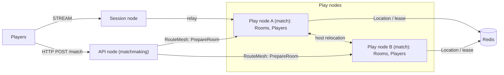

# MyGame FPS API node

API 노드의 `POST /match`가 모드별로 요청을 짝짓고 Room ID와 Session 주소를 반환합니다. RoomRoster가 참가 명단을 관리하고 플레이어는 STREAM의 `JoinRoomRequest`로 입장합니다. RoomState가 경기 상태와 입력 순서, 이동 예산, 사격 판정을 소유합니다.

이 템플릿은 새 게임을 설계할 때 참고하는 예제입니다. 새 프로젝트에서 게임에 맞는 노드, Spot, Actor, 메시지를 설계하고 이 템플릿의 구조와 규칙을 참고합니다. 템플릿의 이름을 바꾸거나 원본을 수정해서 게임 프로젝트로 사용하지 않습니다.



## 서버와 e2e 실행

프로젝트 디렉터리에서 명령을 실행합니다. 서버를 로컬로 빌드하려면 CMake, Ninja, C++20 컴파일러가 필요합니다. Redis를 띄우는 데 Docker Compose v2를 사용합니다. Windows에서는 Linux 컨테이너 모드와 PowerShell 7을 사용합니다.

| 셸 | 서버 실행 | 별도 터미널에서 e2e 실행 |
| --- | --- | --- |
| Bash | `./run-server.sh` | `./run-e2e.sh` |
| Windows | `.\run-server.cmd` | `.\run-e2e.cmd` |

서버가 빌드를 완료하면 Redis와 노드를 시작합니다. 게임 클라이언트는 `Server ready` 뒤에 출력된 WebSocket 주소로 접속합니다. 서버 터미널에서 Ctrl+C를 누르면 노드와 Redis가 종료됩니다. e2e는 `.logs/server.json`을 게시한 서버가 있으면 자동으로 연결합니다. 서버가 없으면 Docker에서 격리 환경을 실행합니다. 연결 실행에서는 API 노드를 재시작하는 `lobby`와 Play 노드를 교체하는 `update`를 제외합니다.

각 실행의 `.logs/run-<id>/`에 노드 stdout(`*.out.log`), stderr(`*.err.log`), Framework message-flow(`*.flow.log`), 실패 상세(`failure.log`)를 저장합니다. 빌드와 Compose 로그도 `.logs/`에 저장합니다.

## 빌드와 검사

Docker는 Ubuntu 24.04에서 빌드합니다. `bootstrap.cmake`가 `framework-cpp/v0.34.0` 릴리스의 prebuilt와 SHA-256 체크섬을 다운로드하여 `.zlink/install`에 설치합니다. prebuilt에는 Core, C++ binding, Framework, Boost 헤더와 nlohmann_json이 들어 있습니다. 로컬 빌드와 Docker 빌드는 같은 bootstrap을 사용합니다.

| 작업 | Bash | Windows |
| --- | --- | --- |
| Docker 빌드 | `./run-e2e.sh --build-only` | `.\run-e2e.cmd -BuildOnly` |
| 구조 검사 | `./run-e2e.sh --check-structure` | `.\run-e2e.cmd -CheckStructure` |
| 시나리오 지정 | `./run-e2e.sh --scenario lobby,hit,wall,input,reconnect,update` | `.\run-e2e.cmd -Scenario lobby,hit,wall,input,reconnect,update` |
| 로컬 격리 실행 | `./run-e2e.sh --local` | `.\run-e2e.cmd -Local` |

`--check-structure`와 `-CheckStructure`는 구조만 검사합니다. Docker 빌드 검사가 끝나면 이번 실행의 이미지 태그를 삭제하고 빌드 레이어는 캐시에 남깁니다. 로컬 빌드를 재사용하려면 `--local --no-build` 또는 `-Local -NoBuild`를 사용합니다.

### 로컬 디버깅

GCC 13 이상 또는 Visual Studio 2022 17.4 이상과 CMake 3.24 이상, Ninja를 설치합니다. Windows에서는 Visual Studio 개발자 셸을 사용합니다. `--local` 또는 `-Local`은 `cmake -P bootstrap.cmake`, `cmake --preset default`, `cmake --build --preset default`를 실행한 뒤 `build/bin/my-game-e2e`를 띄웁니다. Redis는 격리 Compose 프로젝트에서 실행합니다. 빌드만 실행하려면 `--local --build-only` 또는 `-Local -BuildOnly`를 사용합니다.

## 클라이언트 연결

Session 설정의 `StreamEndpoint`는 `ws://127.0.0.1:0`입니다. 운영체제가 포트를 정하면 Session은 `READY`에 실제 `streamEndpoint`를 게시합니다. 로컬에서는 `run-server`가 표시하는 주소를 사용합니다. 컨테이너 외부에서 접근해야 할 때는 인터페이스와 포트를 배포 구성에서 지정합니다. mesh와 Redis 주소는 내부 연결에 사용합니다.

### 첫 패킷

API 노드의 READY에서 `httpEndpoint`를 읽고 두 플레이어가 각각 `POST /match`에 `{"playerId":"player-a","mode":"duel"}` 형식의 JSON을 보냅니다. 같은 모드의 두 요청이 들어올 때까지 첫 요청은 대기합니다. 응답의 `sessionEndpoint`로 접속해 `JoinRoomRequest(playerId, roomId)`를 보내면 승인 후 `RoomView`를 받습니다.

게임 액션 거부 결과는 `ActionRejected`로 확인합니다. 클라이언트는 `send(...).submit()`으로 메시지를 보내고 서버 push를 구독합니다. 운영 환경에서는 Actor를 바인딩하기 전에 플레이어 ID를 인증합니다.

### Connector 설치

`bootstrap.cmake`의 `ZLINK_FRAMEWORK_CPP_VERSION`과 같은 릴리스를 사용합니다. 브라우저에서는 페이지의 보안 정책에 맞는 `ws://` 또는 `wss://` 주소를 사용합니다.

| 클라이언트 | 설치 및 연결 가이드 |
| --- | --- |
| Unity | Native와 Editor는 NuGetForUnity에서 `Zlink.Stream.Connector`를 복원합니다. WebGL은 `com.zlink.stream-connector.webgl` UPM 패키지를 추가하고 해당 target의 assembly를 사용합니다. [Unity README](https://github.com/zlink-systems/zlink/blob/main/framework/languages/engines/Unity/README.md) [.NET engine integration](https://docs.zlink.systems/dotnet/guide/stream-connector/12-engine-integration/) |
| Unreal | `framework/languages/cpp/connector/engines/unreal`을 `Plugins/ZLinkStreamConnector`에 복사하고 네이티브 connector를 함께 패키징합니다. [Unreal README](https://github.com/zlink-systems/zlink/blob/main/framework/languages/engines/Unreal/README.md) [C++ engine integration](https://docs.zlink.systems/cpp/guide/stream-connector/12-engine-integration/) |
| Godot | .NET은 `Zlink.Stream.Connector`를 추가하고 `dotnet restore`를 실행합니다. GDExtension은 C++ adapter를 prebuilt와 동일한 버전의 `godot-cpp`로 빌드합니다. [C# README](https://github.com/zlink-systems/zlink/blob/main/framework/languages/engines/Godot/csharp/README.md) [C++ README](https://github.com/zlink-systems/zlink/blob/main/framework/languages/engines/Godot/cpp/README.md) [.NET](https://docs.zlink.systems/dotnet/guide/stream-connector/12-engine-integration/) [C++](https://docs.zlink.systems/cpp/guide/stream-connector/12-engine-integration/) |
| Cocos Creator | 웹 target에서 `npm install @zlink-systems/stream-connector@<version>`을 실행합니다. [Cocos Creator README](https://github.com/zlink-systems/zlink/blob/main/framework/languages/engines/CocosCreator/README.md) [TypeScript engine integration](https://docs.zlink.systems/node/guide/stream-connector/12-engine-integration/) |
| Axmol | `third_party/zlink_stream_connector_axmol`에 adapter를 복사하고 설치된 package의 `zlink::stream_connector`에 링크합니다. [Axmol README](https://github.com/zlink-systems/zlink/blob/main/framework/languages/engines/Axmol/README.md) [C++ engine integration](https://docs.zlink.systems/cpp/guide/stream-connector/12-engine-integration/) |
| 웹 브라우저 (TypeScript connector) | `npm install @zlink-systems/stream-connector@<version>`을 실행하고 앱에 connector를 import합니다. [TypeScript connector](https://docs.zlink.systems/node/guide/stream-connector/) |
| C++ | C++ prebuilt를 설치합니다. `find_package(zlink_stream_connector_cpp CONFIG REQUIRED)`를 호출하고 `zlink::stream_connector`에 링크합니다. [C++ connector](https://docs.zlink.systems/cpp/guide/stream-connector/) |
| Java | Maven 또는 Gradle에서 `systems.zlink:zlink-stream-connector:<version>`을 추가합니다. [Java connector](https://docs.zlink.systems/java/guide/stream-connector/) |
| Kotlin | `systems.zlink:zlink-stream-connector:<version>`과 `systems.zlink:zlink-framework-kotlin:<version>`을 추가합니다. [Kotlin connector](https://docs.zlink.systems/kotlin/guide/stream-connector/) |

### C++ 연결 예제

다음 예제를 `connect-once.cpp`로 저장하고 prebuilt의 `zlink::stream_connector`에 연결해 C++20으로 빌드합니다. 실행 인수에는 실제 Session 주소를 전달합니다.

```cpp
#include <zlink/stream_connector.hpp>
#include "server/shared/http_lobby_contracts.hpp"
#include <future>
#include <iostream>
#include <memory>
#include <stdexcept>
namespace sc = zlink::stream_connector;

void checked (sc::result_t<void> result)
{
    if (!result) throw std::runtime_error (result.error ()->message);
}

int main (int argc, char **argv)
{
    if (argc != 4) return 2;
    sc::connector_options_t options;
    options.endpoint = argv[1];
    options.reconnect.enabled = false;
    options.dispatch_mode = sc::dispatch_mode_t::immediate;
    auto connector = sc::connector_factory_t::create (options);
    auto errors = connector.on_error ([] (const auto &error) {
        std::cerr << error.message << '\n';
    });
    checked (connector.connect ());
    try {
        using Reply = MyGame::RoomView;
        auto completion = std::make_shared<std::promise<sc::result_t<sc::message_t<Reply>>>> ();
        auto received = completion->get_future ();
        connector.wait_for<Reply> ().submit ([completion] (auto result) {
            completion->set_value (std::move (result));
        });
        connector.send (MyGame::JoinRoomRequest{argv[2], argv[3]}).submit ();
        const auto result = received.get ();
        if (!result) throw std::runtime_error (result.error ()->message);
        std::cout << "Received RoomView\n";
    } catch (...) {
        checked (connector.close ());
        throw;
    }
    checked (connector.close ());
}
```

## e2e 시나리오

| 시나리오 | 검사 내용 |
| --- | --- |
| `lobby` | 기본 모드와 모드별 매칭, 공통 Room ID와 Session 주소, 명단 밖 입장 거부, API 노드 재시작 후 매칭을 검사합니다. |
| `hit` | 유효한 사격의 25 HP 감소, 범위·대상·쿨다운 검증, 경기 종료 시 승자와 종료 후 입력 거부를 검사합니다. |
| `wall` | 사격 경로의 벽은 명중을 막고 대상 뒤의 벽은 명중을 허용하는지 확인합니다. |
| `input` | 이동 및 사격 입력의 순서, 위치·이동 예산, 사격 간격, 서버가 보낸 재시도 시간과 거부 후 상태를 검사합니다. |
| `reconnect` | 새 연결이 기존 Actor에 바인딩되고 게임 진행 및 소속을 유지하는지 검사합니다. |
| `update` | 현재 Play 노드를 drain하고 relocation 및 SafeToShutdown을 관찰합니다. Session과 게임 상태를 유지한 채 노드를 교체한 뒤 새 게임 객체를 수락하는지 확인합니다. |

## 배포

배포마다 Redis 주소와 고유한 `KeyPrefix`를 설정합니다. Play 노드와 Session을 시작합니다. API 설정의 `SessionEndpoint`에 READY에서 얻은 주소를 넣은 뒤 API 노드를 시작합니다. 각 노드의 실제 주소와 구성은 `server/config/` 및 `zlink.structure.json`에서 확인합니다. 실행 파일에는 구성 JSON 경로를 전달합니다.

계획된 업데이트에서는 대상 노드의 stdin으로 `drain`을 보내고 `RELOCATION_REQUESTED`, `RELOCATED`, `SAFE_TO_SHUTDOWN`을 차례로 기다립니다. `shutdown`을 보낸 뒤 `STOPPED`와 종료 코드 0을 확인합니다. 교체 노드를 같은 구성으로 띄우고 `READY` 후 새 요청을 받습니다. 검증 중 lifecycle 작업이 실패하면 배포 절차를 중단합니다.

### 구성과 상태 소유

`POST /match`에서 mode가 생략되면 duel을 사용합니다. Matchmaker는 `RoomPrefix`에 소문자 16진수 32자의 UUID를 더해 ID를 만듭니다. API 노드는 RouteMesh로 `PrepareRoom(MatchId, Members)`를 보내고 `RoomPrepared`를 받은 뒤 응답합니다. 같은 명단의 반복 준비는 멱등이며 다른 명단의 준비는 거부합니다. 준비 대기 중인 HTTP 요청은 API 프로세스 메모리에 있으므로 재시작하면 종료됩니다.

Session은 `JoinRoomRequest`, `RoomViewRequest`, `MoveRequest`, `ShootRequest`, `SessionInfoRequest`를 전달하며 내부 패킷을 `packet-not-allowed`로 거부합니다. `RoomRoster`가 준비된 플레이어만 입장시키고 외부 플레이어에게 `admission-rejected`를 반환합니다. relocation snapshot은 `Game`과 `Roster`를 보관합니다.

## Framework 동작과 알려진 문제

- handler의 일반 async 호출은 turn을 유지합니다. DB나 파일 I/O에 `Yield`를 사용하면 같은 Spot의 다른 handler가 진행할 수 있습니다. [실행 모델](https://docs.zlink.systems/cpp/guide/server/32-execution-model/#io-worker-wait)
- 생성 기한을 초과한 경우 `DeadlineExceeded`가 발생합니다. 호출자의 취소는 별도 결과입니다. [Actor 생성](https://docs.zlink.systems/cpp/guide/server/22-actor/#creation-deadline)
- 서로 다른 ID의 생성 요청마다 Location Store 왕복이 발생합니다. 동시 로그인 부하를 측정한 뒤 기한을 설정합니다. [Location Store 부하](https://docs.zlink.systems/cpp/guide/server/25-location/#creation-load)
- send는 여유가 생길 때까지 기다리고 application에 최종 결과를 반환합니다. [백프레셔](https://docs.zlink.systems/cpp/guide/server/33-backpressure/#send-backpressure)
- 별도 callback을 등록하지 않으면 새 Session 바인딩을 수락합니다. 중복 로그인을 막으려면 Actor의 duplicate-bind callback에서 거부합니다. [Session 바인딩](https://docs.zlink.systems/cpp/guide/server/39-session-binding/#duplicate-session-bind)
- `ObjectGeneration`은 같은 ID의 논리 객체 인스턴스를 구분합니다. [객체 수명](https://docs.zlink.systems/cpp/guide/server/34-activation-lifetime/#object-generation)
- 노드는 Framework runtime이 `Serving`에 도달한 뒤 `READY`를 출력합니다. [서버 준비](https://docs.zlink.systems/cpp/guide/server/12-operations/#wait-for-serving)

C++ Framework 0.34.0에서 WebSocket으로 설정한 STREAM listener가 `tcp://` 주소를 게시할 수 있습니다. 이 경우 runner는 준비 단계에서 실패를 기록합니다. [#5460](https://github.com/zlink-systems/zlink/issues/5460)

게임별 패킷, Framework 동작과 확장 지점은 [영문 README](README.md)에 나와 있습니다.

## FPS 규칙과 확장 지점

`ArenaMap`은 X/Z 0–100, Y 0–10을 경기장 경계로 사용합니다. 벽 상자 두 개의 범위는 `(49, 0, 20)`–`(51, 10, 60)`, `(80, 0, 0)`–`(82, 10, 20)`입니다. 스폰 위치는 `(48, 0, 18)`, `(52, 0, 18)`입니다. 발은 Y=0, 눈 높이는 1.6입니다. 플레이어 상자는 너비 1, 높이 2, 깊이 1입니다. 이동 시 발 위치의 선분이 닫힌 벽 상자에 접촉하는지 확인합니다.

`MoveRequest`는 한 번에 최대 2, 초당 최대 10 단위의 움직임을 허용합니다. 첫 이동은 전량을 사용할 수 있습니다. 맵 경계, 벽, 수직 이동 및 이동 예산을 검사합니다. `ShootRequest`는 유효한 방향을 정규화하고 눈 위치에서 거리 80까지 가장 가까운 벽 또는 살아 있는 플레이어를 찾습니다. 같은 거리에서는 벽이 앞섭니다. 명중은 25 HP를 차감합니다. 승인된 빗나감과 벽에 막힌 사격도 입력 순서와 250 ms 간격을 소모합니다.

이동과 사격은 같은 단조 증가 순서를 사용합니다. 거부된 입력은 위치, HP, 순서 및 타이밍을 바꾸지 않습니다. 이동 예산 또는 사격 간격에 걸리면 서버가 보낸 `RetryAfterMs`만큼 기다리고 같은 입력을 보냅니다. HP 0에서 승자를 기록하고 이후 입력은 `match-finished`로 거부합니다. 게임 규칙은 `RoomState`, 기하와 스폰은 `ArenaMap`, 클라이언트 액션은 typed contracts에서 확장합니다. relocation snapshot은 남은 시간만 밀리초로 저장합니다.
