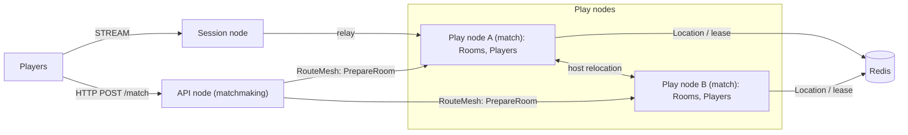

# MyGame FPS API node

This C++20 FPS template pairs players through `POST /match`. The API node matches requests by mode, assigns one Room ID made from the configured prefix and a generated UUID, prepares the Room roster, then returns the same Room ID and Session endpoint to both players. Clients join over STREAM with `JoinRoomRequest`. `RoomRoster` owns the admission list; `RoomState` owns movement budgets, hit decisions, HP, shared input sequences and match completion. Reconnected players resume the same Actor and Room, and draining a play node (match) relocates active matches without reconnecting clients.



## Server and e2e

Run the server from the project directory. The local build requires CMake, Ninja, a C++20 compiler and Docker Compose for Redis.

| Shell | Start the server | Run e2e in a second terminal |
| --- | --- | --- |
| Bash | `./run-server.sh` | `./run-e2e.sh` |
| Windows (PowerShell 7) | `.\run-server.cmd` | `.\run-e2e.cmd` |

Use the WebSocket address printed after `Server ready` for game clients. Press Ctrl+C in the server terminal to stop the nodes and Redis. E2e attaches automatically when the server has published `.logs/server.json`. With no running server, e2e starts an isolated Docker deployment. Attached runs skip `lobby` (API node restart) and `update` (Play node replacement).

Each run saves node stdout (`*.out.log`), stderr (`*.err.log`), Framework message-flow (`*.flow.log`) and failure details (`failure.log`, on failure) under `.logs/run-<id>/`. Build and Docker Compose logs are also under `.logs/`. See [한국어](README.ko.md).

## Prerequisites

Docker Compose v2 and a running Linux-container daemon are required for the default run. Use Bash on Linux or PowerShell 7 on Windows. The Docker build installs the C++ toolchain and CMake; the host does not need them for Docker execution.

Public Framework 0.34.1 is pinned in `bootstrap.cmake`, the only file that names the version. `cmake -P bootstrap.cmake` downloads this platform's prebuilt from the `framework-cpp/v0.34.1` GitHub Release, checks its published SHA-256 checksum and extracts it into `.zlink/install`. The prebuilt carries Core, the C++ binding, Framework libraries, Boost headers and nlohmann_json, so no package manager runs. Docker and local builds use this script. Follow the public package licensing requirements.

## Client connection

### Endpoint and first packet

Connect to the Session `players` STREAM listener. `server/config/session.json` pins `StreamEndpoint` to `ws://127.0.0.1:0`: loopback with an OS-assigned port. Read the Session stdout line `READY {"id":"...","meshEndpoint":"...","streamEndpoint":"..."}` and use its actual `streamEndpoint`, not port `0`. `server/shared/hosting.hpp` emits this value and `e2e/world.hpp` consumes it. Mesh and Redis addresses are internal endpoints.

The listener is reachable from its host/network namespace. Keep a deployment running separately from e2e, which owns and removes its nodes; configure a reachable `StreamEndpoint` interface and port and expose it from containers for external clients. The WebSocket listener supports native and browser clients.

`server/config/lobby.json` configures `HttpEndpoint` as `http://127.0.0.1:0`; use the API node `READY` JSON `httpEndpoint` plus `/match`. Configure `SessionEndpoint` with the actual bound Session endpoint before starting the API node, as `e2e/world.hpp` does.

First POST JSON `{"playerId":"player-a","mode":"duel"}` to the API node's HTTP endpoint plus `/match`. Submit a second distinct player in the same mode concurrently: the first HTTP request remains pending until paired. The HTTP response has `roomId` and `sessionEndpoint`. Connect to that returned Session endpoint and send `JoinRoomRequest` (`playerId`, returned `roomId`) first. Successful admission pushes `RoomView`; the HTTP assignment is a prerequisite, and `ActionRejected` reports rejected actions. These operations use `send(...).submit()` and server pushes, not a correlated connector `request` reply. This template does not authenticate player identity; validate it before binding in a production game.

### Connector installation

Use the same connector release as this template pins in `bootstrap.cmake`, key `ZLINK_FRAMEWORK_CPP_VERSION`. Replace `<version>` below with that pinned value; linked guides may describe other releases. Use this template's packet names with the endpoint described above. Engine installation instructions are in the linked repository READMEs.

| Client                             | Connector installation                                                                                                                                                                                                                                                                                                                                                                                                                                                          | Documentation guide                                                                                                                                                          |
| ---------------------------------- | ------------------------------------------------------------------------------------------------------------------------------------------------------------------------------------------------------------------------------------------------------------------------------------------------------------------------------------------------------------------------------------------------------------------------------------------------------------------------------- | ---------------------------------------------------------------------------------------------------------------------------------------------------------------------------- |
| Unity                              | Native/Editor: restore `Zlink.Stream.Connector` with NuGetForUnity. WebGL: add the `com.zlink.stream-connector.webgl` UPM Git package; include only the connector assembly for the active target. See the [Unity README](https://github.com/zlink-systems/zlink/blob/main/framework/languages/engines/Unity/README.md) and its package manifest.                                                                                                                                | [.NET engine integration](https://docs.zlink.systems/dotnet/guide/stream-connector/12-engine-integration/)                                                                   |
| Unreal                             | Copy `framework/languages/cpp/connector/engines/unreal` into `Plugins/ZLinkStreamConnector`, then package the native connector under `ThirdParty/ZLink` as described in the [Unreal README](https://github.com/zlink-systems/zlink/blob/main/framework/languages/engines/Unreal/README.md).                                                                                                                                                                                     | [C++ engine integration](https://docs.zlink.systems/cpp/guide/stream-connector/12-engine-integration/)                                                                       |
| Godot                              | .NET: add the NuGet package `Zlink.Stream.Connector` and run `dotnet restore`; see the [C# README](https://github.com/zlink-systems/zlink/blob/main/framework/languages/engines/Godot/csharp/README.md). GDExtension: build the C++ Godot adapter against the framework prebuilt and matching `godot-cpp`; see the [C++ README](https://github.com/zlink-systems/zlink/blob/main/framework/languages/engines/Godot/cpp/README.md). The .NET sample does not support Web export. | [.NET](https://docs.zlink.systems/dotnet/guide/stream-connector/12-engine-integration/), [C++](https://docs.zlink.systems/cpp/guide/stream-connector/12-engine-integration/) |
| Cocos Creator                      | Web target: `npm install @zlink-systems/stream-connector@<version>`; see the [Cocos Creator README](https://github.com/zlink-systems/zlink/blob/main/framework/languages/engines/CocosCreator/README.md). This package does not provide a Creator native adapter.                                                                                                                                                                                                                  | [TypeScript engine integration](https://docs.zlink.systems/node/guide/stream-connector/12-engine-integration/)                                                               |
| Axmol                              | Copy `framework/languages/cpp/connector/engines/axmol` into `third_party/zlink_axmol_connector` and link `zlink::stream_connector` from the installed C++ framework package; see the [Axmol README](https://github.com/zlink-systems/zlink/blob/main/framework/languages/engines/Axmol/README.md).                                                                                                                                                                              | [C++ engine integration](https://docs.zlink.systems/cpp/guide/stream-connector/12-engine-integration/)                                                                       |
| Web browser (TypeScript connector) | `npm install @zlink-systems/stream-connector@<version>`; import the package root in the browser build. Use `ws://` or `wss://`, subject to the page's security policy.                                                                                                                                                                                                                                                                                                             | [TypeScript connector](https://docs.zlink.systems/node/guide/stream-connector/)                                                                                              |
| C++                                | Install the C++ framework prebuilt containing the connector; use `find_package(zlink_stream_connector_cpp CONFIG REQUIRED)` and link `zlink::stream_connector`.                                                                                                                                                                                                                                                                                                                 | [C++ connector](https://docs.zlink.systems/cpp/guide/stream-connector/)                                                                                                      |
| C#/.NET                            | `dotnet add package Zlink.Stream.Connector --version <version>`                                                                                                                                                                                                                                                                                                                                                                                                                    | [.NET connector](https://docs.zlink.systems/dotnet/guide/stream-connector/)                                                                                                  |
| Java                               | Add Maven/Gradle dependency `systems.zlink:zlink-stream-connector:<version>`.                                                                                                                                                                                                                                                                                                                                                                                                      | [Java connector](https://docs.zlink.systems/java/guide/stream-connector/)                                                                                                    |
| Kotlin                             | Add `systems.zlink:zlink-stream-connector:<version>` and `systems.zlink:zlink-framework-kotlin:<version>` for the coroutine wrapper.                                                                                                                                                                                                                                                                                                                                                  | [Kotlin connector](https://docs.zlink.systems/kotlin/guide/stream-connector/)                                                                                                |
| Node                               | `npm install @zlink-systems/stream-connector@<version>`; use the package root and Node.js 22 or later.                                                                                                                                                                                                                                                                                                                                                     | [Node connector](https://docs.zlink.systems/node/guide/stream-connector/)                                                                                                    |

### One client connection

Save the following as `connect-once.cpp` in a copy of this template. Build it as a C++20 executable with this directory on the include path and link `zlink::stream_connector` from the installed package (the existing e2e target shows the package setup). Run it with the actual Session endpoint and a fresh player ID, then the room ID returned by /match. Complete the two-player HTTP matching step above first; use the returned `sessionEndpoint` and `roomId`. The receive wait is registered before sending and uses the connector's configured wait deadline. See `e2e/client.hpp` and `e2e/scenarios.hpp` for the complete flow.

```cpp
#include <zlink/stream_connector.hpp>
#include "server/shared/http_lobby_contracts.hpp"
#include <future>
#include <iostream>
#include <memory>
#include <stdexcept>
namespace sc = zlink::stream_connector;

void checked (sc::result_t<void> result)
{
    if (!result) throw std::runtime_error (result.error ()->message);
}

int main (int argc, char **argv)
{
    if (argc != 4) return 2;
    sc::connector_options_t options;
    options.endpoint = argv[1];
    options.reconnect.enabled = false;
    options.dispatch_mode = sc::dispatch_mode_t::immediate;
    auto connector = sc::connector_factory_t::create (options);
    auto errors = connector.on_error ([] (const auto &error) {
        std::cerr << error.message << '\n';
    });
    checked (connector.connect ());
    try {
        using Reply = MyGame::RoomView;
        auto completion = std::make_shared<std::promise<sc::result_t<sc::message_t<Reply>>>> ();
        auto received = completion->get_future ();
        connector.wait_for<Reply> ().submit ([completion] (auto result) {
            completion->set_value (std::move (result));
        });
        connector.send (MyGame::JoinRoomRequest{argv[2], argv[3]}).submit ();
        const auto result = received.get ();
        if (!result) throw std::runtime_error (result.error ()->message);
        std::cout << "Received RoomView\n";
    } catch (...) {
        checked (connector.close ());
        throw;
    }
    checked (connector.close ());
}
```

## Build and run

Run from this directory:

```sh
./run-e2e.sh --build-only
./run-e2e.sh
./run-e2e.sh --scenario lobby,hit,wall,input,reconnect,update
./run-e2e.sh --check-structure
```

PowerShell 7 provides the same commands:

```powershell
.\run-e2e.cmd -BuildOnly
.\run-e2e.cmd
.\run-e2e.cmd -Scenario lobby,hit,wall,input,reconnect,update
.\run-e2e.cmd -CheckStructure
```

The scripts build node and runner images, check `zlink.structure.json`, then start Redis and nodes in a unique Compose project. Nodes share the runner's network namespace, preserving loopback listeners and OS-assigned ports. The runner copies configuration before attaching stdin and stdout; `drain`, `shutdown` and lifecycle output retain their existing protocol.

The runner removes its node containers. The script removes containers carrying this run's label, its Compose resources and image tags. Cleanup failures return exit code 1. Build and orchestration logs remain in `.logs/docker-<project>/`; node logs and generated settings remain in `.logs/run-<id>/`. Unix runners use the caller UID and Docker socket group so those files remain caller-owned.

| Scenario | Observations |
| --- | --- |
| `lobby` | An omitted mode defaults to duel; modes pair separately; matched clients receive the same Room ID and Session endpoint; an outsider is rejected from an empty prepared Room; client `PrepareRoom` is rejected before entry and during a match; a lobby restart preserves the existing match and Session and issues a new Room ID. |
| `hit` | A clear shot deals 25 damage; upward and out-of-range shots miss; four hits finish the match and report the winner; later actions are rejected without changing state. |
| `wall` | A wall between shooter and target blocks damage, while a wall behind the target permits a hit. |
| `input` | Shared sequence, movement limits, map and wall bounds, movement budget, fire interval, unchanged rejected state and server-issued retry durations. |
| `reconnect` | A new connection retains Actor identity, Room, position, HP and sequence; reconnecting after completion retains the winner. |
| `update` | The Room relocates while Sessions remain bound; the outsider remains rejected after relocation; the replacement host accepts a new Room and the original match continues. |

The runner executes 46 game-domain checks and 19 HTTP-lobby checks before scenarios. After a local CMake build, run the same checks with `ctest --test-dir build --output-on-failure`. `my-game-domain-test` runs the game checks; `my-game-http-domain-test` runs both sets.

## FPS rules and extension points

`POST /match` accepts `MatchRequest(PlayerId, Mode)`; an omitted mode defaults to `duel`. The first request waits for another player in the same mode. At pairing, `Matchmaker` generates `RoomPrefix + UUID` with 32 lowercase hexadecimal UUID characters and no counter. The API node creates the Room and sends `PrepareRoom(MatchId, Members)` over the RouteMesh. It returns `MatchResponse(RoomId, SessionEndpoint)` only after the Room replies with `RoomPrepared(MatchId)`. Repeating the same preparation is idempotent; a different member list is rejected. A waiting request is process-local and is not transferred during lobby restart.

The first STREAM packet is `JoinRoomRequest(PlayerId, RoomId)`. Session relays only JoinRoomRequest, RoomViewRequest, MoveRequest, ShootRequest and SessionInfoRequest. Client `PrepareRoom`, `RoomPrepared`, `HttpNodeReady`, internal assignment and result packets receive `packet-not-allowed`. RoomRoster admits only its prepared members; an outsider receives `admission-rejected`. It is included with game state in the relocation snapshot `{Game, Roster}`. Production deployments should authenticate player identity before binding.

Coordinates use `Vec3(X, Y, Z)` with Y up. `ArenaMap` defines bounds X/Z=0..100 and Y=0..10, walls `(49, 0, 20)`–`(51, 10, 60)` and `(80, 0, 0)`–`(82, 10, 20)`, and ordered spawn points `(48, 0, 18)` and `(52, 0, 18)`. A player box is 1 wide, 2 high and 1 deep from its feet, with eye height 1.6. Feet remain at Y=0. Vertical movement is rejected as `vertical-move`; jumping and gravity are not implemented. Movement checks the feet-position segment against closed wall boxes, including contact at its endpoint. It does not implement swept player-volume collision.

`MoveRequest(Delta, Sequence)` has a maximum step of 2 and a speed budget of 10 units per second, capped at 2 since the last accepted movement. The first move has the full budget. Invalid inputs are rejected as `non-finite`, `vertical-move`, `step-too-large`, `outside-map`, `move-blocked-by-wall`, `move-budget`, or `stale-sequence`. `ShootRequest(AimDirection, Sequence)` normalizes finite nonzero aim, casts from the authoritative eye position up to 80 units, and chooses the nearest wall or living player AABB. Closed contact counts as an intersection and a wall wins equal-distance ties. A hit causes 25 damage; accepted misses and wall-blocked shots consume sequence and the 250 ms fire interval. Invalid aim is `invalid-aim`; an early shot is `fire-too-soon`. There is no ammunition model. The Framework message model carries only finite JSON numbers, so nonfinite input reaches only the domain checks.

Move and Shoot share one increasing sequence. Rejections leave position, HP, sequence and timing unchanged. `RetryAfterMs` is positive only for movement-budget and fire-interval rejection; clients wait only for that server-reported duration and resend the same input. At zero HP the match finishes, records its winner and rejects later Move/Shoot inputs as `match-finished`. RoomState owns all game decisions. Its snapshot stores only remaining cooldown and movement-budget milliseconds, never an absolute process clock reading. Production time uses the server's monotonic clock; tests inject a clock through the domain constructor.

There is no lag compensation, projectile simulation or client prediction. Extend `RoomState` for weapon and match rules, `ArenaMap` for geometry and spawn selection, and the typed shared contracts for client actions. `RoomRoster` owns preparation and admission; `Matchmaker` owns mode pairing and Room ID issuance.

## Local debugging and deployment

For host process debugging, install a C++20 compiler (GCC 13 or later, or Visual Studio 2022 17.4 or later), CMake 3.24+ and Ninja. Windows requires a Visual Studio developer shell. Run:

```sh
./run-e2e.sh --local
```

On Windows:

```powershell
.\run-e2e.cmd -Local
```

The script runs `cmake -P bootstrap.cmake`, `cmake --preset default` and `cmake --build --preset default` before starting `build/bin/my-game-e2e`. Redis remains in an isolated Compose project. Use `--no-build` or `-NoBuild` to reuse a local debugger build. Local build-only uses `--local --build-only` or `-Local -BuildOnly`.

Start Redis, play node A (match), play node B (match), Session, then the API node. Each role has its own executable and JSON file in `server/config/`. Listeners bind port 0 and publish their endpoints in `READY`; the runner supplies the Session endpoint to the API node. For a play node (match) update, send `drain`, wait for `RELOCATION_REQUESTED`, `RELOCATED` and `SAFE_TO_SHUTDOWN`, then send `shutdown` and require exit code zero before starting its replacement. The API node keeps pending HTTP requests in process memory, so lobby restart preserves already prepared Rooms but drops requests that have not paired.

## Framework behavior to know

The pinned C++ Framework release can publish a `tcp://` address for a STREAM listener configured with WebSocket. The runner reports a startup failure when this occurs. [#5460](https://github.com/zlink-systems/zlink/issues/5460)

- **Waiting for DB or file I/O in a handler** — An ordinary async terminal holds the turn, while `Yield` lets other handlers on the same Spot proceed. [Guide](https://docs.zlink.systems/cpp/guide/server/32-execution-model/#io-worker-wait).
- **Creation that misses its deadline** — `DeadlineExceeded` and caller cancellation have distinct outcomes. [Guide](https://docs.zlink.systems/cpp/guide/server/22-actor/#creation-deadline). [server/session/session.hpp:36](server/session/session.hpp).
- **Many logins at once** — Each creation for a different ID requires a Location Store round trip, so measure expected load when setting the deadline. [Guide](https://docs.zlink.systems/cpp/guide/server/25-location/#creation-load).
- **Sending under load** — A send waits for capacity and the application observes only its final result. [Guide](https://docs.zlink.systems/cpp/guide/server/33-backpressure/#send-backpressure). [server/match/player.hpp:19](server/match/player.hpp).
- **Duplicate login** — Without a callback, binding a different Session is accepted; reject it in the Actor duplicate-bind callback to prevent it. [Guide](https://docs.zlink.systems/cpp/guide/server/39-session-binding/#duplicate-session-bind). This template keeps the default (accepts the new Session).
- **ObjectGeneration** — `ObjectGeneration` identifies a logical incarnation of the same ID; it is neither a data version nor write authority. [Guide](https://docs.zlink.systems/cpp/guide/server/34-activation-lifetime/#object-generation). [server/session/session.hpp:56](server/session/session.hpp).
- **READY and Serving** — Framework nodes print `READY` after observing runtime `Serving`. [Guide](https://docs.zlink.systems/cpp/guide/server/12-operations/#wait-for-serving). [server/shared/hosting.hpp:45](server/shared/hosting.hpp); [server/shared/hosting.hpp:84](server/shared/hosting.hpp).

## Known issues

Drain confirmation takes about 30 seconds, so a turn clock may expire during the wait. For an update scenario in a game with turn clocks, finish the round before relocating it. Verify that relocation preserves the remaining time in a domain check with a controlled clock.
