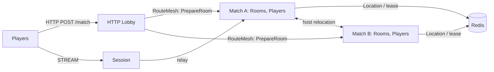

# MyGame FPS HTTP lobby

This C++20 FPS template pairs players through `POST /match`. The lobby matches requests by mode, assigns one Room ID made from the configured prefix and a generated UUID, prepares the Room roster, then returns the same Room ID and Session endpoint to both players. Clients join over STREAM with `JoinRoomRequest`. `RoomRoster` owns the admission list; `RoomState` owns movement budgets, hit decisions, HP, shared input sequences and match completion. Reconnected players resume the same Actor and Room, and draining a Match host relocates active matches without reconnecting clients.



## Prerequisites

Docker Compose v2 and a running Linux-container daemon are required for the default run. Use Bash on Linux or PowerShell 7 on Windows. The Docker build installs the C++ toolchain and CMake; the host does not need them for Docker execution.

Public Framework 0.30.2 is pinned in `bootstrap.cmake`, the only file that names the version. `cmake -P bootstrap.cmake` downloads this platform's prebuilt from the `framework-cpp/v0.30.2` GitHub Release, checks its published SHA-256 checksum and extracts it into `.zlink/install`. The prebuilt carries Core, the C++ binding, Framework libraries, Boost headers and nlohmann_json, so no package manager runs. Docker and local builds use this script. Follow the public package licensing requirements.

## Build and run

Run from this directory:

```sh
./run-e2e.sh --build-only
./run-e2e.sh
./run-e2e.sh --scenario lobby,hit,wall,input,reconnect,update
./run-e2e.sh --check-structure
```

PowerShell 7 provides the same commands:

```powershell
pwsh -NoProfile -File ./run-e2e.ps1 -BuildOnly
pwsh -NoProfile -File ./run-e2e.ps1
pwsh -NoProfile -File ./run-e2e.ps1 -Scenario lobby,hit,wall,input,reconnect,update
pwsh -NoProfile -File ./run-e2e.ps1 -CheckStructure
```

The scripts build node and runner images, check `zlink.structure.json`, then start Redis and nodes in a unique Compose project. Nodes share the runner's network namespace, preserving loopback listeners and OS-assigned ports. The runner copies configuration before attaching stdin and stdout; `drain`, `shutdown` and lifecycle output retain their existing protocol.

The runner removes its node containers. The script removes containers carrying this run's label, its Compose resources and image tags. Cleanup failures return exit code 1. Build and orchestration logs remain in `.logs/docker-<project>/`; node logs and generated settings remain in `.logs/run-<id>/`. Unix runners use the caller UID and Docker socket group so those files remain caller-owned.

| Scenario | Observations |
| --- | --- |
| `lobby` | An omitted mode defaults to duel; modes pair separately; matched clients receive the same Room ID and Session endpoint; an outsider is rejected from an empty prepared Room; client `PrepareRoom` is rejected before entry and during a match; a lobby restart preserves the existing match and Session and issues a new Room ID. |
| `hit` | A clear shot deals 25 damage; upward and out-of-range shots miss; four hits finish the match and report the winner; later actions are rejected without changing state. |
| `wall` | A wall between shooter and target blocks damage, while a wall behind the target permits a hit. |
| `input` | Shared sequence, movement limits, map and wall bounds, movement budget, fire interval, unchanged rejected state and server-issued retry durations. |
| `reconnect` | A new connection retains Actor identity, Room, position, HP and sequence; reconnecting after completion retains the winner. |
| `update` | The Room relocates while Sessions remain bound; the outsider remains rejected after relocation; the replacement host accepts a new Room and the original match continues. |

The runner executes 45 game-domain checks and 19 HTTP-lobby checks before scenarios. After a local CMake build, run the same checks with `ctest --test-dir build --output-on-failure`. `my-game-domain-test` runs the game checks; `my-game-http-domain-test` runs both sets.

## FPS rules and extension points

`POST /match` accepts `MatchRequest(PlayerId, Mode)`; an omitted mode defaults to `duel`. The first request waits for another player in the same mode. At pairing, `Matchmaker` generates `RoomPrefix + UUID` with 32 lowercase hexadecimal UUID characters and no counter. The lobby creates the Room and sends `PrepareRoom(MatchId, Members)` over the RouteMesh. It returns `MatchResponse(RoomId, SessionEndpoint)` only after the Room replies with `RoomPrepared(MatchId)`. Repeating the same preparation is idempotent; a different member list is rejected. A waiting request is process-local and is not transferred during lobby restart.

The first STREAM packet is `JoinRoomRequest(PlayerId, RoomId)`. Session relays only JoinRoomRequest, RoomViewRequest, MoveRequest, ShootRequest and SessionInfoRequest. Client `PrepareRoom`, `RoomPrepared`, `HttpNodeReady`, internal assignment and result packets receive `packet-not-allowed`. RoomRoster admits only its prepared members; an outsider receives `admission-rejected`. It is included with game state in the relocation snapshot `{Game, Roster}`. Production deployments should authenticate player identity before binding.

Coordinates use `Vec3(X, Y, Z)` with Y up. `ArenaMap` defines bounds X/Z=0..100 and Y=0..10, walls `(49, 0, 20)`–`(51, 10, 60)` and `(80, 0, 0)`–`(82, 10, 20)`, and ordered spawn points `(48, 0, 18)` and `(52, 0, 18)`. A player box is 1 wide, 2 high and 1 deep from its feet, with eye height 1.6. Feet remain at Y=0. Vertical movement is rejected as `vertical-move`; jumping and gravity are not implemented. Movement checks the feet-position segment against closed wall boxes, including contact at its endpoint. It does not implement swept player-volume collision.

`MoveRequest(Delta, Sequence)` has a maximum step of 2 and a speed budget of 10 units per second, capped at 2 since the last accepted movement. The first move has the full budget. Invalid inputs are rejected as `non-finite`, `vertical-move`, `step-too-large`, `outside-map`, `move-blocked-by-wall`, `move-budget`, or `stale-sequence`. `ShootRequest(AimDirection, Sequence)` normalizes finite nonzero aim, casts from the authoritative eye position up to 80 units, and chooses the nearest wall or living player AABB. Closed contact counts as an intersection and a wall wins equal-distance ties. A hit causes 25 damage; accepted misses and wall-blocked shots consume sequence and the 250 ms fire interval. Invalid aim is `invalid-aim`; an early shot is `fire-too-soon`. There is no ammunition model. The Framework message model carries only finite JSON numbers, so nonfinite input reaches only the domain checks.

Move and Shoot share one increasing sequence. Rejections leave position, HP, sequence and timing unchanged. `RetryAfterMs` is positive only for movement-budget and fire-interval rejection; clients wait only for that server-reported duration and resend the same input. At zero HP the match finishes, records its winner and rejects later Move/Shoot inputs as `match-finished`. RoomState owns all game decisions. Its snapshot stores only remaining cooldown and movement-budget milliseconds, never an absolute process clock reading. Production time uses the server's monotonic clock; tests inject a clock through the domain constructor.

There is no lag compensation, projectile simulation or client prediction. Extend `RoomState` for weapon and match rules, `ArenaMap` for geometry and spawn selection, and the typed shared contracts for client actions. `RoomRoster` owns preparation and admission; `Matchmaker` owns mode pairing and Room ID issuance.

## Local debugging and deployment

For host process debugging, install a C++20 compiler (GCC 13 or later, or Visual Studio 2022 17.4 or later), CMake 3.24+ and Ninja. Windows requires a Visual Studio developer shell. Run:

```sh
./run-e2e.sh --local
```

On Windows:

```powershell
pwsh -NoProfile -File ./run-e2e.ps1 -Local
```

The script runs `cmake -P bootstrap.cmake`, `cmake --preset default` and `cmake --build --preset default` before starting `build/bin/my-game-e2e`. Redis remains in an isolated Compose project. Use `--no-build` or `-NoBuild` to reuse a local debugger build. Local build-only uses `--local --build-only` or `-Local -BuildOnly`.

Start Redis, Match A, Match B, Session, then the Lobby. Each role has its own executable and JSON file in `server/config/`. Listeners bind port 0 and publish their endpoints in `READY`; the runner supplies the Session endpoint to the Lobby. For a Match host update, send `drain`, wait for `RELOCATION_REQUESTED`, `RELOCATED` and `SAFE_TO_SHUTDOWN`, then send `shutdown` and require exit code zero before starting its replacement. The Lobby keeps pending HTTP requests in process memory, so lobby restart preserves already prepared Rooms but drops requests that have not paired.

## 한국어 실행 안내

기본 실행에는 Docker Compose v2와 Linux 컨테이너 데몬이 필요하다. 템플릿 디렉터리에서 Linux는 `./run-e2e.sh`, Windows는 `pwsh -NoProfile -File ./run-e2e.ps1`을 실행한다. `--build-only`는 이미지 빌드만 하고, 기본 실행은 structure 검사·Redis·node·runner를 실행한 뒤 자신이 만든 리소스를 정리한다. Framework 0.30.2는 `bootstrap.cmake` 한 곳에서 고정하며 공개 prebuilt의 SHA-256 체크섬을 확인한다.

시나리오는 lobby, hit, wall, input, reconnect, update 순서다. Lobby 검사는 기본 duel, mode 분리, 같은 Room·Session endpoint, 빈 방 outsider 거부, client `PrepareRoom`의 입장 전·대전 중 거부, Lobby 재시작 뒤 기존 경기 유지와 새 Room ID 발급을 확인한다. 게임 도메인 45개와 HTTP lobby 도메인 19개 검사는 시나리오 전에 실행한다. 로컬 빌드 후에는 `ctest --test-dir build --output-on-failure`로 두 domain target을 실행한다.

`Matchmaker`가 mode별 매칭과 `RoomPrefix + UUID` Room ID 발급을 소유한다. Room 준비를 확인한 뒤에만 HTTP 응답을 반환한다. `RoomRoster`는 준비된 명단과 admission을 소유하고 `{Game, Roster}` snapshot으로 relocation된다. `RoomState`는 이동 예산·발사 간격·명중 판정·HP·공유 순번·승자와 남은 시간 기반 snapshot을 소유한다. 발은 Y=0이며 수직 이동은 `vertical-move`로 거부한다. RetryAfterMs는 서버가 보낸 시간만 기다린다.

로컬 디버깅은 C++20 compiler, CMake, Ninja를 설치한 뒤 `./run-e2e.sh --local` 또는 PowerShell의 `-Local`로 실행한다. node 설정과 로그는 `.logs/run-<id>/`, Docker 빌드·정리 로그는 `.logs/docker-<project>/`에 남는다. Session typed reply 경계의 0.30.2 public API 불일치는 Known issues에 기록했다.
