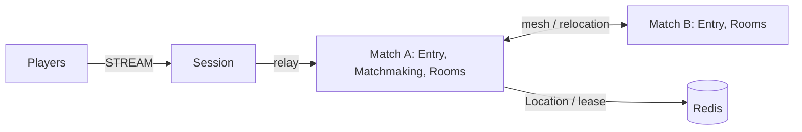

# my-game — Match entry lobby

A C++ starting point for action and FPS games. Session hosts accept STREAM connections, bind Player Actors and relay typed JSON messages. Entry Spots forward players into the fixed `matchmaking` User Spot. Matchmaking owns FIFO queues by mode; dynamic Room User Spots own movement, HP, action sequences and server-side hit decisions.



This source serves both `action-entry-lobby` and `fps-entry-lobby`. The structure ID is `action-entry-lobby`.

## Prerequisites

- CMake 3.24+, Ninja and a C++20 compiler (MSVC 2022 on Windows; GCC on Linux).
- PowerShell 7 on Windows, or Bash on Linux; Docker with Compose v2.
- vcpkg, with `VCPKG_ROOT` pointing to its checkout.
- The zlink overlay ports from the `framework-cpp/v0.30.1` tag of `https://github.com/zlink-systems/zlink`. Set `VCPKG_OVERLAY_PORTS` to that checkout's `vcpkg/ports` directory. The template does not reference repository source or a local package feed.

The vcpkg manifest pins Framework 0.30.1 and its zlink/zlink-cpp 1.19.0 dependencies. Version 0.30.1 must be available before building this manifest. Use a developer shell on Windows so Ninja can find MSVC. Each node configuration uses port zero; the runner reads actual endpoints from Framework listener status and Docker Compose.

## Build

Run from this project directory, after setting `VCPKG_ROOT` and `VCPKG_OVERLAY_PORTS`:

```sh
cmake --preset default
cmake --build --preset default
```

The same commands apply in PowerShell. Optional domain checks:

```sh
ctest --test-dir build --output-on-failure
```

## Local e2e

Bash:

```sh
./run-e2e.sh
./run-e2e.sh --scenario hit,reconnect,update
```

PowerShell:

```powershell
pwsh -NoProfile -File ./run-e2e.ps1
pwsh -NoProfile -File ./run-e2e.ps1 -Scenario hit,reconnect,update
```

The runner checks `zlink.structure.json`, starts a uniquely named Redis Compose project on an ephemeral loopback port, starts Match A before Match B and Session, and saves configuration, stdout, stderr message-flow records and typed client observations in `.logs/run-<id>/`. It cleans up only its own processes and Compose project. Cleanup failures cause a failing exit code.

| Scenario | Assertions |
| --- | --- |
| `hit` | Two players share a Room. An unobstructed shot removes 25 HP; wall, range and missing-target rejections leave state unchanged. Four hits produce the winner for both players. |
| `reconnect` | A new connection rebinds the same Actor generation and Room, preserving HP and position; another shot succeeds. |
| `update` | Drain the current Room host through `RELOCATION_REQUESTED`, `RELOCATED`, `SAFE_TO_SHUTDOWN`; preserve both Sessions and Room state; stop and replace the host; the replacement accepts a new Room. |

The wire contracts are in `server/shared/contracts.hpp`. `SessionInfo` is a push in C++ (see #1785 below). `RoomViewRequest` asks the authoritative Room for its current view. Requests and pushes use the Framework default typed JSON serializer. The runner never retries a failed scenario.

## Known issues

- #1785: C++ Session cannot return an application-created typed reply through the public API. `SessionInfoRequest` receives a typed `SessionInfo` push instead.
- #1771 (handoff candidate; identical cause unconfirmed): Public 0.30.0 validation is blocked during matching: Windows recorded a deferred `JoinSpot` activation failure; Linux reached Room location commits but did not deliver `MatchFound`. The first missing response fails the run. These observations require validation with the 0.30.1 candidate; they are not treated as successful scenarios.
- #1740: Public 0.30.0 shutdown can fail with remaining participants and lacks the required public `SafeToShutdown` observation. The host reports an explicit error when that observation is unavailable; it never infers safety from another status.

## Deployment sequence

1. Start Redis and give all node configurations the same deployment-specific `RedisEndpoint` and `KeyPrefix`.
2. Start the Matchmaking bootstrap owner (`my-game-match server/config/match-a.json`), then other Match hosts (`my-game-match server/config/match-b.json`), then Session (`my-game-session server/config/session.json`). Every role has its own executable; configuration does not select the role.
3. Keep Room capacity available on surviving hosts. Write `drain` to the selected Match host's stdin. Wait for all three relocation markers, then write `shutdown` and require `STOPPED` and exit code zero.
4. Start its replacement with the same node settings and `BootstrapMatchmaking` disabled. Require `READY` before accepting new work. Framework owns Actor placement, membership, binding and relocation; application adapters preserve only queue and combat state.

Room coordinates have no arena bounds. Shots have range 80 and deal 25 damage against 100 initial HP. The closed vertical wall at x=50, y=0–100 blocks intersecting shots, including endpoints. A player's strictly increasing sequence is shared by movement and shooting; rejected attempts with a new sequence consume that sequence. A disconnected player's Room state remains until application lifecycle policy removes it.

## 한국어 실행 안내

CMake·Ninja·C++20 compiler와 Docker Compose를 준비하고 `VCPKG_ROOT`, `VCPKG_OVERLAY_PORTS`를 설정합니다. overlay는 `framework-cpp/v0.30.1` 태그의 `vcpkg/ports`를 사용합니다. 이 디렉터리에서 위 Build 명령과 운영체제에 맞는 Local e2e 명령을 실행합니다.

실행 로그는 `.logs/run-<id>/`에 남습니다. `hit`는 명중과 거부 판정, `reconnect`는 Actor와 Room 상태 유지, `update`는 host relocation과 대체 process의 새 Room 수락을 검사합니다. 공개 0.30.0 검증에서 발견한 차단 사항과 C++ SessionInfo push 제한은 Known issues에 기록되어 있으며, 전체 e2e 통과를 의미하지 않습니다.
