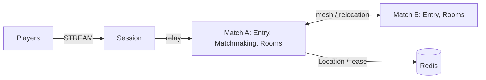

# my-game — Match entry lobby

A C++ starting point for action and FPS games. Session hosts accept STREAM connections, bind Player Actors and relay typed JSON messages. Entry Spots forward players into the fixed `matchmaking` User Spot. Matchmaking owns FIFO queues by mode; dynamic Room User Spots own movement, HP, action sequences and server-side hit decisions.



This source serves both `action-entry-lobby` and `fps-entry-lobby`. The structure ID is `action-entry-lobby`.

## Prerequisites

Docker with Compose v2 and a running Linux-container daemon is required. Use Bash on Linux or PowerShell 7 on Windows. The Docker build installs the C++ toolchain and CMake; the host does not need them for the default run.

Public Framework 0.30.2 is pinned in `bootstrap.cmake`, the only file that names the version. `cmake -P bootstrap.cmake` downloads this platform's prebuilt from the `framework-cpp/v0.30.2` GitHub Release, checks it against the SHA-256 checksum published with it and extracts it into `.zlink/install`. The prebuilt carries Core, the C++ binding, the Framework libraries, Boost headers and nlohmann_json, so no package manager runs. The Docker build and local mode run the same script. Follow the public package licensing requirements.

## Build

Build the node and runner images from this directory:

```sh
./run-e2e.sh --build-only
```

The script removes its unique image tags after checking the build. Docker retains build layers for subsequent runs.

On Windows, use PowerShell 7:

```powershell
pwsh -NoProfile -File ./run-e2e.ps1 -BuildOnly
```

`Dockerfile` defines the Ubuntu 24.04 build and runtime base once in `UBUNTU_IMAGE`. All node roles share the multi-stage image. The runner adds Docker CLI 28.5.1 to the same runtime. These base arguments can be replaced when the deployment base image becomes available.

## Docker e2e

Bash:

```sh
./run-e2e.sh
./run-e2e.sh --scenario hit,wall,input,reconnect,update
./run-e2e.sh --check-structure
```

PowerShell:

```powershell
pwsh -NoProfile -File ./run-e2e.ps1
pwsh -NoProfile -File ./run-e2e.ps1 -Scenario hit,wall,input,reconnect,update
pwsh -NoProfile -File ./run-e2e.ps1 -CheckStructure
```

The runner and nodes execute in containers. The script checks structure before Redis startup, then uses a unique Compose network, project, container names and Redis key prefixes. Nodes share the runner's network namespace, preserving loopback listeners and OS-assigned ports. Configuration is copied into each node before attaching stdin and stdout; `drain`, `shutdown` and lifecycle output retain their existing protocol.

The runner removes its node containers. The script removes remaining containers carrying this run's label, its Compose resources and its image tags. Cleanup failures return exit code 1. Build and orchestration logs remain in `.logs/docker-<project>/`; node logs and generated configurations remain in `.logs/run-<id>/`. Unix runners use the caller UID and Docker socket group so those files remain caller-owned.

The scripts and runner check `zlink.structure.json`, start a uniquely named Redis Compose project on an ephemeral loopback port, start Match A before Match B and Session, and save configuration, stdout, stderr message-flow records and typed client observations in `.logs/run-<id>/`. They clean up only their own processes and Compose project. Cleanup failures cause a failing exit code.

| Scenario | Assertions |
| --- | --- |
| `hit` | Two players receive the defined spawn positions. An unobstructed shot removes 25 HP; internal-packet, wall, range and missing-target rejections preserve the Room view. Four hits produce the same winner for both players. |
| `wall` | The closed wall segment blocks movement and shots at its endpoints without changing the Room view. A clear shot succeeds when the wall lies behind the target. |
| `input` | Movement respects `MaxStep`, map bounds and the speed budget; shots respect `FireIntervalMs`; stale and out-of-range sequences are rejected. Rejections preserve Room state, and retries wait only for the server-provided `RetryAfterMs`. |
| `reconnect` | A new connection rebinds the same Actor generation and Room, preserving HP, position, phase, winner and sequence; active and finished Rooms remain observable after reconnect. |
| `update` | Drain the current Room host through `RELOCATION_REQUESTED`, `RELOCATED`, `SAFE_TO_SHUTDOWN`; preserve both Sessions and Room state; stop and replace the host; the replacement accepts a new Room. |

The wire contracts are in `server/shared/contracts.hpp`. This template answers `SessionInfoRequest` with a typed `SessionInfo` push; Framework 0.30.2 adds a typed Session reply API (#1785), and the template has not switched to it. `RoomViewRequest` asks the authoritative Room for its current view. Requests and pushes use the Framework default typed JSON serializer. The Framework message model carries only finite JSON numbers, so nonfinite input reaches only the domain checks. The runner never retries a failed scenario.

Each scenario uses isolated Redis key prefixes and node containers, with Room capacity set to one per match host. After relocation fills the surviving host, only the replacement has capacity for a new Room. Deployment capacity is configured independently.

Message Follow is configured explicitly to 30 seconds. After `RELOCATED`, the safe shutdown observation budget is the follow duration plus the existing relocation observation budget; the relocation operation deadline is unchanged.

## Local debugging

Local processes remain available for debugging. Install a C++20 compiler (GCC 13 or later, or Visual Studio 2022 17.4 or later), CMake 3.24+ and Ninja. Windows requires a Visual Studio 2022 developer shell. No ZLink checkout or package manager is needed.

Build and run local processes from this directory:

```sh
./run-e2e.sh --local
```

The script runs `cmake -P bootstrap.cmake`, `cmake --preset default` and `cmake --build --preset default` before executing `build/bin/my-game-e2e`. Redis still runs in an isolated Compose project.

On Windows, run:

```powershell
pwsh -NoProfile -File ./run-e2e.ps1 -Local
```

Use `--no-build` or `-NoBuild` with local mode to reuse a debugger build. Scenario selection works in both modes. Local build-only uses `--local --build-only` or `-Local -BuildOnly`.

## Known issues

Validated against the published Framework 0.30.2 packages.

- [#1786](https://github.com/zlink-systems/zlink/issues/1786) (open, planned for 0.31.0): the first push sent from `on_actor_joined` after a deferred join can be lost without an error; it was not observed in 0.30.2 validation.

## Deployment sequence

Wait for the bootstrap owner to report `READY` before starting another match host. Its public GetOrCreate completes while it is the only placement candidate, so the fixed Matchmaking Spot starts on its declared owner.

1. Start Redis and give all node configurations the same deployment-specific `RedisEndpoint` and `KeyPrefix`.
2. Start the Matchmaking bootstrap owner (`my-game-match server/config/match-a.json`), then other Match hosts (`my-game-match server/config/match-b.json`), then Session (`my-game-session server/config/session.json`). Every role has its own executable; configuration does not select the role.
3. Keep Room capacity available on surviving hosts. Write `drain` to the selected Match host's stdin. Wait for all three relocation markers, then write `shutdown` and require `STOPPED` and exit code zero.
4. Start its replacement with the same node settings and `BootstrapMatchmaking` disabled. Require `READY` before accepting new work. Framework owns Actor placement, membership, binding and relocation; application adapters preserve only queue and combat state.

The map spans x=[0,100] and y=[0,100]. Players spawn at (40,10) and (60,10). A move carries a delta with length at most 2; accepted movement is limited to 10 units per second, with a full 2-unit budget on the first move. The closed vertical wall at x=50, y=[20,60] blocks movement and intersecting shots, including endpoint contact. Shots have range 80, deal 25 damage against 100 initial HP, and require 250 ms between accepted shots. A player's sequence is shared by movement and shooting; rejected actions do not consume it. The maximum accepted sequence is 9007199254740991. Room snapshots store remaining movement and fire times in milliseconds, then restore them against the destination node's monotonic clock. A disconnected player's Room state remains until application lifecycle policy removes it.

## 한국어 실행 안내

Docker Compose v2와 Linux 컨테이너 데몬을 준비한다. 템플릿 디렉터리에서 Linux는 `./run-e2e.sh`, Windows는 `pwsh -NoProfile -File ./run-e2e.ps1`을 실행한다. 기본 실행은 이미지 빌드부터 runner·node 컨테이너 기동과 정리까지 수행한다. Framework 버전은 `bootstrap.cmake` 한 곳에서 정하며, 빌드는 그 버전의 GitHub Release prebuilt를 받아 함께 게시된 SHA-256 체크섬으로 확인한다.

로컬 디버깅은 C++20 컴파일러, CMake, Ninja를 설치한 뒤 `./run-e2e.sh --local` 또는 `pwsh -NoProfile -File ./run-e2e.ps1 -Local`로 실행한다. node 로그와 설정은 `.logs/run-<id>/`, Docker 빌드·정리 로그는 `.logs/docker-<project>/`에 남는다. 공개 패키지에서 확인된 차단 사항은 Known issues를 따른다.
