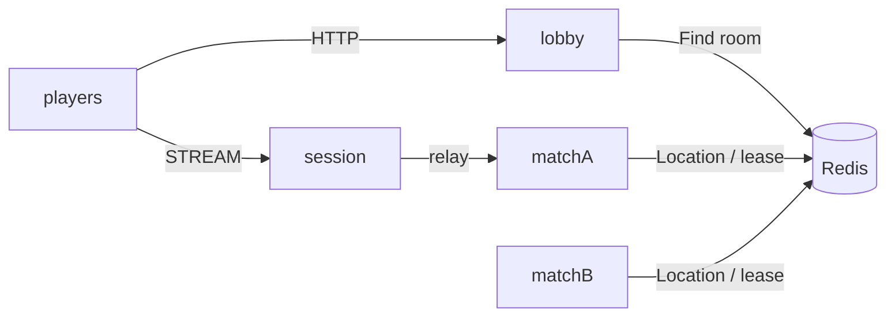

# my-game: HTTP lobby and arena matches

A two-player arena template. The HTTP lobby pairs players by mode, prepares a Room through the public object client, and returns its ID and the published Session endpoint. The RoomRoster approves the listed players before admission. The Session binds a Player Actor and relays only the client packet allowlist. RoomState owns positions, HP, accepted action sequence, phase, winner and monotonic cooldown state. Player carries no application state.



## Prerequisites

Docker with Compose v2 and a running Linux-container daemon is required. Use Bash on Linux or PowerShell 7 on Windows. The Docker build installs the C++ toolchain and CMake; the host does not need them for the default run.

Public Framework 0.30.2 is pinned in `bootstrap.cmake`, the only file that names the version. `cmake -P bootstrap.cmake` downloads this platform's prebuilt from the `framework-cpp/v0.30.2` GitHub Release, checks it against the SHA-256 checksum published with it and extracts it into `.zlink/install`. The prebuilt carries Core, the C++ binding, the Framework libraries, Boost headers and nlohmann_json, so no package manager runs. The Docker build and local mode run the same script. Follow the public package licensing requirements.

## Build

Build the node and runner images from this directory:

```sh
./run-e2e.sh --build-only
```

The script removes its unique image tags after checking the build. Docker retains build layers for subsequent runs.

On Windows, use PowerShell 7:

```powershell
pwsh -NoProfile -File ./run-e2e.ps1 -BuildOnly
```

`Dockerfile` defines the Ubuntu 24.04 build and runtime base once in `UBUNTU_IMAGE`. All node roles share the multi-stage image. The runner adds Docker CLI 28.5.1 to the same runtime. These base arguments can be replaced when the deployment base image becomes available.

## Docker e2e

```sh
./run-e2e.sh
./run-e2e.sh --scenario lobby,hit,wall,input,reconnect,update
```

```powershell
pwsh -NoProfile -File ./run-e2e.ps1
pwsh -NoProfile -File ./run-e2e.ps1 -Scenario lobby,hit,wall,input,reconnect,update
```

The runner and nodes execute in containers. The script checks structure before Redis startup, then uses a unique Compose network, project, container names and Redis key prefixes. Nodes share the runner's network namespace, preserving loopback listeners and OS-assigned ports. Configuration is copied into each node before attaching stdin and stdout; `drain`, `shutdown` and lifecycle output retain their existing protocol.

The runner removes its node containers. The script removes remaining containers carrying this run's label, its Compose resources and its image tags. Cleanup failures return exit code 1. Build and orchestration logs remain in `.logs/docker-<project>/`; node logs and generated configurations remain in `.logs/run-<id>/`. Unix runners use the caller UID and Docker socket group so those files remain caller-owned.

| Scenario | Observation |
| --- | --- |
| `lobby` | Omitted `mode` matches `duel`; both HTTP responses contain the same `room-` plus 32-character lowercase UUID. Before either matched player joins, the prepared empty Room rejects an outsider Join; both listed players then enter, client `PrepareRoom` is rejected, and a restarted lobby assigns a new Room ID. |
| `hit` | Missing and out-of-range targets are rejected without state change. Fire cooldown retries wait for the server's `RetryAfterMs`; accepted hits update HP, `LastSequence`, `Phase` and `Winner`. |
| `wall` | From `(48,24)`, movement through `X=50` and a shot to the player across the wall are rejected without changing state, sequence or HP. Returning to `(40,10)` allows a clear hit at `y=10`, outside the wall segment. |
| `input` | Accepted and rejected movement requests are sent consecutively before waiting for replies, followed by consecutive shot requests. `MoveResult` and `ShotResult` identify accepted actions; `move-budget` and `fire-too-soon` preserve accepted state and sequence. Retrying the same request after the server's `RetryAfterMs` succeeds. Oversized, stale, out-of-map, wall-crossing and over-limit sequences are also rejected without state changes. |
| `reconnect` | Reconnection preserves Actor identity and restores `LastSequence`, `Phase`, `Winner`, position and HP. |
| `update` | Relocation restores game and roster snapshots, remaining cooldown milliseconds, and session bindings. A replacement node accepts a new prepared Room while the old match continues. |

Domain tests cover map edges, step length, wall crossings, movement budget, shot range, fire cooldown, over-limit sequence values, winner transitions, roster preparation and snapshot validation.

Each run checks `zlink.structure.json` before starting Redis, uses a unique Compose project and Redis key prefix, and stores configuration and node stdout/stderr (including Normal message-flow diagnostics) under `.logs/run-<id>/`. Cleanup failures make the run fail. `./run-e2e.sh --check-structure` validates the actual structure without starting Redis or game nodes (PowerShell: `pwsh -NoProfile -File ./run-e2e.ps1 -CheckStructure`).

`POST /match {"playerId":"p1"}` defaults to `duel`; clients may also provide `mode`. The lobby pairs the same mode, creates `room-<UUID-without-hyphens>`, sends `PrepareRoom(matchId, members)` to the Room, and returns `{roomId, sessionEndpoint}` only after `RoomPrepared(matchId)`. Repeating the same preparation is idempotent; a different roster is rejected. The lobby is process-local and is not a relocation participant. Configure `HttpEndpoint` with port 0; READY reports the actual bound port. Set its `SessionEndpoint` to the Session node's published endpoint. A waiting client disconnect removes its request from the queue and releases its player ID. Production authentication and durable matchmaking are extension points.

`MoveRequest` contains `dx`, `dy` and `sequence`. The server applies map `[0,100]²`, `MaxStep=2`, and a movement budget of `min(2, 10/s × elapsed)`; the first move has a budget of 2. `ShootRequest` retains `targetId` and uses a 250 ms fire interval. The shared integer maximum is `9,007,199,254,740,991`. Rejections use `ActionRejected(reason, retryAfterMs)`; only time-budget rejections set a positive `retryAfterMs`. The Room snapshot stores remaining milliseconds, not process timestamps. `RoomView` exposes each player's `lastSequence` and the Room `phase` and `winner`.

Room and HTTP domain boundary tests (admission, movement and shot rules, sequence limits, cooldown snapshots, roster preparation, default mode and UUID Room IDs) and the HTTP disconnect/rejoin regression are available with `ctest --test-dir build --output-on-failure` (`-C Release` for a multi-configuration build).

## Local debugging

Local processes remain available for debugging. Install a C++20 compiler (GCC 13 or later, or Visual Studio 2022 17.4 or later), CMake 3.24+ and Ninja. Windows requires a Visual Studio 2022 developer shell. No ZLink checkout or package manager is needed.

Build and run local processes from this directory:

```sh
./run-e2e.sh --local
```

The script runs `cmake -P bootstrap.cmake`, `cmake --preset default` and `cmake --build --preset default` before executing `build/bin/my-game-e2e`. Redis still runs in an isolated Compose project.

On Windows, run:

```powershell
pwsh -NoProfile -File ./run-e2e.ps1 -Local
```

Use `--no-build` or `-NoBuild` with local mode to reuse a debugger build. Scenario selection works in both modes. Local build-only uses `--local --build-only` or `-Local -BuildOnly`.

## Known issues

Validated against the published Framework 0.30.2 packages.

The default C++ typed serializer emits a signed 64-bit `sequence` as a JSON number, although the message model requires a decimal string ([#1694](https://github.com/zlink-systems/zlink/issues/1694)). The wire golden check passes three common samples; the five samples containing 64-bit fields remain blocked.

This template answers `SessionInfoRequest` with a typed `SessionInfo` push; Framework 0.30.2 adds a typed Session reply API (#1785), and the template has not switched to it.

## Deployment sequence

Start Redis, then the match nodes, Session, and HTTP lobby. Each process has its own executable and JSON configuration in `server/config/`. Mesh and STREAM listeners bind port 0 and publish their endpoints in `READY`. The runner supplies the Session endpoint to the lobby. Clients first match over HTTP and then join over STREAM using `JoinRoomRequest`.

For a match-node update, write `drain` to stdin and wait for `RELOCATION_REQUESTED`, `RELOCATED`, and `SAFE_TO_SHUTDOWN`. Write `shutdown`, verify `STOPPED` and exit code 0, then start a replacement with the same configuration. Do not stop a draining host before its public safety observation. Lobby updates require a separate application policy for pending HTTP matches.

## 한국어 실행 안내

Docker Compose v2와 Linux 컨테이너 데몬을 준비한다. 템플릿 디렉터리에서 Linux는 `./run-e2e.sh`, Windows는 `pwsh -NoProfile -File ./run-e2e.ps1`을 실행한다. 기본 실행은 이미지 빌드부터 runner·node 컨테이너 기동과 정리까지 수행한다. Framework 버전은 `bootstrap.cmake` 한 곳에서 정하며, 빌드는 그 버전의 GitHub Release prebuilt를 받아 함께 게시된 SHA-256 체크섬으로 확인한다.

시나리오는 `lobby`, `hit`, `wall`, `input`, `reconnect`, `update` 순서로 실행한다. `lobby`는 mode 생략 시 `duel`, Room 준비 완료 뒤 HTTP 응답, 두 matched player 입장 전 빈 prepared Room에서 outsider `JoinRoomRequest` 거부, 두 player 입장 뒤 client `PrepareRoom` 거부, 로비 재시작 뒤 새 Room ID를 확인한다. `hit`은 없는 대상과 사거리 밖 사격 거부 뒤 상태 불변 및 사격 쿨다운의 `RetryAfterMs` 대기를 확인한다. `wall`은 `(48,24)`에서 벽 통과 이동과 반대편 사격을 거부하고 상태·순번·HP 불변을 확인한 뒤, `(40,10)`으로 돌아와 `y=10` 벽 구간 밖에서 사격이 명중하는 것을 확인한다. `input`은 최대 걸음 초과·낡은 순번·벽 통과 이동 거부 뒤 상태 불변 및 이동 예산의 `RetryAfterMs` 대기를 확인한다. `hit`, `wall`, `input`은 수락된 액션의 순번, phase와 winner도 확인한다. 시간 제한 거부 뒤에는 응답의 `RetryAfterMs`만 기다린다. `reconnect`와 `update`는 순번·phase·winner·잔여 ms를 포함한 snapshot 복원을 확인한다.

로컬 디버깅은 C++20 컴파일러, CMake, Ninja를 설치한 뒤 `./run-e2e.sh --local` 또는 `pwsh -NoProfile -File ./run-e2e.ps1 -Local`로 실행한다. node 로그와 설정은 `.logs/run-<id>/`, Docker 빌드·정리 로그는 `.logs/docker-<project>/`에 남는다. 공개 패키지에서 확인된 차단 사항은 Known issues를 따른다.

`input`은 이동 요청 두 개와 사격 요청 두 개를 각각 응답 대기 없이 연속 전송한다. 수락 결과와 시간 제한 거부를 모두 확인하고, 거부 뒤 값·순번·쿨다운 불변 및 서버가 준 `RetryAfterMs` 뒤 같은 요청의 수락을 검사한다. 게임 경계는 기준 match-entry-lobby의 게임 범주 9개로 검사하며, 매칭 범주는 HTTP 경계 19개에서 검사한다. `wall`은 벽 반대편 사격 거부와 HP 불변 및 벽 구간 밖 명중을 확인한다.

Run domain and wire checks separately with `./run-e2e.sh --check-domain` or `pwsh -NoProfile -File ./run-e2e.ps1 -CheckDomain`. Game boundary checks use the existing language-specific test location; the HTTP domain suite contains 19 checks.

C++ 공개 0.30.2 serializer는 64-bit `sequence`를 JSON number로 출력한다. 공통 메시지 모델이 요구하는 10진 문자열과 달라 wire 표본 8개 중 5개는 #1694로 차단된다. 나머지 3개 표본은 통과한다.
