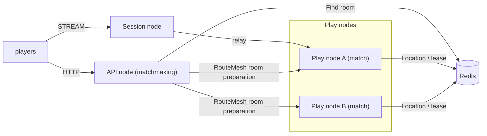

# my-game: API node and arena matches

A two-player arena template. The API node pairs players by mode, prepares a Room through the public object client, and returns its ID and the published Session endpoint. The RoomRoster approves the listed players before admission. The Session binds a Player Actor and relays only the client packet allowlist. RoomState owns positions, HP, accepted action sequence, phase, winner and monotonic cooldown state. Player carries no application state.



## Server and e2e

Run the server from the project directory. The local build requires CMake, Ninja, a C++20 compiler and Docker Compose for Redis.

| Shell | Start the server | Run e2e in a second terminal |
| --- | --- | --- |
| Bash | `./run-server.sh` | `./run-e2e.sh` |
| Windows (PowerShell 7) | `.\run-server.cmd` | `.\run-e2e.cmd` |

Use the WebSocket address printed after `Server ready` for game clients. Press Ctrl+C in the server terminal to stop the nodes and Redis. E2e attaches automatically when the server has published `.logs/server.json`. With no running server, e2e starts an isolated Docker deployment. Attached runs skip `lobby` (API node restart) and `update` (Play node replacement).

Each run saves node stdout (`*.out.log`), stderr (`*.err.log`), Framework message-flow (`*.flow.log`) and failure details (`failure.log`, on failure) under `.logs/run-<id>/`. Build and Docker Compose logs are also under `.logs/`. See [한국어](README.ko.md).

## Prerequisites

Docker with Compose v2 and a running Linux-container daemon is required. Use Bash on Linux or PowerShell 7 on Windows. The Docker build installs the C++ toolchain and CMake; the host does not need them for the default run.

Public Framework 0.34.0 is pinned in `bootstrap.cmake`, the only file that names the version. `cmake -P bootstrap.cmake` downloads this platform's prebuilt from the `framework-cpp/v0.34.0` GitHub Release, checks it against the SHA-256 checksum published with it and extracts it into `.zlink/install`. The prebuilt carries Core, the C++ binding, the Framework libraries, Boost headers and nlohmann_json, so no package manager runs. The Docker build and local mode run the same script. Follow the public package licensing requirements.

## Client connection

### Endpoint and first packet

Connect to the Session `players` STREAM listener. `server/config/session.json` pins `StreamEndpoint` to `ws://127.0.0.1:0`: loopback with an OS-assigned port. Read the Session stdout line `READY {"id":"...","meshEndpoint":"...","streamEndpoint":"..."}` and use its actual `streamEndpoint`, not port `0`. `server/shared/hosting.hpp` emits this value and `e2e/world.hpp` consumes it. Mesh and Redis addresses are internal endpoints.

The listener is reachable from its host/network namespace. Keep a deployment running separately from e2e, which owns and removes its nodes; configure a reachable `StreamEndpoint` interface and port and expose it from containers for external clients. The WebSocket listener supports native and browser clients.

`server/config/lobby.json` configures `HttpEndpoint` as `http://127.0.0.1:0`; use the API node `READY` JSON `httpEndpoint` plus `/match`. Configure `SessionEndpoint` with the actual bound Session endpoint before starting the API node, as `e2e/world.hpp` does.

First POST JSON `{"playerId":"player-a","mode":"duel"}` to the API node's HTTP endpoint plus `/match`. Submit a second distinct player in the same mode concurrently: the first HTTP request remains pending until paired. The HTTP response has `roomId` and `sessionEndpoint`. Connect to that returned Session endpoint and send `JoinRoomRequest` (`playerId`, returned `roomId`) first. Successful admission pushes `RoomView`; the HTTP assignment is a prerequisite, and `ActionRejected` reports rejected actions. These operations use `send(...).submit()` and server pushes, not a correlated connector `request` reply. This template does not authenticate player identity; validate it before binding in a production game.

### Connector installation

Use the same connector release as this template pins in `bootstrap.cmake`, key `ZLINK_FRAMEWORK_CPP_VERSION`. Replace `<version>` below with that pinned value; linked guides may describe other releases. Use this template's packet names with the endpoint described above. Engine installation instructions are in the linked repository READMEs.

| Client                             | Connector installation                                                                                                                                                                                                                                                                                                                                                                                                                                                          | Documentation guide                                                                                                                                                          |
| ---------------------------------- | ------------------------------------------------------------------------------------------------------------------------------------------------------------------------------------------------------------------------------------------------------------------------------------------------------------------------------------------------------------------------------------------------------------------------------------------------------------------------------- | ---------------------------------------------------------------------------------------------------------------------------------------------------------------------------- |
| Unity                              | Native/Editor: restore `Zlink.Stream.Connector` with NuGetForUnity. WebGL: add the `com.zlink.stream-connector.webgl` UPM Git package; include only the connector assembly for the active target. See the [Unity README](https://github.com/zlink-systems/zlink/blob/main/framework/languages/engines/Unity/README.md) and its package manifest.                                                                                                                                | [.NET engine integration](https://docs.zlink.systems/dotnet/guide/stream-connector/12-engine-integration/)                                                                   |
| Unreal                             | Copy `framework/languages/cpp/connector/engines/unreal` into `Plugins/ZLinkStreamConnector`, then package the native connector under `ThirdParty/ZLink` as described in the [Unreal README](https://github.com/zlink-systems/zlink/blob/main/framework/languages/engines/Unreal/README.md).                                                                                                                                                                                     | [C++ engine integration](https://docs.zlink.systems/cpp/guide/stream-connector/12-engine-integration/)                                                                       |
| Godot                              | .NET: add the NuGet package `Zlink.Stream.Connector` and run `dotnet restore`; see the [C# README](https://github.com/zlink-systems/zlink/blob/main/framework/languages/engines/Godot/csharp/README.md). GDExtension: build the C++ Godot adapter against the framework prebuilt and matching `godot-cpp`; see the [C++ README](https://github.com/zlink-systems/zlink/blob/main/framework/languages/engines/Godot/cpp/README.md). The .NET sample does not support Web export. | [.NET](https://docs.zlink.systems/dotnet/guide/stream-connector/12-engine-integration/), [C++](https://docs.zlink.systems/cpp/guide/stream-connector/12-engine-integration/) |
| Cocos Creator                      | Web target: `npm install @zlink-systems/stream-connector@<version>`; see the [Cocos Creator README](https://github.com/zlink-systems/zlink/blob/main/framework/languages/engines/CocosCreator/README.md). This package does not provide a Creator native adapter.                                                                                                                                                                                                                  | [TypeScript engine integration](https://docs.zlink.systems/node/guide/stream-connector/12-engine-integration/)                                                               |
| Axmol                              | Copy `framework/languages/cpp/connector/engines/axmol` into `third_party/zlink_axmol_connector` and link `zlink::stream_connector` from the installed C++ framework package; see the [Axmol README](https://github.com/zlink-systems/zlink/blob/main/framework/languages/engines/Axmol/README.md).                                                                                                                                                                              | [C++ engine integration](https://docs.zlink.systems/cpp/guide/stream-connector/12-engine-integration/)                                                                       |
| Web browser (TypeScript connector) | `npm install @zlink-systems/stream-connector@<version>`; import the package root in the browser build. Use `ws://` or `wss://`, subject to the page's security policy.                                                                                                                                                                                                                                                                                                             | [TypeScript connector](https://docs.zlink.systems/node/guide/stream-connector/)                                                                                              |
| C++                                | Install the C++ framework prebuilt containing the connector; use `find_package(zlink_stream_connector_cpp CONFIG REQUIRED)` and link `zlink::stream_connector`.                                                                                                                                                                                                                                                                                                                 | [C++ connector](https://docs.zlink.systems/cpp/guide/stream-connector/)                                                                                                      |
| C#/.NET                            | `dotnet add package Zlink.Stream.Connector --version <version>`                                                                                                                                                                                                                                                                                                                                                                                                                    | [.NET connector](https://docs.zlink.systems/dotnet/guide/stream-connector/)                                                                                                  |
| Java                               | Add Maven/Gradle dependency `systems.zlink:zlink-stream-connector:<version>`.                                                                                                                                                                                                                                                                                                                                                                                                      | [Java connector](https://docs.zlink.systems/java/guide/stream-connector/)                                                                                                    |
| Kotlin                             | Add `systems.zlink:zlink-stream-connector:<version>` and `systems.zlink:zlink-framework-kotlin:<version>` for the coroutine wrapper.                                                                                                                                                                                                                                                                                                                                                  | [Kotlin connector](https://docs.zlink.systems/kotlin/guide/stream-connector/)                                                                                                |
| Node                               | `npm install @zlink-systems/stream-connector@<version>`; use the package root and Node.js 22 or later.                                                                                                                                                                                                                                                                                                                                                     | [Node connector](https://docs.zlink.systems/node/guide/stream-connector/)                                                                                                    |

### One client connection

Save the following as `connect-once.cpp` in a copy of this template. Build it as a C++20 executable with this directory on the include path and link `zlink::stream_connector` from the installed package (the existing e2e target shows the package setup). Run it with the actual Session endpoint and a fresh player ID, then the room ID returned by /match. Complete the two-player HTTP matching step above first; use the returned `sessionEndpoint` and `roomId`. The receive wait is registered before sending and uses the connector's configured wait deadline. See `e2e/client.hpp` and `e2e/scenarios.hpp` for the complete flow.

```cpp
#include <zlink/stream_connector.hpp>
#include "server/shared/contracts.hpp"
#include <future>
#include <iostream>
#include <memory>
#include <stdexcept>
namespace sc = zlink::stream_connector;

void checked (sc::result_t<void> result)
{
    if (!result) throw std::runtime_error (result.error ()->message);
}

int main (int argc, char **argv)
{
    if (argc != 4) return 2;
    sc::connector_options_t options;
    options.endpoint = argv[1];
    options.reconnect.enabled = false;
    options.dispatch_mode = sc::dispatch_mode_t::immediate;
    auto connector = sc::connector_factory_t::create (options);
    auto errors = connector.on_error ([] (const auto &error) {
        std::cerr << error.message << '\n';
    });
    checked (connector.connect ());
    try {
        using Reply = MyGame::RoomView;
        auto completion = std::make_shared<std::promise<sc::result_t<sc::message_t<Reply>>>> ();
        auto received = completion->get_future ();
        connector.wait_for<Reply> ().submit ([completion] (auto result) {
            completion->set_value (std::move (result));
        });
        connector.send (MyGame::JoinRoomRequest{argv[2], argv[3]}).submit ();
        const auto result = received.get ();
        if (!result) throw std::runtime_error (result.error ()->message);
        std::cout << "Received RoomView\n";
    } catch (...) {
        checked (connector.close ());
        throw;
    }
    checked (connector.close ());
}
```

## Build

Build the node and runner images from this directory:

```sh
./run-e2e.sh --build-only
```

The script removes its unique image tags after checking the build. Docker retains build layers for subsequent runs.

On Windows, use PowerShell 7:

```powershell
.\run-e2e.cmd -BuildOnly
```

`Dockerfile` defines the Ubuntu 24.04 build and runtime base once in `UBUNTU_IMAGE`. All node roles share the multi-stage image. The runner adds Docker CLI 28.5.1 to the same runtime. These base arguments can be replaced when the deployment base image becomes available.

## Docker e2e

```sh
./run-e2e.sh
./run-e2e.sh --scenario lobby,hit,wall,input,reconnect,update
```

```powershell
.\run-e2e.cmd
.\run-e2e.cmd -Scenario lobby,hit,wall,input,reconnect,update
```

The runner and nodes execute in containers. The script checks structure before Redis startup, then uses a unique Compose network, project, container names and Redis key prefixes. Nodes share the runner's network namespace, preserving loopback listeners and OS-assigned ports. Configuration is copied into each node before attaching stdin and stdout; `drain`, `shutdown` and lifecycle output retain their existing protocol.

The runner removes its node containers. The script removes remaining containers carrying this run's label, its Compose resources and its image tags. Cleanup failures return exit code 1. Build and orchestration logs remain in `.logs/docker-<project>/`; node logs and generated configurations remain in `.logs/run-<id>/`. Unix runners use the caller UID and Docker socket group so those files remain caller-owned.

| Scenario | Observation |
| --- | --- |
| `lobby` | Omitted `mode` matches `duel`; both HTTP responses contain the same `room-` plus 32-character lowercase UUID. Before either matched player joins, the prepared empty Room rejects an outsider Join; both listed players then enter, client `PrepareRoom` is rejected, and a restarted lobby assigns a new Room ID. |
| `hit` | Missing and out-of-range targets are rejected without state change. Fire cooldown retries wait for the server's `RetryAfterMs`; accepted hits update HP, `LastSequence`, `Phase` and `Winner`. |
| `wall` | From `(48,24)`, movement through `X=50` and a shot to the player across the wall are rejected without changing state, sequence or HP. Returning to `(40,10)` allows a clear hit at `y=10`, outside the wall segment. |
| `input` | Accepted and rejected movement requests are sent consecutively before waiting for replies, followed by consecutive shot requests. `MoveResult` and `ShotResult` identify accepted actions; `move-budget` and `fire-too-soon` preserve accepted state and sequence. Retrying the same request after the server's `RetryAfterMs` succeeds. Oversized, stale, out-of-map, wall-crossing and over-limit sequences are also rejected without state changes. |
| `reconnect` | Reconnection preserves Actor identity and restores `LastSequence`, `Phase`, `Winner`, position and HP. |
| `update` | Relocation restores game and roster snapshots, remaining cooldown milliseconds, and session bindings. A replacement node accepts a new prepared Room while the old match continues. |

Domain tests cover map edges, step length, wall crossings, movement budget, shot range, fire cooldown, over-limit sequence values, winner transitions, roster preparation and snapshot validation.

Each run checks `zlink.structure.json` before starting Redis, uses a unique Compose project and Redis key prefix, and stores configuration and node stdout/stderr (including Normal message-flow diagnostics) under `.logs/run-<id>/`. Cleanup failures make the run fail. `./run-e2e.sh --check-structure` validates the actual structure without starting Redis or play nodes (PowerShell: `.\run-e2e.cmd -CheckStructure`).

`POST /match {"playerId":"p1"}` defaults to `duel`; clients may also provide `mode`. The API node pairs the same mode, creates `room-<UUID-without-hyphens>`, sends `PrepareRoom(matchId, members)` to the Room, and returns `{roomId, sessionEndpoint}` only after `RoomPrepared(matchId)`. Repeating the same preparation is idempotent; a different roster is rejected. The API node is process-local and is not a relocation participant. Configure `HttpEndpoint` with port 0; READY reports the actual bound port. Set its `SessionEndpoint` to the Session node's published endpoint. A waiting client disconnect removes its request from the queue and releases its player ID. Production authentication and durable matchmaking are extension points.

`MoveRequest` contains `dx`, `dy` and `sequence`. The server applies map `[0,100]²`, `MaxStep=2`, and a movement budget of `min(2, 10/s × elapsed)`; the first move has a budget of 2. `ShootRequest` retains `targetId` and uses a 250 ms fire interval. The shared integer maximum is `9,007,199,254,740,991`. Rejections use `ActionRejected(reason, retryAfterMs)`; only time-budget rejections set a positive `retryAfterMs`. The Room snapshot stores remaining milliseconds, not process timestamps. `RoomView` exposes each player's `lastSequence` and the Room `phase` and `winner`.

Room and HTTP domain boundary tests (admission, movement and shot rules, sequence limits, cooldown snapshots, roster preparation, default mode and UUID Room IDs) and the HTTP disconnect/rejoin regression are available with `ctest --test-dir build --output-on-failure` (`-C Release` for a multi-configuration build).

## Local debugging

Local processes remain available for debugging. Install a C++20 compiler (GCC 13 or later, or Visual Studio 2022 17.4 or later), CMake 3.24+ and Ninja. Windows requires a Visual Studio 2022 developer shell. No ZLink checkout or package manager is needed.

Build and run local processes from this directory:

```sh
./run-e2e.sh --local
```

The script runs `cmake -P bootstrap.cmake`, `cmake --preset default` and `cmake --build --preset default` before executing `build/bin/my-game-e2e`. Redis still runs in an isolated Compose project.

On Windows, run:

```powershell
.\run-e2e.cmd -Local
```

Use `--no-build` or `-NoBuild` with local mode to reuse a debugger build. Scenario selection works in both modes. Local build-only uses `--local --build-only` or `-Local -BuildOnly`.

## Framework behavior to know

- **Waiting for DB or file I/O in a handler** — An ordinary async terminal holds the turn, while `Yield` lets other handlers on the same Spot proceed. [Guide](https://docs.zlink.systems/cpp/guide/server/32-execution-model/#io-worker-wait).
- **Creation that misses its deadline** — `DeadlineExceeded` and caller cancellation have distinct outcomes. [Guide](https://docs.zlink.systems/cpp/guide/server/22-actor/#creation-deadline). [server/session/session.hpp:55](server/session/session.hpp).
- **Many logins at once** — Each creation for a different ID requires a Location Store round trip, so measure expected load when setting the deadline. [Guide](https://docs.zlink.systems/cpp/guide/server/25-location/#creation-load).
- **Sending under load** — A send waits for capacity and the application observes only its final result. [Guide](https://docs.zlink.systems/cpp/guide/server/33-backpressure/#send-backpressure). [server/match/room.hpp:64](server/match/room.hpp).
- **Duplicate login** — Without a callback, binding a different Session is accepted; reject it in the Actor duplicate-bind callback to prevent it. [Guide](https://docs.zlink.systems/cpp/guide/server/39-session-binding/#duplicate-session-bind). This template keeps the default (accepts the new Session).
- **ObjectGeneration** — `ObjectGeneration` identifies a logical incarnation of the same ID; it is neither a data version nor write authority. [Guide](https://docs.zlink.systems/cpp/guide/server/34-activation-lifetime/#object-generation). [server/session/session.hpp:75](server/session/session.hpp).
- **READY and Serving** — Framework nodes print `READY` after observing runtime `Serving`. [Guide](https://docs.zlink.systems/cpp/guide/server/12-operations/#wait-for-serving). [server/shared/hosting.hpp:44](server/shared/hosting.hpp); [server/shared/hosting.hpp:83](server/shared/hosting.hpp).

## Known issues

The pinned C++ Framework release can publish a `tcp://` address for a STREAM listener configured with WebSocket. The runner reports a startup failure when this occurs. [#5460](https://github.com/zlink-systems/zlink/issues/5460)

Validated against the published Framework 0.34.0 packages.

The default C++ typed serializer emits a signed 64-bit `sequence` as a JSON number, although the message model requires a decimal string ([#1694](https://github.com/zlink-systems/zlink/issues/1694)). The wire golden check passes three common samples; the five samples containing 64-bit fields remain blocked.

This template answers `SessionInfoRequest` with a typed `SessionInfo` push; Framework 0.30.2 added a typed Session reply through `reply_packet` (#1785), and the template has not switched to it.

## Deployment sequence

Start Redis, then the play nodes (match), Session, and API node. Each process has its own executable and JSON configuration in `server/config/`. Mesh and STREAM listeners bind port 0 and publish their endpoints in `READY`. The runner supplies the Session endpoint to the API node. Clients first match over HTTP and then join over STREAM using `JoinRoomRequest`.

For a match-node update, write `drain` to stdin and wait for `RELOCATION_REQUESTED`, `RELOCATED`, and `SAFE_TO_SHUTDOWN`. Write `shutdown`, verify `STOPPED` and exit code 0, then start a replacement with the same configuration. Do not stop a draining host before its public safety observation. Lobby updates require a separate application policy for pending HTTP matches.
