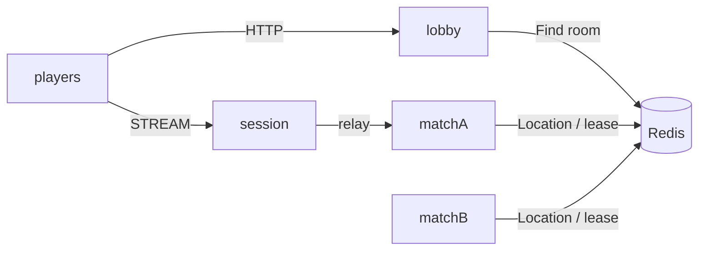

# my-game: HTTP lobby and arena matches

A two-player arena template. The HTTP lobby pairs players by mode, prepares a Room through the public object client, and returns its ID and the published Session endpoint. The Session binds a Player Actor and relays typed packets. Room owns positions, HP, sequence validation, wall intersections and the winner. Player carries no application state.



## Prerequisites

Docker with Compose v2 and a running Linux-container daemon is required. Use Bash on Linux or PowerShell 7 on Windows. The Docker build installs the C++ toolchain and CMake; the host does not need them for the default run.

Public Framework 0.30.2 is pinned in `bootstrap.cmake`, the only file that names the version. `cmake -P bootstrap.cmake` downloads this platform's prebuilt from the `framework-cpp/v0.30.2` GitHub Release, checks it against the SHA-256 checksum published with it and extracts it into `.zlink/install`. The prebuilt carries Core, the C++ binding, the Framework libraries, Boost headers and nlohmann_json, so no package manager runs. The Docker build and local mode run the same script. That release must be published before the pinned build can complete. Follow the public package licensing requirements.

## Build

Build the node and runner images from this directory:

```sh
./run-e2e.sh --build-only
```

The script removes its unique image tags after checking the build. Docker retains build layers for subsequent runs.

On Windows, use PowerShell 7:

```powershell
pwsh -NoProfile -File ./run-e2e.ps1 -BuildOnly
```

`Dockerfile` defines the Ubuntu 24.04 build and runtime base once in `UBUNTU_IMAGE`. All node roles share the multi-stage image. The runner adds Docker CLI 28.5.1 to the same runtime. These base arguments can be replaced when the deployment base image becomes available.

## Docker e2e

```sh
./run-e2e.sh
./run-e2e.sh --scenario lobby,hit,reconnect,update
```

```powershell
pwsh -NoProfile -File ./run-e2e.ps1
pwsh -NoProfile -File ./run-e2e.ps1 -Scenario lobby,hit,reconnect,update
```

The runner and nodes execute in containers. The script checks structure before Redis startup, then uses a unique Compose network, project, container names and Redis key prefixes. Nodes share the runner's network namespace, preserving loopback listeners and OS-assigned ports. Configuration is copied into each node before attaching stdin and stdout; `drain`, `shutdown` and lifecycle output retain their existing protocol.

The runner removes its node containers. The script removes remaining containers carrying this run's label, its Compose resources and its image tags. Cleanup failures return exit code 1. Build and orchestration logs remain in `.logs/docker-<project>/`; node logs and generated configurations remain in `.logs/run-<id>/`. Unix runners use the caller UID and Docker socket group so those files remain caller-owned.

`lobby` checks matching HTTP assignments and both players in the Room. `hit` checks damage, closed wall intersection, range, missing targets and the winner. `reconnect` preserves Actor identity, Room, position and HP. `update` drains the Room host, checks Session bindings and Room state, waits for SafeToShutdown, stops the old process, starts its replacement and checks a new Room on it.

Each run checks `zlink.structure.json` before starting Redis, uses a unique Compose project and Redis key prefix, and stores configuration and node stdout/stderr (including Normal message-flow diagnostics) under `.logs/run-<id>/`. Cleanup failures make the run fail. `./run-e2e.sh --check-structure` validates the actual structure without starting Redis or game nodes (PowerShell: `pwsh -NoProfile -File ./run-e2e.ps1 -CheckStructure`).

`POST /match {"playerId":"p1","mode":"duel"}` holds the first response until another player requests the same mode. Both receive `{roomId, sessionEndpoint}` after Room preparation. The lobby is process-local and is not a relocation participant. Configure `HttpEndpoint` with port 0; READY reports the actual bound port. Set its `SessionEndpoint` to the Session node's published endpoint. A waiting client disconnect removes its request from the queue and releases its player ID. Paired requests keep their existing Room preparation behavior. Production authentication and durable matchmaking are extension points.

Room rule tests (admission, closed wall boundaries, exact range, sequence rejection, winner and application snapshot) and the HTTP disconnect/rejoin regression are available with `ctest --test-dir build --output-on-failure` (`-C Release` for a multi-configuration build).

## Local debugging

Local processes remain available for debugging. Install a C++20 compiler (GCC 13 or later, or Visual Studio 2022 17.4 or later), CMake 3.24+ and Ninja. Windows requires a Visual Studio 2022 developer shell. No ZLink checkout or package manager is needed.

Build and run local processes from this directory:

```sh
./run-e2e.sh --local
```

The script runs `cmake -P bootstrap.cmake`, `cmake --preset default` and `cmake --build --preset default` before executing `build/bin/my-game-e2e`. Redis still runs in an isolated Compose project.

On Windows, run:

```powershell
pwsh -NoProfile -File ./run-e2e.ps1 -Local
```

Use `--no-build` or `-NoBuild` with local mode to reuse a debugger build. Scenario selection works in both modes. Local build-only uses `--local --build-only` or `-Local -BuildOnly`.

## Known issues

- [#1792](https://github.com/zlink-systems/zlink/issues/1792): public 0.30.0 reports a failed Actor join target as a rejected completion instead of a failed one, so the client receives `admission-rejected` for that failure.
- [#1784](https://github.com/zlink-systems/zlink/issues/1784): a failed deferred Actor join can terminate the node process with `result has no Framework error` before the Player receives any completion.
- [#1740](https://github.com/zlink-systems/zlink/issues/1740): public 0.30.0 lacks the required SafeToShutdown observation and can fail shutdown with TeardownFailed. The runner reports these failures and does not infer safety.
- [#1785](https://github.com/zlink-systems/zlink/issues/1785): C++ Session has no public API for replying with a newly created typed value. `SessionInfoRequest` receives a typed `SessionInfo` push; the e2e client observes that push.

## Deployment sequence

Start Redis, then the match nodes, Session, and HTTP lobby. Each process has its own executable and JSON configuration in `server/config/`. Mesh and STREAM listeners bind port 0 and publish their endpoints in `READY`. The runner supplies the Session endpoint to the lobby. Clients first match over HTTP and then join over STREAM using `JoinRoomRequest`.

For a match-node update, write `drain` to stdin and wait for `RELOCATION_REQUESTED`, `RELOCATED`, and `SAFE_TO_SHUTDOWN`. Write `shutdown`, verify `STOPPED` and exit code 0, then start a replacement with the same configuration. Do not stop a draining host before its public safety observation. Lobby updates require a separate application policy for pending HTTP matches.

## 한국어 실행 안내

Docker Compose v2와 Linux 컨테이너 데몬을 준비한다. 템플릿 디렉터리에서 Linux는 `./run-e2e.sh`, Windows는 `pwsh -NoProfile -File ./run-e2e.ps1`을 실행한다. 기본 실행은 이미지 빌드부터 runner·node 컨테이너 기동과 정리까지 수행한다. Framework 버전은 `bootstrap.cmake` 한 곳에서 정하며, 빌드는 그 버전의 GitHub Release prebuilt를 받아 함께 게시된 SHA-256 체크섬으로 확인한다. Framework 0.30.2 릴리스가 게시되어야 고정 버전 빌드를 완료할 수 있다.

로컬 디버깅은 C++20 컴파일러, CMake, Ninja를 설치한 뒤 `./run-e2e.sh --local` 또는 `pwsh -NoProfile -File ./run-e2e.ps1 -Local`로 실행한다. node 로그와 설정은 `.logs/run-<id>/`, Docker 빌드·정리 로그는 `.logs/docker-<project>/`에 남는다. 공개 패키지에서 확인된 차단 사항은 Known issues를 따른다.
