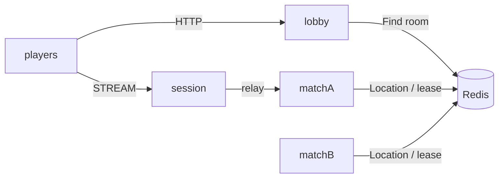

# my-game: HTTP lobby and arena matches

A two-player arena template. The HTTP lobby pairs players by mode, prepares a Room through the public object client, and returns its ID and the published Session endpoint. The Session binds a Player Actor and relays typed packets. Room owns positions, HP, sequence validation, wall intersections and the winner. Player carries no application state.



## Prerequisites

- CMake 3.24+, Ninja, a C++20 compiler, PowerShell 7 on Windows, and Docker Compose v2.
- vcpkg at the baseline in `vcpkg.json`; set `VCPKG_ROOT` to that checkout.
- Clone the public ZLink repository at tag `framework-cpp/v0.30.1` and set `VCPKG_OVERLAY_PORTS` to its `vcpkg/ports` directory. The template uses its public overlay ports and pins Framework 0.30.1 and bindings 1.19.0 in `vcpkg.json`.
- Redis is started by the runner with an ephemeral loopback port. No existing Redis database is modified.

## Build

Run from this directory, in a compiler-enabled shell on Windows.

```sh
cmake --preset default && cmake --build --preset default
```

```powershell
cmake --preset default; if ($LASTEXITCODE -eq 0) { cmake --build --preset default }
```

## Local e2e

```sh
./run-e2e.sh
./run-e2e.sh --scenario lobby,hit,reconnect,update
```

```powershell
pwsh -NoProfile -File ./run-e2e.ps1
pwsh -NoProfile -File ./run-e2e.ps1 -Scenario lobby,hit,reconnect,update
```

`lobby` checks matching HTTP assignments and both players in the Room. `hit` checks damage, closed wall intersection, range, missing targets and the winner. `reconnect` preserves Actor identity, Room, position and HP. `update` drains the Room host, checks Session bindings and Room state, waits for SafeToShutdown, stops the old process, starts its replacement and checks a new Room on it.

Each run checks `zlink.structure.json` before starting Redis, uses a unique Compose project and Redis key prefix, and stores configuration and node stdout/stderr (including Normal message-flow diagnostics) under `.logs/run-<id>/`. Cleanup failures make the run fail. `build/bin/my-game-e2e --check-structure` validates the actual structure without starting services (append `.exe` on Windows).

`POST /match {"playerId":"p1","mode":"duel"}` holds the first response until another player requests the same mode. Both receive `{roomId, sessionEndpoint}` after Room preparation. The lobby is process-local and is not a relocation participant. Configure `HttpEndpoint` with port 0; READY reports the actual bound port. Set its `SessionEndpoint` to the Session node's published endpoint. A pending HTTP request is owned by the lobby until paired or process shutdown; production authentication, cancellation policy and durable matchmaking are extension points.

Pure Room rule tests (admission, closed wall boundaries, exact range, sequence rejection, winner and application snapshot) are available with `ctest --test-dir build --output-on-failure` (`-C Release` for a multi-configuration build).

## Known issues

- #1785: C++ Session has no public API for replying with a newly created typed value. `SessionInfoRequest` receives a typed `SessionInfo` push; the e2e client observes that push instead of using a request/reply correlation workaround.
- #1740: public 0.30.0 lacks the required SafeToShutdown observation / termination behavior. The runner reports the missing observation and does not infer safety.
- Public 0.30.0 validation may also stop at the registered handoff and binding defects #1771, #1772 and #1775. Use the 0.30.1 release/candidate to complete execution validation; no transport or lifecycle workaround is included.

## Deployment sequence

Start Redis, then the match nodes, Session, and HTTP lobby. Each process has its own executable and JSON configuration in `server/config/`. Mesh and STREAM listeners bind port 0 and publish their endpoints in `READY`. The runner supplies the Session endpoint to the lobby. Clients first match over HTTP and then join over STREAM using `JoinRoomRequest`.

For a match-node update, write `drain` to stdin and wait for `RELOCATION_REQUESTED`, `RELOCATED`, and `SAFE_TO_SHUTDOWN`. Write `shutdown`, verify `STOPPED` and exit code 0, then start a replacement with the same configuration. Do not stop a draining host before its public safety observation. Lobby updates require a separate application policy for pending HTTP matches.

## 한국어 실행 안내

이 디렉터리에서 공개 ZLink 태그의 vcpkg overlay 경로와 `VCPKG_ROOT`를 설정한 뒤 위 Build 명령을 실행합니다. e2e runner는 Redis와 노드를 기동하고, 실행마다 고유한 Compose project와 Redis key prefix를 사용합니다. 실행 결과와 message-flow 기록은 `.logs/run-<id>/`에 보존합니다.

로비는 같은 mode의 HTTP 요청 두 개를 짝지은 뒤 Room 준비를 확인하여 접속 정보를 반환합니다. 대전 상태는 Room이 소유합니다. match 노드를 교체할 때는 drain과 공개 SafeToShutdown 관찰을 완료한 뒤 종료합니다. 공개 0.30.0에서 실행이 차단되면 알려진 문제와 첫 실패 로그를 확인하며, 우회 코드로 실행을 계속하지 않습니다.
