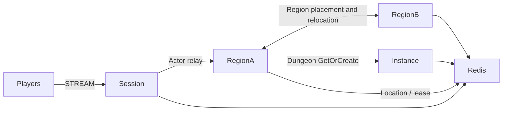

# MyGame megaserver

This template hosts capacity-limited Region User Spots on two physical nodes in one world mesh. Entry selects the first Region instance that accepts a player. A separate Instance node creates Dungeon User Spots on demand.



## Prerequisites

- C++20 compiler, CMake 3.24 or later, Ninja, Git, and vcpkg. On Windows, use a Visual Studio 2022 developer shell.
- Docker Compose v2 with a running Docker daemon, and PowerShell 7 on Windows or Bash on Linux.
- Public Framework 0.30.1 with zlink and zlink-cpp 1.19.0, pinned in `vcpkg.json`. Follow the public package licensing requirements.

Clone the zlink repository at tag `framework-cpp/v0.30.1`. Set `VCPKG_ROOT` to your vcpkg checkout and `VCPKG_OVERLAY_PORTS` to the tagged checkout's `vcpkg/ports` directory. zlink uses this official overlay port. Package 0.30.1 must be available before building the unmodified template.

## Build

Run from this directory in Bash or a Windows developer shell:

```sh
cmake --preset default
cmake --build --preset default
```

Executables appear in `build/bin`: `my-game-session`, `my-game-region`, `my-game-instance`, and `my-game-e2e`. Each server executable takes a configuration file argument. Region nodes register both Entry and Region; `Capacity` is the player limit per instance (default 2), while `RegionLimit` limits Region objects per physical node (default 2).

## Local e2e

Linux:

```sh
./run-e2e.sh
./run-e2e.sh --scenario region,dungeon,reconnect,update
```

Windows:

```powershell
pwsh -NoProfile -File ./run-e2e.ps1
pwsh -NoProfile -File ./run-e2e.ps1 -Scenario region,dungeon,reconnect,update
```

Each scenario checks `zlink.structure.json`, starts an isolated Redis Compose project and four node processes, and shuts down its own resources. Redis and Framework listeners use OS-assigned ports. Each deployment has a unique Redis key prefix. Generated configurations, message-flow diagnostics, and process logs remain in `.logs/run-<id>/`. Scenario and cleanup failures both return exit code 1.

| Scenario | Assertions |
| --- | --- |
| `region` | p1 and p2 share forest-1; p3 enters forest-2. p2 receives p1's movement; p3 receives no Region update during a bounded connector observation. |
| `dungeon` | Dungeon GetOrCreate resolves to the Instance node. |
| `reconnect` | A new Session binds the same Actor generation and retains Region membership and position. |
| `update` | Drain the actual Region owner, observe relocation and SafeToShutdown, retain player state and Session identity, stop and replace that owner, and verify movement and new Region work. |

`build/bin/my-game-e2e --check-structure` validates actual files without starting Docker. The checker accepts valid added or reordered nodes, Spots and edges. It validates references, configuration paths, stable types and the canonical scenario order.

## Known issues

Public 0.30.0 validation does not pass; candidate 0.30.1 validation remains required. The template does not compensate for these Framework defects.

- After the deferred join from Entry to a Region completes, the first RegionView can fail to reach the client without an error ([#1786](https://github.com/zlink-systems/zlink/issues/1786)).
- Planned host relocation of a Region node ends with `relocation_failed` before `RELOCATED` ([#1788](https://github.com/zlink-systems/zlink/issues/1788)).
- Node shutdown reports TeardownFailed, and the C++ lifecycle status has no `SafeToShutdown` field ([#1740](https://github.com/zlink-systems/zlink/issues/1740)).
- A C++ Session cannot yet send a typed reply it creates, so `SessionInfoRequest` uses a typed push with `SessionInfo` read from the bound Actor ([#1785](https://github.com/zlink-systems/zlink/issues/1785)).

## Deployment sequence

Start Redis, the two Region processes, the Instance process, and the Session process. Each process emits `READY` with its actual mesh endpoint; Session also reports its STREAM endpoint. Configure deployment-specific Redis endpoints and key prefixes.

Send `drain` to the Region process being replaced. Require `RELOCATION_REQUESTED`, `RELOCATED`, then `SAFE_TO_SHUTDOWN`. Send `shutdown`, require `STOPPED` and exit code zero, then start the same role with the same configuration. Framework Location Store retains authority for relocated objects. The runner selects the actual owner from RegionView; it does not prescribe placement.

`server/region/domain/positions.hpp` owns capacity, player positions and movement sequence. Entry owns index selection after `region-full`. Region stores player IDs and sends pushes through the public Actor client; its delivery handler forwards to the Actor's bound Session. Request handlers reply through the received Actor's bound Session. Relocation adapters serialize application state only. Player has no application state to duplicate.

## 한국어 실행 안내

C++20 compiler, CMake, Ninja, vcpkg와 Docker Compose를 준비한다. zlink 저장소의 `framework-cpp/v0.30.1` 태그에서 `vcpkg/ports` 경로를 `VCPKG_OVERLAY_PORTS`로 지정하고 `VCPKG_ROOT`를 설정한다. 템플릿 디렉터리에서 위 Build 명령을 실행한다.

Linux에서는 `./run-e2e.sh`, Windows에서는 `pwsh -NoProfile -File ./run-e2e.ps1`을 실행한다. 로그는 `.logs/run-<id>/`에 보존된다. 공개 0.30.0의 차단 사항은 Known issues에 기록되어 있으며, 0.30.1 후보의 Windows·WSL 검증이 끝나기 전에는 운영 배포 가능 판정을 하지 않는다.
