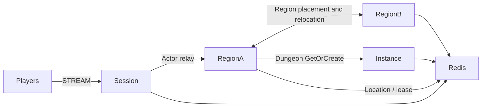

# MyGame megaserver

This template hosts capacity-limited Region User Spots on two physical nodes in one world mesh. Entry selects the first Region instance that accepts a player. A separate Instance node creates Dungeon User Spots on demand.



## Prerequisites

Docker with Compose v2 and a running Linux-container daemon is required. Use Bash on Linux or PowerShell 7 on Windows. The Docker build installs the C++ toolchain and CMake; the host does not need them for the default run.

Public Framework 0.30.1 is pinned in `bootstrap.cmake`, the only file that names the version. `cmake -P bootstrap.cmake` downloads this platform's prebuilt from the `framework-cpp/v0.30.1` GitHub Release, checks it against the SHA-256 checksum published with it and extracts it into `.zlink/install`. The prebuilt carries Core, the C++ binding, the Framework libraries, Boost headers and nlohmann_json, so no package manager runs. The Docker build and local mode run the same script. That release must be published before the pinned build can complete. Follow the public package licensing requirements.

## Build

Build the node and runner images from this directory:

```sh
./run-e2e.sh --build-only
```

The script removes its unique image tags after checking the build. Docker retains build layers for subsequent runs.

On Windows, use PowerShell 7:

```powershell
pwsh -NoProfile -File ./run-e2e.ps1 -BuildOnly
```

`Dockerfile` defines the Ubuntu 24.04 build and runtime base once in `UBUNTU_IMAGE`. All node roles share the multi-stage image. The runner adds Docker CLI 28.5.1 to the same runtime. These base arguments can be replaced when the deployment base image becomes available.

## Docker e2e

Linux:

```sh
./run-e2e.sh
./run-e2e.sh --scenario region,dungeon,reconnect,update
```

Windows:

```powershell
pwsh -NoProfile -File ./run-e2e.ps1
pwsh -NoProfile -File ./run-e2e.ps1 -Scenario region,dungeon,reconnect,update
pwsh -NoProfile -File ./run-e2e.ps1 -CheckStructure
```

The runner and nodes execute in containers. The script checks structure before Redis startup, then uses a unique Compose network, project, container names and Redis key prefixes. Nodes share the runner's network namespace, preserving loopback listeners and OS-assigned ports. Configuration is copied into each node before attaching stdin and stdout; `drain`, `shutdown` and lifecycle output retain their existing protocol.

The runner removes its node containers. The script removes remaining containers carrying this run's label, its Compose resources and its image tags. Cleanup failures return exit code 1. Build and orchestration logs remain in `.logs/docker-<project>/`; node logs and generated configurations remain in `.logs/run-<id>/`. Unix runners use the caller UID and Docker socket group so those files remain caller-owned.

The runner checks `zlink.structure.json` before starting Redis and the four node containers. Each scenario has its own node configuration and Redis key prefix. Redis and Framework listeners use OS-assigned ports. Each deployment has a unique Redis key prefix. Generated configurations, message-flow diagnostics, and process logs remain in `.logs/run-<id>/`. Scenario and cleanup failures both return exit code 1.

| Scenario | Assertions |
| --- | --- |
| `region` | p1 and p2 share forest-1; p3 enters forest-2. p2 receives p1's movement; p3 receives no Region update during a bounded connector observation. |
| `dungeon` | Dungeon GetOrCreate resolves to the Instance node. |
| `reconnect` | A new Session binds the same Actor generation and retains Region membership and position. |
| `update` | Drain the actual Region owner, observe relocation and SafeToShutdown, retain player state and Session identity, stop and replace that owner, and verify movement and new Region work. |

`./run-e2e.sh --check-structure` validates actual files without starting Redis or game nodes. The checker accepts valid added or reordered nodes, Spots and edges. It validates references, configuration paths, stable types and the canonical scenario order.

## Local debugging

Local processes remain available for debugging. Install a C++20 compiler (GCC 13 or later, or Visual Studio 2022 17.4 or later), CMake 3.24+ and Ninja. Windows requires a Visual Studio 2022 developer shell. No ZLink checkout or package manager is needed.

Build and run local processes from this directory:

```sh
./run-e2e.sh --local
```

The script runs `cmake -P bootstrap.cmake`, `cmake --preset default` and `cmake --build --preset default` before executing `build/bin/my-game-e2e`. Redis still runs in an isolated Compose project.

On Windows, run:

```powershell
pwsh -NoProfile -File ./run-e2e.ps1 -Local
```

Use `--no-build` or `-NoBuild` with local mode to reuse a debugger build. Scenario selection works in both modes. Local build-only uses `--local --build-only` or `-Local -BuildOnly`.

## Known issues

Public 0.30.0 validation does not pass; candidate 0.30.1 validation remains required. The template does not compensate for these Framework defects.

- After the deferred join from Entry to a Region completes, the first RegionView can fail to reach the client without an error ([#1786](https://github.com/zlink-systems/zlink/issues/1786)).
- Planned host relocation of a Region node ends with `relocation_failed` before `RELOCATED` ([#1788](https://github.com/zlink-systems/zlink/issues/1788)).
- Node shutdown reports TeardownFailed, and the C++ lifecycle status has no `SafeToShutdown` field ([#1740](https://github.com/zlink-systems/zlink/issues/1740)).
- A C++ Session cannot yet send a typed reply it creates, so `SessionInfoRequest` uses a typed push with `SessionInfo` read from the bound Actor ([#1785](https://github.com/zlink-systems/zlink/issues/1785)).

## Deployment sequence

Start Redis, the two Region processes, the Instance process, and the Session process. Each process emits `READY` with its actual mesh endpoint; Session also reports its STREAM endpoint. Configure deployment-specific Redis endpoints and key prefixes.

Send `drain` to the Region process being replaced. Require `RELOCATION_REQUESTED`, `RELOCATED`, then `SAFE_TO_SHUTDOWN`. Send `shutdown`, require `STOPPED` and exit code zero, then start the same role with the same configuration. Framework Location Store retains authority for relocated objects. The runner selects the actual owner from RegionView; it does not prescribe placement.

`server/region/domain/positions.hpp` owns capacity, player positions and movement sequence. Entry owns index selection after `region-full`. Region stores player IDs and sends pushes through the public Actor client; its delivery handler forwards to the Actor's bound Session. Request handlers reply through the received Actor's bound Session. Relocation adapters serialize application state only. Player has no application state to duplicate.

The e2e fixture limits each Region node to two Region Spots and keeps forest-1 and forest-2 occupied before drain. After relocation the survivor is full. Once the replacement reports `READY`, a new desert Region must be served by that replacement. Existing Region state and Session identity checks remain required. Only Region nodes register the application Entry and its first admission handler, so only those nodes declare an Entry in `zlink.structure.json`.

Message Follow is explicitly set to 30 seconds. The `SAFE_TO_SHUTDOWN` observation budget is the follow duration plus the existing relocation budget; the relocation operation deadline is unchanged.

## 한국어 실행 안내

Docker Compose v2와 Linux 컨테이너 데몬을 준비한다. 템플릿 디렉터리에서 Linux는 `./run-e2e.sh`, Windows는 `pwsh -NoProfile -File ./run-e2e.ps1`을 실행한다. 기본 실행은 이미지 빌드부터 runner·node 컨테이너 기동과 정리까지 수행한다. Framework 버전은 `bootstrap.cmake` 한 곳에서 정하며, 빌드는 그 버전의 GitHub Release prebuilt를 받아 함께 게시된 SHA-256 체크섬으로 확인한다. Framework 0.30.1 릴리스가 게시되어야 고정 버전 빌드를 완료할 수 있다.

로컬 디버깅은 C++20 컴파일러, CMake, Ninja를 설치한 뒤 `./run-e2e.sh --local` 또는 `pwsh -NoProfile -File ./run-e2e.ps1 -Local`로 실행한다. node 로그와 설정은 `.logs/run-<id>/`, Docker 빌드·정리 로그는 `.logs/docker-<project>/`에 남는다. 공개 패키지에서 확인된 차단 사항은 Known issues를 따른다.
