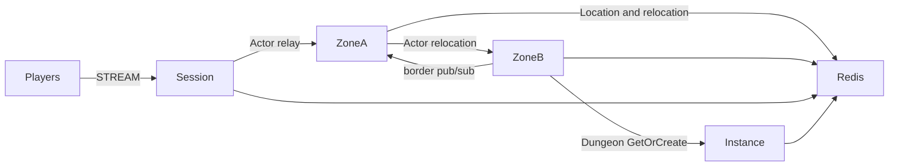

# MyGame seamless world

This template runs a persistent player Actor across six Zones on two physical nodes. Zone border visibility uses the `border` logical multicast channel. A separate Instance node creates Dungeon User Spots on demand.



## Prerequisites

Docker with Compose v2 and a running Linux-container daemon is required. Use Bash on Linux or PowerShell 7 on Windows. The Docker build installs the C++ toolchain and CMake; the host does not need them for the default run.

Public Framework 0.30.1 is pinned in `bootstrap.cmake`, the only file that names the version. `cmake -P bootstrap.cmake` downloads this platform's prebuilt from the `framework-cpp/v0.30.1` GitHub Release, checks it against the SHA-256 checksum published with it and extracts it into `.zlink/install`. The prebuilt carries Core, the C++ binding, the Framework libraries, Boost headers and nlohmann_json, so no package manager runs. The Docker build and local mode run the same script. That release must be published before the pinned build can complete. Follow the public package licensing requirements.

## Build

Build the node and runner images from this directory:

```sh
./run-e2e.sh --build-only
```

The script removes its unique image tags after checking the build. Docker retains build layers for subsequent runs.

On Windows, use PowerShell 7:

```powershell
pwsh -NoProfile -File ./run-e2e.ps1 -BuildOnly
```

`Dockerfile` defines the Ubuntu 24.04 build and runtime base once in `UBUNTU_IMAGE`. All node roles share the multi-stage image. The runner adds Docker CLI 28.5.1 to the same runtime. These base arguments can be replaced when the deployment base image becomes available.

## Docker e2e

Linux:

```sh
./run-e2e.sh
./run-e2e.sh --scenario cross,border,reconnect
```

Windows:

```powershell
pwsh -NoProfile -File ./run-e2e.ps1
pwsh -NoProfile -File ./run-e2e.ps1 -Scenario cross,border,reconnect
```

The runner and nodes execute in containers. The script checks structure before Redis startup, then uses a unique Compose network, project, container names and Redis key prefixes. Nodes share the runner's network namespace, preserving loopback listeners and OS-assigned ports. Configuration is copied into each node before attaching stdin and stdout; `drain`, `shutdown` and lifecycle output retain their existing protocol.

The runner removes its node containers. The script removes remaining containers carrying this run's label, its Compose resources and its image tags. Cleanup failures return exit code 1. Build and orchestration logs remain in `.logs/docker-<project>/`; node logs and generated configurations remain in `.logs/run-<id>/`. Unix runners use the caller UID and Docker socket group so those files remain caller-owned.

The scripts and C++ runner check `zlink.structure.json`, start Redis and the four node containers, run scenarios, and shut down their own resources. Logs and generated configurations remain in `.logs/run-<id>/`. A scenario or cleanup failure returns exit code 1. The default scenario order is:

| Scenario | Assertion |
| --- | --- |
| `cross` | Move from x=299 on zone-3 / Zone A to x=300 on zone-4 / Zone B, preserving Actor and Session identity; continue movement and open a Dungeon. |
| `border` | A player at x=300 receives the adjacent Zone's authoritative update for another player moving to x=298. |
| `reconnect` | A new physical Session binds the same Actor generation and retains position and movement sequence. |
| `update` | Drain Zone A while moving, observe relocation and SafeToShutdown, preserve Session and world state, replace Zone A, and verify fresh Actor creation and movement. |

`./run-e2e.sh --check-structure` checks the actual project files without starting Redis or game nodes. The structure checker accepts valid added nodes and reordered edges; it rejects inconsistent IDs, owner references, channels, stable types, scenario order, and escaping configuration paths.

## Local debugging

Local processes remain available for debugging. Install a C++20 compiler (GCC 13 or later, or Visual Studio 2022 17.4 or later), CMake 3.24+ and Ninja. Windows requires a Visual Studio 2022 developer shell. No ZLink checkout or package manager is needed.

Build and run local processes from this directory:

```sh
./run-e2e.sh --local
```

The script runs `cmake -P bootstrap.cmake`, `cmake --preset default` and `cmake --build --preset default` before executing `build/bin/my-game-e2e`. Redis still runs in an isolated Compose project.

On Windows, run:

```powershell
pwsh -NoProfile -File ./run-e2e.ps1 -Local
```

Use `--no-build` or `-NoBuild` with local mode to reuse a debugger build. Scenario selection works in both modes. Local build-only uses `--local --build-only` or `-Local -BuildOnly`.

## Known issues

Public 0.30.0 is not an accepted runtime for this template. Spot subscription registration takes only a topic and fixes the subscription channel to MeshName, while the public C++ contract requires `add_subscribe(channel_name, topic)`; a `border` publication therefore cannot reach its subscriber. The template reports the missing public API at Zone startup instead of changing the channel ([#1783](https://github.com/zlink-systems/zlink/issues/1783)).

The C++ lifecycle status has no `SafeToShutdown` field, so drain completion cannot be observed ([#1740](https://github.com/zlink-systems/zlink/issues/1740)). Before the startup check was added, a failed cross-node deferred Actor Join terminated the Zone process with `result has no Framework error` ([#1784](https://github.com/zlink-systems/zlink/issues/1784)), and Windows host relocation reported `StateIncompatible`. A C++ Session cannot yet send a typed reply that it creates, so `SessionInfoRequest` is answered with a push instead of a request reply ([#1785](https://github.com/zlink-systems/zlink/issues/1785)). The 0.30.1 candidate must pass Windows and Linux verification before this template is declared ready.

The update fixture follows the Node reference's fresh-player check. It does not prove that the replacement physical node receives the new Actor: Actor placement is a Framework decision. A deterministic replacement-node work probe remains an acceptance gap.

Message Follow is explicitly configured to 30 seconds in shared hosting. The wait for `SAFE_TO_SHUTDOWN` is derived from that period plus the existing host relocation budget. Packet deadlines and the relocation operation budget remain unchanged.

## Deployment sequence

Start Redis, Zone A, Zone B, Instance nodes, and then the Session node. Zone A bootstraps zone-1 through zone-3; Zone B bootstraps zone-4 through zone-6 and has capacity for all six Zones. Initial actor placement and Dungeon placement remain Framework decisions.

For a planned update, write `drain` to the affected process's standard input. Wait for `RELOCATION_REQUESTED`, `RELOCATED`, and `SAFE_TO_SHUTDOWN`. Write `shutdown` and require `STOPPED` plus exit code zero before replacing the process. Use the same node configuration with `Bootstrap` set to `false` on a Zone replacement; existing logical Zones remain under Location Store authority. Every listener binds an OS-assigned port. Configure Redis endpoints and a deployment-specific key prefix for your environment.

Game messages carry world state; `SessionInfo` carries Session ID, Actor ID, and object generation from the actual bound Actor. Player movement is owned by `server/zone/domain.hpp`. Zone visibility stores player IDs and position projections, and sends pushes through the public Actor client. Relocation adapters preserve application state only.

Fixed Zones are bootstrapped serially: Zone A fills its three-Spot capacity before Zone B starts. This makes the declared initial owners deterministic through public stable-type capacity. During e2e, Zone B has capacity for all but one world Zone. Before update drains Zone A, `vacate-zone` closes the unused first Zone through the public Spot manager. The remaining Zones fill Zone B; a fresh player then recreates the first Zone at the replacement Zone A and verifies its host and continued movement. Existing relocated players remain on Zone B.

## 한국어 실행 안내

Docker Compose v2와 Linux 컨테이너 데몬을 준비한다. 템플릿 디렉터리에서 Linux는 `./run-e2e.sh`, Windows는 `pwsh -NoProfile -File ./run-e2e.ps1`을 실행한다. 기본 실행은 이미지 빌드부터 runner·node 컨테이너 기동과 정리까지 수행한다. Framework 버전은 `bootstrap.cmake` 한 곳에서 정하며, 빌드는 그 버전의 GitHub Release prebuilt를 받아 함께 게시된 SHA-256 체크섬으로 확인한다. Framework 0.30.1 릴리스가 게시되어야 고정 버전 빌드를 완료할 수 있다.

로컬 디버깅은 C++20 컴파일러, CMake, Ninja를 설치한 뒤 `./run-e2e.sh --local` 또는 `pwsh -NoProfile -File ./run-e2e.ps1 -Local`로 실행한다. node 로그와 설정은 `.logs/run-<id>/`, Docker 빌드·정리 로그는 `.logs/docker-<project>/`에 남는다. 공개 패키지에서 확인된 차단 사항은 Known issues를 따른다.
