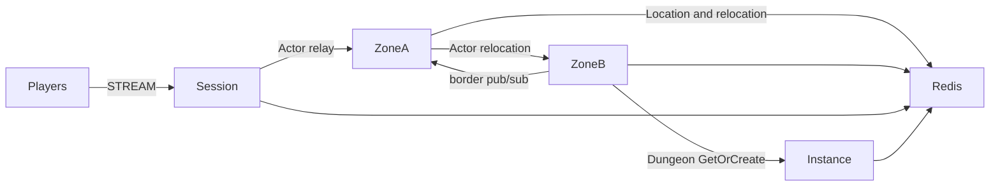

# MyGame seamless world

This template runs a persistent player Actor across six Zones on two physical nodes. Zone border visibility uses the `border` logical multicast channel. A separate Instance node creates Dungeon User Spots on demand.



## Prerequisites

- C++20 compiler, CMake 3.24 or later, Ninja, Git, and vcpkg. Windows builds use a Visual Studio 2022 developer shell.
- Docker with Compose v2 and a running daemon. The runner starts its own Redis container with an ephemeral loopback port.
- PowerShell 7 on Windows; Bash on Linux.
- Public Framework package 0.30.1 and its zlink / zlink-cpp 1.19.0 dependencies, pinned in `vcpkg.json`. A Framework license must be available under the public package's licensing rules.

Clone the zlink repository at tag `framework-cpp/v0.30.1`. Set `VCPKG_ROOT` to your vcpkg checkout and `VCPKG_OVERLAY_PORTS` to the tagged checkout's `vcpkg/ports` directory. zlink packages use that official overlay rather than the default vcpkg registry. The template contains no checkout path or Framework source reference. Version 0.30.1 is a release prerequisite; the 0.30.0 validation results are listed below.

## Build

Run from this directory:

```sh
cmake --preset default
cmake --build --preset default
```

The same commands apply in a Windows developer shell. Executables are written to `build/bin/`: `my-game-session`, `my-game-zone`, `my-game-instance`, and `my-game-e2e`. Each server takes one configuration file argument. `server/config` contains the initial deployment configuration; listeners bind port zero and report Framework-published endpoints through `READY`.

## Local e2e

Linux:

```sh
./run-e2e.sh
./run-e2e.sh --scenario cross,border,reconnect
```

Windows:

```powershell
pwsh -NoProfile -File ./run-e2e.ps1
pwsh -NoProfile -File ./run-e2e.ps1 -Scenario cross,border,reconnect
```

The C++ runner checks `zlink.structure.json`, starts Redis and the four node processes, runs scenarios, and shuts down its own resources. Logs and generated configurations remain in `.logs/run-<id>/`. A scenario or cleanup failure returns exit code 1. The default scenario order is:

| Scenario | Assertion |
| --- | --- |
| `cross` | Move from x=299 on zone-3 / Zone A to x=300 on zone-4 / Zone B, preserving Actor and Session identity; continue movement and open a Dungeon. |
| `border` | A player at x=300 receives the adjacent Zone's authoritative update for another player moving to x=298. |
| `reconnect` | A new physical Session binds the same Actor generation and retains position and movement sequence. |
| `update` | Drain Zone A while moving, observe relocation and SafeToShutdown, preserve Session and world state, replace Zone A, and verify fresh Actor creation and movement. |

`build/bin/my-game-e2e --check-structure` checks the actual project files without starting Docker. The structure checker accepts valid added nodes and reordered edges; it rejects inconsistent IDs, owner references, channels, stable types, scenario order, and escaping configuration paths.

## Known issues

Public 0.30.0 is not an accepted runtime for this template. Spot subscription registration takes only a topic and fixes the subscription channel to MeshName, while the public C++ contract requires `add_subscribe(channel_name, topic)`; a `border` publication therefore cannot reach its subscriber. The template reports the missing public API at Zone startup instead of changing the channel ([#1783](https://github.com/zlink-systems/zlink/issues/1783)).

The C++ lifecycle status has no `SafeToShutdown` field, so drain completion cannot be observed ([#1740](https://github.com/zlink-systems/zlink/issues/1740)). Before the startup check was added, a failed cross-node deferred Actor Join terminated the Zone process with `result has no Framework error` ([#1784](https://github.com/zlink-systems/zlink/issues/1784)), and Windows host relocation reported `StateIncompatible`. A C++ Session cannot yet send a typed reply that it creates, so `SessionInfoRequest` is answered with a push instead of a request reply ([#1785](https://github.com/zlink-systems/zlink/issues/1785)). The 0.30.1 candidate must pass Windows and Linux verification before this template is declared ready.

The update fixture follows the Node reference's fresh-player check. It does not prove that the replacement physical node receives the new Actor: Actor placement is a Framework decision. A deterministic replacement-node work probe remains an acceptance gap.

Message Follow is explicitly configured to 30 seconds in shared hosting. The wait for `SAFE_TO_SHUTDOWN` is derived from that period plus the existing host relocation budget. Packet deadlines and the relocation operation budget remain unchanged.

## Deployment sequence

Start Redis, Zone A, Zone B, Instance nodes, and then the Session node. Zone A bootstraps zone-1 through zone-3; Zone B bootstraps zone-4 through zone-6 and has capacity for all six Zones. Initial actor placement and Dungeon placement remain Framework decisions.

For a planned update, write `drain` to the affected process's standard input. Wait for `RELOCATION_REQUESTED`, `RELOCATED`, and `SAFE_TO_SHUTDOWN`. Write `shutdown` and require `STOPPED` plus exit code zero before replacing the process. Use the same node configuration with `Bootstrap` set to `false` on a Zone replacement; existing logical Zones remain under Location Store authority. Every listener binds an OS-assigned port. Configure Redis endpoints and a deployment-specific key prefix for your environment.

Game messages carry world state; `SessionInfo` carries Session ID, Actor ID, and object generation from the actual bound Actor. Player movement is owned by `server/zone/domain.hpp`. Zone visibility stores player IDs and position projections, and sends pushes through the public Actor client. Relocation adapters preserve application state only.

## 한국어 실행 안내

C++20 compiler, CMake, Ninja, vcpkg와 Docker Compose를 준비한다. `framework-cpp/v0.30.1` 태그의 zlink 저장소에서 `vcpkg/ports` 경로를 `VCPKG_OVERLAY_PORTS`로 지정하고, `VCPKG_ROOT`를 설정한다. 템플릿 디렉터리에서 위 Build 명령을 실행한다.

Linux에서는 `./run-e2e.sh`, Windows에서는 `pwsh -NoProfile -File ./run-e2e.ps1`을 실행한다. runner가 실행별 Redis와 node process를 관리하며, 로그는 `.logs/run-<id>/`에 남긴다. 공개 0.30.0에서 확인된 구독 API와 relocation 차단 사항은 Known issues에 기록되어 있다. 0.30.1 후보의 양쪽 환경 검증이 끝나기 전에는 운영 배포 가능 판정을 하지 않는다.
