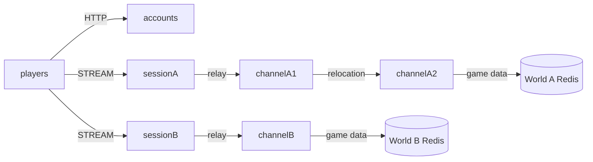

# MyGame world and channels

This C++ MMORPG template runs an accounts HTTP service, two independent worlds, and channel servers. Each world has its own Session endpoint, mesh, and Redis database. A Player Actor owns gold and persists it under `player:<id>` in its world database. Channel changes relocate the Actor while preserving the client connection.



## Prerequisites

Docker with Compose v2 and a running Linux-container daemon is required. Use Bash on Linux or PowerShell 7 on Windows. The Docker build installs the C++ toolchain and CMake; the host does not need them for the default run.

Public Framework 0.30.1 is pinned in `bootstrap.cmake`, the only file that names the version. `cmake -P bootstrap.cmake` downloads this platform's prebuilt from the `framework-cpp/v0.30.1` GitHub Release, checks it against the SHA-256 checksum published with it and extracts it into `.zlink/install`. The prebuilt carries Core, the C++ binding, the Framework libraries, Boost headers and nlohmann_json, so no package manager runs. The Docker build and local mode run the same script. That release must be published before the pinned build can complete. Follow the public package licensing requirements.

## Build

Build the node and runner images from this directory:

```sh
./run-e2e.sh --build-only
```

The script removes its unique image tags after checking the build. Docker retains build layers for subsequent runs.

On Windows, use PowerShell 7:

```powershell
pwsh -NoProfile -File ./run-e2e.ps1 -BuildOnly
```

`Dockerfile` defines the Ubuntu 24.04 build and runtime base once in `UBUNTU_IMAGE`. All node roles share the multi-stage image. The runner adds Docker CLI 28.5.1 to the same runtime. These base arguments can be replaced when the deployment base image becomes available.

## Docker e2e

```sh
./run-e2e.sh
./run-e2e.sh --scenario worlds,channel,reconnect,update
```

```powershell
pwsh -NoProfile -File ./run-e2e.ps1
pwsh -NoProfile -File ./run-e2e.ps1 -Scenario worlds,channel,reconnect,update
```

The runner and nodes execute in containers. The script checks structure before Redis startup, then uses a unique Compose network, project, container names and Redis key prefixes. Nodes share the runner's network namespace, preserving loopback listeners and OS-assigned ports. Configuration is copied into each node before attaching stdin and stdout; `drain`, `shutdown` and lifecycle output retain their existing protocol.

The runner removes its node containers. The script removes remaining containers carrying this run's label, its Compose resources and its image tags. Cleanup failures return exit code 1. Build and orchestration logs remain in `.logs/docker-<project>/`; node logs and generated configurations remain in `.logs/run-<id>/`. Unix runners use the caller UID and Docker socket group so those files remain caller-owned.

The runner checks the project structure before starting its Redis containers and node containers. All listeners bind port zero. Actual endpoints come from Framework readiness or the bound HTTP listener. Each run uses a distinct Compose project and Redis prefix; configurations, message-flow diagnostics, and process logs remain in `.logs/run-<id>/`.

| Scenario | Assertions |
| --- | --- |
| `worlds` | Accounts lists both actual Session endpoints; one player earns 10 gold in A and has zero in B. |
| `channel` | Channel 1 to 2 preserves gold, Actor identity, and physical Session; the target is channelA2. |
| `reconnect` | A new physical connection binds the same Actor generation, channel, and gold. |
| `update` | Draining channelA1 moves its Zone and Actors to channelA2, leaves B unchanged, and verifies a new Zone and Player work on the replacement. |

Run `./run-e2e.sh --check-structure` for an isolated structure check (PowerShell: `pwsh -NoProfile -File ./run-e2e.ps1 -CheckStructure`).

## Local debugging

Local processes remain available for debugging. Install a C++20 compiler (GCC 13 or later, or Visual Studio 2022 17.4 or later), CMake 3.24+ and Ninja. Windows requires a Visual Studio 2022 developer shell. No ZLink checkout or package manager is needed.

Build and run local processes from this directory:

```sh
./run-e2e.sh --local
```

The script runs `cmake -P bootstrap.cmake`, `cmake --preset default` and `cmake --build --preset default` before executing `build/bin/my-game-e2e`. Redis still runs in an isolated Compose project.

On Windows, run:

```powershell
pwsh -NoProfile -File ./run-e2e.ps1 -Local
```

Use `--no-build` or `-NoBuild` with local mode to reuse a debugger build. Scenario selection works in both modes. Local build-only uses `--local --build-only` or `-Local -BuildOnly`.

## Known issues

- [#1786: missing PlayerView or EarnRequest response](https://github.com/zlink-systems/zlink/issues/1786). Public 0.30.0 validation stops during world setup after local or cross-node Actor join: the expected typed push does not arrive, and no dispatch error explains its absence. Remaining scenarios depend on this setup.
- [#1740: SafeToShutdown and TeardownFailed](https://github.com/zlink-systems/zlink/issues/1740). Public 0.30.0 lacks the required SafeToShutdown observation, and validation observed node shutdown failure. The runner preserves the failure and returns a nonzero exit status.
- [#1785: typed Session reply API unavailable](https://github.com/zlink-systems/zlink/issues/1785). As approved for C++ templates, the client sends `SessionInfoRequest` and waits for a typed `SessionInfo` push. The Session reads identity from its bound Actor and uses the public bound Session send API without manual encoding.

## Deployment sequence

1. Provision separate Redis databases for worlds A and B. Set each node's `RedisEndpoint`, `WorldId`, and world-specific `KeyPrefix` consistently. Retain player keys across process updates.
2. Start channelA1, channelA2, and channelB with their corresponding `server/config/*.json` files. Each channel registers an Entry Spot and the Player factory. A1 owns `field@1`, A2 owns `field@2`, and B owns its independent `field@1`.
3. Start sessionA and sessionB. Populate accounts' `Worlds` list with their published STREAM endpoints and start accounts. Clients select a world through `GET /worlds` and send `EnterWorldRequest` first.
4. Send `drain` on channelA1's standard input. Wait for `RELOCATION_REQUESTED`, `RELOCATED`, and `SAFE_TO_SHUTDOWN`. Send `shutdown`, wait for `STOPPED` and exit zero, then start its replacement with the same configuration. The logical Zone remains on its relocation target; a new Zone on the replacement accepts Player work.

Player gold persistence currently follows the public Bingo sample's synchronous Boost.Asio Redis boundary. It uses one short connection per load/save and runs no background application queue. Production storage can replace `server/channel/data.hpp` without changing Actor, Session, or relocation contracts.

ChannelA1 has a one-Zone capacity and starts before channelA2, whose capacity is two.
This places each fixed Zone on its declared initial owner and leaves room for drain.
After replacement, update sends `create-update-zone` and waits for `UPDATE_ZONE_CREATED`.
The command creates verification Zone `field@3` through the public Spot manager.
ChannelA2 already holds two Zones, so the replacement must host the new Zone.
A new Player joins it and earns gold; the test checks channelA1 in both responses.
Existing Players remain in their relocated Zones. The replacement uses the same configuration.
Message Follow is explicitly 30 seconds; the safe shutdown observation budget is
derived from that duration and the existing operation budget.

## 한국어 실행 안내

Docker Compose v2와 Linux 컨테이너 데몬을 준비한다. 템플릿 디렉터리에서 Linux는 `./run-e2e.sh`, Windows는 `pwsh -NoProfile -File ./run-e2e.ps1`을 실행한다. 기본 실행은 이미지 빌드부터 runner·node 컨테이너 기동과 정리까지 수행한다. Framework 버전은 `bootstrap.cmake` 한 곳에서 정하며, 빌드는 그 버전의 GitHub Release prebuilt를 받아 함께 게시된 SHA-256 체크섬으로 확인한다. Framework 0.30.1 릴리스가 게시되어야 고정 버전 빌드를 완료할 수 있다.

로컬 디버깅은 C++20 컴파일러, CMake, Ninja를 설치한 뒤 `./run-e2e.sh --local` 또는 `pwsh -NoProfile -File ./run-e2e.ps1 -Local`로 실행한다. node 로그와 설정은 `.logs/run-<id>/`, Docker 빌드·정리 로그는 `.logs/docker-<project>/`에 남는다. 공개 패키지에서 확인된 차단 사항은 Known issues를 따른다.
