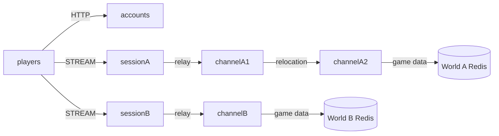

# MyGame world and channels

This C++ MMORPG template runs an accounts HTTP service, two independent worlds, and channel servers. Each world has its own Session endpoint, mesh, and Redis database. A Player Actor owns gold and persists it under `player:<id>` in its world database. Channel changes relocate the Actor while preserving the client connection.



## Prerequisites

Docker with Compose v2 and a running Linux-container daemon is required. Use Bash on Linux or PowerShell 7 on Windows. The Docker build installs the C++ toolchain and CMake; the host does not need them for the default run.

Public Framework 0.32.0 is pinned in `bootstrap.cmake`, the only file that names the version. `cmake -P bootstrap.cmake` downloads this platform's prebuilt from the `framework-cpp/v0.32.0` GitHub Release, checks it against the SHA-256 checksum published with it and extracts it into `.zlink/install`. The prebuilt carries Core, the C++ binding, the Framework libraries, Boost headers and nlohmann_json, so no package manager runs. The Docker build and local mode run the same script. Follow the public package licensing requirements.

## Client connection

### Endpoint and first packet

Connect to the Session `players` STREAM listener. `server/config/sessionA.json` and `server/config/sessionB.json` pin `StreamEndpoint` to `tcp://127.0.0.1:0`: loopback with an OS-assigned port. Read the Session stdout line `READY {"id":"...","meshEndpoint":"...","streamEndpoint":"..."}` and use its actual `streamEndpoint`, not port `0`. `server/shared/hosting.hpp` emits this value and `e2e/world.hpp` consumes it. Mesh and Redis addresses are internal endpoints.

The listener is reachable from its host/network namespace. Keep a deployment running separately from e2e, which owns and removes its nodes; configure a reachable `StreamEndpoint` interface and port and expose it from containers for external clients. This is a TCP endpoint with no HTTP/WebSocket path. Browsers, Unity WebGL and Cocos Creator web cannot connect to this default listener; those clients require a deployed WebSocket listener.

`server/config/accounts.json` configures `HttpEndpoint` as `http://127.0.0.1:0`. Accounts prints `READY {"id":"accounts","endpoint":"..."}`; use that `endpoint` plus `/worlds`. Populate `Worlds[].sessionEndpoint` with the actual bound Session endpoints before starting Accounts, as `e2e/world.hpp` does.

First GET `/worlds` from the Accounts HTTP endpoint and choose a `WorldInfo` entry (`worldId`, `name`, `sessionEndpoint`). Connect to its `sessionEndpoint`, then send `EnterWorldRequest` (`playerId`) first. Successful entry publishes `PlayerView` and channel membership updates through `ChannelView`; `ActionRejected` reports rejection. The chosen Session determines the world. Enter before sending other game packets. These operations use `send(...).submit()` and server pushes, not a correlated connector `request` reply. This template does not authenticate player identity; validate it before binding in a production game.

### Connector installation

Use the same connector release as this template pins in `bootstrap.cmake`, key `ZLINK_FRAMEWORK_CPP_VERSION`. Replace `<version>` below with that pinned value; linked guides may describe other releases. Use this template's packet names with the endpoint described above. Engine installation instructions are in the linked repository READMEs.

| Client                             | Connector installation                                                                                                                                                                                                                                                                                                                                                                                                                                                          | Documentation guide                                                                                                                                                          |
| ---------------------------------- | ------------------------------------------------------------------------------------------------------------------------------------------------------------------------------------------------------------------------------------------------------------------------------------------------------------------------------------------------------------------------------------------------------------------------------------------------------------------------------- | ---------------------------------------------------------------------------------------------------------------------------------------------------------------------------- |
| Unity                              | Native/Editor: restore `Zlink.Stream.Connector` with NuGetForUnity. WebGL: add the `com.zlink.stream-connector.webgl` UPM Git package; include only the connector assembly for the active target. See the [Unity README](https://github.com/zlink-systems/zlink/blob/main/framework/languages/engines/Unity/README.md) and its package manifest.                                                                                                                                | [.NET engine integration](https://docs.zlink.systems/dotnet/guide/stream-connector/12-engine-integration/)                                                                   |
| Unreal                             | Copy `framework/languages/cpp/connector/engines/unreal` into `Plugins/ZLinkStreamConnector`, then package the native connector under `ThirdParty/ZLink` as described in the [Unreal README](https://github.com/zlink-systems/zlink/blob/main/framework/languages/engines/Unreal/README.md).                                                                                                                                                                                     | [C++ engine integration](https://docs.zlink.systems/cpp/guide/stream-connector/12-engine-integration/)                                                                       |
| Godot                              | .NET: add the NuGet package `Zlink.Stream.Connector` and run `dotnet restore`; see the [C# README](https://github.com/zlink-systems/zlink/blob/main/framework/languages/engines/Godot/csharp/README.md). GDExtension: build the C++ Godot adapter against the framework prebuilt and matching `godot-cpp`; see the [C++ README](https://github.com/zlink-systems/zlink/blob/main/framework/languages/engines/Godot/cpp/README.md). The .NET sample does not support Web export. | [.NET](https://docs.zlink.systems/dotnet/guide/stream-connector/12-engine-integration/), [C++](https://docs.zlink.systems/cpp/guide/stream-connector/12-engine-integration/) |
| Cocos Creator                      | Web target: `npm install @zlink-systems/stream-connector@<version>`; see the [Cocos Creator README](https://github.com/zlink-systems/zlink/blob/main/framework/languages/engines/CocosCreator/README.md). This package does not provide a Creator native adapter.                                                                                                                                                                                                                  | [TypeScript engine integration](https://docs.zlink.systems/node/guide/stream-connector/12-engine-integration/)                                                               |
| Axmol                              | Copy `framework/languages/cpp/connector/engines/axmol` into `third_party/zlink_axmol_connector` and link `zlink::stream_connector` from the installed C++ framework package; see the [Axmol README](https://github.com/zlink-systems/zlink/blob/main/framework/languages/engines/Axmol/README.md).                                                                                                                                                                              | [C++ engine integration](https://docs.zlink.systems/cpp/guide/stream-connector/12-engine-integration/)                                                                       |
| Web browser (TypeScript connector) | `npm install @zlink-systems/stream-connector@<version>`; import the package root in the browser build. Use `ws://` or `wss://`, subject to the page's security policy.                                                                                                                                                                                                                                                                                                             | [TypeScript connector](https://docs.zlink.systems/node/guide/stream-connector/)                                                                                              |
| C++                                | Install the C++ framework prebuilt containing the connector; use `find_package(zlink_stream_connector_cpp CONFIG REQUIRED)` and link `zlink::stream_connector`.                                                                                                                                                                                                                                                                                                                 | [C++ connector](https://docs.zlink.systems/cpp/guide/stream-connector/)                                                                                                      |
| C#/.NET                            | `dotnet add package Zlink.Stream.Connector --version <version>`                                                                                                                                                                                                                                                                                                                                                                                                                    | [.NET connector](https://docs.zlink.systems/dotnet/guide/stream-connector/)                                                                                                  |
| Java                               | Add Maven/Gradle dependency `systems.zlink:zlink-stream-connector:<version>`.                                                                                                                                                                                                                                                                                                                                                                                                      | [Java connector](https://docs.zlink.systems/java/guide/stream-connector/)                                                                                                    |
| Kotlin                             | Add `systems.zlink:zlink-stream-connector:<version>` and `systems.zlink:zlink-framework-kotlin:<version>` for the coroutine wrapper.                                                                                                                                                                                                                                                                                                                                                  | [Kotlin connector](https://docs.zlink.systems/kotlin/guide/stream-connector/)                                                                                                |
| Node                               | `npm install @zlink-systems/stream-connector@<version>`; use the package root and Node.js 22 or later.                                                                                                                                                                                                                                                                                                                                                     | [Node connector](https://docs.zlink.systems/node/guide/stream-connector/)                                                                                                    |

### One client connection

Save the following as `connect-once.cpp` in a copy of this template. Build it as a C++20 executable with this directory on the include path and link `zlink::stream_connector` from the installed package (the existing e2e target shows the package setup). Run it with the actual Session endpoint and a fresh player ID. Complete the Accounts world-selection step above first and use that world's returned endpoint. The receive wait is registered before sending and uses the connector's configured wait deadline. See `e2e/client.hpp` and `e2e/scenarios.hpp` for the complete flow.

```cpp
#include <zlink/stream_connector.hpp>
#include "server/shared/contracts.hpp"
#include <future>
#include <iostream>
#include <memory>
#include <stdexcept>
namespace sc = zlink::stream_connector;

void checked (sc::result_t<void> result)
{
    if (!result) throw std::runtime_error (result.error ()->message);
}

int main (int argc, char **argv)
{
    if (argc != 3) return 2;
    sc::connector_options_t options;
    options.endpoint = argv[1];
    options.reconnect.enabled = false;
    options.dispatch_mode = sc::dispatch_mode_t::immediate;
    auto connector = sc::connector_factory_t::create (options);
    auto errors = connector.on_error ([] (const auto &error) {
        std::cerr << error.message << '\n';
    });
    checked (connector.connect ());
    try {
        using Reply = MyGame::PlayerView;
        auto completion = std::make_shared<std::promise<sc::result_t<sc::message_t<Reply>>>> ();
        auto received = completion->get_future ();
        connector.wait_for<Reply> ().submit ([completion] (auto result) {
            completion->set_value (std::move (result));
        });
        connector.send (MyGame::EnterWorldRequest{argv[2]}).submit ();
        const auto result = received.get ();
        if (!result) throw std::runtime_error (result.error ()->message);
        std::cout << "Received PlayerView\n";
    } catch (...) {
        checked (connector.close ());
        throw;
    }
    checked (connector.close ());
}
```

## Build

Build the node and runner images from this directory:

```sh
./run-e2e.sh --build-only
```

The script removes its unique image tags after checking the build. Docker retains build layers for subsequent runs.

On Windows, use PowerShell 7:

```powershell
pwsh -NoProfile -File ./run-e2e.ps1 -BuildOnly
```

`Dockerfile` defines the Ubuntu 24.04 build and runtime base once in `UBUNTU_IMAGE`. All node roles share the multi-stage image. The runner adds Docker CLI 28.5.1 to the same runtime. These base arguments can be replaced when the deployment base image becomes available.

## Docker e2e

```sh
./run-e2e.sh
./run-e2e.sh --scenario worlds,channel,reconnect,update
```

```powershell
pwsh -NoProfile -File ./run-e2e.ps1
pwsh -NoProfile -File ./run-e2e.ps1 -Scenario worlds,channel,reconnect,update
```

The runner and nodes execute in containers. The script checks structure before Redis startup, then uses a unique Compose network, project, container names and Redis key prefixes. Nodes share the runner's network namespace, preserving loopback listeners and OS-assigned ports. Configuration is copied into each node before attaching stdin and stdout; `drain`, `shutdown` and lifecycle output retain their existing protocol.

The runner removes its node containers. The script removes remaining containers carrying this run's label, its Compose resources and its image tags. Cleanup failures return exit code 1. Build and orchestration logs remain in `.logs/docker-<project>/`; node logs and generated configurations remain in `.logs/run-<id>/`. Unix runners use the caller UID and Docker socket group so those files remain caller-owned.

The runner checks the project structure before starting its Redis containers and node containers. All listeners bind port zero. Actual endpoints come from Framework readiness or the bound HTTP listener. Each run uses a distinct Compose project and Redis prefix; configurations, message-flow diagnostics, and process logs remain in `.logs/run-<id>/`.

| Scenario | Assertions |
| --- | --- |
| `worlds` | Accounts lists both actual Session endpoints. A repeated earn is rejected without changing gold, returns `earn-too-soon` with `retryAfterMs`, and succeeds after that duration. The same player starts with zero gold in B. |
| `channel` | Players in one channel see each other in `ChannelView`; another channel is isolated. Oversized channel requests return `integer-out-of-range` without changing membership. A move and disconnect remove players from the previous list. Session rejects internal packets with `packet-not-allowed`; channel relocation preserves gold, Actor identity, and physical Session. |
| `reconnect` | A new physical connection binds the same Actor generation, channel, and gold. |
| `update` | Draining channelA1 moves its Zone and Actors to channelA2, leaves B unchanged, and verifies a new Zone and Player work on the replacement. |

Run `./run-e2e.sh --check-structure` for an isolated structure check (PowerShell: `pwsh -NoProfile -File ./run-e2e.ps1 -CheckStructure`).

## Local debugging

Local processes remain available for debugging. Install a C++20 compiler (GCC 13 or later, or Visual Studio 2022 17.4 or later), CMake 3.24+ and Ninja. Windows requires a Visual Studio 2022 developer shell. No ZLink checkout or package manager is needed.

Build and run local processes from this directory:

```sh
./run-e2e.sh --local
```

The script runs `cmake -P bootstrap.cmake`, `cmake --preset default` and `cmake --build --preset default` before executing `build/bin/my-game-e2e`. Redis still runs in an isolated Compose project.

On Windows, run:

```powershell
pwsh -NoProfile -File ./run-e2e.ps1 -Local
```

Use `--no-build` or `-NoBuild` with local mode to reuse a debugger build. Scenario selection works in both modes. Local build-only uses `--local --build-only` or `-Local -BuildOnly`.

## Framework behavior to know

- **Waiting for DB or file I/O in a handler** — An ordinary async terminal holds the turn, while `Yield` lets other handlers on the same Spot proceed. [Guide](https://docs.zlink.systems/cpp/guide/server/32-execution-model/#io-worker-wait). [server/channel/player.hpp:45](server/channel/player.hpp).
- **Creation that misses its deadline** — `DeadlineExceeded` and caller cancellation have distinct outcomes. [Guide](https://docs.zlink.systems/cpp/guide/server/22-actor/#creation-deadline). [server/session/session.hpp:42](server/session/session.hpp).
- **Many logins at once** — Each creation for a different ID requires a Location Store round trip, so measure expected load when setting the deadline. [Guide](https://docs.zlink.systems/cpp/guide/server/25-location/#creation-load).
- **Sending under load** — A send waits for capacity and the application observes only its final result. [Guide](https://docs.zlink.systems/cpp/guide/server/33-backpressure/#send-backpressure). [server/channel/player.hpp:27](server/channel/player.hpp).
- **Duplicate login** — Without a callback, binding a different Session is accepted; reject it in the Actor duplicate-bind callback to prevent it. [Guide](https://docs.zlink.systems/cpp/guide/server/39-session-binding/#duplicate-session-bind). This template keeps the default (accepts the new Session).
- **ObjectGeneration** — `ObjectGeneration` identifies a logical incarnation of the same ID; it is neither a data version nor write authority. [Guide](https://docs.zlink.systems/cpp/guide/server/34-activation-lifetime/#object-generation). [server/session/session.hpp:76](server/session/session.hpp).
- **READY and Serving** — Framework nodes print `READY` after observing runtime `Serving`; the Accounts process prints `READY` without a Framework runtime. [Guide](https://docs.zlink.systems/cpp/guide/server/12-operations/#wait-for-serving). [server/shared/hosting.hpp:52](server/shared/hosting.hpp); [server/shared/hosting.hpp:96](server/shared/hosting.hpp). [server/accounts/main.cpp:107](server/accounts/main.cpp).

## Known issues

Validated against the published Framework 0.32.0 packages.

This template answers `SessionInfoRequest` with a typed `SessionInfo` push; Framework 0.30.2 added a typed Session reply through `reply_packet` (#1785), and the template has not switched to it.

- [#1786](https://github.com/zlink-systems/zlink/issues/1786) (open, planned for 0.31.0): the first push sent from `on_actor_joined` after a deferred join can be lost without an error; it was not observed in 0.31.0 validation.

## Deployment sequence

1. Provision separate Redis databases for worlds A and B. Set each node's `RedisEndpoint`, `WorldId`, and world-specific `KeyPrefix` consistently. Retain player keys across process updates.
2. Start channelA1, channelA2, and channelB with their corresponding `server/config/*.json` files. Each channel registers an Entry Spot and the Player factory. A1 owns `field@1`, A2 owns `field@2`, and B owns its independent `field@1`.
3. Start sessionA and sessionB. Populate accounts' `Worlds` list with their published STREAM endpoints and start accounts. Clients select a world through `GET /worlds` and send `EnterWorldRequest` first.
4. Send `drain` on channelA1's standard input. Wait for `RELOCATION_REQUESTED`, `RELOCATED`, and `SAFE_TO_SHUTDOWN`. Send `shutdown`, wait for `STOPPED` and exit zero, then start its replacement with the same configuration. The logical Zone remains on its relocation target; a new Zone on the replacement accepts Player work.

Player gold persistence uses an asynchronous Boost.Asio Redis client in `server/channel/data.hpp` with one short connection per load/save. Commands run on that client's own I/O thread and return Framework tasks; `Zone::earn` awaits the save through the Spot's I/O worker, so no handler thread waits on a socket. Production storage can replace `server/channel/data.hpp` without changing Actor, Session, or relocation contracts.

`GoldBalance` grants 10 gold per accepted request, enforces a 1000 ms monotonic interval, and rejects a result above `9,007,199,254,740,991` without changing state. Its Actor relocation snapshot stores the remaining cooldown in milliseconds. Each Zone owns its connected player IDs and includes them in its relocation snapshot. `ChannelViewRequest` returns the Zone's current list. A channel move keeps the client Session bound while the Player Actor changes Zones, so the list follows Zone membership callbacks.

ChannelA1 has a one-Zone capacity and starts before channelA2, whose capacity is two.
This places each fixed Zone on its declared initial owner and leaves room for drain.
After replacement, update sends `create-update-zone` and waits for `UPDATE_ZONE_CREATED`.
The command creates verification Zone `field@3` through the public Spot manager.
ChannelA2 already holds two Zones, so the replacement must host the new Zone.
A new Player joins it and earns gold; the test checks channelA1 in both responses.
Existing Players remain in their relocated Zones. The replacement uses the same configuration.
Message Follow is explicitly 30 seconds; the safe shutdown observation budget is
derived from that duration and the existing operation budget.
