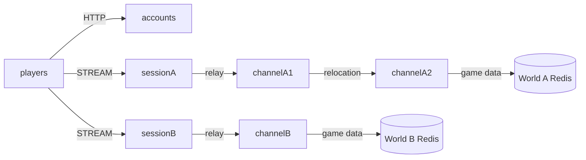

# MyGame world and channels

This C++ MMORPG template runs an accounts HTTP service, two independent worlds, and channel servers. Each world has its own Session endpoint, mesh, and Redis database. A Player Actor owns gold and persists it under `player:<id>` in its world database. Channel changes relocate the Actor while preserving the client connection.



## Prerequisites

CMake 3.24+, Ninja, a C++20 compiler, vcpkg, Docker Compose v2, and PowerShell 7 on Windows are required. Use a Visual Studio developer shell on Windows. Set `VCPKG_ROOT` to your vcpkg installation. The template depends on the public ZLink Framework 0.30.1 package and its matching binding versions, pinned in `vcpkg.json`.

ZLink uses its official overlay ports rather than the default vcpkg registry. Obtain the ZLink repository at tag `framework-cpp/v0.30.1` and set `VCPKG_OVERLAY_PORTS` to its `vcpkg/ports` directory. No repository checkout is required inside this project. The 0.30.1 tag must be published before the pinned build can resolve it.

## Build

Linux or WSL:

```sh
cmake --preset default && cmake --build --preset default
```

Windows:

```powershell
cmake --preset default; if ($LASTEXITCODE -eq 0) { cmake --build --preset default }
```

## Local e2e

```sh
./run-e2e.sh
./run-e2e.sh --scenario worlds,channel,reconnect,update
```

```powershell
pwsh -NoProfile -File ./run-e2e.ps1
pwsh -NoProfile -File ./run-e2e.ps1 -Scenario worlds,channel,reconnect,update
```

The runner checks the project structure before starting its Redis containers and node processes. All listeners bind port zero. Actual endpoints come from Framework readiness or the bound HTTP listener. Each run uses a distinct Compose project and Redis prefix; configurations, message-flow diagnostics, and process logs remain in `.logs/run-<id>/`.

| Scenario | Assertions |
| --- | --- |
| `worlds` | Accounts lists both actual Session endpoints; one player earns 10 gold in A and has zero in B. |
| `channel` | Channel 1 to 2 preserves gold, Actor identity, and physical Session; the target is channelA2. |
| `reconnect` | A new physical connection binds the same Actor generation, channel, and gold. |
| `update` | Draining channelA1 moves its Zone and Actors to channelA2, leaves B unchanged, and permits new Actor creation on the replacement process. |

Run `build/bin/my-game-e2e --root . --check-structure` for an isolated structure check (`.exe` on Windows).

## Known issues

Public C++ Framework 0.30.0 exposes `stream_t::reply_packet(message_t)` but no typed Session reply API. `SessionInfoRequest` remains a request; the server reports the missing typed reply capability instead of using a push or manually encoded payload. Identity assertions require a public typed reply API before they can pass.

Public 0.30.0 also has registered host shutdown and SafeToShutdown limitations (#1740), relocation handoff waiting (#1771), new Actor placement without Entry Spots (#1772), and bound Session send-route availability (#1775). The runner preserves failures and returns a nonzero exit status; it does not compensate with retries or longer deadlines. These issues require candidate package validation before deployment.

Validation on Windows and WSL with public 0.30.0 currently stops at the first `EnterWorldRequest`: message-flow reaches `field@1`'s Actor `location_committed`, but the client receives no initial `PlayerView`. The remaining game scenarios are blocked at this shared prerequisite. The candidate package must resolve or classify this failure as well as the typed reply gap.

## Deployment sequence

1. Provision separate Redis databases for worlds A and B. Set each node's `RedisEndpoint`, `WorldId`, and world-specific `KeyPrefix` consistently. Retain player keys across process updates.
2. Start channelA1, channelA2, and channelB with their corresponding `server/config/*.json` files. Each channel registers an Entry Spot and the Player factory. A1 owns `field@1`, A2 owns `field@2`, and B owns its independent `field@1`.
3. Start sessionA and sessionB. Populate accounts' `Worlds` list with their published STREAM endpoints and start accounts. Clients select a world through `GET /worlds` and send `EnterWorldRequest` first.
4. Send `drain` on channelA1's standard input. Wait for `RELOCATION_REQUESTED`, `RELOCATED`, and `SAFE_TO_SHUTDOWN`. Send `shutdown`, wait for `STOPPED` and exit zero, then start its replacement with the same configuration. The logical Zone remains on its relocation target; the replacement accepts new Actor work.

Player gold persistence currently follows the public Bingo sample's synchronous Boost.Asio Redis boundary. It uses one short connection per load/save and runs no background application queue. Production storage can replace `server/channel/data.hpp` without changing Actor, Session, or relocation contracts.

## 한국어 실행 안내

ZLink 저장소의 `framework-cpp/v0.30.1` 태그와 vcpkg를 준비하고 `VCPKG_ROOT`, `VCPKG_OVERLAY_PORTS`를 설정하십시오. Windows에서는 Visual Studio 개발자 셸에서 빌드합니다. Docker Compose가 실행 중이어야 e2e runner가 월드별 Redis를 생성할 수 있습니다.

위 Build와 Local e2e 명령으로 빌드·검증합니다. 실행 기록은 `.logs/run-<id>/`에 보존됩니다. 공개 패키지의 typed Session reply 및 종료·relocation 제약은 Known issues에 기록되어 있으며, 해당 제약을 해결한 패키지로 검증하기 전에는 전체 시나리오 통과로 판정하지 않습니다.
