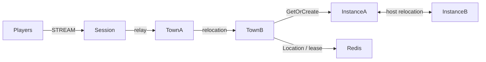

# MyGame channel town

Players gather in two town channels, form parties of up to four members, and enter a dedicated dungeon per party. Town Spots own channel membership and parties; Dungeon Spots own the party roster and stage. Player Actors retain their Framework identity across channel travel, reconnection and host relocation.



## Prerequisites

- C++20 compiler, CMake 3.24 or later, Ninja, Git and vcpkg. Windows requires a Visual Studio 2022 developer shell.
- Docker with Compose v2 and a running daemon; PowerShell 7 on Windows or Bash on Linux.
- Public Framework 0.30.1 with zlink / zlink-cpp 1.19.0, pinned centrally in `vcpkg.json`. Provide a Framework license according to the public package licensing rules.

Clone the zlink repository at tag `framework-cpp/v0.30.1`. Set `VCPKG_ROOT` to your vcpkg checkout and `VCPKG_OVERLAY_PORTS` to that tagged checkout's `vcpkg/ports` directory. These official overlay ports supply the zlink packages, which are not in the default vcpkg registry. No repository path is embedded in this template.

## Build

Run from this directory in Bash or a Windows developer shell:

```sh
cmake --preset default
cmake --build --preset default
```

Executables are written to `build/bin/`: `my-game-session`, `my-game-town`, `my-game-instance`, and `my-game-e2e`. Each server accepts its JSON configuration path as its only argument. Node roles have separate entrypoints; the two Town processes and two Instance processes share their role's executable.

## Local e2e

Linux:

```sh
./run-e2e.sh
./run-e2e.sh --scenario channel,dungeon,reconnect,update
```

Windows:

```powershell
pwsh -NoProfile -File ./run-e2e.ps1
pwsh -NoProfile -File ./run-e2e.ps1 -Scenario channel,dungeon,reconnect,update
```

The runner validates the actual structure files, starts Redis with an OS-assigned loopback port, starts five node processes, executes the selected scenarios and cleans up its own resources. Each run uses a unique Compose project and Redis key prefix. Configurations and stdout/stderr logs, including Normal message-flow diagnostics, remain in `.logs/run-<id>/`. Cleanup failure returns exit code 1.

| Scenario | Assertions |
| --- | --- |
| `channel` | Move from town-1 on townA to town-2 on townB while preserving the physical Session and Actor generation. |
| `dungeon` | Two players create and join a party, enter the same dungeon at stage 0 and both receive stage 1 after Advance. |
| `reconnect` | Reconnect the second player with a new physical Session, retaining Actor identity, dungeon roster and stage. |
| `update` | Drain the active Instance, observe relocation and SafeToShutdown, preserve both Sessions and dungeon state, stop and replace that Instance, then verify fresh dungeon placement there. |

The three party scenarios share a fixture so each can run alone or in combination. Both Instance nodes have `DungeonCapacity: 1`; the occupied target leaves the replacement as the available owner for a fresh dungeon. Placement remains a Framework decision. `build/bin/my-game-e2e --check-structure` validates the actual files without starting Docker.

## Known issues

Framework 0.30.0 is a diagnostic baseline, not the required package version. Published 0.30.1 or a candidate must complete Windows and Linux validation before deployment acceptance. Public 0.30.0 runs encountered the following Framework defects; the template does not compensate for them.

- The Session's Actor GetOrCreate can be rejected when placement selects an instance node without an Entry Spot ([#1772](https://github.com/zlink-systems/zlink/issues/1772)).
- A failed cross-node deferred Join ends with `activation_rejected` and terminates the source process ([#1784](https://github.com/zlink-systems/zlink/issues/1784)).
- Planned host relocation of an instance ends with `relocation_failed` before `RELOCATED` ([#1788](https://github.com/zlink-systems/zlink/issues/1788)).
- The C++ lifecycle status has no `SafeToShutdown` field, and node shutdown reports TeardownFailed ([#1740](https://github.com/zlink-systems/zlink/issues/1740)).
- A C++ Session cannot yet send a typed reply it creates, so `SessionInfoRequest` is answered with a push ([#1785](https://github.com/zlink-systems/zlink/issues/1785)).

## Deployment sequence

Start Redis, townA (town-1), townB (town-2), instanceA, instanceB, then Session. Wait for each process's `READY` record. All listeners bind port zero and readiness reports Framework-published endpoints. Configure production Redis and key prefixes through `server/config/*.json`; distribute each actual Session endpoint to clients.

For maintenance, send `drain` on the selected process's stdin. Wait for `RELOCATION_REQUESTED`, `RELOCATED` and `SAFE_TO_SHUTDOWN`, then send `shutdown` and require `STOPPED` plus exit code 0. Start the replacement with the same configuration and wait for `READY` before assigning new work. A failed lifecycle operation must stop the deployment sequence.

All Object Servers that register Player factories also register the shared Entry and first-admission handler, including both Instance nodes. Entry admission joins the requested fixed Town channel. Each Instance declares its dynamic Dungeon factory in `zlink.structure.json`.

The e2e configuration uses one Dungeon slot per Instance. After drain, the surviving Instance is full, so only the replacement can accept the fresh Dungeon. The structure checker enforces this configuration. Message Follow remains 30 seconds; the SafeToShutdown observation budget is derived from that duration plus the existing relocation operation budget.

## 한국어 실행 안내

Framework 0.30.1 태그의 공식 vcpkg overlay port와 C++20 빌드 환경을 준비한 뒤, 이 디렉터리에서 `cmake --preset default`, `cmake --build --preset default`를 실행합니다. Docker 데몬을 기동하고 Linux에서는 `./run-e2e.sh`, Windows에서는 `pwsh -NoProfile -File ./run-e2e.ps1`을 실행합니다.

검증은 채널 이동, 파티 던전 입장과 진행, 재접속, Instance 교체 순서로 실행됩니다. 실행별 설정과 message-flow 기록은 `.logs/run-<id>/`에 보존됩니다. 공개 패키지의 결함으로 실패하면 기록을 확인하고 수정 패키지로 검증해야 하며, 재시도나 판정 완화로 통과시키지 않습니다.
