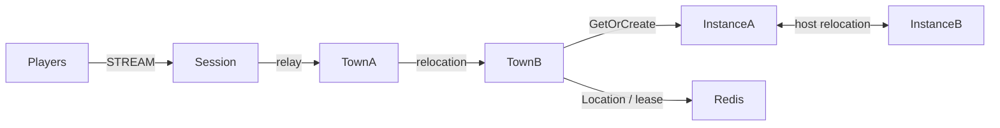

# MyGame channel town

Players gather in two town channels, form parties of up to four members, and enter a dedicated dungeon per party. Town Spots own channel membership and parties; Dungeon Spots own the party roster and stage. Player Actors retain their Framework identity across channel travel, reconnection and host relocation.



## Prerequisites

Docker with Compose v2 and a running Linux-container daemon is required. Use Bash on Linux or PowerShell 7 on Windows. The Docker build installs the C++ toolchain and CMake; the host does not need them for the default run.

Public Framework 0.30.1 is pinned in `bootstrap.cmake`, the only file that names the version. `cmake -P bootstrap.cmake` downloads this platform's prebuilt from the `framework-cpp/v0.30.1` GitHub Release, checks it against the SHA-256 checksum published with it and extracts it into `.zlink/install`. The prebuilt carries Core, the C++ binding, the Framework libraries, Boost headers and nlohmann_json, so no package manager runs. The Docker build and local mode run the same script. That release must be published before the pinned build can complete. Follow the public package licensing requirements.

## Build

Build the node and runner images from this directory:

```sh
./run-e2e.sh --build-only
```

The script removes its unique image tags after checking the build. Docker retains build layers for subsequent runs.

On Windows, use PowerShell 7:

```powershell
pwsh -NoProfile -File ./run-e2e.ps1 -BuildOnly
```

`Dockerfile` defines the Ubuntu 24.04 build and runtime base once in `UBUNTU_IMAGE`. All node roles share the multi-stage image. The runner adds Docker CLI 28.5.1 to the same runtime. These base arguments can be replaced when the deployment base image becomes available.

## Docker e2e

Linux:

```sh
./run-e2e.sh
./run-e2e.sh --scenario channel,dungeon,reconnect,update
```

Windows:

```powershell
pwsh -NoProfile -File ./run-e2e.ps1
pwsh -NoProfile -File ./run-e2e.ps1 -Scenario channel,dungeon,reconnect,update
pwsh -NoProfile -File ./run-e2e.ps1 --check-structure
```

The runner and nodes execute in containers. The script checks structure before Redis startup, then uses a unique Compose network, project, container names and Redis key prefixes. Nodes share the runner's network namespace, preserving loopback listeners and OS-assigned ports. Configuration is copied into each node before attaching stdin and stdout; `drain`, `shutdown` and lifecycle output retain their existing protocol.

The runner removes its node containers. The script removes remaining containers carrying this run's label, its Compose resources and its image tags. Cleanup failures return exit code 1. Build and orchestration logs remain in `.logs/docker-<project>/`; node logs and generated configurations remain in `.logs/run-<id>/`. Unix runners use the caller UID and Docker socket group so those files remain caller-owned.

The scripts and runner validate the actual structure files, start Redis with an OS-assigned loopback port, start five node containers, execute the selected scenarios and clean up their own resources. Each run uses a unique Compose project and Redis key prefix. Configurations and stdout/stderr logs, including Normal message-flow diagnostics, remain in `.logs/run-<id>/`. Cleanup failure returns exit code 1.

| Scenario | Assertions |
| --- | --- |
| `channel` | Move from town-1 on townA to town-2 on townB while preserving the physical Session and Actor generation. |
| `dungeon` | Two players create and join a party, enter the same dungeon at stage 0 and both receive stage 1 after Advance. |
| `reconnect` | Reconnect the second player with a new physical Session, retaining Actor identity, dungeon roster and stage. |
| `update` | Drain the active Instance, observe relocation and SafeToShutdown, preserve both Sessions and dungeon state, stop and replace that Instance, then verify fresh dungeon placement there. |

The three party scenarios share a fixture so each can run alone or in combination. Both Instance nodes have `DungeonCapacity: 1`; the occupied target leaves the replacement as the available owner for a fresh dungeon. Placement remains a Framework decision. `./run-e2e.sh --check-structure` validates the actual files without starting Redis or game nodes.

## Local debugging

Local processes remain available for debugging. Install a C++20 compiler (GCC 13 or later, or Visual Studio 2022 17.4 or later), CMake 3.24+ and Ninja. Windows requires a Visual Studio 2022 developer shell. No ZLink checkout or package manager is needed.

Build and run local processes from this directory:

```sh
./run-e2e.sh --local
```

The script runs `cmake -P bootstrap.cmake`, `cmake --preset default` and `cmake --build --preset default` before executing `build/bin/my-game-e2e`. Redis still runs in an isolated Compose project.

On Windows, run:

```powershell
pwsh -NoProfile -File ./run-e2e.ps1 -Local
```

Use `--no-build` or `-NoBuild` with local mode to reuse a debugger build. Scenario selection works in both modes. Local build-only uses `--local --build-only` or `-Local -BuildOnly`.

## Known issues

Framework 0.30.0 is a diagnostic baseline, not the required package version. Published 0.30.1 or a candidate must complete Windows and Linux validation before deployment acceptance. Public 0.30.0 runs encountered the following Framework defects; the template does not compensate for them.

- The Session's Actor GetOrCreate can be rejected when placement selects an instance node without an Entry Spot ([#1772](https://github.com/zlink-systems/zlink/issues/1772)).
- A failed cross-node deferred Join ends with `activation_rejected` and terminates the source process ([#1784](https://github.com/zlink-systems/zlink/issues/1784)).
- Planned host relocation of an instance ends with `relocation_failed` before `RELOCATED` ([#1788](https://github.com/zlink-systems/zlink/issues/1788)).
- The C++ lifecycle status has no `SafeToShutdown` field, and node shutdown reports TeardownFailed ([#1740](https://github.com/zlink-systems/zlink/issues/1740)).
- A C++ Session cannot yet send a typed reply it creates, so `SessionInfoRequest` is answered with a push ([#1785](https://github.com/zlink-systems/zlink/issues/1785)).

## Deployment sequence

Bootstrap Town providers sequentially and wait for each READY before starting the next. Each provider's public Town stable-type capacity must equal its configured fixed Town count; the structure checker enforces this. Earlier providers are full and later providers are absent, making each fixed Town's declared initial owner deterministic. Entry declarations describe the application Entry registered by Town and Instance, excluding Framework default Entries.

Start Redis, townA (town-1), townB (town-2), instanceA, instanceB, then Session. Wait for each process's `READY` record. All listeners bind port zero and readiness reports Framework-published endpoints. Configure production Redis and key prefixes through `server/config/*.json`; distribute each actual Session endpoint to clients.

For maintenance, send `drain` on the selected process's stdin. Wait for `RELOCATION_REQUESTED`, `RELOCATED` and `SAFE_TO_SHUTDOWN`, then send `shutdown` and require `STOPPED` plus exit code 0. Start the replacement with the same configuration and wait for `READY` before assigning new work. A failed lifecycle operation must stop the deployment sequence.

All Object Servers that register Player factories also register the shared Entry and first-admission handler, including both Instance nodes. Entry admission joins the requested fixed Town channel. Each Instance declares its dynamic Dungeon factory in `zlink.structure.json`.

The e2e configuration uses one Dungeon slot per Instance. After drain, the surviving Instance is full, so only the replacement can accept the fresh Dungeon. The structure checker enforces this configuration. Message Follow remains 30 seconds; the SafeToShutdown observation budget is derived from that duration plus the existing relocation operation budget.

## 한국어 실행 안내

Docker Compose v2와 Linux 컨테이너 데몬을 준비한다. 템플릿 디렉터리에서 Linux는 `./run-e2e.sh`, Windows는 `pwsh -NoProfile -File ./run-e2e.ps1`을 실행한다. 기본 실행은 이미지 빌드부터 runner·node 컨테이너 기동과 정리까지 수행한다. Framework 버전은 `bootstrap.cmake` 한 곳에서 정하며, 빌드는 그 버전의 GitHub Release prebuilt를 받아 함께 게시된 SHA-256 체크섬으로 확인한다. Framework 0.30.1 릴리스가 게시되어야 고정 버전 빌드를 완료할 수 있다.

로컬 디버깅은 C++20 컴파일러, CMake, Ninja를 설치한 뒤 `./run-e2e.sh --local` 또는 `pwsh -NoProfile -File ./run-e2e.ps1 -Local`로 실행한다. node 로그와 설정은 `.logs/run-<id>/`, Docker 빌드·정리 로그는 `.logs/docker-<project>/`에 남는다. 공개 패키지에서 확인된 차단 사항은 Known issues를 따른다.
