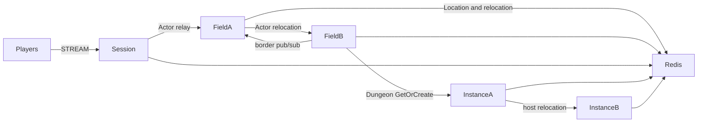

# MyGame MORPG fields and instances

This template runs a persistent player Actor across four Fields on two physical nodes. Field border visibility uses the `border` logical multicast channel. Two Instance nodes host party Dungeon User Spots and preserve dungeon stage on relocation.



## Prerequisites

- C++20 compiler, CMake 3.24 or later, Ninja, Git, and vcpkg. Windows builds use a Visual Studio 2022 developer shell.
- Docker with Compose v2 and a running daemon. The runner starts its own Redis container with an ephemeral loopback port.
- PowerShell 7 on Windows; Bash on Linux.
- Public Framework package 0.30.1 and its zlink / zlink-cpp 1.19.0 dependencies, pinned in `vcpkg.json`. A Framework license must be available under the public package's licensing rules.

Clone the zlink repository at tag `framework-cpp/v0.30.1`. Set `VCPKG_ROOT` to your vcpkg checkout and `VCPKG_OVERLAY_PORTS` to the tagged checkout's `vcpkg/ports` directory. zlink packages use that official overlay rather than the default vcpkg registry. The template contains no checkout path or Framework source reference. Version 0.30.1 is a release prerequisite; the 0.30.0 validation results are listed below.

## Build

Run from this directory:

```sh
cmake --preset default
cmake --build --preset default
```

The same commands apply in a Windows developer shell. Executables are written to `build/bin/`: `my-game-session`, `my-game-field`, `my-game-instance`, and `my-game-e2e`. Each server takes one configuration file argument. `server/config` contains the initial deployment configuration; listeners bind port zero and report Framework-published endpoints through `READY`.

## Local e2e

Linux:

```sh
./run-e2e.sh
./run-e2e.sh --scenario field,dungeon,reconnect,update
```

Windows:

```powershell
./run-e2e.ps1
./run-e2e.ps1 -Scenario field,dungeon,reconnect,update
```

The C++ runner checks `zlink.structure.json`, starts Redis and the five node processes, runs scenarios, and shuts down its own resources. Logs and generated configurations remain in `.logs/run-<id>/`. A scenario or cleanup failure returns exit code 1. The default scenario order is:

| Scenario | Assertion |
| --- | --- |
| `field` | Move from field-2 on fieldA to field-3 on fieldB, preserving Session and Actor identity; p2 receives the border publication. |
| `dungeon` | Create and join a party in one Field; enter the same fresh Dungeon and advance to the same stage. |
| `reconnect` | Reconnect a Dungeon member, retaining Actor generation, Dungeon and stage. |
| `update` | Drain the Dungeon host, preserve both Sessions and Dungeon state, replace the host and verify that it accepts a new Dungeon. |

`build/bin/my-game-e2e --check-structure` checks the actual project files without starting Docker. The structure checker accepts valid added nodes and reordered edges; it rejects inconsistent IDs, owner references, channels, stable types, scenario order, and escaping configuration paths.

## Known issues

Public 0.30.0 is not an accepted runtime for this template. Spot subscription registration takes only a topic and fixes the subscription channel to MeshName, while the public C++ contract requires `add_subscribe(channel_name, topic)`; a `border` publication therefore cannot reach its subscriber. The template reports the missing public API at Field startup instead of changing the channel ([#1783](https://github.com/zlink-systems/zlink/issues/1783)).

The C++ lifecycle status has no `SafeToShutdown` field, so drain completion cannot be observed ([#1740](https://github.com/zlink-systems/zlink/issues/1740)). A C++ Session cannot yet send a typed reply that it creates, so `SessionInfoRequest` is answered with a push instead of a request reply ([#1785](https://github.com/zlink-systems/zlink/issues/1785)). The 0.30.1 candidate must pass Windows and Linux verification before this template is declared ready.

Each selected scenario uses a fresh world. Instance capacity is one Dungeon per node, so a replacement must accept a fresh Dungeon while the surviving node holds the relocated Dungeon. Placement remains a Framework decision.

## Deployment sequence

Start Redis, fieldA, fieldB, instanceA, instanceB, and then session. fieldA bootstraps field-1 and field-2; fieldB bootstraps field-3 and field-4. Each Field node registers an Entry Spot and a Player factory. Instance nodes register Player factories and Dungeon User Spots without Entry Spots. Initial actor placement and Dungeon placement remain Framework decisions.

For a planned update, write `drain` to the affected process's standard input. Wait for `RELOCATION_REQUESTED`, `RELOCATED`, and `SAFE_TO_SHUTDOWN`. Write `shutdown` and require `STOPPED` plus exit code zero before replacing the process. Start the replacement with the same node configuration; a Field node creates its configured Fields only when they do not exist, and existing logical Fields remain under Location Store authority. Every listener binds an OS-assigned port. Configure Redis endpoints and a deployment-specific key prefix for your environment.

Game messages carry world state; `SessionInfo` carries Session ID, Actor ID, and object generation from the actual bound Actor. Parties are owned by Field state; dungeon membership and stage are owned by Dungeon state. Player movement is owned by `server/shared/player-state.hpp`; party rules are in `server/field/domain.hpp` and dungeon rules in `server/instance/domain.hpp`. Field visibility stores player IDs and position projections, and sends pushes through the public Actor client. Relocation adapters preserve application state only.

Player Actor factories and the shared Entry implementation are registered on both Field and Instance nodes. Keep one Entry declaration per Object Server in `zlink.structure.json`. The update scenario uses Dungeon capacity 1: after relocation, the occupied peer cannot create the new Dungeon, so the replacement must accept it.

Message Follow is explicitly 20 seconds, preserving the default 15-second route cache and its 5-second safety margin. Safe-shutdown observation is derived as Message Follow plus 10 seconds. Relocation operation deadlines are unchanged.

## 한국어 실행 안내

C++20 compiler, CMake, Ninja, vcpkg와 Docker Compose를 준비한다. `framework-cpp/v0.30.1` 태그의 zlink 저장소에서 `vcpkg/ports` 경로를 `VCPKG_OVERLAY_PORTS`로 지정하고, `VCPKG_ROOT`를 설정한다. 템플릿 디렉터리에서 위 Build 명령을 실행한다.

Linux에서는 `./run-e2e.sh`, Windows에서는 `./run-e2e.ps1`을 실행한다. runner가 실행별 Redis와 node process를 관리하며, 로그는 `.logs/run-<id>/`에 남긴다. 공개 0.30.0에서 확인된 구독 API와 relocation 차단 사항은 Known issues에 기록되어 있다. 0.30.1 후보의 양쪽 환경 검증이 끝나기 전에는 운영 배포 가능 판정을 하지 않는다.
