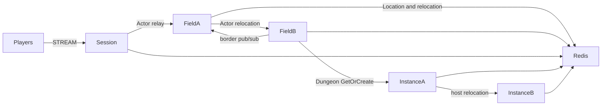

# MyGame MORPG fields and instances

This template runs a persistent player Actor across four Fields on two physical nodes. Field border visibility uses the `border` logical multicast channel. Two Instance nodes host party Dungeon User Spots and preserve dungeon stage on relocation.



## Prerequisites

Docker with Compose v2 and a running Linux-container daemon is required. Use Bash on Linux or PowerShell 7 on Windows. The Docker build installs the C++ toolchain, CMake and vcpkg; the host does not need them for the default run.

Public Framework 0.30.1 and its binding dependencies are pinned in `vcpkg.json`. The Docker build obtains the official overlay from the corresponding `framework-cpp/v0.30.1` tag. That tag and package must be published before the pinned build can complete. Follow the public package licensing requirements.

## Build

Build the node and runner images from this directory:

```sh
./run-e2e.sh --build-only
```

The script removes its unique image tags after checking the build. Docker retains build layers for subsequent runs.

On Windows, use PowerShell 7:

```powershell
pwsh -NoProfile -File ./run-e2e.ps1 -BuildOnly
```

`Dockerfile` defines the Ubuntu 24.04 build and runtime base once in `UBUNTU_IMAGE`. All node roles share the multi-stage image. The runner adds Docker CLI 28.5.1 to the same runtime. These base arguments can be replaced when the deployment base image becomes available.

## Docker e2e

Linux:

```sh
./run-e2e.sh
./run-e2e.sh --scenario field,dungeon,reconnect,update
```

Windows:

```powershell
pwsh -NoProfile -File ./run-e2e.ps1
pwsh -NoProfile -File ./run-e2e.ps1 -Scenario field,dungeon,reconnect,update
```

The runner and nodes execute in containers. The script checks structure before Redis startup, then uses a unique Compose network, project, container names and Redis key prefixes. Nodes share the runner's network namespace, preserving loopback listeners and OS-assigned ports. Configuration is copied into each node before attaching stdin and stdout; `drain`, `shutdown` and lifecycle output retain their existing protocol.

The runner removes its node containers. The script removes remaining containers carrying this run's label, its Compose resources and its image tags. Cleanup failures return exit code 1. Build and orchestration logs remain in `.logs/docker-<project>/`; node logs and generated configurations remain in `.logs/run-<id>/`. Unix runners use the caller UID and Docker socket group so those files remain caller-owned.

The C++ runner checks `zlink.structure.json`, starts Redis and the five node containers, runs scenarios, and shuts down its own resources. Logs and generated configurations remain in `.logs/run-<id>/`. A scenario or cleanup failure returns exit code 1. The default scenario order is:

| Scenario | Assertion |
| --- | --- |
| `field` | Move from field-2 on fieldA to field-3 on fieldB, preserving Session and Actor identity; p2 receives the border publication. |
| `dungeon` | Create and join a party in one Field; enter the same fresh Dungeon and advance to the same stage. |
| `reconnect` | Reconnect a Dungeon member, retaining Actor generation, Dungeon and stage. |
| `update` | Drain the Dungeon host, preserve both Sessions and Dungeon state, replace the host and verify that it accepts a new Dungeon. |

`./run-e2e.sh --check-structure` checks the actual project files without starting Redis or game nodes. The structure checker accepts valid added nodes and reordered edges; it rejects inconsistent IDs, owner references, channels, stable types, scenario order, and escaping configuration paths.

## Local debugging

Local processes remain available for debugging. Install a C++20 compiler, CMake 3.24+, Ninja, Git and vcpkg. Windows requires a Visual Studio 2022 developer shell. Set `VCPKG_ROOT` to vcpkg and `VCPKG_OVERLAY_PORTS` to `vcpkg/ports` in the ZLink checkout at tag `framework-cpp/v0.30.1`.

Build and run local processes from this directory:

```sh
./run-e2e.sh --local
```

The script runs `cmake --preset default` and `cmake --build --preset default` before executing `build/bin/my-game-e2e`. Redis still runs in an isolated Compose project.

On Windows, run:

```powershell
pwsh -NoProfile -File ./run-e2e.ps1 -Local
```

Use `--no-build` or `-NoBuild` with local mode to reuse a debugger build. Scenario selection works in both modes. Local build-only uses `--local --build-only` or `-Local -BuildOnly`.

## Known issues

Public 0.30.0 is not an accepted runtime for this template. Spot subscription registration takes only a topic and fixes the subscription channel to MeshName, while the public C++ contract requires `add_subscribe(channel_name, topic)`; a `border` publication therefore cannot reach its subscriber. The template reports the missing public API at Field startup instead of changing the channel ([#1783](https://github.com/zlink-systems/zlink/issues/1783)).

The C++ lifecycle status has no `SafeToShutdown` field, so drain completion cannot be observed ([#1740](https://github.com/zlink-systems/zlink/issues/1740)). A C++ Session cannot yet send a typed reply that it creates, so `SessionInfoRequest` is answered with a push instead of a request reply ([#1785](https://github.com/zlink-systems/zlink/issues/1785)). The 0.30.1 candidate must pass Windows and Linux verification before this template is declared ready.

Each selected scenario uses a fresh world. Instance capacity is one Dungeon per node, so a replacement must accept a fresh Dungeon while the surviving node holds the relocated Dungeon. Placement remains a Framework decision.

## Deployment sequence

Start Redis, fieldA, fieldB, instanceA, instanceB, and then session. fieldA bootstraps field-1 and field-2; fieldB bootstraps field-3 and field-4. Each Field node registers an Entry Spot and a Player factory. Instance nodes register Player factories and Dungeon User Spots without Entry Spots. Initial actor placement and Dungeon placement remain Framework decisions.

For a planned update, write `drain` to the affected process's standard input. Wait for `RELOCATION_REQUESTED`, `RELOCATED`, and `SAFE_TO_SHUTDOWN`. Write `shutdown` and require `STOPPED` plus exit code zero before replacing the process. Start the replacement with the same node configuration; a Field node creates its configured Fields only when they do not exist, and existing logical Fields remain under Location Store authority. Every listener binds an OS-assigned port. Configure Redis endpoints and a deployment-specific key prefix for your environment.

Game messages carry world state; `SessionInfo` carries Session ID, Actor ID, and object generation from the actual bound Actor. Parties are owned by Field state; dungeon membership and stage are owned by Dungeon state. Player movement is owned by `server/shared/player-state.hpp`; party rules are in `server/field/domain.hpp` and dungeon rules in `server/instance/domain.hpp`. Field visibility stores player IDs and position projections, and sends pushes through the public Actor client. Relocation adapters preserve application state only.

Player Actor factories and the shared Entry implementation are registered on both Field and Instance nodes. Declare one Entry in `zlink.structure.json` for each Field or Instance node, where the application registers Entry and its first-entry handler. Do not declare Framework default Entries on other roles. The update scenario uses Dungeon capacity 1: after relocation, the occupied peer cannot create the new Dungeon, so the replacement must accept it.

Message Follow is explicitly 30 seconds, matching the Framework default. Safe-shutdown observation is derived as Message Follow plus the relocation observation budget. Shared lifecycle constants own both values.

Initial Field placement uses public stable-type capacity and sequential startup. Set each Field node capacity to exactly its configured Field ID count. Start one Field node and wait for its READY, which follows creation of all its Fields, before starting the next Field node. Earlier nodes are full, so the newly started node is the only eligible Field host. Do not start initial Field hosts concurrently.

## 한국어 실행 안내

Docker Compose v2와 Linux 컨테이너 데몬을 준비한다. 템플릿 디렉터리에서 Linux는 `./run-e2e.sh`, Windows는 `pwsh -NoProfile -File ./run-e2e.ps1`을 실행한다. 기본 실행은 이미지 빌드부터 runner·node 컨테이너 기동과 정리까지 수행한다. Framework 0.30.1 공개 패키지와 태그가 있어야 고정 버전 빌드를 완료할 수 있다.

로컬 디버깅은 C++ 도구와 공식 vcpkg overlay를 설정한 뒤 `./run-e2e.sh --local` 또는 `pwsh -NoProfile -File ./run-e2e.ps1 -Local`로 실행한다. node 로그와 설정은 `.logs/run-<id>/`, Docker 빌드·정리 로그는 `.logs/docker-<project>/`에 남는다. 공개 패키지에서 확인된 차단 사항은 Known issues를 따른다.
