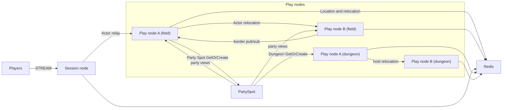

# MyGame MORPG fields and instances

This template runs a persistent player Actor across four Fields on two physical nodes. Field border visibility uses the `border` logical multicast channel. Party membership and run progress live in independent Party Spots; two play nodes (dungeon) host the party Dungeon User Spots and preserve their state on relocation.



## Prerequisites

Docker with Compose v2 and a running Linux-container daemon is required. Use Bash on Linux or PowerShell 7 on Windows. The Docker build installs the C++ toolchain and CMake; the host does not need them for the default run.

Public Framework 0.34.1 is pinned in `bootstrap.cmake`, the only file that names the version. `cmake -P bootstrap.cmake` downloads this platform's prebuilt from the `framework-cpp/v0.34.1` GitHub Release, checks it against the SHA-256 checksum published with it and extracts it into `.zlink/install`. The prebuilt carries Core, the C++ binding, the Framework libraries, Boost headers and nlohmann_json, so no package manager runs. The Docker build and local mode run the same script. Follow the public package licensing requirements.

## Client connection

### Endpoint and first packet

Connect to the Session `players` STREAM listener. `server/config/session.json` pins `StreamEndpoint` to `ws://127.0.0.1:0`: loopback with an OS-assigned port. Read the Session stdout line `READY {"id":"...","meshEndpoint":"...","streamEndpoint":"..."}` and use its actual `streamEndpoint`, not port `0`. `server/shared/hosting.hpp` emits this value and `e2e/world.hpp` consumes it. Mesh and Redis addresses are internal endpoints.

The listener is reachable from its host/network namespace. Keep a deployment running separately from e2e, which owns and removes its nodes; configure a reachable `StreamEndpoint` interface and port and expose it from containers for external clients. The checked-in configuration uses WebSocket; `e2e/world.hpp` overrides this listener to `tcp://127.0.0.1:0` for its test deployment. The WebSocket URL has no application path (use `/`). Browsers can use it; an HTTPS page requires a secure `wss://` deployment, which this default does not provide.

Send `JoinWorldRequest` (`playerId`, `x`, for example `0`) first. Successful field entry pushes `WorldState` with `fieldId`, `nodeId`, position and sequence. Join before movement, party and dungeon operations; `ActionRejected` reports rejected actions. These operations use `send(...).submit()` and server pushes, not a correlated connector `request` reply. This template does not authenticate player identity; validate it before binding in a production game.

### Connector installation

Use the same connector release as this template pins in `bootstrap.cmake`, key `ZLINK_FRAMEWORK_CPP_VERSION`. Replace `<version>` below with that pinned value; linked guides may describe other releases. Use this template's packet names with the endpoint described above. Engine installation instructions are in the linked repository READMEs.

| Client                             | Connector installation                                                                                                                                                                                                                                                                                                                                                                                                                                                          | Documentation guide                                                                                                                                                          |
| ---------------------------------- | ------------------------------------------------------------------------------------------------------------------------------------------------------------------------------------------------------------------------------------------------------------------------------------------------------------------------------------------------------------------------------------------------------------------------------------------------------------------------------- | ---------------------------------------------------------------------------------------------------------------------------------------------------------------------------- |
| Unity                              | Native/Editor: restore `Zlink.Stream.Connector` with NuGetForUnity. WebGL: add the `com.zlink.stream-connector.webgl` UPM Git package; include only the connector assembly for the active target. See the [Unity README](https://github.com/zlink-systems/zlink/blob/main/framework/languages/engines/Unity/README.md) and its package manifest.                                                                                                                                | [.NET engine integration](https://docs.zlink.systems/dotnet/guide/stream-connector/12-engine-integration/)                                                                   |
| Unreal                             | Copy `framework/languages/cpp/connector/engines/unreal` into `Plugins/ZLinkStreamConnector`, then package the native connector under `ThirdParty/ZLink` as described in the [Unreal README](https://github.com/zlink-systems/zlink/blob/main/framework/languages/engines/Unreal/README.md).                                                                                                                                                                                     | [C++ engine integration](https://docs.zlink.systems/cpp/guide/stream-connector/12-engine-integration/)                                                                       |
| Godot                              | .NET: add the NuGet package `Zlink.Stream.Connector` and run `dotnet restore`; see the [C# README](https://github.com/zlink-systems/zlink/blob/main/framework/languages/engines/Godot/csharp/README.md). GDExtension: build the C++ Godot adapter against the framework prebuilt and matching `godot-cpp`; see the [C++ README](https://github.com/zlink-systems/zlink/blob/main/framework/languages/engines/Godot/cpp/README.md). The .NET sample does not support Web export. | [.NET](https://docs.zlink.systems/dotnet/guide/stream-connector/12-engine-integration/), [C++](https://docs.zlink.systems/cpp/guide/stream-connector/12-engine-integration/) |
| Cocos Creator                      | Web target: `npm install @zlink-systems/stream-connector@<version>`; see the [Cocos Creator README](https://github.com/zlink-systems/zlink/blob/main/framework/languages/engines/CocosCreator/README.md). This package does not provide a Creator native adapter.                                                                                                                                                                                                                  | [TypeScript engine integration](https://docs.zlink.systems/node/guide/stream-connector/12-engine-integration/)                                                               |
| Axmol                              | Copy `framework/languages/cpp/connector/engines/axmol` into `third_party/zlink_axmol_connector` and link `zlink::stream_connector` from the installed C++ framework package; see the [Axmol README](https://github.com/zlink-systems/zlink/blob/main/framework/languages/engines/Axmol/README.md).                                                                                                                                                                              | [C++ engine integration](https://docs.zlink.systems/cpp/guide/stream-connector/12-engine-integration/)                                                                       |
| Web browser (TypeScript connector) | `npm install @zlink-systems/stream-connector@<version>`; import the package root in the browser build. Use `ws://` or `wss://`, subject to the page's security policy.                                                                                                                                                                                                                                                                                                             | [TypeScript connector](https://docs.zlink.systems/node/guide/stream-connector/)                                                                                              |
| C++                                | Install the C++ framework prebuilt containing the connector; use `find_package(zlink_stream_connector_cpp CONFIG REQUIRED)` and link `zlink::stream_connector`.                                                                                                                                                                                                                                                                                                                 | [C++ connector](https://docs.zlink.systems/cpp/guide/stream-connector/)                                                                                                      |
| C#/.NET                            | `dotnet add package Zlink.Stream.Connector --version <version>`                                                                                                                                                                                                                                                                                                                                                                                                                    | [.NET connector](https://docs.zlink.systems/dotnet/guide/stream-connector/)                                                                                                  |
| Java                               | Add Maven/Gradle dependency `systems.zlink:zlink-stream-connector:<version>`.                                                                                                                                                                                                                                                                                                                                                                                                      | [Java connector](https://docs.zlink.systems/java/guide/stream-connector/)                                                                                                    |
| Kotlin                             | Add `systems.zlink:zlink-stream-connector:<version>` and `systems.zlink:zlink-framework-kotlin:<version>` for the coroutine wrapper.                                                                                                                                                                                                                                                                                                                                                  | [Kotlin connector](https://docs.zlink.systems/kotlin/guide/stream-connector/)                                                                                                |
| Node                               | `npm install @zlink-systems/stream-connector@<version>`; use the package root and Node.js 22 or later.                                                                                                                                                                                                                                                                                                                                                     | [Node connector](https://docs.zlink.systems/node/guide/stream-connector/)                                                                                                    |

### One client connection

Save the following as `connect-once.cpp` in a copy of this template. Build it as a C++20 executable with this directory on the include path and link `zlink::stream_connector` from the installed package (the existing e2e target shows the package setup). Run it with the actual Session endpoint and a fresh player ID. The receive wait is registered before sending and uses the connector's configured wait deadline. See `e2e/client.hpp` and `e2e/scenarios.hpp` for the complete flow.

```cpp
#include <zlink/stream_connector.hpp>
#include "server/shared/contracts.hpp"
#include <future>
#include <iostream>
#include <memory>
#include <stdexcept>
namespace sc = zlink::stream_connector;

void checked (sc::result_t<void> result)
{
    if (!result) throw std::runtime_error (result.error ()->message);
}

int main (int argc, char **argv)
{
    if (argc != 3) return 2;
    sc::connector_options_t options;
    options.endpoint = argv[1];
    options.reconnect.enabled = false;
    options.dispatch_mode = sc::dispatch_mode_t::immediate;
    auto connector = sc::connector_factory_t::create (options);
    auto errors = connector.on_error ([] (const auto &error) {
        std::cerr << error.message << '\n';
    });
    checked (connector.connect ());
    try {
        using Reply = MyGame::WorldState;
        auto completion = std::make_shared<std::promise<sc::result_t<sc::message_t<Reply>>>> ();
        auto received = completion->get_future ();
        connector.wait_for<Reply> ().submit ([completion] (auto result) {
            completion->set_value (std::move (result));
        });
        connector.send (MyGame::JoinWorldRequest{argv[2], 0.0}).submit ();
        const auto result = received.get ();
        if (!result) throw std::runtime_error (result.error ()->message);
        std::cout << "Received WorldState\n";
    } catch (...) {
        checked (connector.close ());
        throw;
    }
    checked (connector.close ());
}
```

## Build

Build the node and runner images from this directory:

```sh
./run-e2e.sh --build-only
```

The script removes its unique image tags after checking the build. Docker retains build layers for subsequent runs.

On Windows, use PowerShell 7:

```powershell
pwsh -NoProfile -File ./run-e2e.ps1 -BuildOnly
```

`Dockerfile` defines the Ubuntu 24.04 build and runtime base once in `UBUNTU_IMAGE`. All node roles share the multi-stage image. The runner adds Docker CLI 28.5.1 to the same runtime. These base arguments can be replaced when the deployment base image becomes available.

## Docker e2e

Linux:

```sh
./run-e2e.sh
./run-e2e.sh --scenario field,dungeon,reconnect,update
./run-e2e.sh --check-domain
```

Windows:

```powershell
pwsh -NoProfile -File ./run-e2e.ps1
pwsh -NoProfile -File ./run-e2e.ps1 -Scenario field,dungeon,reconnect,update
pwsh -NoProfile -File ./run-e2e.ps1 -CheckStructure
```

The runner and nodes execute in containers. The script checks structure before Redis startup, then uses a unique Compose network, project, container names and Redis key prefixes. Nodes share the runner's network namespace, preserving loopback listeners and OS-assigned ports. Configuration is copied into each node before attaching stdin and stdout; `drain`, `shutdown` and lifecycle output retain their existing protocol.

The runner removes its node containers. The script removes remaining containers carrying this run's label, its Compose resources and its image tags. Cleanup failures return exit code 1. Build and orchestration logs remain in `.logs/docker-<project>/`; node logs and generated configurations remain in `.logs/run-<id>/`. Unix runners use the caller UID and Docker socket group so those files remain caller-owned.

The scripts and C++ runner check `zlink.structure.json`, start Redis and the five node containers, run scenarios, and shut down their own resources. Logs and generated configurations remain in `.logs/run-<id>/`. A scenario or cleanup failure returns exit code 1. The default scenario order is:

| Scenario | Assertion |
| --- | --- |
| `field` | Server issues a 32-character hexadecimal Party ID; membership and leadership survive a move from field-2 on fieldA to field-3 on fieldB, Session and Actor identity stay fixed, and p2 receives the border publication. Invalid and time-limited moves preserve state; the timed case sends the accepted and rejected requests before waiting for either reply. |
| `dungeon` | Repeated entry requests prepare one fresh Run ID; all members enter the same Dungeon, observe the Active and Completed phases, and village-only packets are rejected inside the Dungeon. Different parties receive different runs. |
| `reconnect` | Reconnect a Dungeon member, retaining Actor generation, Dungeon and stage. |
| `update` | Drain the Dungeon host, preserve both Sessions and Dungeon run state, replace the host and verify that it accepts a new Dungeon. |

`./run-e2e.sh --check-structure` checks the actual project files without starting Redis or play nodes. The structure checker accepts valid added nodes and reordered edges; it rejects inconsistent IDs, owner references, channels, Spot types, scenario order, and escaping configuration paths. `./run-e2e.sh --check-domain` runs the same domain checks as the `game-domain` CTest target without starting Redis or play nodes.

## Local debugging

Local processes remain available for debugging. Install a C++20 compiler (GCC 13 or later, or Visual Studio 2022 17.4 or later), CMake 3.24+ and Ninja. Windows requires a Visual Studio 2022 developer shell. No ZLink checkout or package manager is needed.

Build and run local processes from this directory:

```sh
./run-e2e.sh --local
```

The script runs `cmake -P bootstrap.cmake`, `cmake --preset default` and `cmake --build --preset default` before executing `build/bin/my-game-e2e`. Redis still runs in an isolated Compose project.

On Windows, run:

```powershell
pwsh -NoProfile -File ./run-e2e.ps1 -Local
```

Use `--no-build` or `-NoBuild` with local mode to reuse a debugger build. Scenario selection works in both modes. Local build-only uses `--local --build-only` or `-Local -BuildOnly`.

## Framework behavior to know

- **Waiting for DB or file I/O in a handler** — An ordinary async terminal holds the turn, while `Yield` lets other handlers on the same Spot proceed. [Guide](https://docs.zlink.systems/cpp/guide/server/32-execution-model/#io-worker-wait).
- **Creation that misses its deadline** — `DeadlineExceeded` and caller cancellation have distinct outcomes. [Guide](https://docs.zlink.systems/cpp/guide/server/22-actor/#creation-deadline). [server/session/session.hpp:34](server/session/session.hpp).
- **Many logins at once** — Each creation for a different ID requires a Location Store round trip, so measure expected load when setting the deadline. [Guide](https://docs.zlink.systems/cpp/guide/server/25-location/#creation-load).
- **Sending under load** — A send waits for capacity and the application observes only its final result. [Guide](https://docs.zlink.systems/cpp/guide/server/33-backpressure/#send-backpressure). [server/field/field.hpp:42](server/field/field.hpp).
- **Duplicate login** — Without a callback, binding a different Session is accepted; reject it in the Actor duplicate-bind callback to prevent it. [Guide](https://docs.zlink.systems/cpp/guide/server/39-session-binding/#duplicate-session-bind). This template keeps the default (accepts the new Session).
- **ObjectGeneration** — `ObjectGeneration` identifies a logical incarnation of the same ID; it is neither a data version nor write authority. [Guide](https://docs.zlink.systems/cpp/guide/server/34-activation-lifetime/#object-generation). [server/session/session.hpp:54](server/session/session.hpp).
- **READY and Serving** — Framework nodes print `READY` after observing runtime `Serving`. [Guide](https://docs.zlink.systems/cpp/guide/server/12-operations/#wait-for-serving). [server/shared/hosting.hpp:44](server/shared/hosting.hpp); [server/shared/hosting.hpp:93](server/shared/hosting.hpp).

## Known issues

Validated against the published Framework 0.34.1 packages.

This template answers `SessionInfoRequest` with a typed `SessionInfo` push; Framework 0.30.2 added a typed Session reply through `reply_packet` (#1785), and the template has not switched to it.

Each selected scenario uses a fresh world. Instance capacity is one Dungeon per node, so a replacement must accept a fresh Dungeon while the surviving node holds the relocated Dungeon. Placement remains a Framework decision.

## Deployment sequence

Start Redis, fieldA, fieldB, instanceA, instanceB, and then session. fieldA bootstraps field-1 and field-2; fieldB bootstraps field-3 and field-4. Each play node (field) registers an Entry Spot and a Player factory. Play nodes (dungeon) register Player factories and Dungeon User Spots without Entry Spots. Initial actor placement and Dungeon placement remain Framework decisions.

For a planned update, write `drain` to the affected process's standard input. Wait for `RELOCATION_REQUESTED`, `RELOCATED`, and `SAFE_TO_SHUTDOWN`. Write `shutdown` and require `STOPPED` plus exit code zero before replacing the process. Start the replacement with the same node configuration; a play node (field) creates its configured Fields only when they do not exist, and existing logical Fields remain under Location Store authority. Every listener binds an OS-assigned port. Configure Redis endpoints and a deployment-specific key prefix for your environment.

Game messages use camelCase JSON fields, string `RunPhase` values, nullable `runId` values, and 64-bit movement sequences. Party and run IDs are issued by the server as a prefix followed by 32 lowercase hexadecimal characters. A Party ID is also its independent Party Spot ID. `FieldPositionDomain` owns movement decisions and cooldown snapshots; `PlayerState` retains accepted coordinates, sequence, and Party ID. `PartyRun` owns party membership and run phases, while `DungeonRun` owns the roster, stage, and owning Party Spot ID. Field departure removes visibility and movement projection only. Field and Dungeon Spots request party state through the public `RequestToSpot` API and send pushes by Actor ID. Relocation adapters preserve application state only.

Player Actor factories and the shared Entry implementation are registered on both play nodes (field and dungeon). Play nodes (field) also register the dynamic Party Spot factory; play nodes (dungeon) register dynamic Dungeon Spots. Declare one Entry in `zlink.structure.json` for each play node (field or dungeon), where the application registers Entry and its first-entry handler. Do not declare Framework default Entries on other roles. The update scenario uses Dungeon capacity 1: after relocation, the occupied peer cannot create the new Dungeon, so the replacement must accept it.

Message Follow is explicitly 30 seconds, matching the Framework default. Safe-shutdown observation is derived as Message Follow plus the relocation observation budget. Shared lifecycle constants own both values.

Initial Field placement uses public stable-type capacity and sequential startup. Set each play node (field) capacity to exactly its configured Field ID count. Start one play node (field) and wait for its READY, which follows creation of all its Fields, before starting the next play node (field). Earlier nodes are full, so the newly started node is the only eligible play node (field). Do not start initial play nodes (field) concurrently.
