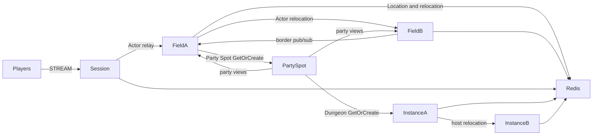

# MyGame MORPG fields and instances

This template runs a persistent player Actor across four Fields on two physical nodes. Field border visibility uses the `border` logical multicast channel. Party membership and run progress live in independent Party Spots; two Instance nodes host the party Dungeon User Spots and preserve their state on relocation.



## Prerequisites

Docker with Compose v2 and a running Linux-container daemon is required. Use Bash on Linux or PowerShell 7 on Windows. The Docker build installs the C++ toolchain and CMake; the host does not need them for the default run.

Public Framework 0.30.2 is pinned in `bootstrap.cmake`, the only file that names the version. `cmake -P bootstrap.cmake` downloads this platform's prebuilt from the `framework-cpp/v0.30.2` GitHub Release, checks it against the SHA-256 checksum published with it and extracts it into `.zlink/install`. The prebuilt carries Core, the C++ binding, the Framework libraries, Boost headers and nlohmann_json, so no package manager runs. The Docker build and local mode run the same script. Follow the public package licensing requirements.

## Build

Build the node and runner images from this directory:

```sh
./run-e2e.sh --build-only
```

The script removes its unique image tags after checking the build. Docker retains build layers for subsequent runs.

On Windows, use PowerShell 7:

```powershell
pwsh -NoProfile -File ./run-e2e.ps1 -BuildOnly
```

`Dockerfile` defines the Ubuntu 24.04 build and runtime base once in `UBUNTU_IMAGE`. All node roles share the multi-stage image. The runner adds Docker CLI 28.5.1 to the same runtime. These base arguments can be replaced when the deployment base image becomes available.

## Docker e2e

Linux:

```sh
./run-e2e.sh
./run-e2e.sh --scenario field,dungeon,reconnect,update
./run-e2e.sh --check-domain
```

Windows:

```powershell
pwsh -NoProfile -File ./run-e2e.ps1
pwsh -NoProfile -File ./run-e2e.ps1 -Scenario field,dungeon,reconnect,update
pwsh -NoProfile -File ./run-e2e.ps1 -CheckStructure
```

The runner and nodes execute in containers. The script checks structure before Redis startup, then uses a unique Compose network, project, container names and Redis key prefixes. Nodes share the runner's network namespace, preserving loopback listeners and OS-assigned ports. Configuration is copied into each node before attaching stdin and stdout; `drain`, `shutdown` and lifecycle output retain their existing protocol.

The runner removes its node containers. The script removes remaining containers carrying this run's label, its Compose resources and its image tags. Cleanup failures return exit code 1. Build and orchestration logs remain in `.logs/docker-<project>/`; node logs and generated configurations remain in `.logs/run-<id>/`. Unix runners use the caller UID and Docker socket group so those files remain caller-owned.

The scripts and C++ runner check `zlink.structure.json`, start Redis and the five node containers, run scenarios, and shut down their own resources. Logs and generated configurations remain in `.logs/run-<id>/`. A scenario or cleanup failure returns exit code 1. The default scenario order is:

| Scenario | Assertion |
| --- | --- |
| `field` | Server issues a 32-character hexadecimal Party ID; membership and leadership survive a move from field-2 on fieldA to field-3 on fieldB, Session and Actor identity stay fixed, and p2 receives the border publication. Invalid and time-limited moves preserve state; the timed case sends the accepted and rejected requests before waiting for either reply. |
| `dungeon` | Repeated entry requests prepare one fresh Run ID; all members enter the same Dungeon, observe the Active and Completed phases, and village-only packets are rejected inside the Dungeon. Different parties receive different runs. |
| `reconnect` | Reconnect a Dungeon member, retaining Actor generation, Dungeon and stage. |
| `update` | Drain the Dungeon host, preserve both Sessions and Dungeon run state, replace the host and verify that it accepts a new Dungeon. |

`./run-e2e.sh --check-structure` checks the actual project files without starting Redis or game nodes. The structure checker accepts valid added nodes and reordered edges; it rejects inconsistent IDs, owner references, channels, Spot types, scenario order, and escaping configuration paths. `./run-e2e.sh --check-domain` runs the same domain checks as the `game-domain` CTest target without starting Redis or game nodes.

## Local debugging

Local processes remain available for debugging. Install a C++20 compiler (GCC 13 or later, or Visual Studio 2022 17.4 or later), CMake 3.24+ and Ninja. Windows requires a Visual Studio 2022 developer shell. No ZLink checkout or package manager is needed.

Build and run local processes from this directory:

```sh
./run-e2e.sh --local
```

The script runs `cmake -P bootstrap.cmake`, `cmake --preset default` and `cmake --build --preset default` before executing `build/bin/my-game-e2e`. Redis still runs in an isolated Compose project.

On Windows, run:

```powershell
pwsh -NoProfile -File ./run-e2e.ps1 -Local
```

Use `--no-build` or `-NoBuild` with local mode to reuse a debugger build. Scenario selection works in both modes. Local build-only uses `--local --build-only` or `-Local -BuildOnly`.

## Known issues

Validated against the published Framework 0.30.2 packages.

This template answers `SessionInfoRequest` with a typed `SessionInfo` push; Framework 0.30.2 adds a typed Session reply API (#1785), and the template has not switched to it.

Each selected scenario uses a fresh world. Instance capacity is one Dungeon per node, so a replacement must accept a fresh Dungeon while the surviving node holds the relocated Dungeon. Placement remains a Framework decision.

## Deployment sequence

Start Redis, fieldA, fieldB, instanceA, instanceB, and then session. fieldA bootstraps field-1 and field-2; fieldB bootstraps field-3 and field-4. Each Field node registers an Entry Spot and a Player factory. Instance nodes register Player factories and Dungeon User Spots without Entry Spots. Initial actor placement and Dungeon placement remain Framework decisions.

For a planned update, write `drain` to the affected process's standard input. Wait for `RELOCATION_REQUESTED`, `RELOCATED`, and `SAFE_TO_SHUTDOWN`. Write `shutdown` and require `STOPPED` plus exit code zero before replacing the process. Start the replacement with the same node configuration; a Field node creates its configured Fields only when they do not exist, and existing logical Fields remain under Location Store authority. Every listener binds an OS-assigned port. Configure Redis endpoints and a deployment-specific key prefix for your environment.

Game messages use camelCase JSON fields, string `RunPhase` values, nullable `runId` values, and 64-bit movement sequences. Party and run IDs are issued by the server as a prefix followed by 32 lowercase hexadecimal characters. A Party ID is also its independent Party Spot ID. `FieldPositionDomain` owns movement decisions and cooldown snapshots; `PlayerState` retains accepted coordinates, sequence, and Party ID. `PartyRun` owns party membership and run phases, while `DungeonRun` owns the roster, stage, and owning Party Spot ID. Field departure removes visibility and movement projection only. Field and Dungeon Spots request party state through the public `RequestToSpot` API and send pushes by Actor ID. Relocation adapters preserve application state only.

Player Actor factories and the shared Entry implementation are registered on both Field and Instance nodes. Field nodes also register the dynamic Party Spot factory; Instance nodes register dynamic Dungeon Spots. Declare one Entry in `zlink.structure.json` for each Field or Instance node, where the application registers Entry and its first-entry handler. Do not declare Framework default Entries on other roles. The update scenario uses Dungeon capacity 1: after relocation, the occupied peer cannot create the new Dungeon, so the replacement must accept it.

Message Follow is explicitly 30 seconds, matching the Framework default. Safe-shutdown observation is derived as Message Follow plus the relocation observation budget. Shared lifecycle constants own both values.

Initial Field placement uses public stable-type capacity and sequential startup. Set each Field node capacity to exactly its configured Field ID count. Start one Field node and wait for its READY, which follows creation of all its Fields, before starting the next Field node. Earlier nodes are full, so the newly started node is the only eligible Field host. Do not start initial Field hosts concurrently.

## 한국어 실행 안내

Docker Compose v2와 Linux 컨테이너 데몬을 준비한다. 템플릿 디렉터리에서 Linux는 `./run-e2e.sh`, Windows는 `pwsh -NoProfile -File ./run-e2e.ps1`을 실행한다. 기본 실행은 이미지 빌드부터 runner·node 컨테이너 기동과 정리까지 수행한다. 도메인 판정만 확인할 때는 `./run-e2e.sh --check-domain`을 실행한다. Framework 버전은 `bootstrap.cmake` 한 곳에서 정하며, 빌드는 그 버전의 GitHub Release prebuilt를 받아 함께 게시된 SHA-256 체크섬으로 확인한다.

로컬 디버깅은 C++20 컴파일러, CMake, Ninja를 설치한 뒤 `./run-e2e.sh --local` 또는 `pwsh -NoProfile -File ./run-e2e.ps1 -Local`로 실행한다. node 로그와 설정은 `.logs/run-<id>/`, Docker 빌드·정리 로그는 `.logs/docker-<project>/`에 남는다. 공개 패키지에서 확인된 차단 사항은 Known issues를 따른다.
