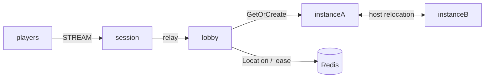

# my-game

A C++ MORPG server template with a stateless lobby entry, dynamic Party User Spots and Dungeon instances. Parties contain up to four players. The leader enters a Dungeon after every member is ready. Dungeon state survives reconnect and planned host relocation.



## Prerequisites

Use C++20, CMake 3.24 or later, Ninja, vcpkg, Docker Compose and PowerShell 7 on Windows or Bash on Linux. Windows requires the Visual Studio C++ toolchain in the current shell.

Clone the ZLink repository at tag `framework-cpp/v0.30.1` and set `VCPKG_OVERLAY_PORTS` to its `vcpkg/ports` directory. Set `VCPKG_ROOT` to your vcpkg installation. ZLink is distributed through this overlay rather than the official vcpkg registry. The manifest pins Framework 0.30.1 and its public binding dependencies. Copy this template directory alone to create a project; no repository source reference is required.

## Build

Bash:

```sh
cmake --preset default && cmake --build --preset default
```

PowerShell:

```powershell
cmake --preset default; if ($LASTEXITCODE -eq 0) { cmake --build --preset default }
```

## Local e2e

```sh
./run-e2e.sh
./run-e2e.sh --scenario party,reconnect,update
```

```powershell
pwsh -NoProfile -File ./run-e2e.ps1
pwsh -NoProfile -File ./run-e2e.ps1 -Scenario party,reconnect,update
```

The runner checks the structure. Each selected scenario starts Redis under a unique Compose project and starts lobby, instanceA, instanceB and session. Each instance admits one Dungeon, so replacement verification requires new work to use the replacement instance while the surviving instance retains the relocated Dungeon. Listener and Redis ports are assigned by the OS. Run configurations and message-flow diagnostics remain in `.logs/run-<id>/`. Cleanup errors fail the run.

| Scenario | Assertions |
| --- | --- |
| party | Membership pushes, not-ready rejection, readiness and matching stage-zero Dungeon views |
| reconnect | Same Actor and Dungeon stage, new physical Session, continued advancement |
| update | Drain observation, preserved binding and state, stopped source, replacement readiness and new work |

## Known issues

The committed version is 0.30.1; validation against public 0.30.0 uses an isolated copy and does not pass. The template does not compensate for these Framework defects.

- The first `JoinLobbyRequest` fails in the Session handler. Instance nodes register the Player factory for relocation but have no Entry Spot, and the C++ Actor GetOrCreate can be rejected for that placement ([#1772](https://github.com/zlink-systems/zlink/issues/1772)).
- The C++ lifecycle status has no `SafeToShutdown` field, so drain completion cannot be observed ([#1740](https://github.com/zlink-systems/zlink/issues/1740)).
- A C++ Session cannot yet send a typed reply it creates, so `SessionInfo` is a typed push after `SessionInfoRequest` rather than a correlated reply ([#1785](https://github.com/zlink-systems/zlink/issues/1785)). Actor identity and generation are still read from the binding.

## Deployment sequence

1. Provision Redis and configure a shared unique KeyPrefix and RedisEndpoint for this deployment.
2. Start the lobby executable with `server/config/lobby.json` and the instance executable separately with each instance configuration. Wait for their READY lines.
3. Start the session executable with `server/config/session.json`. Use its published streamEndpoint for clients.
4. For an instance update, write `drain` to its standard input and wait for RELOCATION_REQUESTED, RELOCATED and SAFE_TO_SHUTDOWN. Keep a compatible target instance available.
5. Write `shutdown`, require STOPPED and a zero process exit, then start the replacement with the same configuration and require READY before new work.

## 한국어 실행 안내

C++20 toolchain, CMake, Ninja, vcpkg와 Docker Compose를 준비합니다. ZLink의 `framework-cpp/v0.30.1` 태그에서 제공하는 overlay port 경로를 `VCPKG_OVERLAY_PORTS`로 지정하고 `VCPKG_ROOT`를 설정합니다. Build 절의 명령으로 빌드한 뒤 운영체제에 맞는 Local e2e 명령을 실행합니다.

검증은 파티 입장, 재접속, instance 교체를 실제 응답으로 확인합니다. 실행별 설정과 message-flow 기록은 `.logs/`에 보존됩니다. 공개 패키지 결함으로 실패하면 재시도나 assertion 완화로 통과시키지 말고 최초 실패 기록을 확인합니다.
