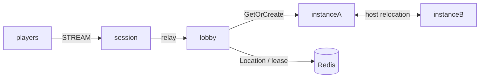

# my-game

A C++ MORPG server template with a stateless lobby entry, dynamic Party User Spots and Dungeon instances. Parties contain up to four players. The leader enters a Dungeon after every member is ready. Dungeon state survives reconnect and planned host relocation.



The Lobby and Instance roles (`lobby`, `instanceA`, and `instanceB`) explicitly register the shared stateless application Entry and initial party-admission handlers. The structure declares Entry only for those application registrations; Framework infrastructure Entry instances are not declared. Party state remains in the Lobby Party User Spot. Message Follow is explicitly 30 seconds; the safe-shutdown observation budget adds that duration to the existing host-operation budget. Each instance admits one Dungeon, so the relocated Dungeon fills the surviving instance and fresh work must use the replacement.

## Prerequisites

Docker with Compose v2 and a running Linux-container daemon is required. Use Bash on Linux or PowerShell 7 on Windows. The Docker build installs the C++ toolchain and CMake; the host does not need them for the default run.

Public Framework 0.30.2 is pinned in `bootstrap.cmake`, the only file that names the version. `cmake -P bootstrap.cmake` downloads this platform's prebuilt from the `framework-cpp/v0.30.2` GitHub Release, checks it against the SHA-256 checksum published with it and extracts it into `.zlink/install`. The prebuilt carries Core, the C++ binding, the Framework libraries, Boost headers and nlohmann_json, so no package manager runs. The Docker build and local mode run the same script. Follow the public package licensing requirements.

## Build

Build the node and runner images from this directory:

```sh
./run-e2e.sh --build-only
```

The script removes its unique image tags after checking the build. Docker retains build layers for subsequent runs.

On Windows, use PowerShell 7:

```powershell
pwsh -NoProfile -File ./run-e2e.ps1 -BuildOnly
```

`Dockerfile` defines the Ubuntu 24.04 build and runtime base once in `UBUNTU_IMAGE`. All node roles share the multi-stage image. The runner adds Docker CLI 28.5.1 to the same runtime. These base arguments can be replaced when the deployment base image becomes available.

## Docker e2e

```sh
./run-e2e.sh
./run-e2e.sh --scenario party,reconnect,update
./run-e2e.sh --check-structure
```

```powershell
pwsh -NoProfile -File ./run-e2e.ps1
pwsh -NoProfile -File ./run-e2e.ps1 -Scenario party,reconnect,update
pwsh -NoProfile -File ./run-e2e.ps1 -CheckStructure
```

The runner and nodes execute in containers. The script checks structure before Redis startup, then uses a unique Compose network, project, container names and Redis key prefixes. Nodes share the runner's network namespace, preserving loopback listeners and OS-assigned ports. Configuration is copied into each node before attaching stdin and stdout; `drain`, `shutdown` and lifecycle output retain their existing protocol.

The runner removes its node containers. The script removes remaining containers carrying this run's label, its Compose resources and its image tags. Cleanup failures return exit code 1. Build and orchestration logs remain in `.logs/docker-<project>/`; node logs and generated configurations remain in `.logs/run-<id>/`. Unix runners use the caller UID and Docker socket group so those files remain caller-owned.

The runner checks the structure. The script starts Redis under a unique Compose project. Each selected scenario starts lobby, instanceA, instanceB and session with a distinct Redis key prefix. Each instance admits one Dungeon, so replacement verification requires new work to use the replacement instance while the surviving instance retains the relocated Dungeon. Listener and Redis ports are assigned by the OS. Run configurations and message-flow diagnostics remain in `.logs/run-<id>/`. Cleanup errors fail the run.

| Scenario | Assertions |
| --- | --- |
| party | Membership pushes, not-ready rejection, readiness and matching stage-zero Dungeon views |
| reconnect | Same Actor and Dungeon stage, new physical Session, continued advancement |
| update | Drain observation, preserved binding and state, stopped source, replacement readiness and new work |

## Local debugging

Local processes remain available for debugging. Install a C++20 compiler (GCC 13 or later, or Visual Studio 2022 17.4 or later), CMake 3.24+ and Ninja. Windows requires a Visual Studio 2022 developer shell. No ZLink checkout or package manager is needed.

Build and run local processes from this directory:

```sh
./run-e2e.sh --local
```

The script runs `cmake -P bootstrap.cmake`, `cmake --preset default` and `cmake --build --preset default` before executing `build/bin/my-game-e2e`. Redis still runs in an isolated Compose project.

On Windows, run:

```powershell
pwsh -NoProfile -File ./run-e2e.ps1 -Local
```

Use `--no-build` or `-NoBuild` with local mode to reuse a debugger build. Scenario selection works in both modes. Local build-only uses `--local --build-only` or `-Local -BuildOnly`.

## Known issues

Validated against the published Framework 0.30.2 packages.

This template answers `SessionInfoRequest` with a typed `SessionInfo` push; Framework 0.30.2 adds a typed Session reply API (#1785), and the template has not switched to it.

## Deployment sequence

1. Provision Redis and configure a shared unique KeyPrefix and RedisEndpoint for this deployment.
2. Start the lobby executable with `server/config/lobby.json` and the instance executable separately with each instance configuration. Wait for their READY lines.
3. Start the session executable with `server/config/session.json`. Use its published streamEndpoint for clients.
4. For an instance update, write `drain` to its standard input and wait for RELOCATION_REQUESTED, RELOCATED and SAFE_TO_SHUTDOWN. Keep a compatible target instance available.
5. Write `shutdown`, require STOPPED and a zero process exit, then start the replacement with the same configuration and require READY before new work.

## 한국어 실행 안내

Docker Compose v2와 Linux 컨테이너 데몬을 준비한다. 템플릿 디렉터리에서 Linux는 `./run-e2e.sh`, Windows는 `pwsh -NoProfile -File ./run-e2e.ps1`을 실행한다. 기본 실행은 이미지 빌드부터 runner·node 컨테이너 기동과 정리까지 수행한다. Framework 버전은 `bootstrap.cmake` 한 곳에서 정하며, 빌드는 그 버전의 GitHub Release prebuilt를 받아 함께 게시된 SHA-256 체크섬으로 확인한다.

로컬 디버깅은 C++20 컴파일러, CMake, Ninja를 설치한 뒤 `./run-e2e.sh --local` 또는 `pwsh -NoProfile -File ./run-e2e.ps1 -Local`로 실행한다. node 로그와 설정은 `.logs/run-<id>/`, Docker 빌드·정리 로그는 `.logs/docker-<project>/`에 남는다. 공개 패키지에서 확인된 차단 사항은 Known issues를 따른다.
