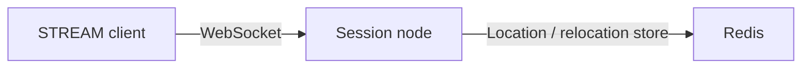

# MyGame C++ starter

Session 노드 하나가 WebSocket으로 STREAM 연결을 받고, Redis에 Location Store와 relocation 상태를 저장합니다. 서버 호스팅, 진단, 프로세스 제어, 연결 e2e를 제공합니다. 게임 패킷과 인증은 새 프로젝트에서 설계합니다.

이 템플릿은 새 게임을 설계할 때 참고하는 예제입니다. 새 프로젝트에서 게임에 맞는 노드, Spot, Actor, 메시지를 설계하고 이 템플릿의 구조와 규칙을 참고합니다. 템플릿의 이름을 바꾸거나 원본을 수정해서 게임 프로젝트로 사용하지 않습니다.



## 서버와 e2e 실행

프로젝트 디렉터리에서 명령을 실행합니다. 서버를 로컬로 빌드하려면 CMake, Ninja, C++20 컴파일러가 필요합니다. Redis를 띄우는 데 Docker Compose v2를 사용합니다. Windows에서는 Linux 컨테이너 모드와 PowerShell 7을 사용합니다.

| 셸 | 서버 실행 | 별도 터미널에서 e2e 실행 |
| --- | --- | --- |
| Bash | `./run-server.sh` | `./run-e2e.sh` |
| Windows | `.\run-server.cmd` | `.\run-e2e.cmd` |

서버가 빌드를 완료하면 Redis와 노드를 시작합니다. 게임 클라이언트는 `Server ready` 뒤에 출력된 WebSocket 주소로 접속합니다. 서버 터미널에서 Ctrl+C를 누르면 노드와 Redis가 종료됩니다. e2e는 `.logs/server.json`을 게시한 서버가 있으면 자동으로 연결합니다. 서버가 없으면 Docker에서 격리 환경을 실행합니다. 연결 시나리오에 포함된 drain과 종료 검사는 격리 실행에서 수행합니다.

각 실행의 `.logs/run-<id>/`에 노드 stdout(`*.out.log`), stderr(`*.err.log`), Framework message-flow(`*.flow.log`), 실패 상세(`failure.log`)를 저장합니다. 빌드와 Compose 로그도 `.logs/`에 저장합니다.

## 빌드와 검사

Docker는 Ubuntu 24.04에서 빌드합니다. `bootstrap.cmake`가 `framework-cpp/v0.34.0` 릴리스의 prebuilt와 SHA-256 체크섬을 다운로드하여 `.zlink/install`에 설치합니다. prebuilt에는 Core, C++ binding, Framework, Boost 헤더와 nlohmann_json이 들어 있습니다. 로컬 빌드와 Docker 빌드는 같은 bootstrap을 사용합니다.

| 작업 | Bash | Windows |
| --- | --- | --- |
| Docker 빌드 | `./run-e2e.sh --build-only` | `.\run-e2e.cmd -BuildOnly` |
| 구조 검사 | `./run-e2e.sh --check-structure` | `.\run-e2e.cmd -CheckStructure` |
| 시나리오 지정 | `./run-e2e.sh --scenario connect` | `.\run-e2e.cmd -Scenario connect` |
| 로컬 격리 실행 | `./run-e2e.sh --local` | `.\run-e2e.cmd -Local` |

`--check-structure`와 `-CheckStructure`는 구조만 검사합니다. Docker 빌드 검사가 끝나면 이번 실행의 이미지 태그를 삭제하고 빌드 레이어는 캐시에 남깁니다. 로컬 빌드를 재사용하려면 `--local --no-build` 또는 `-Local -NoBuild`를 사용합니다.

### 로컬 디버깅

GCC 13 이상 또는 Visual Studio 2022 17.4 이상과 CMake 3.24 이상, Ninja를 설치합니다. Windows에서는 Visual Studio 개발자 셸을 사용합니다. `--local` 또는 `-Local`은 `cmake -P bootstrap.cmake`, `cmake --preset default`, `cmake --build --preset default`를 실행한 뒤 `build/bin/my-game-e2e`를 띄웁니다. Redis는 격리 Compose 프로젝트에서 실행합니다. 빌드만 실행하려면 `--local --build-only` 또는 `-Local -BuildOnly`를 사용합니다.

## 클라이언트 연결

Session 설정의 `StreamEndpoint`는 `ws://127.0.0.1:0`입니다. 운영체제가 포트를 정하면 Session은 `READY`에 실제 `streamEndpoint`를 게시합니다. 로컬에서는 `run-server`가 표시하는 주소를 사용합니다. 컨테이너 외부에서 접근해야 할 때는 인터페이스와 포트를 배포 구성에서 지정합니다. mesh와 Redis 주소는 내부 연결에 사용합니다.

### 첫 패킷

Session의 `on_connected`는 게임 메시지를 발행하지 않습니다. `on_packet`은 `No application packets are registered yet.`로 게임 패킷을 거부합니다. 게임 패킷을 보내려면 typed DTO와 Session handler를 등록합니다.

### Connector 설치

`bootstrap.cmake`의 `ZLINK_FRAMEWORK_CPP_VERSION`과 같은 릴리스를 사용합니다. 브라우저에서는 페이지의 보안 정책에 맞는 `ws://` 또는 `wss://` 주소를 사용합니다.

| 클라이언트 | 설치 및 연결 가이드 |
| --- | --- |
| Unity | Native와 Editor는 NuGetForUnity에서 `Zlink.Stream.Connector`를 복원합니다. WebGL은 `com.zlink.stream-connector.webgl` UPM 패키지를 추가하고 해당 target의 assembly를 사용합니다. [Unity README](https://github.com/zlink-systems/zlink/blob/main/framework/languages/engines/Unity/README.md) [.NET engine integration](https://docs.zlink.systems/dotnet/guide/stream-connector/12-engine-integration/) |
| Unreal | `framework/languages/cpp/connector/engines/unreal`을 `Plugins/ZLinkStreamConnector`에 복사하고 네이티브 connector를 함께 패키징합니다. [Unreal README](https://github.com/zlink-systems/zlink/blob/main/framework/languages/engines/Unreal/README.md) [C++ engine integration](https://docs.zlink.systems/cpp/guide/stream-connector/12-engine-integration/) |
| Godot | .NET은 `Zlink.Stream.Connector`를 추가하고 `dotnet restore`를 실행합니다. GDExtension은 C++ adapter를 prebuilt와 동일한 버전의 `godot-cpp`로 빌드합니다. [C# README](https://github.com/zlink-systems/zlink/blob/main/framework/languages/engines/Godot/csharp/README.md) [C++ README](https://github.com/zlink-systems/zlink/blob/main/framework/languages/engines/Godot/cpp/README.md) [.NET](https://docs.zlink.systems/dotnet/guide/stream-connector/12-engine-integration/) [C++](https://docs.zlink.systems/cpp/guide/stream-connector/12-engine-integration/) |
| Cocos Creator | 웹 target에서 `npm install @zlink-systems/stream-connector@<version>`을 실행합니다. [Cocos Creator README](https://github.com/zlink-systems/zlink/blob/main/framework/languages/engines/CocosCreator/README.md) [TypeScript engine integration](https://docs.zlink.systems/node/guide/stream-connector/12-engine-integration/) |
| Axmol | `third_party/zlink_stream_connector_axmol`에 adapter를 복사하고 설치된 package의 `zlink::stream_connector`에 링크합니다. [Axmol README](https://github.com/zlink-systems/zlink/blob/main/framework/languages/engines/Axmol/README.md) [C++ engine integration](https://docs.zlink.systems/cpp/guide/stream-connector/12-engine-integration/) |
| 웹 브라우저 (TypeScript connector) | `npm install @zlink-systems/stream-connector@<version>`을 실행하고 앱에 connector를 import합니다. [TypeScript connector](https://docs.zlink.systems/node/guide/stream-connector/) |
| C++ | C++ prebuilt를 설치합니다. `find_package(zlink_stream_connector_cpp CONFIG REQUIRED)`를 호출하고 `zlink::stream_connector`에 링크합니다. [C++ connector](https://docs.zlink.systems/cpp/guide/stream-connector/) |
| Java | Maven 또는 Gradle에서 `systems.zlink:zlink-stream-connector:<version>`을 추가합니다. [Java connector](https://docs.zlink.systems/java/guide/stream-connector/) |
| Kotlin | `systems.zlink:zlink-stream-connector:<version>`과 `systems.zlink:zlink-framework-kotlin:<version>`을 추가합니다. [Kotlin connector](https://docs.zlink.systems/kotlin/guide/stream-connector/) |

### C++ 연결 예제

다음 예제를 `connect-once.cpp`로 저장하고 prebuilt의 `zlink::stream_connector`에 연결해 C++20으로 빌드합니다. 실행 인수에는 실제 Session 주소를 전달합니다.

```cpp
#include <zlink/stream_connector.hpp>
#include <iostream>
#include <stdexcept>
namespace sc = zlink::stream_connector;

void checked (sc::result_t<void> result)
{
    if (!result) throw std::runtime_error (result.error ()->message);
}

int main (int argc, char **argv)
{
    if (argc != 2) return 2;
    sc::connector_options_t options;
    options.endpoint = argv[1];
    options.reconnect.enabled = false;
    options.dispatch_mode = sc::dispatch_mode_t::immediate;
    auto connector = sc::connector_factory_t::create (options);
    auto errors = connector.on_error ([] (const auto &error) {
        std::cerr << error.message << '\n';
    });
    checked (connector.connect ());
    try {
        std::cout << "Connected; no application packets are defined.\n";
    } catch (...) {
        checked (connector.close ());
        throw;
    }
    checked (connector.close ());
}
```

## e2e 시나리오

| 시나리오 | 검사 내용 |
| --- | --- |
| `connect` | STREAM 연결과 정상 종료를 확인합니다. 격리 실행에서는 Session drain과 종료도 검사합니다. |

## 배포

배포마다 Redis 주소와 고유한 `KeyPrefix`를 설정합니다. Redis를 준비한 뒤 Session 실행 파일에 `server/config/session.json`을 전달합니다. 각 노드의 실제 주소와 구성은 `server/config/` 및 `zlink.structure.json`에서 확인합니다. 실행 파일에는 구성 JSON 경로를 전달합니다.

계획된 업데이트에서는 대상 노드의 stdin으로 `drain`을 보내고 `RELOCATION_REQUESTED`, `RELOCATED`, `SAFE_TO_SHUTDOWN`을 차례로 기다립니다. `shutdown`을 보낸 뒤 `STOPPED`와 종료 코드 0을 확인합니다. 교체 노드를 같은 구성으로 띄우고 `READY` 후 새 요청을 받습니다. 검증 중 lifecycle 작업이 실패하면 배포 절차를 중단합니다.

### 구성과 상태 소유

Docker의 `node` target은 `/app/bin/my-game-session /app/node.json`을 실행합니다. 해당 경로에 구성 파일을 두고 stdin을 열어 둡니다. Session에 RouteMesh listener가 등록되어 있으므로 Play 노드를 추가할 때는 별도 템플릿의 등록 구성과 게임 메시지를 참고합니다. starter의 drain 검사는 클라이언트가 끊긴 빈 Session을 대상으로 합니다.

## Framework 동작과 알려진 문제

- handler의 일반 async 호출은 turn을 유지합니다. DB나 파일 I/O에 `Yield`를 사용하면 같은 Spot의 다른 handler가 진행할 수 있습니다. [실행 모델](https://docs.zlink.systems/cpp/guide/server/32-execution-model/#io-worker-wait)
- 생성 기한을 초과한 경우 `DeadlineExceeded`가 발생합니다. 호출자의 취소는 별도 결과입니다. [Actor 생성](https://docs.zlink.systems/cpp/guide/server/22-actor/#creation-deadline)
- 서로 다른 ID의 생성 요청마다 Location Store 왕복이 발생합니다. 동시 로그인 부하를 측정한 뒤 기한을 설정합니다. [Location Store 부하](https://docs.zlink.systems/cpp/guide/server/25-location/#creation-load)
- send는 여유가 생길 때까지 기다리고 application에 최종 결과를 반환합니다. [백프레셔](https://docs.zlink.systems/cpp/guide/server/33-backpressure/#send-backpressure)
- 별도 callback을 등록하지 않으면 새 Session 바인딩을 수락합니다. 중복 로그인을 막으려면 Actor의 duplicate-bind callback에서 거부합니다. [Session 바인딩](https://docs.zlink.systems/cpp/guide/server/39-session-binding/#duplicate-session-bind)
- `ObjectGeneration`은 같은 ID의 논리 객체 인스턴스를 구분합니다. [객체 수명](https://docs.zlink.systems/cpp/guide/server/34-activation-lifetime/#object-generation)
- 노드는 Framework runtime이 `Serving`에 도달한 뒤 `READY`를 출력합니다. [서버 준비](https://docs.zlink.systems/cpp/guide/server/12-operations/#wait-for-serving)

C++ Framework 0.34.0에서 WebSocket으로 설정한 STREAM listener가 `tcp://` 주소를 게시할 수 있습니다. 이 경우 runner는 준비 단계에서 실패를 기록합니다. [#5460](https://github.com/zlink-systems/zlink/issues/5460)

게임별 패킷, Framework 동작과 확장 지점은 [영문 README](README.md)에 나와 있습니다.
