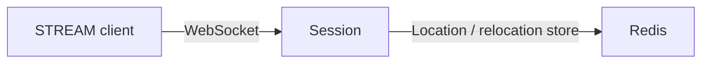

# MyGame C++ starter

This setup runs one Session node that accepts STREAM connections over WebSocket, with Redis for Location Store and relocation storage. It provides hosting, diagnostics, process control, and an e2e starting point. It contains no application Spot, Actor, Entry, authentication, subscriptions, or game packets.



## Prerequisites

Docker with Compose v2 and a running Linux-container daemon is required. Use Bash on Linux or PowerShell 7 on Windows. The Docker build installs the C++ toolchain and CMake; the host does not need them for the default run. The `Dockerfile` defines the Ubuntu 24.04 base in `UBUNTU_IMAGE` and Docker CLI 28.5.1 in `DOCKER_CLI_IMAGE`.

`bootstrap.cmake` is the only file that names the Framework version, `0.30.1`. `cmake -P bootstrap.cmake` downloads this platform's prebuilt from the `framework-cpp/v0.30.1` GitHub Release, checks it against the SHA-256 checksum published with it, and extracts it into `.zlink/install`. The prebuilt carries Core, the C++ binding, the Framework libraries, Boost headers, and nlohmann_json, so no package manager runs. The Docker build and local mode run the same script. That release must be published before this setup can build. Do not add repository source references or a private feed.

## Build

Build the node and runner images from this directory.

```sh
./run-e2e.sh --build-only
```

The build command removes its image tags after checking the build; Docker retains reusable build layers. PowerShell provides the same command.

```powershell
pwsh -NoProfile -File ./run-e2e.ps1 -BuildOnly
```

Both commands build the targets listed in `CMakeLists.txt`: `my-game-session` and `my-game-e2e`.

## Local e2e

Run the default Docker scenario from this directory.

```sh
./run-e2e.sh
./run-e2e.sh --scenario connect
```

The `connect` scenario waits for node READY, connects and closes one public STREAM connector, then checks the drain markers and a successful shutdown. PowerShell selects the same scenario.

```powershell
pwsh -NoProfile -File ./run-e2e.ps1
pwsh -NoProfile -File ./run-e2e.ps1 -Scenario connect
```

A successful run prints `✓ connect` and `Scenarios: 1/1 passed`. Cleanup failures return a nonzero exit code.

The runner and the node run in containers that share one network namespace, so loopback listeners and OS-assigned ports keep working. The runner assigns unique Redis keys and Compose names. Logs and generated run settings are in `.logs/run-<id>/`; Docker build and cleanup logs are in `.logs/docker-<project>/`.

Validate the structure without starting Redis or the node.

```sh
./run-e2e.sh --check-structure
```

PowerShell accepts `--check-structure` after the script name. Changes to registrations, settings, structure, and scenarios must be made together; see [the development guide](AGENTS.md).

## Local debugging

Install a C++20 compiler (GCC 13 or later, or Visual Studio 2022 17.4 or later), CMake 3.24+, and Ninja. Windows requires a Visual Studio 2022 developer shell. No ZLink checkout or package manager is needed.

```sh
./run-e2e.sh --local
```

The script runs `cmake -P bootstrap.cmake`, `cmake --preset default`, and `cmake --build --preset default`, then executes `build/bin/my-game-e2e`. Redis still runs in an isolated Compose project. On Windows, run:

```powershell
pwsh -NoProfile -File ./run-e2e.ps1 -Local
```

Add `--no-build` or `-NoBuild` only after a local build. Local build-only uses `--local --build-only` or `-Local -BuildOnly`.

## Known issues

On Framework 0.30.0, `drain` on this Session-only host ends in `Blocked/TargetUnavailable` after the relocation deadline, so the `connect` scenario fails at `RELOCATED`. The relocation spec ends a host that owns no Actor or Spot with `Relocated/None` without searching for a target, but the C++ relocation preflight searches for a replacement peer first (`framework/languages/cpp/framework/src/runtime/host/app.cpp:3354`). The .NET starter completes the same sequence. This starter does not compensate for the failure; the tracking issue number is recorded here when it exists.

## Deployment sequence

Start Redis, set `RedisEndpoint` and a deployment-specific `KeyPrefix` in `server/config/session.json`, then start the Session executable with the configuration path: `my-game-session <config.json>`. The Docker `node` target runs `/app/bin/my-game-session /app/node.json`; copy your settings to that path and keep stdin open. Publish STREAM on a reachable interface when clients run outside the node's network namespace.

Wait for `READY <json>` before admitting clients. It contains the node ID and the actual mesh and STREAM endpoints. This starter registers a RouteMesh listener for future node composition but registers no object server or game Entry. Add gameplay from a separately downloaded sample before using it as a game server.

After clients disconnect, write `drain` to stdin. Wait for `RELOCATION_REQUESTED`, `RELOCATED`, and `SAFE_TO_SHUTDOWN`, then write `shutdown`, wait for `STOPPED`, and verify exit code zero. `Control` in `server/shared/contracts.hpp` owns these markers. The starter checks an empty host drain; it does not demonstrate moving connected clients or game state to another node.

## 한국어 실행 안내

이 셋업은 STREAM 연결을 받는 Session node와 Redis를 실행한다. Docker 환경에서 Bash의 `./run-e2e.sh` 또는 PowerShell의 `pwsh -NoProfile -File ./run-e2e.ps1`을 실행하면 접속·종료와 drain·shutdown을 검사한다. Framework 버전은 `bootstrap.cmake` 한 곳에서 정하며, 빌드는 그 버전의 GitHub Release prebuilt를 받아 함께 게시된 SHA-256 체크섬으로 확인한다. Framework 0.30.1 릴리스가 게시되어야 빌드할 수 있다.

게임 기능은 포함하지 않는다. [한국어 개발 지침](AGENTS.ko.md)에 따라 필요한 샘플을 별도로 받아 실행한 뒤 Spot·Actor·Entry 등을 추가한다. 기능을 추가할 때 구조 선언과 구조 검사, e2e 시나리오도 함께 확장한다. 로컬 디버깅은 C++20 컴파일러, CMake, Ninja를 설치한 뒤 `./run-e2e.sh --local` 또는 `pwsh -NoProfile -File ./run-e2e.ps1 -Local`로 실행한다.
