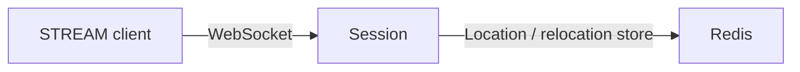

# MyGame C++ starter

This setup runs one Session node that accepts STREAM connections over WebSocket, with Redis for Location Store and relocation storage. It provides hosting, diagnostics, process control, and an e2e starting point. It contains no application Spot, Actor, Entry, authentication, subscriptions, or game packets.



## Prerequisites

Docker with Compose v2 and a running Linux-container daemon is required. Use Bash on Linux or PowerShell 7 on Windows. The Docker build installs the C++ toolchain and CMake; the host does not need them for the default run. The `Dockerfile` defines the Ubuntu 24.04 base in `UBUNTU_IMAGE` and Docker CLI 28.5.1 in `DOCKER_CLI_IMAGE`.

`bootstrap.cmake` is the only file that names the Framework version, `0.34.0`. `cmake -P bootstrap.cmake` downloads this platform's prebuilt from the `framework-cpp/v0.34.0` GitHub Release, checks it against the SHA-256 checksum published with it, and extracts it into `.zlink/install`. The prebuilt carries Core, the C++ binding, the Framework libraries, Boost headers, and nlohmann_json, so no package manager runs. The Docker build and local mode run the same script. Do not add repository source references or a private feed.

## Client connection

### Endpoint and first packet

Connect to the Session `players` STREAM listener. `server/config/session.json` pins `StreamEndpoint` to `tcp://127.0.0.1:0`: loopback with an OS-assigned port. Read the Session stdout line `READY {"id":"...","meshEndpoint":"...","streamEndpoint":"..."}` and use its actual `streamEndpoint`, not port `0`. `server/shared/hosting.hpp` emits this value and `e2e/world.hpp` consumes it. Mesh and Redis addresses are internal endpoints.

The listener is reachable from its host/network namespace. Keep a deployment running separately from e2e, which owns and removes its nodes; configure a reachable `StreamEndpoint` interface and port and expose it from containers for external clients. This is a TCP endpoint with no HTTP/WebSocket path. Browsers, Unity WebGL and Cocos Creator web cannot connect to this default listener; those clients require a deployed WebSocket listener.

This starter has no application packets or application handshake. `on_connected` completes without sending a message, and `on_packet` rejects incoming application packets with `No application packets are registered yet.` A client can connect and close; add typed DTOs and Session handlers before sending game messages.

### Connector installation

Use the same connector release as this template pins in `bootstrap.cmake`, key `ZLINK_FRAMEWORK_CPP_VERSION`. Replace `<version>` below with that pinned value; linked guides may describe other releases. Use this template's packet names with the endpoint described above. Engine installation instructions are in the linked repository READMEs.

| Client                             | Connector installation                                                                                                                                                                                                                                                                                                                                                                                                                                                          | Documentation guide                                                                                                                                                          |
| ---------------------------------- | ------------------------------------------------------------------------------------------------------------------------------------------------------------------------------------------------------------------------------------------------------------------------------------------------------------------------------------------------------------------------------------------------------------------------------------------------------------------------------- | ---------------------------------------------------------------------------------------------------------------------------------------------------------------------------- |
| Unity                              | Native/Editor: restore `Zlink.Stream.Connector` with NuGetForUnity. WebGL: add the `com.zlink.stream-connector.webgl` UPM Git package; include only the connector assembly for the active target. See the [Unity README](https://github.com/zlink-systems/zlink/blob/main/framework/languages/engines/Unity/README.md) and its package manifest.                                                                                                                                | [.NET engine integration](https://docs.zlink.systems/dotnet/guide/stream-connector/12-engine-integration/)                                                                   |
| Unreal                             | Copy `framework/languages/cpp/connector/engines/unreal` into `Plugins/ZLinkStreamConnector`, then package the native connector under `ThirdParty/ZLink` as described in the [Unreal README](https://github.com/zlink-systems/zlink/blob/main/framework/languages/engines/Unreal/README.md).                                                                                                                                                                                     | [C++ engine integration](https://docs.zlink.systems/cpp/guide/stream-connector/12-engine-integration/)                                                                       |
| Godot                              | .NET: add the NuGet package `Zlink.Stream.Connector` and run `dotnet restore`; see the [C# README](https://github.com/zlink-systems/zlink/blob/main/framework/languages/engines/Godot/csharp/README.md). GDExtension: build the C++ Godot adapter against the framework prebuilt and matching `godot-cpp`; see the [C++ README](https://github.com/zlink-systems/zlink/blob/main/framework/languages/engines/Godot/cpp/README.md). The .NET sample does not support Web export. | [.NET](https://docs.zlink.systems/dotnet/guide/stream-connector/12-engine-integration/), [C++](https://docs.zlink.systems/cpp/guide/stream-connector/12-engine-integration/) |
| Cocos Creator                      | Web target: `npm install @zlink-systems/stream-connector@<version>`; see the [Cocos Creator README](https://github.com/zlink-systems/zlink/blob/main/framework/languages/engines/CocosCreator/README.md). This package does not provide a Creator native adapter.                                                                                                                                                                                                                  | [TypeScript engine integration](https://docs.zlink.systems/node/guide/stream-connector/12-engine-integration/)                                                               |
| Axmol                              | Copy `framework/languages/cpp/connector/engines/axmol` into `third_party/zlink_axmol_connector` and link `zlink::stream_connector` from the installed C++ framework package; see the [Axmol README](https://github.com/zlink-systems/zlink/blob/main/framework/languages/engines/Axmol/README.md).                                                                                                                                                                              | [C++ engine integration](https://docs.zlink.systems/cpp/guide/stream-connector/12-engine-integration/)                                                                       |
| Web browser (TypeScript connector) | `npm install @zlink-systems/stream-connector@<version>`; import the package root in the browser build. Use `ws://` or `wss://`, subject to the page's security policy.                                                                                                                                                                                                                                                                                                             | [TypeScript connector](https://docs.zlink.systems/node/guide/stream-connector/)                                                                                              |
| C++                                | Install the C++ framework prebuilt containing the connector; use `find_package(zlink_stream_connector_cpp CONFIG REQUIRED)` and link `zlink::stream_connector`.                                                                                                                                                                                                                                                                                                                 | [C++ connector](https://docs.zlink.systems/cpp/guide/stream-connector/)                                                                                                      |
| C#/.NET                            | `dotnet add package Zlink.Stream.Connector --version <version>`                                                                                                                                                                                                                                                                                                                                                                                                                    | [.NET connector](https://docs.zlink.systems/dotnet/guide/stream-connector/)                                                                                                  |
| Java                               | Add Maven/Gradle dependency `systems.zlink:zlink-stream-connector:<version>`.                                                                                                                                                                                                                                                                                                                                                                                                      | [Java connector](https://docs.zlink.systems/java/guide/stream-connector/)                                                                                                    |
| Kotlin                             | Add `systems.zlink:zlink-stream-connector:<version>` and `systems.zlink:zlink-framework-kotlin:<version>` for the coroutine wrapper.                                                                                                                                                                                                                                                                                                                                                  | [Kotlin connector](https://docs.zlink.systems/kotlin/guide/stream-connector/)                                                                                                |
| Node                               | `npm install @zlink-systems/stream-connector@<version>`; use the package root and Node.js 22 or later.                                                                                                                                                                                                                                                                                                                                                     | [Node connector](https://docs.zlink.systems/node/guide/stream-connector/)                                                                                                    |

### One client connection

Save the following as `connect-once.cpp` in a copy of this template. Build it as a C++20 executable linked to `zlink::stream_connector` from the installed package, then run it with the actual Session endpoint. It only connects and closes.

```cpp
#include <zlink/stream_connector.hpp>
#include <iostream>
#include <stdexcept>
namespace sc = zlink::stream_connector;

void checked (sc::result_t<void> result)
{
    if (!result) throw std::runtime_error (result.error ()->message);
}

int main (int argc, char **argv)
{
    if (argc != 2) return 2;
    sc::connector_options_t options;
    options.endpoint = argv[1];
    options.reconnect.enabled = false;
    options.dispatch_mode = sc::dispatch_mode_t::immediate;
    auto connector = sc::connector_factory_t::create (options);
    auto errors = connector.on_error ([] (const auto &error) {
        std::cerr << error.message << '\n';
    });
    checked (connector.connect ());
    try {
        std::cout << "Connected; no application packets are defined.\n";
    } catch (...) {
        checked (connector.close ());
        throw;
    }
    checked (connector.close ());
}
```

## Build

Build the node and runner images from this directory.

```sh
./run-e2e.sh --build-only
```

The build command removes its image tags after checking the build; Docker retains reusable build layers. PowerShell provides the same command.

```powershell
pwsh -NoProfile -File ./run-e2e.ps1 -BuildOnly
```

Both commands build the targets listed in `CMakeLists.txt`: `my-game-session` and `my-game-e2e`.

## Local e2e

Run the default Docker scenario from this directory.

```sh
./run-e2e.sh
./run-e2e.sh --scenario connect
```

The `connect` scenario waits for node READY, connects and closes one public STREAM connector, then checks the drain markers and a successful shutdown. PowerShell selects the same scenario.

```powershell
pwsh -NoProfile -File ./run-e2e.ps1
pwsh -NoProfile -File ./run-e2e.ps1 -Scenario connect
pwsh -NoProfile -File ./run-e2e.ps1 -CheckStructure
```

A successful run prints `✓ connect` and `Scenarios: 1/1 passed`. Cleanup failures return a nonzero exit code.

The runner and the node run in containers that share one network namespace, so loopback listeners and OS-assigned ports keep working. The runner assigns unique Redis keys and Compose names. Logs and generated run settings are in `.logs/run-<id>/`; Docker build and cleanup logs are in `.logs/docker-<project>/`.

Validate the structure without starting Redis or the node.

```sh
./run-e2e.sh --check-structure
```

PowerShell uses the `-CheckStructure` switch. Changes to registrations, settings, structure, and scenarios must be made together; see [the development guide](AGENTS.md).

## Local debugging

Install a C++20 compiler (GCC 13 or later, or Visual Studio 2022 17.4 or later), CMake 3.24+, and Ninja. Windows requires a Visual Studio 2022 developer shell. No ZLink checkout or package manager is needed.

```sh
./run-e2e.sh --local
```

The script runs `cmake -P bootstrap.cmake`, `cmake --preset default`, and `cmake --build --preset default`, then executes `build/bin/my-game-e2e`. Redis still runs in an isolated Compose project. On Windows, run:

```powershell
pwsh -NoProfile -File ./run-e2e.ps1 -Local
```

Add `--no-build` or `-NoBuild` only after a local build. Local build-only uses `--local --build-only` or `-Local -BuildOnly`.

## Framework behavior to know

- **Waiting for DB or file I/O in a handler** — An ordinary async terminal holds the turn, while `Yield` lets other handlers on the same Spot proceed. [Guide](https://docs.zlink.systems/cpp/guide/server/32-execution-model/#io-worker-wait).
- **Creation that misses its deadline** — `DeadlineExceeded` and caller cancellation have distinct outcomes. [Guide](https://docs.zlink.systems/cpp/guide/server/22-actor/#creation-deadline).
- **Many logins at once** — Each creation for a different ID requires a Location Store round trip, so measure expected load when setting the deadline. [Guide](https://docs.zlink.systems/cpp/guide/server/25-location/#creation-load).
- **Sending under load** — A send waits for capacity and the application observes only its final result. [Guide](https://docs.zlink.systems/cpp/guide/server/33-backpressure/#send-backpressure).
- **Duplicate login** — Without a callback, binding a different Session is accepted; reject it in the Actor duplicate-bind callback to prevent it. [Guide](https://docs.zlink.systems/cpp/guide/server/39-session-binding/#duplicate-session-bind). This template has no Actor or duplicate-bind callback.
- **ObjectGeneration** — `ObjectGeneration` identifies a logical incarnation of the same ID; it is neither a data version nor write authority. [Guide](https://docs.zlink.systems/cpp/guide/server/34-activation-lifetime/#object-generation).
- **READY and Serving** — Framework nodes print `READY` after observing runtime `Serving`. [Guide](https://docs.zlink.systems/cpp/guide/server/12-operations/#wait-for-serving). [server/shared/hosting.hpp:43](server/shared/hosting.hpp); [server/shared/hosting.hpp:75](server/shared/hosting.hpp).

## Known issues

Validated against the published Framework 0.34.0 packages.

## Deployment sequence

Start Redis, set `RedisEndpoint` and a deployment-specific `KeyPrefix` in `server/config/session.json`, then start the Session executable with the configuration path: `my-game-session <config.json>`. The Docker `node` target runs `/app/bin/my-game-session /app/node.json`; copy your settings to that path and keep stdin open. Publish STREAM on a reachable interface when clients run outside the node's network namespace.

Wait for `READY <json>` before admitting clients. It contains the node ID and the actual mesh and STREAM endpoints. This starter registers a RouteMesh listener for future node composition but registers no object server or game Entry. Add gameplay from a separately downloaded sample before using it as a game server.

After clients disconnect, write `drain` to stdin. Wait for `RELOCATION_REQUESTED`, `RELOCATED`, and `SAFE_TO_SHUTDOWN`, then write `shutdown`, wait for `STOPPED`, and verify exit code zero. `Control` in `server/shared/contracts.hpp` owns these markers. The starter checks an empty host drain; it does not demonstrate moving connected clients or game state to another node.
