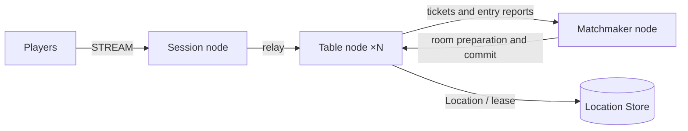

# MyGame 보드 테이블 서버

[English](README.md)

Session 노드는 STREAM 연결을 수락하고 Player Actor에 연결한 뒤 메시지를 전달한다. Table 노드 A와 B는 동적으로 생성하는 Table User Spot과 Player Actor를 호스팅한다. Table Spot은 좌석, 칩, 비공개 카드, 턴, 정산을 소유한다. Matchmaker 노드의 공용 Pool Spot은 플레이어를 짝짓고 같은 방에 입장하도록 조정한다.



`zlink.structure.json`은 초기 구성을 정의한다. Table 노드 A와 B는 같은 서버 프로젝트를 서로 다른 설정으로 실행한다. Framework와 Redis가 실행 중 Spot 소유권과 재배치를 관리한다. 확장 지점과 공개 API 경계는 [AGENTS.md](AGENTS.md)에 정리되어 있다.

## 설치 요건

격리 E2E는 Docker의 Linux 컨테이너에서 빌드하고 실행한다. 전경 서버에는 호스트 .NET SDK가 필요하다.

- `run-server`와 `--local` / `-Local` 실행에 필요한 .NET 8 SDK와 ASP.NET Core 8 런타임
- Docker Engine과 Docker Compose v2
- Linux 또는 WSL의 Bash, Windows의 PowerShell 7
- 배포된 Zlink 네이티브 패키지가 지원하는 운영체제와 CPU 아키텍처

`Directory.Packages.props`는 Zlink.Framework 패키지와 STREAM 커넥터를 `0.34.0`으로 고정한다. `nuget.config`는 nuget.org만 사용한다. 이 디렉터리를 복사해 독립적으로 빌드할 수 있다.

## 빌드

프로젝트 루트에서 다음 명령을 실행한다.

```sh
./run-e2e.sh --build-only
```

Windows에서도 같은 Dockerfile 대상을 빌드한다.

```powershell
./run-e2e.cmd -BuildOnly
```

`Dockerfile`은 `SDK_IMAGE`, `RUNTIME_IMAGE`, `DOCKER_CLI_IMAGE`의 기본값을 관리한다. ZLink 기반 이미지로 전환할 때 해당 빌드 인자를 변경한다. 런타임 의존성이 같은 노드는 하나의 이미지를 공유하고, 각 역할에는 별도의 실행 진입점이 있다. ASP.NET Core 런타임은 공통 호스팅 의존성을 제공한다. Runner 이미지에는 Docker CLI와 구조 검사 입력이 포함된다.

스크립트는 실행을 마치면 해당 실행에서 생성한 이미지 태그를 제거한다. Docker는 다음 빌드에 사용할 레이어를 보존한다.

## 로컬 서버 실행

이 디렉터리에서 Bash는 `./run-server.sh`, Windows Terminal은 `./run-server.cmd`를 실행한다. CMD 래퍼는 PowerShell 7로 `run-server.ps1`을 실행한다. 실행 정책에서 허용하는 경우 PowerShell에서 `./run-server.ps1`을 직접 실행할 수 있다.

스크립트는 `Preparing: building the server (...)`와 `Build complete. Starting servers...`를 출력한 뒤 Docker에서 Redis를, 호스트에서 .NET 노드를 실행한다. 클라이언트는 `Server ready:` 줄에 출력한 WebSocket 주소를 사용한다. 같은 주소를 `.logs/server.json`에서도 읽을 수 있다. 연결을 유지하는 동안 터미널을 열어 둔다. Ctrl+C를 누르면 노드와 Redis가 종료된다.

다른 터미널에서 `./run-e2e.sh` 또는 `./run-e2e.cmd`를 실행하면 준비된 서버에 연결한다. 준비된 서버가 없으면 같은 명령이 Docker 격리 환경을 시작한다. `update` 요구 조건은 아래 시나리오 표와 설명을 참고한다.

## 클라이언트 연결

### 주소와 첫 패킷

Session의 `players` STREAM 리스너는 `server/config/session.json`의 `streamEndpoint`를 사용한다. 기본값 `ws://127.0.0.1:0`은 루프백 주소, 운영체제가 할당하는 포트, 루트 경로 `/`를 뜻한다. `e2e/MyGame.E2E/TableRun.cs`는 Session이 출력하는 `READY` JSON의 `StreamEndpoint`에서 실제 주소를 읽는다. Table Mesh와 Redis 주소는 내부 통신에 사용한다.

테이블을 고르려면 `JoinTableRequest(PlayerId, TableId)`를, 매치메이킹을 요청하려면 `FindMatch`를 보낸다. 첫 패킷이 `FindMatch`이면 Session이 Actor ID를 발급한다. 지정 테이블에 입장하면 서버는 배정된 좌석과 테이블 상태를 담은 `TableView`를 푸시한다. 거절된 동작의 결과는 `ActionRejected`다. 입장에는 send/push를, 바인딩 뒤 `SessionInfoRequest`에는 request/reply를 사용한다. 인증을 추가하는 배포에서는 바인딩 전에 클라이언트가 제공한 ID를 검증한다.

### 커넥터 설치

기본 루프백 리스너에는 같은 호스트 또는 네트워크 네임스페이스에서 접근할 수 있다. Docker E2E의 노드는 Runner의 네임스페이스를 공유하며 실행이 끝나면 삭제된다. 외부 클라이언트를 연결하려면 접근 가능한 리스너 주소와 공개 포트를 구성하고 서버를 유지한다. 브라우저, Unity WebGL, Cocos Creator 웹 클라이언트는 WebSocket 주소를 지원한다. HTTPS 페이지의 배포 주소에는 `wss://`를 사용한다. 브라우저에서 HTTP 진입점도 호출한다면 허용할 origin과 CORS 정책을 설정한다.

설치 명령의 `<version>`에는 `Directory.Packages.props`의 `Zlink.Framework`와 `Zlink.Stream.Connector` 항목에 지정된 릴리스 버전을 사용한다. 가이드를 사용할 때 해당 릴리스의 API를 확인한다. 엔진별 설치 절차는 각 어댑터의 README를 따른다. 모든 클라이언트는 템플릿의 패킷 계약을 사용한다.

| 클라이언트 | 설치 | 가이드 |
| --- | --- | --- |
| Unity | Native/Editor는 NuGetForUnity로 `Zlink.Stream.Connector`를 복원한다. WebGL은 `com.zlink.stream-connector.webgl` UPM Git 패키지를 추가한다. 대상에 맞는 커넥터 어셈블리를 포함한다. [Unity README](https://github.com/zlink-systems/zlink/blob/main/framework/languages/engines/Unity/README.md) | [.NET 엔진 연동](https://docs.zlink.systems/dotnet/guide/stream-connector/12-engine-integration/) |
| Unreal | `framework/languages/cpp/connector/engines/unreal`을 `Plugins/ZLinkStreamConnector`에 복사하고 네이티브 커넥터를 `ThirdParty/ZLink`에 패키징한다. [Unreal README](https://github.com/zlink-systems/zlink/blob/main/framework/languages/engines/Unreal/README.md) | [C++ 엔진 연동](https://docs.zlink.systems/cpp/guide/stream-connector/12-engine-integration/) |
| Godot | .NET에서는 `Zlink.Stream.Connector`를 추가하고 `dotnet restore`를 실행한다. GDExtension에서는 Framework 사전 빌드와 같은 `godot-cpp`로 C++ 어댑터를 빌드한다. .NET 예제의 대상은 네이티브 빌드다. [C# README](https://github.com/zlink-systems/zlink/blob/main/framework/languages/engines/Godot/csharp/README.md), [C++ README](https://github.com/zlink-systems/zlink/blob/main/framework/languages/engines/Godot/cpp/README.md) | [.NET](https://docs.zlink.systems/dotnet/guide/stream-connector/12-engine-integration/), [C++](https://docs.zlink.systems/cpp/guide/stream-connector/12-engine-integration/) |
| Cocos Creator | 웹 대상에서 `npm install @zlink-systems/stream-connector@<version>`을 실행한다. [Cocos Creator README](https://github.com/zlink-systems/zlink/blob/main/framework/languages/engines/CocosCreator/README.md) | [TypeScript 엔진 연동](https://docs.zlink.systems/node/guide/stream-connector/12-engine-integration/) |
| Axmol | `framework/languages/cpp/connector/engines/axmol`을 복사하고 `zlink::stream_connector`를 링크한다. [Axmol README](https://github.com/zlink-systems/zlink/blob/main/framework/languages/engines/Axmol/README.md) | [C++ 엔진 연동](https://docs.zlink.systems/cpp/guide/stream-connector/12-engine-integration/) |
| 웹 브라우저 | `npm install @zlink-systems/stream-connector@<version>`을 실행하고 패키지 루트를 import한다. 페이지의 보안 정책에 따라 `ws://` 또는 `wss://`를 쓴다. | [TypeScript 커넥터](https://docs.zlink.systems/node/guide/stream-connector/) |
| C++ | 커넥터가 포함된 Framework 사전 빌드를 설치하고 `find_package(zlink_stream_connector_cpp CONFIG REQUIRED)`와 `zlink::stream_connector`를 사용한다. | [C++ 커넥터](https://docs.zlink.systems/cpp/guide/stream-connector/) |
| C#/.NET | `dotnet add package Zlink.Stream.Connector --version <version>`을 실행한다. | [.NET 커넥터](https://docs.zlink.systems/dotnet/guide/stream-connector/) |
| Java | Maven 또는 Gradle에 `systems.zlink:zlink-stream-connector:<version>`을 추가한다. | [Java 커넥터](https://docs.zlink.systems/java/guide/stream-connector/) |
| Kotlin | 코루틴 래퍼를 사용하려면 `systems.zlink:zlink-stream-connector:<version>`과 `systems.zlink:zlink-framework-kotlin:<version>`을 추가한다. | [Kotlin 커넥터](https://docs.zlink.systems/kotlin/guide/stream-connector/) |
| Node | Node.js 22 이상에서 `npm install @zlink-systems/stream-connector@<version>`을 실행하고 패키지 루트를 사용한다. | [Node 커넥터](https://docs.zlink.systems/node/guide/stream-connector/) |

### 첫 테이블 입장 예제

템플릿 사본에 .NET 8 콘솔 프로젝트를 만들고 `server/MyGame.Shared/MyGame.Shared.csproj`를 참조한다. 위에서 확인한 버전의 `Zlink.Stream.Connector`를 추가한다. 아래 코드를 `Program.cs`에 저장하고 `dotnet run --project <client-project> -- <actual-session-endpoint>`를 실행한다. `run-server`를 유지하고 출력한 주소를 전달한다. 플레이어와 테이블에 새 ID를 사용한다. 전체 게임 흐름은 `e2e/MyGame.E2E/GameClient.cs`에 있다.

```csharp
using MyGame.Shared;
using Systems.Zlink.Stream.Connector;
using Systems.Zlink.Stream.Connector.Contracts;

using var deadline = new CancellationTokenSource(TimeSpan.FromSeconds(10));
var ct = deadline.Token;
await using var client = ZlinkStreamConnectorFactory.Create(new ZlinkStreamConnectorOptions
{
    Endpoint = new Uri(args[0]),
    DispatchMode = ZlinkStreamDispatchMode.Immediate,
    Reconnect = new ZlinkStreamReconnectOptions { Enabled = false },
});
var received = new TaskCompletionSource<TableView>(TaskCreationOptions.RunContinuationsAsynchronously);
using var view = client.On<TableView>((message, _) =>
{
    received.TrySetResult(message.Payload!);
    return ValueTask.CompletedTask;
});
using var rejected = client.On<ActionRejected>((message, _) =>
{
    received.TrySetException(new InvalidOperationException(message.Payload!.ToString()));
    return ValueTask.CompletedTask;
});
using var error = client.OnErrorReceived((message, _) =>
{
    received.TrySetException(new IOException(message.Message));
    return ValueTask.CompletedTask;
});
using var disconnected = client.OnDisconnected((_, _) =>
{
    received.TrySetException(new IOException("Disconnected before TableView"));
    return ValueTask.CompletedTask;
});
await client.Connect.Async(ct);
await client.Send(new JoinTableRequest("guide-player", "guide-table")).Async(ct);
Console.WriteLine(await received.Task.WaitAsync(ct));
```

## 로컬 E2E

격리 모드에서는 스크립트가 이미지를 빌드하고 Runner 컨테이너의 C# 프로그램을 실행한다. 실행별 Compose 프로젝트와 네트워크에서 Redis와 Runner를 시작한다. Runner는 노드를 시작하기 전에 구조를 검사한다. 노드는 Runner의 네트워크 네임스페이스를 공유하여 루프백 리스너와 자동 할당 포트를 사용한다. 로컬 디버깅을 위한 Redis 포트는 루프백에 게시된다.

Runner는 표준 입력을 사용할 수 있게 컨테이너를 생성하고 `docker cp`로 설정을 복사한 뒤 `docker start -a -i`로 연결한다. 시작 확인, drain, 종료 및 교체는 `ManagedProcess`가 처리한다. Docker 소켓은 Runner에만 마운트하므로 신뢰하는 로컬 데몬을 사용한다. 스크립트는 실행에서 만든 컨테이너, Compose 프로젝트, 이미지 태그를 제거한다. 정리 실패는 종료 코드 1을 반환한다.

노드의 `<node>.err.log`에는 dispatch diagnostics `Normal`의 Framework 메시지 흐름 기록이 들어 있다. 실패를 조사할 때 첫 실행의 로그를 확인한다. Unix에서는 Bash가 호출자의 UID/GID와 Docker 소켓 그룹으로 Runner를 실행한다. Windows에서는 Docker Desktop의 파일 매핑을 사용한다. 빌드, Redis, 외부 정리 로그는 `.logs/docker-<project>/`에, 노드 설정과 제어 로그는 `.logs/run-<id>/`에 남긴다.

.NET 8 SDK를 설치한 호스트에서 노드를 디버깅하려면 `--local` 또는 `-Local`을 사용한다. Redis는 Docker에서 실행한다. 로컬 Debug 빌드가 있으면 `--no-build` 또는 `-NoBuild`로 빌드를 생략할 수 있다.

```sh
./run-e2e.sh --local
./run-e2e.sh --local --no-build
```

```powershell
pwsh -NoProfile -File ./run-e2e.ps1 -Local
pwsh -NoProfile -File ./run-e2e.ps1 -Local -NoBuild
```

Bash에서 전체 또는 개별 시나리오와 구조 검사를 실행한다.

```sh
./run-e2e.sh
./run-e2e.sh --scenario table,reconnect,match,match-cancel,update
./run-e2e.sh --check-structure
```

Windows에서는 CMD 래퍼 또는 같은 PowerShell 7 스크립트를 사용한다.

```powershell
./run-e2e.cmd
./run-e2e.cmd -Scenario table,reconnect,match,match-cancel,update
./run-e2e.cmd -CheckStructure
```

격리 모드는 구조 검사 뒤 독립 Compose 프로젝트에서 Redis, Table A와 B, Matchmaker, Session을 순서대로 시작한다. 실행별 Redis 키 접두사와 운영체제가 할당하는 루프백 포트를 사용한다. 각 노드의 `READY`를 확인한 뒤 시나리오를 실행하고, 종료할 때 자신이 시작한 프로세스와 컨테이너를 정리한다. 설정과 로그는 `.logs/run-<id>/`에 보존한다.

| 시나리오 | 검증 동작 |
| --- | --- |
| `table` | 좌석과 칩, 비공개 카드, 서버 발신 패킷 거절, 차례 밖의 베팅, 상한 초과, 칩 부족을 확인한다. 거절은 `RetryAfterMs: 0`을 반환하고 테이블 상태를 유지한다. 정산 후 모든 `cardCount`는 0이며, 다음 판 전의 비공개 카드 조회는 빈 배열을 반환한다. |
| `reconnect` | 재접속하면 `SessionInfo`의 sessionId가 바뀌고 Actor ID와 generation은 유지된다. 좌석, 칩, 카드, 턴을 유지하고 재접속 후 정산에서 손패를 비운다. |
| `match` | 두 플레이어가 같은 방 ID와 서로 다른 좌석을 받는다. `MatchFound` 뒤 `TableView`를 받고 한 판을 정산한다. |
| `match-cancel` | 대기 중인 클라이언트가 `cancelled` 사유의 `MatchCancelled`를 받는다. 뒤이어 요청한 두 클라이언트가 정상적으로 매칭된다. |
| `update` | drain 전후에 두 클라이언트의 `SessionInfo`, 연결 및 게임 상태를 유지한다. 이동한 노드에서 한 판을 정산하면서 손패를 비운다. 기존 노드를 교체한 뒤 교체 노드의 새 테이블에서 한 판을 진행한다. |

실행 중인 서버에 연결하면 기본으로 `table`, `reconnect`, `match`, `match-cancel`을 실행한다. 실행 중인 서버에만 연결하려면 `--attach` 또는 `-Attach`를 사용한다. `update`는 정해진 Table 수용 한도를 적용하고 노드를 교체하므로 격리 실행이 필요하다. 전경 서버를 중지하거나 `--local` / `-Local`과 `--no-build` / `-NoBuild`를 함께 사용해 별도의 로컬 환경에서 실행한다.

Runner는 구조 검사 후 도메인 경계 조건을 검사하고 `Domain checks: 7/7`을 출력한다. 표 순서대로 선택한 시나리오를 실행하며 각각 제목과 `PASS` 또는 `FAIL` 한 줄을 출력한다. 마지막 집계는 `Scenarios: N/M passed, F failed`다. 시나리오 또는 정리 작업이 실패하면 종료 코드 1을 반환한다.

로컬 빌드 후 다음 명령은 노드를 시작하지 않고 구조만 검사한다.

```sh
dotnet e2e/MyGame.E2E/bin/Debug/net8.0/MyGame.E2E.dll --root . --check-structure
```

구조 검사는 실제 파일의 버전과 ID, 설정 경로와 ID, Spot 등록과 참조, 시나리오 목록을 확인한다. 유효한 구성에서 노드, Spot, 연결을 추가하거나 배열 순서를 바꿀 수 있다. 이 서버는 Channel을 등록하지 않으므로 `channels`는 빈 배열이다.

## 게임 규칙과 확장

지정 테이블에 입장하는 클라이언트는 첫 패킷으로 `JoinTableRequest{playerId,tableId}`를 보낸다. Entry Spot은 테이블에 `GetOrCreate`를 호출하고 Actor 입장을 요청한다. 같은 플레이어가 재접속하면 새 Session을 기존 Actor에 바인딩하고, 플레이어는 현재 테이블 상태와 자신의 카드를 받는다. 연결이 끊겨도 좌석과 게임 상태를 유지한다.

첫 패킷으로 Player Actor를 바인딩한 뒤 `SessionInfoRequest`를 보낸다. Session은 현재 sessionId와 바인딩한 Actor의 actorId, objectGeneration을 담은 `SessionInfo`를 반환한다. Table 상태에는 Actor의 실행 식별자를 저장하지 않는다.

테이블은 좌석 네 개를 가지며 플레이어마다 칩 1,000개로 시작한다. 플레이어가 두 명 이상이면 운영체제의 암호학적 난수로 섞은 52장 덱에서 각자 카드 두 장을 받는다. 가장 낮은 좌석부터 차례로 한 번씩 베팅한다. 카드 두 장의 값 합계가 가장 높은 플레이어가 팟을 가져간다. 동점자가 팟을 균등하게 나눠 받고 나머지는 승자 중 가장 낮은 좌석에 지급한다. 진행 중인 테이블에 앉은 플레이어는 다음 판부터 참여한다. 정산은 모든 손패를 비운 후 `HandResult`를 전송한다. 이후 비공개 카드 조회는 빈 카드 목록을 반환한다.

`server/MyGame.Shared/Contracts.cs`는 typed 메시지, `GameNames.MaxContractInteger`(`9007199254740991`), 거절 사유를 정의한다. 요청과 응답에 이 정수 상한을 적용한다. Table Spot은 상태를 변경하기 전에 요청을 검증하고 베팅과 정산을 계산한다. 값 또는 결과가 상한을 넘으면 `integer-out-of-range`로 거절한다. `ActionRejected`의 `RetryAfterMs`는 기본 typed JSON 직렬화에서 `retryAfterMs`에 해당하는 32비트 정수다. 칩, 팟, 핸드 번호는 64비트 정수다. 현재 시간에 따른 거절이 없어서 `RetryAfterMs`는 0이다. 시간에 따른 판정을 추가할 때는 Table Spot에서 단조 시계를 사용하고, 검사용 시계를 생성자로 주입하고, 남은 밀리초를 재배치 스냅샷에 저장한다. 클라이언트는 서버가 양수 지연을 지정했을 때만 대기한다.

`server/MyGame.Session/PlayerSession.cs`는 `JoinTableRequest`, `FindMatch`, `CancelMatch`, `TableViewRequest`, `StartHandRequest`, `BetRequest`, `SessionInfoRequest`를 전달한다. 나머지 패킷은 `packet-not-allowed`로 거절한다. 클라이언트 발신 요청만 이 허용 목록에 추가한다. 클라이언트가 관찰할 동작의 검사는 `e2e/MyGame.E2E/Scenarios.cs`에 추가한다. 시나리오 ID는 README 표 및 `zlink.structure.json`의 `run.scenarios`와 일치시킨다.

Message Follow는 30초로 설정한다. `SAFE_TO_SHUTDOWN`의 관찰 기한은 이 구간과 기존 재배치 기한을 합한 값이다. `update`는 교체 노드의 `READY`를 기다린 뒤 교체 노드가 새 테이블을 호스팅하고 한 판을 마치는지 확인한다.

### 매치메이킹

Matchmaker 노드는 `server/config/matchmaker.json`의 설정으로 SpotWide Pool인 `pool-board`를 시작한다. Pool은 새 요청 또는 500 ms마다 오래 기다린 두 명을 선택하고 Table을 준비한다. 두 Actor의 deferred 입장이 10초 안에 완료되면 Pool은 방을 확정한다. Table이 좌석을 배정하면 각 Actor가 클라이언트에 `MatchFound`와 `TableView`를 차례로 보낸다.

대기열에서 나오려면 `MatchQueued`의 티켓 ID와 함께 `CancelMatch`를 보낸다. 연결이 끊어진 플레이어의 티켓은 짝짓기에서 제외된다. 총 120초의 대기 기한이 먼저 끝나지 않으면 연결이 끊긴 지 15초 뒤 Pool이 `disconnected` 사유로 티켓을 취소한다. 방에 배정된 티켓은 입장 기한을 따른다. Matchmaker를 재시작하면 메모리의 대기열이 비워진다. `server/MyGame.Matchmaker/MatchRule.cs`에서 짝짓기 규칙을 확장한다.

## 배포 순서

각 환경에 맞는 Redis 주소와 공용 키 접두사를 `server/config/`에 지정한다. Mesh 주소는 노드 간, STREAM 주소는 클라이언트에서 접근할 수 있어야 한다.

1. Redis를 시작한다. 로컬에서는 `docker compose -p my-game-local up -d --wait`를 실행하고 `docker compose -p my-game-local port location 6379`에서 포트를 확인한다.
2. Table A와 B를 각각의 설정으로 시작하고 `READY`를 기다린다.
3. Matchmaker를 `server/config/matchmaker.json` 설정으로 시작하고 `READY`를 기다린다.
4. Session을 시작하고 출력된 STREAM 주소에 클라이언트를 연결한다.

다음 명령은 Table 노드를 시작한다.

```sh
dotnet server/MyGame.Table/bin/Debug/net8.0/MyGame.Table.dll --config server/config/table-a.json
```

Table 프로세스를 교체하려면 표준 입력에 `drain`을 보낸다. `RELOCATION_REQUESTED`, `RELOCATED`, `SAFE_TO_SHUTDOWN`을 확인한 뒤 `shutdown`을 보내고 정상 종료를 확인한다. 같은 설정으로 교체 프로세스를 시작하고 `READY`를 기다린다. 기존 Table은 이동한 노드에 계속 남으며 교체 프로세스는 새 배치를 받을 수 있다.

이 절차의 `PlannedMaintenance`는 같은 애플리케이션 버전에서 실행한다. 운영 환경에서는 배포 오케스트레이터가 프로세스 수명과 호환 버전 배치를 관리한다. 수동으로 시작한 Redis는 `docker compose -p my-game-local down --volumes`로 정리한다.

## Windows와 진단

PowerShell 7을 사용한다. CMD 래퍼는 실행 중 콘솔에서 UTF-8을 쓰고 종료 시 기존 코드페이지를 복원한다. IPv6 환경에서 NuGet 연결이 실패하면 해당 셸에서 `DOTNET_SYSTEM_NET_DISABLEIPV6=1`을 설정할 수 있다. 이 값은 호스트 환경에서 관리한다. Runner가 시작하는 프로세스는 콘솔 창을 별도로 만들지 않는다.

노드의 stderr에는 dispatch diagnostics `Normal`의 메시지 흐름 기록이 있다. 첫 실패의 `<node>.err.log`에서 같은 flow와 패킷의 마지막 단계를 확인한다. 공개 패키지의 결함은 최소 재현으로 보고한다.

## Framework 동작

- **핸들러에서 DB나 파일 I/O를 기다리는 경우** 일반 async terminal은 turn을 유지한다. `Yield`는 같은 Spot에서 다른 핸들러의 진행을 허용한다. [실행 모델](https://docs.zlink.systems/dotnet/guide/server/32-execution-model/#io-worker-wait)
- **생성이 기한을 넘긴 경우** `DeadlineExceeded`와 호출자 취소는 구분된다. [Actor 생성 기한](https://docs.zlink.systems/dotnet/guide/server/22-actor/#creation-deadline), [PlayerSession.cs](server/MyGame.Session/PlayerSession.cs)
- **동시 로그인이 많은 경우** ID별 생성에 Location Store 왕복이 필요하다. 예상 부하를 측정한 결과로 기한을 정한다. [Location Store](https://docs.zlink.systems/dotnet/guide/server/25-location/#creation-load)
- **부하 중 전송** send는 수용 가능할 때까지 대기하고 애플리케이션은 최종 결과를 관찰한다. [Backpressure](https://docs.zlink.systems/dotnet/guide/server/33-backpressure/#send-backpressure), [Handlers.cs](server/MyGame.Table/Handlers.cs)
- **중복 로그인** 다른 Session의 바인딩은 기본적으로 수락한다. 중복 로그인을 거부해야 하면 Actor duplicate-bind 콜백에서 거절한다. [Session 바인딩](https://docs.zlink.systems/dotnet/guide/server/39-session-binding/#duplicate-session-bind)
- **ObjectGeneration** 같은 ID로 생성한 논리 객체의 생애를 식별한다. [객체 수명](https://docs.zlink.systems/dotnet/guide/server/34-activation-lifetime/#object-generation)
- **READY와 Serving** Framework 노드는 런타임 `Serving`을 확인한 뒤 `READY`를 출력한다. [운영 가이드](https://docs.zlink.systems/dotnet/guide/server/12-operations/#wait-for-serving), [NodeControl.cs](server/MyGame.Shared/NodeControl.cs)

## 공개 패키지의 알려진 문제

이 프로젝트는 배포된 Framework 0.34.0 패키지를 사용한다. 방 입장 도중 `match`와 `match-cancel` 시나리오에서 매치메이킹 알림이 순서와 다르게 도착할 수 있다. Runner는 `MatchQueued` → `MatchFound` → `TableView` 순서를 확인하고 실패 시 수신 순서를 출력한다.

격리 E2E Runner는 공개 Table stable-type 한도 기능을 사용해 노드별 선택 사항인 `TableCapacity`를 실행할 시나리오 수로 설정한다. 각 시나리오는 테이블 한 개를 유지한다. drain이 끝나면 남은 노드가 수용 한도에 도달하여 교체 노드에서만 새 테이블이 생성된다. 새 플레이어 두 명 모두 교체 노드의 ID를 확인해야 한다. 수용 한도 설정을 생략하거나 0으로 지정하면 배포 수용 한도는 없다. Table 노드별 Entry 선언은 애플리케이션의 Entry를 지정한다. Matchmaker 설정은 고정 Pool을 소유한다.
