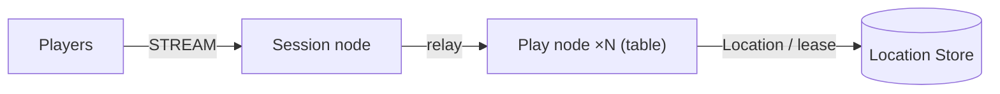

# MyGame board table server

The Session node accepts STREAM connections, binds them to Player Actors, and relays messages. Play nodes A and B (table) host dynamically created Table User Spots and Player Actors. The Table Spot owns seats, chips, private cards, turns, and settlement.



`zlink.structure.json` describes the initial composition. Play nodes A and B (table) run the same server project with different configurations. The Framework and Redis manage the actual Spot ownership and relocation. Extension points and public API boundaries are in [AGENTS.md](AGENTS.md).

## Prerequisites

Default execution requires Docker Linux containers; no host .NET SDK is needed.

- .NET 8 SDK and ASP.NET Core 8 runtime for `--local` / `-Local` debugging only.
- Docker Engine with Docker Compose v2.
- Bash on Linux or WSL, or PowerShell 7 on Windows.
- An operating system and architecture supported by the published Zlink native package.

`Directory.Packages.props` pins the Zlink.Framework package family and the STREAM connector to `0.32.0`. `nuget.config` uses nuget.org only. This directory can be copied and built independently.

## Build

Run commands from this project root:

```sh
./run-e2e.sh --build-only
```

PowerShell builds the same Dockerfile targets:

```powershell
pwsh -NoProfile -File ./run-e2e.ps1 -BuildOnly
```

`Dockerfile` owns fixed `SDK_IMAGE`, `RUNTIME_IMAGE`, and `DOCKER_CLI_IMAGE` defaults. Replace the appropriate base ARG when adopting a ZLink base image. All node roles share the node image because their runtime dependencies match; each retains its own executable entry point. The ASP.NET Core runtime supplies shared hosting dependencies. The runner target adds Docker CLI and structure inputs without including the SDK.

Scripts remove unique image tags after each invocation. Docker retains build layers for subsequent runs.

## Client connection

### Endpoint and first packet

The Session `players` STREAM listener uses `StreamEndpoint` in `server/config/session.json`, defaulting to `ws://127.0.0.1:0`: loopback WebSocket, OS-assigned port, root path `/`. Read `StreamEndpoint` from the Session's `READY` JSON, as `e2e/MyGame.E2E/TableRun.cs` does. Table mesh listeners and Redis are internal endpoints.

Send `JoinTableRequest(PlayerId, TableId)` first. The Session creates/binds the Actor; successful seating produces a `TableView` push, including the assigned seat and table state. `ActionRejected` reports rejected actions. Entry is send/push; `SessionInfoRequest` is request/reply after binding. This template does not authenticate the supplied player ID; validate identity before binding when adding authentication.

### Connector installation

The default loopback listener is reachable only within its host/network namespace. Docker e2e nodes share the runner network namespace and are removed at the end. External clients need a deployment kept running with a reachable listener and an exposed container port. Browser, Unity WebGL, and Cocos Creator web clients can use this WebSocket endpoint; HTTPS pages require a secure `wss://` deployment. HTTP entry points also need a browser-accessible origin/CORS policy when called from a web client.

Use the release pinned in `Directory.Packages.props`, at `PackageVersion Include="Zlink.Framework"` and `PackageVersion Include="Zlink.Stream.Connector"` (`Version` attributes). Replace `<version>` in the installation commands with that release. Check linked guides against that pin; engine adapters follow the linked repository READMEs. All clients use this template's packet contract.

| Client                             | Connector installation                                                                                                                                                                                                                                                                                                                                                                                                                                                          | Documentation guide                                                                                                                                                          |
| ---------------------------------- | ------------------------------------------------------------------------------------------------------------------------------------------------------------------------------------------------------------------------------------------------------------------------------------------------------------------------------------------------------------------------------------------------------------------------------------------------------------------------------- | ---------------------------------------------------------------------------------------------------------------------------------------------------------------------------- |
| Unity                              | Native/Editor: restore `Zlink.Stream.Connector` with NuGetForUnity. WebGL: add the `com.zlink.stream-connector.webgl` UPM Git package; include only the connector assembly for the active target. See the [Unity README](https://github.com/zlink-systems/zlink/blob/main/framework/languages/engines/Unity/README.md) and its package manifest.                                                                                                                                | [.NET engine integration](https://docs.zlink.systems/dotnet/guide/stream-connector/12-engine-integration/)                                                                   |
| Unreal                             | Copy `framework/languages/cpp/connector/engines/unreal` into `Plugins/ZLinkStreamConnector`, then package the native connector under `ThirdParty/ZLink` as described in the [Unreal README](https://github.com/zlink-systems/zlink/blob/main/framework/languages/engines/Unreal/README.md).                                                                                                                                                                                     | [C++ engine integration](https://docs.zlink.systems/cpp/guide/stream-connector/12-engine-integration/)                                                                       |
| Godot                              | .NET: add the NuGet package `Zlink.Stream.Connector` and run `dotnet restore`; see the [C# README](https://github.com/zlink-systems/zlink/blob/main/framework/languages/engines/Godot/csharp/README.md). GDExtension: build the C++ Godot adapter against the framework prebuilt and matching `godot-cpp`; see the [C++ README](https://github.com/zlink-systems/zlink/blob/main/framework/languages/engines/Godot/cpp/README.md). The .NET sample does not support Web export. | [.NET](https://docs.zlink.systems/dotnet/guide/stream-connector/12-engine-integration/), [C++](https://docs.zlink.systems/cpp/guide/stream-connector/12-engine-integration/) |
| Cocos Creator                      | Web target: `npm install @zlink-systems/stream-connector@<version>`; see the [Cocos Creator README](https://github.com/zlink-systems/zlink/blob/main/framework/languages/engines/CocosCreator/README.md). This package does not provide a Creator native adapter.                                                                                                                                                                                                                  | [TypeScript engine integration](https://docs.zlink.systems/node/guide/stream-connector/12-engine-integration/)                                                               |
| Axmol                              | Copy `framework/languages/cpp/connector/engines/axmol` into `third_party/zlink_axmol_connector` and link `zlink::stream_connector` from the installed C++ framework package; see the [Axmol README](https://github.com/zlink-systems/zlink/blob/main/framework/languages/engines/Axmol/README.md).                                                                                                                                                                              | [C++ engine integration](https://docs.zlink.systems/cpp/guide/stream-connector/12-engine-integration/)                                                                       |
| Web browser (TypeScript connector) | `npm install @zlink-systems/stream-connector@<version>`; import the package root in the browser build. Use `ws://` or `wss://`, subject to the page's security policy.                                                                                                                                                                                                                                                                                                             | [TypeScript connector](https://docs.zlink.systems/node/guide/stream-connector/)                                                                                              |
| C++                                | Install the C++ framework prebuilt containing the connector; use `find_package(zlink_stream_connector_cpp CONFIG REQUIRED)` and link `zlink::stream_connector`.                                                                                                                                                                                                                                                                                                                 | [C++ connector](https://docs.zlink.systems/cpp/guide/stream-connector/)                                                                                                      |
| C#/.NET                            | `dotnet add package Zlink.Stream.Connector --version <version>`                                                                                                                                                                                                                                                                                                                                                                                                                    | [.NET connector](https://docs.zlink.systems/dotnet/guide/stream-connector/)                                                                                                  |
| Java                               | Add Maven/Gradle dependency `systems.zlink:zlink-stream-connector:<version>`.                                                                                                                                                                                                                                                                                                                                                                                                      | [Java connector](https://docs.zlink.systems/java/guide/stream-connector/)                                                                                                    |
| Kotlin                             | Add `systems.zlink:zlink-stream-connector:<version>` and `systems.zlink:zlink-framework-kotlin:<version>` for the coroutine wrapper.                                                                                                                                                                                                                                                                                                                                                  | [Kotlin connector](https://docs.zlink.systems/kotlin/guide/stream-connector/)                                                                                                |
| Node                               | `npm install @zlink-systems/stream-connector@<version>`; use the package root and Node.js 22 or later.                                                                                                                                                                                                                                                                                                                                                     | [Node connector](https://docs.zlink.systems/node/guide/stream-connector/)                                                                                                    |

### First table example

In a copy of this template, create a .NET 8 console project, reference `server/MyGame.Shared/MyGame.Shared.csproj`, and add `Zlink.Stream.Connector` using the pinned version described above. Save this as its `Program.cs` and run `dotnet run --project <client-project> -- <actual-session-endpoint>`. Keep Session, play nodes (table), and Redis running separately from the temporary e2e deployment. Use fresh player/table IDs. `e2e/MyGame.E2E/GameClient.cs` shows the full game flow.

```csharp
using MyGame.Shared;
using Systems.Zlink.Stream.Connector;
using Systems.Zlink.Stream.Connector.Contracts;

using var deadline = new CancellationTokenSource(TimeSpan.FromSeconds(10));
var ct = deadline.Token;
await using var client = ZlinkStreamConnectorFactory.Create(new ZlinkStreamConnectorOptions
{
    Endpoint = new Uri(args[0]),
    DispatchMode = ZlinkStreamDispatchMode.Immediate,
    Reconnect = new ZlinkStreamReconnectOptions { Enabled = false },
});
var received = new TaskCompletionSource<TableView>(TaskCreationOptions.RunContinuationsAsynchronously);
using var view = client.On<TableView>((message, _) =>
{
    received.TrySetResult(message.Payload!);
    return ValueTask.CompletedTask;
});
using var rejected = client.On<ActionRejected>((message, _) =>
{
    received.TrySetException(new InvalidOperationException(message.Payload!.ToString()));
    return ValueTask.CompletedTask;
});
using var error = client.OnErrorReceived((message, _) =>
{
    received.TrySetException(new IOException(message.Message));
    return ValueTask.CompletedTask;
});
using var disconnected = client.OnDisconnected((_, _) =>
{
    received.TrySetException(new IOException("Disconnected before TableView"));
    return ValueTask.CompletedTask;
});
await client.Connect.Async(ct);
await client.Send(new JoinTableRequest("guide-player", "guide-table")).Async(ct);
Console.WriteLine(await received.Task.WaitAsync(ct));
```

## Local e2e

Both scripts build images and call the same C# orchestrator inside a runner container. A unique Compose project/network contains Redis and the runner. The runner checks structure before starting nodes. Nodes share its network namespace, preserving loopback listeners and OS-assigned ports without host port mappings. Redis publishes an ephemeral loopback port for local debugging.

The runner creates each node with interactive stdin, copies its configuration with `docker cp`, and attaches through `docker start -a -i`. `ManagedProcess` retains readiness, drain, shutdown, and replacement controls. Only the runner mounts the Docker socket; use a trusted local daemon. Scripts remove their labeled containers, Compose project, and image tags. Cleanup failure returns exit code 1.

Node stderr logs (`<node>.err.log`) include Framework message flow records because dispatch diagnostics use `Normal`. Inspect these logs from the first failing run.

On Unix sockets, Bash runs the runner with the caller's UID/GID and the socket's group so retained logs remain writable by the caller. Windows uses Docker Desktop's filesystem mapping. Build, Redis, and outer cleanup logs are in `.logs/docker-<project>/`; node settings and control logs are in `.logs/run-<id>/`.

For host process debugging, install the .NET 8 SDK and add `--local` or `-Local`. Redis remains in Docker. After a local build, `--no-build` or `-NoBuild` skips compilation:

```sh
./run-e2e.sh --local
./run-e2e.sh --local --no-build
```

```powershell
pwsh -NoProfile -File ./run-e2e.ps1 -Local
pwsh -NoProfile -File ./run-e2e.ps1 -Local -NoBuild
```

On Bash, run:

```sh
./run-e2e.sh
./run-e2e.sh --scenario table,reconnect,update
./run-e2e.sh --check-structure
```

On PowerShell 7, run the same runner with:

```powershell
pwsh -NoProfile -File ./run-e2e.ps1
pwsh -NoProfile -File ./run-e2e.ps1 -Scenario table,reconnect,update
pwsh -NoProfile -File ./run-e2e.ps1 -CheckStructure
```

The runner checks the structure, then starts Redis, play node A (table) and B, and Session in order under a uniquely named Compose project. It uses OS-assigned loopback ports and a per-run Redis key prefix. It runs the scenarios after each process reports `READY` and cleans up the processes and containers it created. Configuration and logs are retained under `.logs/run-<id>/`.

| Scenario | Verified behavior |
| --- | --- |
| `table` | Seats and chips, private cards, rejection of server-originated packets, out-of-turn bets, over-limit values, and insufficient chips. Each rejection has `RetryAfterMs: 0` and leaves table state unchanged. Settlement reports every `cardCount` as zero; a private-hand query before the next hand returns no cards. |
| `reconnect` | The sessionId in `SessionInfo` changes while the Actor ID and generation stay the same. Seat, chips, cards, and turn persist, and the hand settles after reconnecting with empty hands. |
| `update` | Both clients keep their `SessionInfo` across drain, connection and game state persist, the hand settles on a different node with empty hands, and after the original node is replaced a new table plays one hand. |

After the structure check, the runner executes the domain boundary checks and prints `Domain checks: 7/7`. It then starts the nodes and runs selected scenarios in the order shown above. Scenario results are printed with `✓`/`✗` and `Scenarios: N/M passed`. Failures and cleanup errors are reported with exit code 1. A rerun that passes without a known cause does not cancel an intermittent failure.

After a local build, use the following command to check structure without starting nodes:

```sh
dotnet e2e/MyGame.E2E/bin/Debug/net8.0/MyGame.E2E.dll --root . --check-structure
```

The structure check validates the actual files' version, identifiers, configuration paths and IDs, Spot registrations and references, and the scenario list. It accepts additional nodes, Spots, and edges in a valid composition, and reordered arrays. `channels` is an empty array because the server registers no channels.

## Game rules and extension

The first client packet is `JoinTableRequest{playerId,tableId}`. The Entry Spot calls `GetOrCreate` for the Table and joins the Actor. When the same player reconnects, the new Session is bound to the existing Actor, and the player receives the current Table state and their own cards. Seats and game state persist when the connection drops.

Send `SessionInfoRequest` after `JoinTableRequest`. The Session node replies with `SessionInfo` containing the current sessionId and the bound Actor's actorId and objectGeneration. The Table state does not store Actor identity.

There are four seats, and each player starts with 1000 chips. With two or more players, each receives two cards from a fresh 52-card deck shuffled by the operating system cryptographic random source. Players bet once in turn starting from the lowest seat. The player with the highest sum of the two cards' values takes the pot. Ties split the pot evenly, and the remainder goes to the lowest winning seat. A player who sits down during a hand joins from the next hand. Settlement clears every player's hand before sending `HandResult`; a subsequent private-hand query returns an empty card list.

`server/MyGame.Shared/Contracts.cs` owns typed messages, `GameNames.MaxContractInteger` (`9007199254740991`), and rejection reason strings. Requests and results use that integer limit. `TableSpot` validates requests before changing state, calculates bets and settlement, and rejects a value or result outside the limit with `integer-out-of-range`. `ActionRejected` carries `Reason` and `RetryAfterMs`; `RetryAfterMs` is a 32-bit integer serialized as `retryAfterMs` by the default typed JSON serializer. Chips, pots, and hand numbers remain 64-bit integers. Current rules have no time-based rejection, so the value is zero. Extend `TableSpot` as the only owner of any time-based decision, use a monotonic clock, pass a test clock through its constructor, and store remaining milliseconds in relocation snapshots. A client waits only for a positive delay supplied by the server.

`server/MyGame.Session/PlayerSession.cs` forwards only `JoinTableRequest`, `TableViewRequest`, `StartHandRequest`, `BetRequest`, and `SessionInfoRequest`. It rejects other packets with `packet-not-allowed`. Add only client-to-server requests to this allowlist. Add new client-observable checks in `e2e/MyGame.E2E/Scenarios.cs`, and keep its scenario IDs aligned with the README table and `run.scenarios` in `zlink.structure.json`.

Message Follow is explicitly configured for 30 seconds. The `SAFE_TO_SHUTDOWN` observation budget is that period plus the existing relocation budget. Update waits for replacement `READY`, then asserts that the replacement hosts the new table and completes a hand.

## Deployment sequence

Set the Redis address and the shared key prefix in `server/config/` for each environment. Set mesh addresses reachable between nodes and STREAM addresses reachable by clients.

1. Start Redis. For a manual local Compose run, use `docker compose -p my-game-local up -d --wait` and read the assigned port with `docker compose -p my-game-local port location 6379`.
2. Start play node A (table) and B with their own configurations and wait for `READY`.
3. Start Session and connect clients to the STREAM endpoint it prints.

Example of starting a play node (table):

```sh
dotnet server/MyGame.Table/bin/Debug/net8.0/MyGame.Table.dll --config server/config/table-a.json
```

To replace a play node (table), send `drain` to its standard input. After `RELOCATION_REQUESTED`, `RELOCATED`, and `SAFE_TO_SHUTDOWN` appear, send `shutdown` and confirm a normal exit. Start a replacement process with the same configuration and wait for `READY`. Existing Tables stay on the node they were relocated to; the new process does not redistribute them automatically.

This procedure is a `PlannedMaintenance` example at the same application version. A production deployment orchestrator owns process lifetime and compatible version placement. Clean up a manually started Redis with `docker compose -p my-game-local down --volumes`.

## Windows notes and diagnostics

Use PowerShell 7. If NuGet connections fail in an IPv6 environment, you can set `DOTNET_SYSTEM_NET_DISABLEIPV6=1` in that shell. The scripts do not change this machine-specific setting. Processes started by the runner do not create console windows.

Node stderr records the message flow from the dispatch diagnostics `Normal` logger. In `<node>.err.log` of the first failing run, find the last transition of the same flow and packet. Do not compensate for a public package defect with internal APIs, manual codecs, sleeps, retries, or longer deadlines.

## Framework behavior to know

- **Waiting for DB or file I/O in a handler** — An ordinary async terminal holds the turn, while `Yield` lets other handlers on the same Spot proceed. [Guide](https://docs.zlink.systems/dotnet/guide/server/32-execution-model/#io-worker-wait).
- **Creation that misses its deadline** — `DeadlineExceeded` and caller cancellation have distinct outcomes. [Guide](https://docs.zlink.systems/dotnet/guide/server/22-actor/#creation-deadline). [server/MyGame.Session/PlayerSession.cs:56](server/MyGame.Session/PlayerSession.cs).
- **Many logins at once** — Each creation for a different ID requires a Location Store round trip, so measure expected load when setting the deadline. [Guide](https://docs.zlink.systems/dotnet/guide/server/25-location/#creation-load).
- **Sending under load** — A send waits for capacity and the application observes only its final result. [Guide](https://docs.zlink.systems/dotnet/guide/server/33-backpressure/#send-backpressure). [server/MyGame.Table/Handlers.cs:70](server/MyGame.Table/Handlers.cs).
- **Duplicate login** — Without a callback, binding a different Session is accepted; reject it in the Actor duplicate-bind callback to prevent it. [Guide](https://docs.zlink.systems/dotnet/guide/server/39-session-binding/#duplicate-session-bind). This template keeps the default (accepts the new Session).
- **ObjectGeneration** — `ObjectGeneration` identifies a logical incarnation of the same ID; it is neither a data version nor write authority. [Guide](https://docs.zlink.systems/dotnet/guide/server/34-activation-lifetime/#object-generation). [server/MyGame.Session/PlayerSession.cs:74](server/MyGame.Session/PlayerSession.cs).
- **READY and Serving** — Framework nodes print `READY` after observing runtime `Serving`. [Guide](https://docs.zlink.systems/dotnet/guide/server/12-operations/#wait-for-serving). [server/MyGame.Shared/NodeControl.cs:19](server/MyGame.Shared/NodeControl.cs); [server/MyGame.Shared/NodeControl.cs:40](server/MyGame.Shared/NodeControl.cs).

## Known issues in the public package

Validated against the published Framework 0.32.0 packages.

The e2e runner sets each node's optional `TableCapacity` to the number of selected scenarios through the public Table stable-type limit. Each scenario retains one table. After update drains the source, the surviving node is at capacity, so only the replacement can host the new table. Both new players must observe the replacement node ID. Omitted or zero capacity leaves deployment capacity unlimited. Entry declarations describe the application Entry on play nodes (table) only; there are no fixed User Spots in this template.
