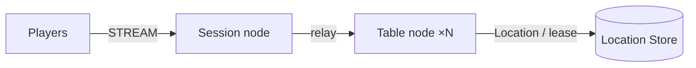

# MyGame 보드 테이블 서버

Session node는 STREAM 연결을 받고 Player Actor에 bind한 메시지를 relay한다. Table node A·B는 동적으로 생성되는 Table User Spot과 Player Actor를 호스팅한다. Table Spot이 좌석, 칩, 비공개 카드, 차례와 결산을 소유한다.



`zlink.structure.json`은 초기 구성을 기술한다. Table node A·B는 같은 서버 프로젝트를 서로 다른 설정으로 실행한다. 실제 Spot 소유 위치와 relocation은 Framework와 Redis가 관리한다. 확장 위치와 공개 API 경계는 [AGENTS.md](AGENTS.md)에 있다.

## 준비물

- .NET SDK 8 이상과 .NET·ASP.NET Core 8 runtime
- Docker Engine과 Docker Compose v2
- Linux·WSL의 Bash 또는 Windows의 PowerShell 7
- 공개 Zlink native package가 지원하는 운영체제와 아키텍처

`Directory.Packages.props`는 Zlink.Framework 계열과 STREAM connector를 `0.30.0`으로 고정한다. `nuget.config`는 nuget.org만 사용한다. 이 디렉터리를 복사하여 독립적으로 빌드할 수 있다.

## Build

프로젝트 루트에서 솔루션을 빌드한다.

```sh
dotnet build server/MyGame.sln
```

솔루션에는 Shared, Session, Table 서버와 C# E2E client가 포함된다. `TreatWarningsAsErrors`가 활성화되어 있다.

## Local e2e

Bash에서는 다음 명령을 실행한다.

```sh
./run-e2e.sh
./run-e2e.sh --scenario table,reconnect,update
```

PowerShell 7에서는 같은 runner를 다음 명령으로 실행한다.

```powershell
pwsh -NoProfile -File ./run-e2e.ps1
pwsh -NoProfile -File ./run-e2e.ps1 -Scenario table,reconnect,update
```

Runner는 구조를 검사하고 고유 Compose project의 Redis, Table A·B, Session을 순서대로 기동한다. OS가 할당한 loopback 포트와 실행별 Redis key prefix를 사용한다. 각 process의 `READY` 이후 시나리오를 실행하고, 자신이 생성한 process와 container를 정리한다. 설정과 로그는 `.logs/run-<id>/`에 보존된다.

| 시나리오 | 판정 |
| --- | --- |
| `table` | 좌석·초기 칩, 카드 중복·비공개 유지, 차례 위반 거부, 승자·분배·칩 보존 |
| `reconnect` | `SessionInfo`의 sessionId 변경과 Actor ID·generation 유지, 좌석·칩·카드·차례 유지, 재접속 후 결산 |
| `update` | drain 전후 두 client의 `SessionInfo` 유지, 연결·게임 상태 유지, 다른 node에서 결산, 기존 node 교체 후 새 테이블 한 판 |

선택한 시나리오는 위 순서대로 실행된다. 결과는 `✓`·`✗`와 `Scenarios: N/M passed`로 출력한다. 실패와 정리 오류는 종료 코드 1로 보고한다. 원인을 확인하지 않은 재실행 성공은 간헐 실패를 취소하지 않는다.

빌드 생략은 Bash의 `--no-build`, PowerShell의 `-NoBuild`로 선택한다. 구조 검사만 실행할 수도 있다.

```sh
dotnet e2e/MyGame.E2E/bin/Debug/net8.0/MyGame.E2E.dll --root . --check-structure
```

구조 검사는 실제 파일의 version, 식별자, 설정 경로·Id, Spot 등록과 참조, scenario 목록을 검증한다. 정상 구성의 node·Spot·edge 추가와 배열 재배치를 허용한다. 서버가 channel을 등록하지 않으므로 `channels`는 빈 배열이다.

## 게임과 확장

첫 client packet은 `JoinTableRequest{playerId,tableId}`다. Entry Spot이 Table을 `GetOrCreate`하고 Actor를 join시킨다. 같은 플레이어가 재접속하면 기존 Actor에 새 Session을 bind하고 현재 Table 상태와 자기 카드를 받는다. 연결이 끊겨도 좌석과 게임 상태는 유지된다.

`SessionInfoRequest`는 `JoinTableRequest` 뒤에 보낸다. Session node는 현재 sessionId와 bound Actor의 actorId·objectGeneration을 `SessionInfo`로 답한다. Table 상태에는 Actor identity를 보관하지 않는다.

좌석은 4개이며 초기 칩은 1000이다. 2명 이상이면 새 52장 덱에서 각자 2장을 받고, 낮은 좌석부터 한 번씩 베팅한다. 두 카드 끗수 합이 가장 큰 플레이어가 판돈을 받는다. 동점은 균등 분배하고 나머지는 가장 낮은 승자 좌석에 지급한다. 판 진행 중 새로 앉은 플레이어는 다음 판부터 참가한다.

프로토콜과 상수는 `MyGame.Shared/Contracts.cs`, 게임 상태와 판정은 `MyGame.Table/TableSpot.cs`에서 확장한다. Player Actor는 게임 상태 사본을 소유하지 않는다. 인증은 Session의 Actor bind 이전에 추가한다.

## 배포 순서

`server/config/`의 Redis 주소와 공통 key prefix를 환경별로 지정한다. Mesh 주소는 node 사이에서 접근 가능한 주소로, STREAM 주소는 client가 접근 가능한 주소로 설정한다.

1. Redis를 시작한다. 로컬 Compose 수동 실행은 `docker compose -p my-game-local up -d --wait`를 사용하고, `docker compose -p my-game-local port location 6379`에서 할당 포트를 확인한다.
2. Table A·B를 각각의 설정으로 시작하고 `READY`를 확인한다.
3. Session을 시작하고 출력된 STREAM endpoint로 client를 연결한다.

Table node 실행 예시는 다음과 같다.

```sh
dotnet server/MyGame.Table/bin/Debug/net8.0/MyGame.Table.dll --config server/config/table-a.json
```

교체할 Table process의 표준 입력에 `drain`을 보낸다. `RELOCATION_REQUESTED`, `RELOCATED`, `SAFE_TO_SHUTDOWN`을 확인한 뒤 `shutdown`을 보내고 정상 종료를 확인한다. 같은 설정으로 대체 process를 시작하여 `READY`를 확인한다. 기존 Table은 relocation 대상 node에 유지되며 새 process가 자동으로 재분배하지 않는다.

이 절차는 같은 application version의 `PlannedMaintenance` 예시다. 운영 배포 orchestrator가 process 수명과 호환 version 배치를 담당한다. 수동 Redis 정리는 `docker compose -p my-game-local down --volumes`로 수행한다.

## Windows 주의 사항과 진단

PowerShell 7을 사용한다. NuGet 연결이 IPv6 환경에서 실패하면 해당 shell에서 `DOTNET_SYSTEM_NET_DISABLEIPV6=1`을 설정할 수 있다. 실행 스크립트는 이 머신별 설정을 변경하지 않는다. Runner가 시작하는 process는 콘솔 창을 생성하지 않는다.

Node stderr에는 dispatch diagnostics `Normal` logger의 message flow가 기록된다. 첫 실패 실행의 `<node>.err.log`에서 같은 flow와 packet의 마지막 transition을 확인한다. 공개 package 결함은 internal API, 수동 codec, sleep, 재시도 또는 deadline 확대로 보상하지 않는다.

## 알려진 공개 package 결함

공개 `0.30.0`에는 cross-node join의 `OnJoinedActorAsync`에서 Actor로 보낸 push가 전달되지 않는 [#1723](https://github.com/zlink-systems/zlink/issues/1723)이 등록되어 있다. 이 경로에서는 `table`·`reconnect`가 실패할 수 있다. 또한 drain 이후 `RELOCATED`가 도달하지 않는 [#1712](https://github.com/zlink-systems/zlink/issues/1712)의 증상이 관측되었다. Runner는 실패를 유지하며 기본 시나리오에서 어느 항목도 제외하지 않는다. node 교체와 교체 후 새 테이블 판정은 해당 경계 이후이므로 검증이 남아 있다.
