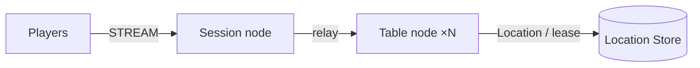

# MyGame board table server

The Session node accepts STREAM connections, binds them to Player Actors, and relays messages. Table nodes A and B host dynamically created Table User Spots and Player Actors. The Table Spot owns seats, chips, private cards, turns, and settlement.



`zlink.structure.json` describes the initial composition. Table nodes A and B run the same server project with different configurations. The Framework and Redis manage the actual Spot ownership and relocation. Extension points and public API boundaries are in [AGENTS.md](AGENTS.md).

## Prerequisites

- .NET SDK 8 or later with the .NET and ASP.NET Core 8 runtimes.
- Docker Engine with Docker Compose v2.
- Bash on Linux or WSL, or PowerShell 7 on Windows.
- An operating system and architecture supported by the published Zlink native package.

`Directory.Packages.props` pins the Zlink.Framework package family and the STREAM connector to `0.30.0`. `nuget.config` uses nuget.org only. This directory can be copied and built independently.

## Build

Build the solution from the project root.

```sh
dotnet build server/MyGame.sln
```

The solution includes the Shared, Session, and Table servers and the C# e2e client. `TreatWarningsAsErrors` is enabled.

## Local e2e

On Bash, run:

```sh
./run-e2e.sh
./run-e2e.sh --scenario table,reconnect,update
```

On PowerShell 7, run the same runner with:

```powershell
pwsh -NoProfile -File ./run-e2e.ps1
pwsh -NoProfile -File ./run-e2e.ps1 -Scenario table,reconnect,update
```

The runner checks the structure, then starts Redis, Table A and B, and Session in order under a uniquely named Compose project. It uses OS-assigned loopback ports and a per-run Redis key prefix. It runs the scenarios after each process reports `READY` and cleans up the processes and containers it created. Configuration and logs are retained under `.logs/run-<id>/`.

| Scenario | Verified behavior |
| --- | --- |
| `table` | Seats and initial chips, unique cards with private visibility, rejection of out-of-turn actions, winner, payout, and chip conservation. |
| `reconnect` | The sessionId in `SessionInfo` changes while the Actor ID and generation stay the same. Seat, chips, cards, and turn persist, and the hand settles after reconnecting. |
| `update` | Both clients keep their `SessionInfo` across drain, connection and game state persist, the hand settles on a different node, and after the original node is replaced a new table plays one hand. |

Selected scenarios run in the order shown above. Results are printed with `✓`/`✗` and `Scenarios: N/M passed`. Failures and cleanup errors are reported with exit code 1. A rerun that passes without a known cause does not cancel an intermittent failure.

To skip the build, use `--no-build` on Bash or `-NoBuild` on PowerShell. You can also run only the structure check:

```sh
dotnet e2e/MyGame.E2E/bin/Debug/net8.0/MyGame.E2E.dll --root . --check-structure
```

The structure check validates the actual files' version, identifiers, configuration paths and IDs, Spot registrations and references, and the scenario list. It accepts additional nodes, Spots, and edges in a valid composition, and reordered arrays. `channels` is an empty array because the server registers no channels.

## Game and extension

The first client packet is `JoinTableRequest{playerId,tableId}`. The Entry Spot calls `GetOrCreate` for the Table and joins the Actor. When the same player reconnects, the new Session is bound to the existing Actor, and the player receives the current Table state and their own cards. Seats and game state persist when the connection drops.

Send `SessionInfoRequest` after `JoinTableRequest`. The Session node replies with `SessionInfo` containing the current sessionId and the bound Actor's actorId and objectGeneration. The Table state does not store Actor identity.

There are four seats, and each player starts with 1000 chips. With two or more players, each receives two cards from a fresh 52-card deck, and players bet once in turn starting from the lowest seat. The player with the highest sum of the two cards' values takes the pot. Ties split the pot evenly, and the remainder goes to the lowest winning seat. A player who sits down during a hand joins from the next hand.

Extend the protocol and constants in `MyGame.Shared/Contracts.cs`, and game state and decisions in `MyGame.Table/TableSpot.cs`. The Player Actor holds no copy of the game state. Add authentication before the Session binds the Actor.

Message Follow is explicitly configured for 30 seconds. The `SAFE_TO_SHUTDOWN` observation budget is that period plus the existing relocation budget. Update waits for replacement `READY`, then asserts that the replacement hosts the new table and completes a hand.

## Deployment sequence

Set the Redis address and the shared key prefix in `server/config/` for each environment. Set mesh addresses reachable between nodes and STREAM addresses reachable by clients.

1. Start Redis. For a manual local Compose run, use `docker compose -p my-game-local up -d --wait` and read the assigned port with `docker compose -p my-game-local port location 6379`.
2. Start Table A and B with their own configurations and wait for `READY`.
3. Start Session and connect clients to the STREAM endpoint it prints.

Example of starting a Table node:

```sh
dotnet server/MyGame.Table/bin/Debug/net8.0/MyGame.Table.dll --config server/config/table-a.json
```

To replace a Table process, send `drain` to its standard input. After `RELOCATION_REQUESTED`, `RELOCATED`, and `SAFE_TO_SHUTDOWN` appear, send `shutdown` and confirm a normal exit. Start a replacement process with the same configuration and wait for `READY`. Existing Tables stay on the node they were relocated to; the new process does not redistribute them automatically.

This procedure is a `PlannedMaintenance` example at the same application version. A production deployment orchestrator owns process lifetime and compatible version placement. Clean up a manually started Redis with `docker compose -p my-game-local down --volumes`.

## Windows notes and diagnostics

Use PowerShell 7. If NuGet connections fail in an IPv6 environment, you can set `DOTNET_SYSTEM_NET_DISABLEIPV6=1` in that shell. The scripts do not change this machine-specific setting. Processes started by the runner do not create console windows.

Node stderr records the message flow from the dispatch diagnostics `Normal` logger. In `<node>.err.log` of the first failing run, find the last transition of the same flow and packet. Do not compensate for a public package defect with internal APIs, manual codecs, sleeps, retries, or longer deadlines.

## Known issues in the public package

The public `0.30.0` has [#1723](https://github.com/zlink-systems/zlink/issues/1723) registered: a push sent to an Actor from `OnJoinedActorAsync` in a cross-node join is not delivered. `table` and `reconnect` can fail on this path. The symptom of [#1712](https://github.com/zlink-systems/zlink/issues/1712), where `RELOCATED` does not arrive after drain, was also observed. The runner keeps the failure and excludes no scenario from the default run. Node replacement and the new-table check after replacement come after this boundary, so their verification remains open.

The e2e runner sets each node's optional `TableCapacity` to the number of selected scenarios through the public Table stable-type limit. Each scenario retains one table. After update drains the source, the surviving node is at capacity, so only the replacement can host the new table. Both new players must observe the replacement node ID. Omitted or zero capacity leaves deployment capacity unlimited. Entry declarations describe the application Entry on Table nodes only; there are no fixed User Spots in this template.

## 한국어 실행 안내

이 프로젝트는 Session node 하나, Table node A·B, Redis Location Store를 실행합니다. Session이 STREAM 연결을 받아 Player Actor에 bind하고, 좌석·칩·카드·차례·결산은 Table node의 Table Spot이 맡습니다. 게임 규칙은 `MyGame.Table/TableSpot.cs`에서, 공개 API 사용 규칙은 `AGENTS.md`에서 확인하십시오.

e2e는 `./run-e2e.sh` 또는 `pwsh -NoProfile -File ./run-e2e.ps1`로 실행합니다. 실행기는 구조를 검사한 뒤 Redis와 각 node를 순서대로 기동하고, `table`·`reconnect`·`update` 시나리오를 확인하고, 자신이 만든 process와 container를 정리합니다. 특정 시나리오만 돌리려면 `--scenario`(PowerShell은 `-Scenario`)를 사용합니다.

설정과 로그는 `.logs/run-<id>/`에 남습니다. 실패하면 첫 실행의 `<node>.err.log`에서 message flow의 마지막 transition을 먼저 확인하십시오. 현재 공개 `0.30.0`에는 #1723과 #1712 결함이 있어 일부 시나리오가 실패할 수 있습니다.
