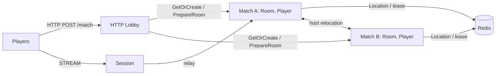

# MyGame FPS HTTP lobby

This .NET FPS template pairs players by mode through an HTTP lobby. `POST /match` returns the same GUID-based Room ID and Session endpoint to both matched players. The lobby creates a dynamic Room User Spot and sends its member list in `PrepareRoom`; the Room returns `RoomPrepared` before the lobby responds. `RoomRoster` admits only those members. Players connect to Session over STREAM and join the assigned Room. The RouteMesh name is `my-game-arena` (`GameNames.WorldMesh`). RoomState owns movement budgets, ray hit decisions, health, shared input sequences, and match completion. Disconnected players resume the same Actor and Room; draining a Match host relocates ongoing matches without reconnecting clients.



## Prerequisites

Default execution requires Docker Linux containers; no host .NET SDK is needed.

Docker with Compose v2 (Linux containers), and PowerShell 7 on Windows or Bash on Linux. Public ZLink packages are pinned centrally to 0.32.0. No repository checkout is required. Supply any required ZLink license through the public package's license configuration; license files must not be committed.

## Build

Run commands from this project root:

```sh
./run-e2e.sh --build-only
```

PowerShell builds the same Dockerfile targets:

```powershell
pwsh -NoProfile -File ./run-e2e.ps1 -BuildOnly
```

`Dockerfile` owns fixed `SDK_IMAGE`, `RUNTIME_IMAGE`, and `DOCKER_CLI_IMAGE` defaults. Replace the appropriate base ARG when adopting a ZLink base image. All node roles share the node image because their runtime dependencies match; each retains its own executable entry point. The ASP.NET Core runtime supplies shared hosting dependencies. The runner target adds Docker CLI and structure inputs without including the SDK.

Scripts remove unique image tags after each invocation. Docker retains build layers for subsequent runs.

## Client connection

### Endpoint and first packet

Start with Lobby HTTP: `server/config/lobby.json` defaults `HttpEndpoint` to `http://127.0.0.1:0`. Read `httpEndpoint` from Lobby `READY` JSON. Two concurrent `POST /match` JSON requests with distinct `PlayerId` values and the same `Mode` (`duel` by default) wait for pairing and room preparation, then return `RoomId` and `SessionEndpoint`. See `e2e/MyGame.E2E/Scenarios.cs` and `server/MyGame.Shared/HttpLobbyContracts.cs`.

Session's `players` STREAM listener defaults to `ws://127.0.0.1:0` in `server/config/session.json`, root path `/`. Use its `streamEndpoint` from `READY`. Lobby's default advertised `SessionEndpoint` is `ws://127.0.0.1:8080`; it must be set to the actual running Session address, as `MatchRun.cs` does. Port-zero listeners need runtime addresses. Match mesh listeners and Redis are internal endpoints.

Connect to the assigned Session and send `JoinRoomRequest(PlayerId, RoomId)` first. Only assigned members can enter. Success produces `MatchFound` and `RoomView` pushes; later `SessionInfoRequest` is request/reply after binding. Admission does not authenticate identity; validate identity before binding when adding authentication.

### Connector installation

The default loopback listener is reachable only within its host/network namespace. Docker e2e nodes share the runner network namespace and are removed at the end. External clients need a deployment kept running with a reachable listener and an exposed container port. Browser, Unity WebGL, and Cocos Creator web clients can use this WebSocket endpoint; HTTPS pages require a secure `wss://` deployment. HTTP entry points also need a browser-accessible origin/CORS policy when called from a web client.

Use the release pinned in `Directory.Packages.props`, at `PackageVersion Include="Zlink.Framework"` and `PackageVersion Include="Zlink.Stream.Connector"` (`Version` attributes). Replace `<version>` in the installation commands with that release. Check linked guides against that pin; engine adapters follow the linked repository READMEs. All clients use this template's packet contract.

| Client                             | Connector installation                                                                                                                                                                                                                                                                                                                                                                                                                                                          | Documentation guide                                                                                                                                                          |
| ---------------------------------- | ------------------------------------------------------------------------------------------------------------------------------------------------------------------------------------------------------------------------------------------------------------------------------------------------------------------------------------------------------------------------------------------------------------------------------------------------------------------------------- | ---------------------------------------------------------------------------------------------------------------------------------------------------------------------------- |
| Unity                              | Native/Editor: restore `Zlink.Stream.Connector` with NuGetForUnity. WebGL: add the `com.zlink.stream-connector.webgl` UPM Git package; include only the connector assembly for the active target. See the [Unity README](https://github.com/zlink-systems/zlink/blob/main/framework/languages/engines/Unity/README.md) and its package manifest.                                                                                                                                | [.NET engine integration](https://docs.zlink.systems/dotnet/guide/stream-connector/12-engine-integration/)                                                                   |
| Unreal                             | Copy `framework/languages/cpp/connector/engines/unreal` into `Plugins/ZLinkStreamConnector`, then package the native connector under `ThirdParty/ZLink` as described in the [Unreal README](https://github.com/zlink-systems/zlink/blob/main/framework/languages/engines/Unreal/README.md).                                                                                                                                                                                     | [C++ engine integration](https://docs.zlink.systems/cpp/guide/stream-connector/12-engine-integration/)                                                                       |
| Godot                              | .NET: add the NuGet package `Zlink.Stream.Connector` and run `dotnet restore`; see the [C# README](https://github.com/zlink-systems/zlink/blob/main/framework/languages/engines/Godot/csharp/README.md). GDExtension: build the C++ Godot adapter against the framework prebuilt and matching `godot-cpp`; see the [C++ README](https://github.com/zlink-systems/zlink/blob/main/framework/languages/engines/Godot/cpp/README.md). The .NET sample does not support Web export. | [.NET](https://docs.zlink.systems/dotnet/guide/stream-connector/12-engine-integration/), [C++](https://docs.zlink.systems/cpp/guide/stream-connector/12-engine-integration/) |
| Cocos Creator                      | Web target: `npm install @zlink-systems/stream-connector@<version>`; see the [Cocos Creator README](https://github.com/zlink-systems/zlink/blob/main/framework/languages/engines/CocosCreator/README.md). This package does not provide a Creator native adapter.                                                                                                                                                                                                                  | [TypeScript engine integration](https://docs.zlink.systems/node/guide/stream-connector/12-engine-integration/)                                                               |
| Axmol                              | Copy `framework/languages/cpp/connector/engines/axmol` into `third_party/zlink_axmol_connector` and link `zlink::stream_connector` from the installed C++ framework package; see the [Axmol README](https://github.com/zlink-systems/zlink/blob/main/framework/languages/engines/Axmol/README.md).                                                                                                                                                                              | [C++ engine integration](https://docs.zlink.systems/cpp/guide/stream-connector/12-engine-integration/)                                                                       |
| Web browser (TypeScript connector) | `npm install @zlink-systems/stream-connector@<version>`; import the package root in the browser build. Use `ws://` or `wss://`, subject to the page's security policy.                                                                                                                                                                                                                                                                                                             | [TypeScript connector](https://docs.zlink.systems/node/guide/stream-connector/)                                                                                              |
| C++                                | Install the C++ framework prebuilt containing the connector; use `find_package(zlink_stream_connector_cpp CONFIG REQUIRED)` and link `zlink::stream_connector`.                                                                                                                                                                                                                                                                                                                 | [C++ connector](https://docs.zlink.systems/cpp/guide/stream-connector/)                                                                                                      |
| C#/.NET                            | `dotnet add package Zlink.Stream.Connector --version <version>`                                                                                                                                                                                                                                                                                                                                                                                                                    | [.NET connector](https://docs.zlink.systems/dotnet/guide/stream-connector/)                                                                                                  |
| Java                               | Add Maven/Gradle dependency `systems.zlink:zlink-stream-connector:<version>`.                                                                                                                                                                                                                                                                                                                                                                                                      | [Java connector](https://docs.zlink.systems/java/guide/stream-connector/)                                                                                                    |
| Kotlin                             | Add `systems.zlink:zlink-stream-connector:<version>` and `systems.zlink:zlink-framework-kotlin:<version>` for the coroutine wrapper.                                                                                                                                                                                                                                                                                                                                                  | [Kotlin connector](https://docs.zlink.systems/kotlin/guide/stream-connector/)                                                                                                |
| Node                               | `npm install @zlink-systems/stream-connector@<version>`; use the package root and Node.js 22 or later.                                                                                                                                                                                                                                                                                                                                                     | [Node connector](https://docs.zlink.systems/node/guide/stream-connector/)                                                                                                    |

### HTTP assignment and STREAM join example

Create a .NET 8 console project in a copy, reference `server/MyGame.Shared/MyGame.Shared.csproj`, and add `Zlink.Stream.Connector` using the pinned version described above. Save as `Program.cs`, then run `dotnet run --project <client-project> -- <actual-lobby-http-endpoint>` against separately running Lobby, Session, Match nodes, and Redis. Use fresh player IDs. E2E removes its temporary deployment; its `GameClient.cs` shows the complete flow.

```csharp
using System.Net.Http.Json;
using MyGame.Shared;
using Systems.Zlink.Stream.Connector;
using Systems.Zlink.Stream.Connector.Contracts;

using var deadline = new CancellationTokenSource(TimeSpan.FromSeconds(10));
var ct = deadline.Token;
using var http = new HttpClient { BaseAddress = new Uri(args[0]) };
async Task<MatchResponse> AssignAsync(string playerId)
{
    using var response = await http.PostAsJsonAsync("/match", new MatchRequest(playerId, "duel"), ct);
    response.EnsureSuccessStatusCode();
    return await response.Content.ReadFromJsonAsync<MatchResponse>(ct)
        ?? throw new InvalidDataException("Missing assignment");
}
var players = new[] { "guide-player-a", "guide-player-b" };
var assignments = await Task.WhenAll(players.Select(AssignAsync));
async Task JoinAsync(int index)
{
    var assignment = assignments[index];
    await using var client = ZlinkStreamConnectorFactory.Create(new ZlinkStreamConnectorOptions
    {
        Endpoint = new Uri(assignment.SessionEndpoint),
        DispatchMode = ZlinkStreamDispatchMode.Immediate,
        Reconnect = new ZlinkStreamReconnectOptions { Enabled = false },
    });
    var received = new TaskCompletionSource<RoomView>(TaskCreationOptions.RunContinuationsAsynchronously);
    using var view = client.On<RoomView>((message, _) =>
    {
        received.TrySetResult(message.Payload!);
        return ValueTask.CompletedTask;
    });
    using var rejected = client.On<ActionRejected>((message, _) =>
    {
        received.TrySetException(new InvalidOperationException(message.Payload!.ToString()));
        return ValueTask.CompletedTask;
    });
    using var error = client.OnErrorReceived((message, _) =>
    {
        received.TrySetException(new IOException(message.Message));
        return ValueTask.CompletedTask;
    });
    using var disconnected = client.OnDisconnected((_, _) =>
    {
        received.TrySetException(new IOException("Disconnected before RoomView"));
        return ValueTask.CompletedTask;
    });
    await client.Connect.Async(ct);
    await client.Send(new JoinRoomRequest(players[index], assignment.RoomId)).Async(ct);
    Console.WriteLine(await received.Task.WaitAsync(ct));
}
await Task.WhenAll(JoinAsync(0), JoinAsync(1));
```

## Local e2e

Both scripts build images and call the same C# orchestrator inside a runner container. A unique Compose project/network contains Redis and the runner. The runner checks structure before starting nodes. Nodes share its network namespace, preserving loopback listeners and OS-assigned ports without host port mappings. Redis publishes an ephemeral loopback port for local debugging.

The runner creates each node with interactive stdin, copies its configuration with `docker cp`, and attaches through `docker start -a -i`. `ManagedProcess` retains readiness, drain, shutdown, and replacement controls. Only the runner mounts the Docker socket; use a trusted local daemon. Scripts remove their labeled containers, Compose project, and image tags. Cleanup failure returns exit code 1.

Node stderr logs (`<node>.err.log`) include Framework message flow records because dispatch diagnostics use `Normal`. Inspect these logs from the first failing run.

On Unix sockets, Bash runs the runner with the caller's UID/GID and the socket's group so retained logs remain writable by the caller. Windows uses Docker Desktop's filesystem mapping. Build, Redis, and outer cleanup logs are in `.logs/docker-<project>/`; node settings and control logs are in `.logs/run-<id>/`.

For host process debugging, install the .NET 8 SDK and add `--local` or `-Local`. Redis remains in Docker. After a local build, `--no-build` or `-NoBuild` skips compilation:

```sh
./run-e2e.sh --local
./run-e2e.sh --local --no-build
```

```powershell
pwsh -NoProfile -File ./run-e2e.ps1 -Local
pwsh -NoProfile -File ./run-e2e.ps1 -Local -NoBuild
```

```sh
./run-e2e.sh
./run-e2e.sh --scenario lobby,hit,wall,input,reconnect,update
./run-e2e.sh --check-structure
```

```powershell
pwsh -NoProfile -File ./run-e2e.ps1
pwsh -NoProfile -File ./run-e2e.ps1 -Scenario lobby,hit,wall,input,reconnect,update
pwsh -NoProfile -File ./run-e2e.ps1 -CheckStructure
```

The runner checks the structure, starts its own Redis Compose project and node processes, and records stdout, stderr and message-flow diagnostics in `.logs/run-<id>/`. Redis and node listeners use OS-assigned ports; Redis keys use a unique run prefix. Cleanup failures return exit code 1. Each scenario uses fresh node containers and an independent Redis key prefix; the invocation shares one Redis service. The fixture sets RoomCapacity to one, so after migration fills the surviving process, the replacement is the eligible provider for a new Room. Production defaults to unrestricted Room capacity.

| Scenario | Checks |
| --- | --- |
| lobby | Omitted mode defaults to duel; matched players receive the same Room and Session endpoint; modes use separate Rooms; unlisted players and client `PrepareRoom` packets are rejected; lobby restart provisions a new Room |
| hit | 25 damage, upward and out-of-range misses, four hits, finished phase and winner |
| wall | An intervening wall blocks damage; a wall behind the target permits a hit |
| input | Shared sequence, movement boundaries, movement budget, fire interval, unchanged rejected state, server-issued retry delays |
| reconnect | A new client retains Actor, Room, position, HP and last sequence; finished reconnect retains winner |
| update | Relocation completion, safe shutdown, unchanged connection and Room state, replacement and new Room admission |

`DomainChecks.cs` and `LobbyDomainChecks.cs` run boundary checks in the existing e2e executable before scenario nodes start. They cover closed ray/AABB faces, tangents, exact range, wall/player distance ties, movement budget and cooldown boundaries, rejected state, snapshots restored against a different monotonic clock origin, Room ID uniqueness, roster admission and roster restoration. `./run-e2e.sh --check-domain` or `pwsh -NoProfile -File ./run-e2e.ps1 -CheckDomain` runs these checks together with a separate local typed Session wire golden check; Redis and game scenario nodes are not started.

## FPS rules and extension points

`POST /match` accepts `MatchRequest(PlayerId, Mode)` and pairs two requests for the same mode. An omitted mode defaults to `duel`. This example accepts a claimed player ID; replace this boundary with authenticated identity before deployment. The response contains `RoomId` and `SessionEndpoint`; the first STREAM packet is `JoinRoomRequest`. Session relays only JoinRoomRequest, RoomViewRequest, MoveRequest, ShootRequest and SessionInfoRequest. `PrepareRoom`, `RoomPrepared`, `HttpNodeReady`, internal assignment and result packets are rejected as `packet-not-allowed`. Messages use the default typed Framework serializer.

Coordinates use `Vec3(X, Y, Z)` with Y up. `ArenaMap` defines bounds X/Z=0..100 and Y=0..10, two static AABBs, and ordered server spawn points. A player box is 1 wide, 2 high and 1 deep from its feet, with eye height 1.6. Feet remain at Y=0. Vertical movement is rejected as `vertical-move`; jumping and gravity are not implemented. Movement tests the feet-position segment against the closed wall boxes, including contact at the endpoint. It does not implement swept player-volume collision.

`MoveRequest(Delta, Sequence)` has a maximum step of 2 and speed budget of 10 units per second, capped at 2 since the last accepted movement. First movement has the full budget. Nonfinite deltas, nonzero Delta.Y, oversized steps, map exits, wall intersections and budget overruns are rejected. `ShootRequest(AimDirection, Sequence)` normalizes finite nonzero aim, casts from the authoritative eye position up to 80 units, and chooses the closest wall or living player AABB. Wall ties and box contact block the ray. A hit causes 25 damage; accepted misses and wall-blocked shots still consume their sequence and 250 ms fire interval. There is no ammunition model. The Framework message model carries only finite JSON numbers, so nonfinite input reaches only the domain checks.

Move and Shoot share one increasing sequence in `1..9007199254740991`. Values above the upper bound are rejected as `integer-out-of-range`; values at or below the last accepted sequence, including zero and negative values, are rejected as `stale-sequence`. The shared domain check evaluates the upper bound before stale sequence and match phase. Rejections change neither position, HP, sequence nor movement/fire timing. `RetryAfterMs` is positive only for movement-budget or fire-interval rejection; clients can wait that reported duration and resend the same input. MoveResult and ShotResult acknowledge accepted actions; ActionRejected and ShotRejected report rejected inputs. RoomView includes all positions, HP, last sequences, phase and winner so a fresh client can continue with its last sequence plus one. At zero HP the match finishes and later Move/Shoot inputs are rejected.

Hit detection uses the current server state. There is no lag compensation, projectile simulation or client prediction. Extend `RoomState` for weapons and match rules, `ArenaMap` for level geometry and spawn selection, and the shared contracts for client-facing actions. Keep cooldown, movement budget and hit decisions in RoomState. `RoomSnapshot` carries only remaining milliseconds for timing; it never transfers a process's absolute clock reading.

Message Follow is configured explicitly to 30 seconds. After `RELOCATED`, the safe shutdown observation budget is the follow duration plus the existing relocation observation budget; the relocation operation deadline is unchanged.

`--check-domain` (`-CheckDomain` in PowerShell) runs 46 game domain checks and one separate wire golden check for four samples. The wire check briefly starts one local typed Session host and observes its public connector payloads; Redis and game scenario nodes are not started.

## Known issues

Validated against the published Framework 0.32.0 packages.

## Deployment sequence

Start Redis, then Match A, Match B, Session and the HTTP Lobby. Wait for each process to report `READY` before starting the next dependent process. Use each project's `--config server/config/<node>.json` argument. Configure production Redis endpoints, unique key prefixes and listener addresses. The Lobby requires the Session endpoint; both Match processes register the same stable Room type and relocation adapter.

The Lobby pairs HTTP requests by mode, provisions a GUID-based Room through the RouteMesh, and waits for `RoomPrepared` before returning the Room ID and Session endpoint. Send `drain` on the selected Match process's standard input. Wait for `RELOCATION_REQUESTED`, `RELOCATED`, then `SAFE_TO_SHUTDOWN`. Send `shutdown`, require successful process termination, and start the same role with the same configuration. Read actual bound endpoints from `READY` JSON. The runner performs this sequence without client reconnection.
