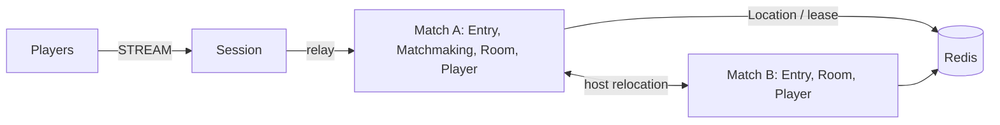

# MyGame match entry lobby

This .NET template serves action and FPS lobbies through Entry Spots, a persistent Matchmaking User Spot, and dynamically created Room User Spots. Matchmaking pairs players by mode. Rooms own position, health, sequence validation, range and wall intersection decisions.



## Prerequisites

Default execution requires Docker Linux containers; no host .NET SDK is needed.

Docker with Compose v2 (Linux containers), and PowerShell 7 on Windows or Bash on Linux. Public ZLink packages are pinned centrally to 0.30.2. No repository checkout is required. Supply any required ZLink license through the public package's license configuration; license files must not be committed.

## Build

Run commands from this project root:

```sh
./run-e2e.sh --build-only
```

PowerShell builds the same Dockerfile targets:

```powershell
pwsh -NoProfile -File ./run-e2e.ps1 -BuildOnly
```

`Dockerfile` owns fixed `SDK_IMAGE`, `RUNTIME_IMAGE`, and `DOCKER_CLI_IMAGE` defaults. Replace the appropriate base ARG when adopting a ZLink base image. All node roles share the node image because their runtime dependencies match; each retains its own executable entry point. The ASP.NET Core runtime supplies shared hosting dependencies. The runner target adds Docker CLI and structure inputs without including the SDK.

Scripts remove unique image tags after each invocation. Docker retains build layers for subsequent runs.

## Local e2e

Both scripts build images and call the same C# orchestrator inside a runner container. A unique Compose project/network contains Redis and the runner. The runner checks structure before starting nodes. Nodes share its network namespace, preserving loopback listeners and OS-assigned ports without host port mappings. Redis publishes an ephemeral loopback port for local debugging.

The runner creates each node with interactive stdin, copies its configuration with `docker cp`, and attaches through `docker start -a -i`. `ManagedProcess` retains readiness, drain, shutdown, and replacement controls. Only the runner mounts the Docker socket; use a trusted local daemon. Scripts remove their labeled containers, Compose project, and image tags. Cleanup failure returns exit code 1.

Node stderr logs (`<node>.err.log`) include Framework message flow records because dispatch diagnostics use `Normal`. Inspect these logs from the first failing run.

On Unix sockets, Bash runs the runner with the caller's UID/GID and the socket's group so retained logs remain writable by the caller. Windows uses Docker Desktop's filesystem mapping. Build, Redis, and outer cleanup logs are in `.logs/docker-<project>/`; node settings and control logs are in `.logs/run-<id>/`.

For host process debugging, install the .NET 8 SDK and add `--local` or `-Local`. Redis remains in Docker. After a local build, `--no-build` or `-NoBuild` skips compilation:

```sh
./run-e2e.sh --local
./run-e2e.sh --local --no-build
```

```powershell
pwsh -NoProfile -File ./run-e2e.ps1 -Local
pwsh -NoProfile -File ./run-e2e.ps1 -Local -NoBuild
pwsh -NoProfile -File ./run-e2e.ps1 -CheckDomain
```

```sh
./run-e2e.sh
./run-e2e.sh --scenario hit,wall,input,reconnect,update
./run-e2e.sh --check-structure
./run-e2e.sh --check-domain
```

```powershell
pwsh -NoProfile -File ./run-e2e.ps1
pwsh -NoProfile -File ./run-e2e.ps1 -Scenario hit,wall,input,reconnect,update
pwsh -NoProfile -File ./run-e2e.ps1 -CheckStructure
pwsh -NoProfile -File ./run-e2e.ps1 -CheckDomain
```

The runner checks the structure, starts its own Redis Compose project and node processes, and records stdout, stderr and message-flow diagnostics in `.logs/run-<id>/`. Redis and node listeners use OS-assigned ports; Redis keys use a unique run prefix. Cleanup failures return exit code 1. Each scenario uses fresh node containers and an independent Redis key prefix; the invocation shares one Redis service. The fixture sets RoomCapacity to one, so after migration fills the surviving process, the replacement is the eligible provider for a new Room. Production defaults to unrestricted Room capacity.

| Scenario | Checks |
| --- | --- |
| hit | Matchmaking, client `RoomAssignment` rejection, HP 75 after a hit, wall and range rejections without damage, absent target, HP zero and winner |
| wall | A wall blocks a shot and movement at its segment; walking below its endpoint reaches the other side, where a shot with the wall behind the target is accepted |
| input | Duplicate and reversed sequences, `MaxStep`, map and wall bounds, move/fire cooldown responses, unchanged state after rejection, and first retry acceptance after the server-provided delay |
| reconnect | A new Session retains Actor identity and the Room's position, HP, last sequence, phase, and winner, including after the match finishes |
| update | Relocation retains Room state and client Sessions, then the replacement node accepts new work |

`QueueRequest` is the first client packet. The Session relays only `QueueRequest`, `RoomViewRequest`, `MoveRequest`, `ShootRequest`, and `SessionInfoRequest`; internal packets receive `ActionRejected("packet-not-allowed", 0)`. The example accepts a claimed player ID; replace this boundary with authenticated identity before deployment. Requests use typed messages and the default Framework serializer. The Framework message model carries only finite JSON numbers, so nonfinite input reaches only the domain checks.

`RoomState` owns movement, shooting, action sequence, cooldown, and winner decisions. It sets players at `(40, 10)` and `(60, 10)`. `MoveRequest` carries displacement, and the server checks finite values, `MaxStep` 2.0, map bounds `[0, 100]` on each axis, the closed wall segment at `x=50, y=20..60`, and the movement budget `min(MaxStep, MaxSpeed × elapsed)` with `MaxSpeed` 10 units per second. Shots use server positions and have a 250 ms fire interval. Contract integers are limited to `9,007,199,254,740,991`; requests and results outside that range are rejected. Only accepted moves and shots advance `LastSequence`; rejected actions preserve room state. `ActionRejected` carries `Reason` and `RetryAfterMs`; only time-limited rejections have a positive delay, and clients wait for that returned value before retrying the same request. `RoomView` includes each player's `LastSequence`, the room `Phase`, and `Winner`. Relocation snapshots store remaining cooldown and movement-budget time in milliseconds, not process timestamps. `DomainChecks` exercises domain boundaries without sending nonfinite values over the wire.

Message Follow is configured explicitly to 30 seconds. After `RELOCATED`, the safe shutdown observation budget is the follow duration plus the existing relocation observation budget; the relocation operation deadline is unchanged.

## Known issues

Validated against the published Framework 0.30.2 packages.

## Deployment sequence

Wait for the bootstrap owner to report `READY` before starting another match host. Its public GetOrCreate completes while it is the only placement candidate, so the fixed Matchmaking Spot starts on its declared owner.

Start Redis, then match A (which bootstraps `matchmaking`), match B, and Session, using each project's `--config server/config/<node>.json` argument. Configure production Redis endpoints, unique key prefixes and listener addresses. Both match processes register relocation adapters and the same stable types.

Send `drain` on the selected match process's standard input. Wait for `RELOCATION_REQUESTED`, `RELOCATED`, then `SAFE_TO_SHUTDOWN`. Send `shutdown`, require successful process termination, and start the same role with the same configuration. Read actual bound endpoints from `READY` JSON. The runner performs this sequence without client reconnection.

## 한국어 실행 안내

기본 실행은 Docker에서 node와 e2e runner를 함께 실행하므로 호스트 .NET SDK가 필요하지 않습니다. Docker Compose v2와 Linux container 환경을 준비하십시오. 로컬 process 디버깅은 .NET 8 SDK를 설치한 뒤 `./run-e2e.sh --local` 또는 `pwsh -NoProfile -File ./run-e2e.ps1 -Local`로 실행합니다. 이미지 빌드·정리 로그는 `.logs/docker-<project>/`, node 로그는 `.logs/run-<id>/`에 남습니다. Windows에서는 PowerShell 7의 `run-e2e.ps1`, Linux에서는 `run-e2e.sh`를 실행합니다. 기본 시나리오는 `hit`, `wall`, `input`, `reconnect`, `update` 순서입니다. `hit`은 매칭·명중·사격 거부·승자를, `wall`은 벽의 사격 차단·이동 차단과 끝을 돌아가는 합법 경로를, `input`은 순번·이동·쿨다운 거부와 상태 불변을, `reconnect`는 진행 중·종료 뒤의 순번·phase·winner 복원을, `update`는 relocation과 대체 node 동작을 확인합니다. `--check-domain`은 단조 시계 기준의 도메인 경계를 검증합니다.

매칭 대기열은 Matchmaking User Spot이, 위치와 HP는 Room User Spot이 소유합니다. 실행별 로그와 message-flow 기록은 `.logs/run-<id>/`에 보존됩니다. 프로덕션 배포에서는 플레이어 인증과 Redis 연결 설정을 적용해야 합니다.
