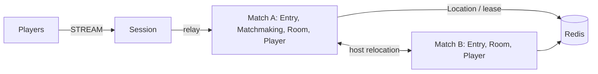

# MyGame match entry lobby

This .NET template serves action and FPS lobbies through Entry Spots, a persistent Matchmaking User Spot, and dynamically created Room User Spots. Matchmaking pairs players by mode. Rooms own position, health, sequence validation, range and wall intersection decisions.



## Prerequisites

.NET 8 SDK, Docker with Compose v2, and PowerShell 7 on Windows or Bash on Linux. Public ZLink packages are pinned centrally to 0.30.1. No repository checkout is required. Supply any required ZLink license through the public package's license configuration; license files must not be committed.

## Build

```sh
dotnet build server/MyGame.sln
```

## Local e2e

```sh
./run-e2e.sh
./run-e2e.sh --scenario hit,reconnect,update
```

```powershell
pwsh -NoProfile -File ./run-e2e.ps1
pwsh -NoProfile -File ./run-e2e.ps1 -Scenario hit,reconnect,update
```

The runner checks the structure, starts its own Redis Compose project and node processes, and records stdout, stderr and message-flow diagnostics in `.logs/run-<id>/`. Redis and node listeners use OS-assigned ports; Redis keys use a unique run prefix. Cleanup failures return exit code 1. Each scenario uses an isolated process and Redis lifetime. The fixture sets RoomCapacity to one, so after migration fills the surviving process, the replacement is the eligible provider for a new Room. Production defaults to unrestricted Room capacity.

| Scenario | Checks |
| --- | --- |
| hit | Matching, HP 75 after a hit, wall and range rejections without damage, absent target, HP zero and winner |
| reconnect | A new Session retains the Actor identity, Room, position and HP |
| update | Planned relocation, unchanged sessions and Room state, shutdown, replacement readiness and new work |

`QueueRequest` is the first client packet. The example accepts a claimed player ID; replace this boundary with authenticated identity before deployment. Requests use typed messages and the default Framework serializer. The Room's shared action sequence must increase across Move and Shoot requests. The closed vertical wall at x=50, y=0..100 blocks touching shots; movement is unconstrained except for finite coordinates.

## Known issues

Public 0.30.0 validation is blocked by the cross-node Actor join/relay failure tracked as #1723: MatchFound is not delivered after RoomAssignment and node message-flow logs report a stale relay peer identity. This template pins 0.30.1, which contains the scheduled fix; its candidate feed is required to complete e2e validation. No workaround is applied.

## Deployment sequence

Start Redis, then match A (which bootstraps `matchmaking`), match B, and Session, using each project's `--config server/config/<node>.json` argument. Configure production Redis endpoints, unique key prefixes and listener addresses. Both match processes register relocation adapters and the same stable types.

Send `drain` on the selected match process's standard input. Wait for `RELOCATION_REQUESTED`, `RELOCATED`, then `SAFE_TO_SHUTDOWN`. Send `shutdown`, require successful process termination, and start the same role with the same configuration. Read actual bound endpoints from `READY` JSON. The runner performs this sequence without client reconnection.

## 한국어 실행 안내

.NET 8 SDK와 Docker Compose를 준비하고 위 Build 명령으로 빌드합니다. Windows에서는 PowerShell 7의 `run-e2e.ps1`, Linux에서는 `run-e2e.sh`를 실행합니다. 시나리오를 지정하지 않으면 명중 판정, 재접속, 노드 교체를 순서대로 검증합니다.

매칭 대기열은 Matchmaking User Spot이, 위치와 HP는 Room User Spot이 소유합니다. 실행별 로그와 message-flow 기록은 `.logs/run-<id>/`에 보존됩니다. 프로덕션 배포에서는 플레이어 인증과 Redis 연결 설정을 적용해야 합니다.
