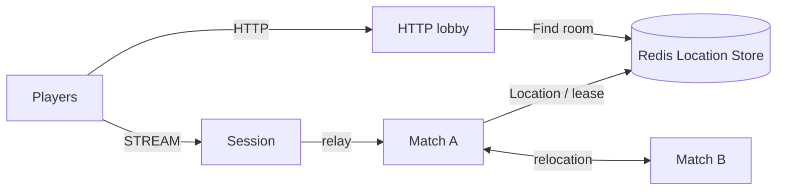

# MyGame HTTP match lobby

This standalone .NET template separates HTTP matchmaking from STREAM gameplay. The HTTP lobby pairs players by mode, creates a Room User Spot, and waits for its `RoomPrepared` reply before returning the Room ID and Session endpoint. `RoomRoster` owns matched membership and admission. `RoomState` owns positions, HP, action sequence, movement budget, fire cooldown, phase, winner, map boundaries and wall checks. Match nodes register Player Actors, an Entry Spot and the dynamic Room family in `my-game-arena`.



## Prerequisites

Default execution requires Docker Linux containers; no host .NET SDK is needed.

Install Docker with Compose v2 (Linux containers) and Bash or PowerShell 7. Dependencies are pinned in `Directory.Packages.props`: Framework and STREAM connector 0.32.0 and binding 1.23.0. The template uses NuGet.org; it has no repository or local-feed dependency.

## Build

Run commands from this project root:

```sh
./run-e2e.sh --build-only
```

PowerShell builds the same Dockerfile targets:

```powershell
pwsh -NoProfile -File ./run-e2e.ps1 -BuildOnly
```

`Dockerfile` owns fixed `SDK_IMAGE`, `RUNTIME_IMAGE`, and `DOCKER_CLI_IMAGE` defaults. Replace the appropriate base ARG when adopting a ZLink base image. All node roles share the node image because their runtime dependencies match; each retains its own executable entry point. The ASP.NET Core runtime supplies shared hosting dependencies. The runner target adds Docker CLI and structure inputs without including the SDK.

Scripts remove unique image tags after each invocation. Docker retains build layers for subsequent runs.

## Client connection

### Endpoint and first packet

Start with Lobby HTTP: `server/config/lobby.json` defaults `HttpEndpoint` to `http://127.0.0.1:0`. Read `httpEndpoint` from Lobby `READY` JSON. Two concurrent `POST /match` JSON requests with distinct `PlayerId` values and the same `Mode` (`duel` by default) wait for pairing and room preparation, then return `RoomId` and `SessionEndpoint`. See `e2e/MyGame.E2E/Scenarios.cs` and `server/MyGame.Shared/Contracts.cs`.

Session's `players` STREAM listener defaults to `ws://127.0.0.1:0` in `server/config/session.json`, root path `/`. Use its `streamEndpoint` from `READY`. Lobby's default advertised `SessionEndpoint` is `ws://127.0.0.1:8080`; it must be set to the actual running Session address, as `MatchRun.cs` does. Port-zero listeners need runtime addresses. Match mesh listeners and Redis are internal endpoints.

Connect to the assigned Session and send `JoinRoomRequest(PlayerId, RoomId)` first. Only assigned members can enter. Success produces `MatchFound` and `RoomView` pushes; later `SessionInfoRequest` is request/reply after binding. Admission does not authenticate identity; validate identity before binding when adding authentication.

### Connector installation

The default loopback listener is reachable only within its host/network namespace. Docker e2e nodes share the runner network namespace and are removed at the end. External clients need a deployment kept running with a reachable listener and an exposed container port. Browser, Unity WebGL, and Cocos Creator web clients can use this WebSocket endpoint; HTTPS pages require a secure `wss://` deployment. HTTP entry points also need a browser-accessible origin/CORS policy when called from a web client.

Use the release pinned in `Directory.Packages.props`, at `PackageVersion Include="Zlink.Framework"` and `PackageVersion Include="Zlink.Stream.Connector"` (`Version` attributes). Replace `<version>` in the installation commands with that release. Check linked guides against that pin; engine adapters follow the linked repository READMEs. All clients use this template's packet contract.

| Client                             | Connector installation                                                                                                                                                                                                                                                                                                                                                                                                                                                          | Documentation guide                                                                                                                                                          |
| ---------------------------------- | ------------------------------------------------------------------------------------------------------------------------------------------------------------------------------------------------------------------------------------------------------------------------------------------------------------------------------------------------------------------------------------------------------------------------------------------------------------------------------- | ---------------------------------------------------------------------------------------------------------------------------------------------------------------------------- |
| Unity                              | Native/Editor: restore `Zlink.Stream.Connector` with NuGetForUnity. WebGL: add the `com.zlink.stream-connector.webgl` UPM Git package; include only the connector assembly for the active target. See the [Unity README](https://github.com/zlink-systems/zlink/blob/main/framework/languages/engines/Unity/README.md) and its package manifest.                                                                                                                                | [.NET engine integration](https://docs.zlink.systems/dotnet/guide/stream-connector/12-engine-integration/)                                                                   |
| Unreal                             | Copy `framework/languages/cpp/connector/engines/unreal` into `Plugins/ZLinkStreamConnector`, then package the native connector under `ThirdParty/ZLink` as described in the [Unreal README](https://github.com/zlink-systems/zlink/blob/main/framework/languages/engines/Unreal/README.md).                                                                                                                                                                                     | [C++ engine integration](https://docs.zlink.systems/cpp/guide/stream-connector/12-engine-integration/)                                                                       |
| Godot                              | .NET: add the NuGet package `Zlink.Stream.Connector` and run `dotnet restore`; see the [C# README](https://github.com/zlink-systems/zlink/blob/main/framework/languages/engines/Godot/csharp/README.md). GDExtension: build the C++ Godot adapter against the framework prebuilt and matching `godot-cpp`; see the [C++ README](https://github.com/zlink-systems/zlink/blob/main/framework/languages/engines/Godot/cpp/README.md). The .NET sample does not support Web export. | [.NET](https://docs.zlink.systems/dotnet/guide/stream-connector/12-engine-integration/), [C++](https://docs.zlink.systems/cpp/guide/stream-connector/12-engine-integration/) |
| Cocos Creator                      | Web target: `npm install @zlink-systems/stream-connector@<version>`; see the [Cocos Creator README](https://github.com/zlink-systems/zlink/blob/main/framework/languages/engines/CocosCreator/README.md). This package does not provide a Creator native adapter.                                                                                                                                                                                                                  | [TypeScript engine integration](https://docs.zlink.systems/node/guide/stream-connector/12-engine-integration/)                                                               |
| Axmol                              | Copy `framework/languages/cpp/connector/engines/axmol` into `third_party/zlink_axmol_connector` and link `zlink::stream_connector` from the installed C++ framework package; see the [Axmol README](https://github.com/zlink-systems/zlink/blob/main/framework/languages/engines/Axmol/README.md).                                                                                                                                                                              | [C++ engine integration](https://docs.zlink.systems/cpp/guide/stream-connector/12-engine-integration/)                                                                       |
| Web browser (TypeScript connector) | `npm install @zlink-systems/stream-connector@<version>`; import the package root in the browser build. Use `ws://` or `wss://`, subject to the page's security policy.                                                                                                                                                                                                                                                                                                             | [TypeScript connector](https://docs.zlink.systems/node/guide/stream-connector/)                                                                                              |
| C++                                | Install the C++ framework prebuilt containing the connector; use `find_package(zlink_stream_connector_cpp CONFIG REQUIRED)` and link `zlink::stream_connector`.                                                                                                                                                                                                                                                                                                                 | [C++ connector](https://docs.zlink.systems/cpp/guide/stream-connector/)                                                                                                      |
| C#/.NET                            | `dotnet add package Zlink.Stream.Connector --version <version>`                                                                                                                                                                                                                                                                                                                                                                                                                    | [.NET connector](https://docs.zlink.systems/dotnet/guide/stream-connector/)                                                                                                  |
| Java                               | Add Maven/Gradle dependency `systems.zlink:zlink-stream-connector:<version>`.                                                                                                                                                                                                                                                                                                                                                                                                      | [Java connector](https://docs.zlink.systems/java/guide/stream-connector/)                                                                                                    |
| Kotlin                             | Add `systems.zlink:zlink-stream-connector:<version>` and `systems.zlink:zlink-framework-kotlin:<version>` for the coroutine wrapper.                                                                                                                                                                                                                                                                                                                                                  | [Kotlin connector](https://docs.zlink.systems/kotlin/guide/stream-connector/)                                                                                                |
| Node                               | `npm install @zlink-systems/stream-connector@<version>`; use the package root and Node.js 22 or later.                                                                                                                                                                                                                                                                                                                                                     | [Node connector](https://docs.zlink.systems/node/guide/stream-connector/)                                                                                                    |

### HTTP assignment and STREAM join example

Create a .NET 8 console project in a copy, reference `server/MyGame.Shared/MyGame.Shared.csproj`, and add `Zlink.Stream.Connector` using the pinned version described above. Save as `Program.cs`, then run `dotnet run --project <client-project> -- <actual-lobby-http-endpoint>` against separately running Lobby, Session, Match nodes, and Redis. Use fresh player IDs. E2E removes its temporary deployment; its `GameClient.cs` shows the complete flow.

```csharp
using System.Net.Http.Json;
using MyGame.Shared;
using Systems.Zlink.Stream.Connector;
using Systems.Zlink.Stream.Connector.Contracts;

using var deadline = new CancellationTokenSource(TimeSpan.FromSeconds(10));
var ct = deadline.Token;
using var http = new HttpClient { BaseAddress = new Uri(args[0]) };
async Task<MatchResponse> AssignAsync(string playerId)
{
    using var response = await http.PostAsJsonAsync("/match", new MatchRequest(playerId, "duel"), ct);
    response.EnsureSuccessStatusCode();
    return await response.Content.ReadFromJsonAsync<MatchResponse>(ct)
        ?? throw new InvalidDataException("Missing assignment");
}
var players = new[] { "guide-player-a", "guide-player-b" };
var assignments = await Task.WhenAll(players.Select(AssignAsync));
async Task JoinAsync(int index)
{
    var assignment = assignments[index];
    await using var client = ZlinkStreamConnectorFactory.Create(new ZlinkStreamConnectorOptions
    {
        Endpoint = new Uri(assignment.SessionEndpoint),
        DispatchMode = ZlinkStreamDispatchMode.Immediate,
        Reconnect = new ZlinkStreamReconnectOptions { Enabled = false },
    });
    var received = new TaskCompletionSource<RoomView>(TaskCreationOptions.RunContinuationsAsynchronously);
    using var view = client.On<RoomView>((message, _) =>
    {
        received.TrySetResult(message.Payload!);
        return ValueTask.CompletedTask;
    });
    using var rejected = client.On<ActionRejected>((message, _) =>
    {
        received.TrySetException(new InvalidOperationException(message.Payload!.ToString()));
        return ValueTask.CompletedTask;
    });
    using var error = client.OnErrorReceived((message, _) =>
    {
        received.TrySetException(new IOException(message.Message));
        return ValueTask.CompletedTask;
    });
    using var disconnected = client.OnDisconnected((_, _) =>
    {
        received.TrySetException(new IOException("Disconnected before RoomView"));
        return ValueTask.CompletedTask;
    });
    await client.Connect.Async(ct);
    await client.Send(new JoinRoomRequest(players[index], assignment.RoomId)).Async(ct);
    Console.WriteLine(await received.Task.WaitAsync(ct));
}
await Task.WhenAll(JoinAsync(0), JoinAsync(1));
```

## Local e2e

Both scripts build images and call the same C# orchestrator inside a runner container. A unique Compose project/network contains Redis and the runner. The runner checks structure before starting nodes. Nodes share its network namespace, preserving loopback listeners and OS-assigned ports without host port mappings. Redis publishes an ephemeral loopback port for local debugging.

The runner creates each node with interactive stdin, copies its configuration with `docker cp`, and attaches through `docker start -a -i`. `ManagedProcess` retains readiness, drain, shutdown, and replacement controls. Only the runner mounts the Docker socket; use a trusted local daemon. Scripts remove their labeled containers, Compose project, and image tags. Cleanup failure returns exit code 1.

Node stderr logs (`<node>.err.log`) include Framework message flow records because dispatch diagnostics use `Normal`. Inspect these logs from the first failing run.

On Unix sockets, Bash runs the runner with the caller's UID/GID and the socket's group so retained logs remain writable by the caller. Windows uses Docker Desktop's filesystem mapping. Build, Redis, and outer cleanup logs are in `.logs/docker-<project>/`; node settings and control logs are in `.logs/run-<id>/`.

For host process debugging, install the .NET 8 SDK and add `--local` or `-Local`. Redis remains in Docker. After a local build, `--no-build` or `-NoBuild` skips compilation:

```sh
./run-e2e.sh --local
./run-e2e.sh --local --no-build
```

```powershell
pwsh -NoProfile -File ./run-e2e.ps1 -Local
pwsh -NoProfile -File ./run-e2e.ps1 -Local -NoBuild
```

Bash:

```sh
./run-e2e.sh
./run-e2e.sh --scenario lobby,hit,wall,input,reconnect,update
./run-e2e.sh --check-structure
```

PowerShell:

```powershell
pwsh -NoProfile -File ./run-e2e.ps1
pwsh -NoProfile -File ./run-e2e.ps1 -Scenario lobby,hit,wall,input,reconnect,update
pwsh -NoProfile -File ./run-e2e.ps1 -CheckStructure
```

The runner validates `zlink.structure.json`, starts a uniquely named Redis Compose project on an OS-assigned loopback port, and launches the match nodes, Session and HTTP lobby. It injects the Session's published endpoint into the lobby configuration. HTTP, STREAM and mesh listeners bind port 0. Every run has a unique Redis key prefix and preserves node output, message-flow diagnostics and effective configurations in `.logs/run-<id>/`. Cleanup failures produce a nonzero exit code.

| Scenario | Assertions |
| --- | --- |
| `lobby` | Omitted mode selects `duel`; the lobby waits for Room preparation; an outsider and a client `PrepareRoom` packet are rejected; restarting the lobby produces a new Room ID. |
| `hit` | A hit reduces HP by 25; excessive range and a missing target reject shots without changing state; lethal damage sets the phase and winner. |
| `wall` | Both players move to (48,40) and (52,40). Movement into the wall and a shot across it are rejected without changing state or HP. Returning both players to (40,10) and (60,10) permits a clear shot below the wall. |
| `input` | Accepted and rejected movement requests are sent consecutively before waiting for replies, followed by consecutive shot requests. `MoveResult` and `ShotResult` identify accepted actions; `move-budget` and `fire-too-soon` preserve accepted state and sequence. Retrying the same request after the server's `RetryAfterMs` succeeds. Oversized, stale, out-of-map, wall-crossing and over-limit sequences are also rejected without state changes. |
| `reconnect` | A new Session binds the same Actor generation and restores sequence, phase, winner, position and HP after the match ends. |
| `update` | Planned maintenance relocates the owning match node, preserves connected Sessions, roster and room state, confirms shutdown, and proves the replacement accepts a new room. |

`POST /match` accepts `{ "playerId": "p1" }`; omitted `mode` defaults to `duel`. The response is deferred until another player in that mode arrives and the lobby receives `RoomPrepared` for the generated Room ID and matched member list. The response is `{ "roomId": "room-<32 lowercase hex characters>", "sessionEndpoint": "ws://..." }`. Clients connect there and send typed `JoinRoomRequest`. A Room admits only the two matched players. Session relays `JoinRoomRequest`, `RoomViewRequest`, `MoveRequest`, `ShootRequest` and `SessionInfoRequest`; internal packets receive `ActionRejected("packet-not-allowed", 0)`. Cancellation removes a request that is still queued; a duplicate pending player receives HTTP 400. The template has no authentication; production deployments should validate player identity before matchmaking and Session binding.

Movement uses `MoveRequest(dx, dy, sequence)` on the `[0,100]²` map. The server checks finite deltas, a 2.0 step limit, map boundaries, wall crossing and a movement budget of `min(2.0, 10 units/s × elapsed time)`. The first move has the full budget. Shooting targets a player ID, uses an 80-unit range and a 250 ms fire interval. An accepted move or shot advances the shared `LastSequence`; rejected inputs do not change values, sequence or cooldown. `ActionRejected` has `Reason` and `RetryAfterMs`; only movement-budget and fire-cooldown rejections return a positive retry time. Clients wait for that server value before retrying.

Integer contract values use the common maximum `9,007,199,254,740,991`; requests above it are rejected before state changes. The Room view reports each player's `LastSequence`, the `Phase` and the `Winner`. Domain time uses a monotonic clock, and relocation snapshots preserve movement and fire time as remaining milliseconds.

## Known issues

Validated against the published Framework 0.32.0 packages.

## Deployment sequence

1. Provision Redis and set the shared `RedisEndpoint` and `KeyPrefix` in `server/config/*.json`.
2. Launch match A and B with `dotnet server/MyGame.Match/bin/Debug/net8.0/MyGame.Match.dll --config server/config/match-a.json` (or `match-b.json`).
3. Launch Session with its executable and `server/config/session.json`. Read its `READY` output and configure the lobby's `SessionEndpoint` with the published STREAM endpoint.
4. Launch the HTTP lobby with its executable and `server/config/lobby.json`. Read the actual HTTP endpoint from `READY`. Expose the configured endpoints through the deployment's ingress.
5. For a match update, send `drain` on stdin and wait for `RELOCATION_REQUESTED`, `RELOCATED` and `SAFE_TO_SHUTDOWN`. Send `shutdown` and require a successful process exit after the public runtime returns `Stopped`. Start the replacement using the same configuration.

The HTTP lobby's in-memory queue is not a relocation participant. Stop accepting HTTP requests and finish or cancel outstanding matches before restarting that process. The Room relocation snapshot preserves game state and `RoomRoster`; Actor routing, binding, membership and transport lifecycle remain Framework responsibilities.
