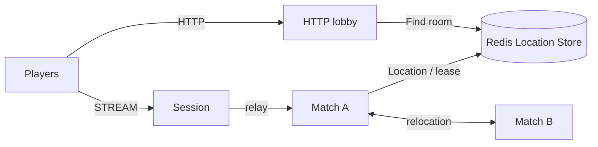

# MyGame HTTP match lobby

This standalone .NET template separates HTTP matchmaking from STREAM gameplay. The HTTP lobby pairs players by mode and prepares a Room User Spot through the public object client before returning its room ID and Session endpoint. Room owns positions, HP, sequence validation, range and wall collision checks. Match nodes register Player Actors, an Entry Spot and the dynamic Room family in `my-game-arena`.



## Prerequisites

Install the .NET 8 SDK, Docker with Compose v2 and Bash or PowerShell 7. Dependencies are pinned in `Directory.Packages.props`: Framework and STREAM connector 0.30.1 and binding 1.19.0. The template uses NuGet.org; it has no repository or local-feed dependency. Framework 0.30.1 must be published before the pinned build can restore.

## Build

Run from this directory:

```sh
dotnet build server/MyGame.sln
```

The solution builds separate `MyGame.Lobby`, `MyGame.Session`, `MyGame.Match` and `MyGame.E2E` executables. Match A and B use the same match executable with distinct JSON configurations.

## Local e2e

Bash:

```sh
./run-e2e.sh
./run-e2e.sh --scenario lobby,hit,reconnect,update
```

PowerShell:

```powershell
pwsh -NoProfile -File ./run-e2e.ps1
pwsh -NoProfile -File ./run-e2e.ps1 -Scenario lobby,hit,reconnect,update
```

The runner validates `zlink.structure.json`, starts a uniquely named Redis Compose project on an OS-assigned loopback port, and launches the match nodes, Session and HTTP lobby. It injects the Session's published endpoint into the lobby configuration. HTTP, STREAM and mesh listeners bind port 0. Every run has a unique Redis key prefix and preserves node output, message-flow diagnostics and effective configurations in `.logs/run-<id>/`. Cleanup failures produce a nonzero exit code.

| Scenario | Assertions |
| --- | --- |
| `lobby` | HTTP assignments agree; both STREAM clients enter the assigned room and observe both players. |
| `hit` | A hit reduces HP by 25; a wall, excessive range and a missing target reject shots; lethal damage declares the winner. |
| `reconnect` | A new Session binds the same Actor generation and restores the room's position and HP. |
| `update` | Planned maintenance relocates the owning match node, preserves connected Sessions and room state, confirms shutdown, and proves the replacement accepts a new room. |

`POST /match` accepts `{ "playerId": "p1", "mode": "duel" }`. Its response is deferred until another player in that mode arrives and Room creation succeeds, then returns `{ "roomId": "room-1", "sessionEndpoint": "ws://..." }`. Clients connect there and send typed `JoinRoomRequest`. Cancellation removes a request that is still queued; a duplicate pending player returns HTTP 400. This template has no authentication; production deployments should validate player identity before matchmaking and Session binding.

## Known issues

Public Framework 0.30.0 verification on Windows and WSL stopped at the initial RoomView after a cross-node Actor join (existing issue #1723, scheduled for 0.30.1). HTTP pairing and Room preparation succeeded in both runs. The pinned 0.30.1 build and all gameplay/update scenarios still require candidate-feed validation. The template keeps the public delivery path and the original assertions.

## Deployment sequence

1. Provision Redis and set the shared `RedisEndpoint` and `KeyPrefix` in `server/config/*.json`.
2. Launch match A and B with `dotnet server/MyGame.Match/bin/Debug/net8.0/MyGame.Match.dll --config server/config/match-a.json` (or `match-b.json`).
3. Launch Session with its executable and `server/config/session.json`. Read its `READY` output and configure the lobby's `SessionEndpoint` with the published STREAM endpoint.
4. Launch the HTTP lobby with its executable and `server/config/lobby.json`. Read the actual HTTP endpoint from `READY`. Expose the configured endpoints through the deployment's ingress.
5. For a match update, send `drain` on stdin and wait for `RELOCATION_REQUESTED`, `RELOCATED` and `SAFE_TO_SHUTDOWN`. Send `shutdown` and require a successful process exit after the public runtime returns `Stopped`. Start the replacement using the same configuration.

The HTTP lobby's in-memory queue is not a relocation participant. Stop accepting HTTP requests and finish or cancel outstanding matches before restarting that process. Application relocation adapters preserve Room combat state only. Actor routing, binding, membership and transport lifecycle remain Framework responsibilities.

## 한국어 실행 안내

.NET 8 SDK와 Docker Compose v2, Bash 또는 PowerShell 7이 필요합니다. 이 디렉터리에서 위 Build 명령을 실행한 뒤 Local e2e 명령으로 검증합니다. Framework 0.30.1이 게시되기 전에는 고정된 패키지 버전의 복원이 완료되지 않을 수 있습니다.

HTTP 로비에서 배정받은 Session endpoint로 STREAM에 접속한 뒤 `JoinRoomRequest`를 보냅니다. 로비는 매칭 대기열을, Room Spot은 위치와 HP를 소유합니다. 실행별 설정과 message flow 로그는 `.logs/run-<id>/`에 보존되며, runner는 자신이 시작한 process와 Compose project만 정리합니다.
