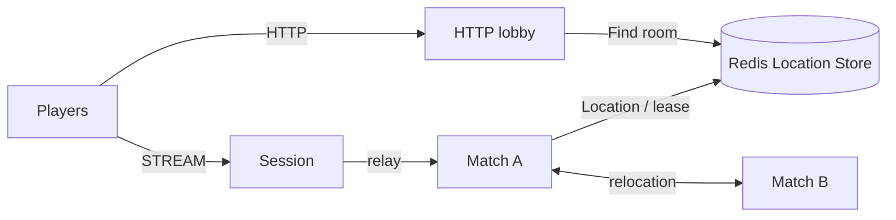

# MyGame HTTP match lobby

This standalone .NET template separates HTTP matchmaking from STREAM gameplay. The HTTP lobby pairs players by mode, creates a Room User Spot, and waits for its `RoomPrepared` reply before returning the Room ID and Session endpoint. `RoomRoster` owns matched membership and admission. `RoomState` owns positions, HP, action sequence, movement budget, fire cooldown, phase, winner, map boundaries and wall checks. Match nodes register Player Actors, an Entry Spot and the dynamic Room family in `my-game-arena`.



## Prerequisites

Default execution requires Docker Linux containers; no host .NET SDK is needed.

Install Docker with Compose v2 (Linux containers) and Bash or PowerShell 7. Dependencies are pinned in `Directory.Packages.props`: Framework and STREAM connector 0.30.2 and binding 1.20.0. The template uses NuGet.org; it has no repository or local-feed dependency.

## Build

Run commands from this project root:

```sh
./run-e2e.sh --build-only
```

PowerShell builds the same Dockerfile targets:

```powershell
pwsh -NoProfile -File ./run-e2e.ps1 -BuildOnly
```

`Dockerfile` owns fixed `SDK_IMAGE`, `RUNTIME_IMAGE`, and `DOCKER_CLI_IMAGE` defaults. Replace the appropriate base ARG when adopting a ZLink base image. All node roles share the node image because their runtime dependencies match; each retains its own executable entry point. The ASP.NET Core runtime supplies shared hosting dependencies. The runner target adds Docker CLI and structure inputs without including the SDK.

Scripts remove unique image tags after each invocation. Docker retains build layers for subsequent runs.

## Local e2e

Both scripts build images and call the same C# orchestrator inside a runner container. A unique Compose project/network contains Redis and the runner. The runner checks structure before starting nodes. Nodes share its network namespace, preserving loopback listeners and OS-assigned ports without host port mappings. Redis publishes an ephemeral loopback port for local debugging.

The runner creates each node with interactive stdin, copies its configuration with `docker cp`, and attaches through `docker start -a -i`. `ManagedProcess` retains readiness, drain, shutdown, and replacement controls. Only the runner mounts the Docker socket; use a trusted local daemon. Scripts remove their labeled containers, Compose project, and image tags. Cleanup failure returns exit code 1.

Node stderr logs (`<node>.err.log`) include Framework message flow records because dispatch diagnostics use `Normal`. Inspect these logs from the first failing run.

On Unix sockets, Bash runs the runner with the caller's UID/GID and the socket's group so retained logs remain writable by the caller. Windows uses Docker Desktop's filesystem mapping. Build, Redis, and outer cleanup logs are in `.logs/docker-<project>/`; node settings and control logs are in `.logs/run-<id>/`.

For host process debugging, install the .NET 8 SDK and add `--local` or `-Local`. Redis remains in Docker. After a local build, `--no-build` or `-NoBuild` skips compilation:

```sh
./run-e2e.sh --local
./run-e2e.sh --local --no-build
```

```powershell
pwsh -NoProfile -File ./run-e2e.ps1 -Local
pwsh -NoProfile -File ./run-e2e.ps1 -Local -NoBuild
```

Bash:

```sh
./run-e2e.sh
./run-e2e.sh --scenario lobby,hit,wall,input,reconnect,update
./run-e2e.sh --check-structure
```

PowerShell:

```powershell
pwsh -NoProfile -File ./run-e2e.ps1
pwsh -NoProfile -File ./run-e2e.ps1 -Scenario lobby,hit,wall,input,reconnect,update
pwsh -NoProfile -File ./run-e2e.ps1 -CheckStructure
```

The runner validates `zlink.structure.json`, starts a uniquely named Redis Compose project on an OS-assigned loopback port, and launches the match nodes, Session and HTTP lobby. It injects the Session's published endpoint into the lobby configuration. HTTP, STREAM and mesh listeners bind port 0. Every run has a unique Redis key prefix and preserves node output, message-flow diagnostics and effective configurations in `.logs/run-<id>/`. Cleanup failures produce a nonzero exit code.

| Scenario | Assertions |
| --- | --- |
| `lobby` | Omitted mode selects `duel`; the lobby waits for Room preparation; an outsider and a client `PrepareRoom` packet are rejected; restarting the lobby produces a new Room ID. |
| `hit` | A hit reduces HP by 25; excessive range and a missing target reject shots without changing state; lethal damage sets the phase and winner. |
| `wall` | Both players move to (48,40) and (52,40). Movement into the wall and a shot across it are rejected without changing state or HP. Returning both players to (40,10) and (60,10) permits a clear shot below the wall. |
| `input` | Accepted and rejected movement requests are sent consecutively before waiting for replies, followed by consecutive shot requests. `MoveResult` and `ShotResult` identify accepted actions; `move-budget` and `fire-too-soon` preserve accepted state and sequence. Retrying the same request after the server's `RetryAfterMs` succeeds. Oversized, stale, out-of-map, wall-crossing and over-limit sequences are also rejected without state changes. |
| `reconnect` | A new Session binds the same Actor generation and restores sequence, phase, winner, position and HP after the match ends. |
| `update` | Planned maintenance relocates the owning match node, preserves connected Sessions, roster and room state, confirms shutdown, and proves the replacement accepts a new room. |

`POST /match` accepts `{ "playerId": "p1" }`; omitted `mode` defaults to `duel`. The response is deferred until another player in that mode arrives and the lobby receives `RoomPrepared` for the generated Room ID and matched member list. The response is `{ "roomId": "room-<32 lowercase hex characters>", "sessionEndpoint": "ws://..." }`. Clients connect there and send typed `JoinRoomRequest`. A Room admits only the two matched players. Session relays `JoinRoomRequest`, `RoomViewRequest`, `MoveRequest`, `ShootRequest` and `SessionInfoRequest`; internal packets receive `ActionRejected("packet-not-allowed", 0)`. Cancellation removes a request that is still queued; a duplicate pending player receives HTTP 400. The template has no authentication; production deployments should validate player identity before matchmaking and Session binding.

Movement uses `MoveRequest(dx, dy, sequence)` on the `[0,100]²` map. The server checks finite deltas, a 2.0 step limit, map boundaries, wall crossing and a movement budget of `min(2.0, 10 units/s × elapsed time)`. The first move has the full budget. Shooting targets a player ID, uses an 80-unit range and a 250 ms fire interval. An accepted move or shot advances the shared `LastSequence`; rejected inputs do not change values, sequence or cooldown. `ActionRejected` has `Reason` and `RetryAfterMs`; only movement-budget and fire-cooldown rejections return a positive retry time. Clients wait for that server value before retrying.

Integer contract values use the common maximum `9,007,199,254,740,991`; requests above it are rejected before state changes. The Room view reports each player's `LastSequence`, the `Phase` and the `Winner`. Domain time uses a monotonic clock, and relocation snapshots preserve movement and fire time as remaining milliseconds.

## Known issues

Validated against the published Framework 0.30.2 packages.

## Deployment sequence

1. Provision Redis and set the shared `RedisEndpoint` and `KeyPrefix` in `server/config/*.json`.
2. Launch match A and B with `dotnet server/MyGame.Match/bin/Debug/net8.0/MyGame.Match.dll --config server/config/match-a.json` (or `match-b.json`).
3. Launch Session with its executable and `server/config/session.json`. Read its `READY` output and configure the lobby's `SessionEndpoint` with the published STREAM endpoint.
4. Launch the HTTP lobby with its executable and `server/config/lobby.json`. Read the actual HTTP endpoint from `READY`. Expose the configured endpoints through the deployment's ingress.
5. For a match update, send `drain` on stdin and wait for `RELOCATION_REQUESTED`, `RELOCATED` and `SAFE_TO_SHUTDOWN`. Send `shutdown` and require a successful process exit after the public runtime returns `Stopped`. Start the replacement using the same configuration.

The HTTP lobby's in-memory queue is not a relocation participant. Stop accepting HTTP requests and finish or cancel outstanding matches before restarting that process. The Room relocation snapshot preserves game state and `RoomRoster`; Actor routing, binding, membership and transport lifecycle remain Framework responsibilities.

## 한국어 실행 안내

기본 시나리오는 `lobby`, `hit`, `wall`, `input`, `reconnect`, `update` 순서로 실행합니다. `wall`은 벽 양쪽의 이동·사격 거부와 거부 뒤 HP 불변, 벽을 피해 이동한 뒤의 명중을 확인합니다. Docker에서 node와 e2e runner를 함께 실행하므로 호스트 .NET SDK가 필요하지 않습니다. Docker Compose v2와 Linux container 환경을 준비하십시오. 로컬 process 디버깅은 .NET 8 SDK를 설치한 뒤 `./run-e2e.sh --local` 또는 `pwsh -NoProfile -File ./run-e2e.ps1 -Local`로 실행합니다. 이미지 빌드·정리 로그는 `.logs/docker-<project>/`, node 로그는 `.logs/run-<id>/`에 남습니다. Bash 또는 PowerShell 7에서 실행합니다. 이 디렉터리에서 위 Build 명령을 실행한 뒤 Local e2e 명령으로 검증합니다.

HTTP 로비에서 배정받은 Session endpoint로 STREAM에 접속한 뒤 `JoinRoomRequest`를 보냅니다. `RoomRoster`는 입장 명단을, `RoomState`는 위치·HP·순번·이동 예산·쿨다운·phase·승자를 소유합니다. 거부 응답은 `ActionRejected(Reason, RetryAfterMs)`이며 시간 제한 거부의 재시도 시간은 서버가 반환합니다. 실행별 설정과 message flow 로그는 `.logs/run-<id>/`에 보존되며, runner는 자신이 시작한 process와 Compose project만 정리합니다.

`input`은 이동 요청 두 개와 사격 요청 두 개를 각각 응답 대기 없이 연속 전송한다. 수락 결과와 시간 제한 거부를 모두 확인하고, 거부 뒤 값·순번·쿨다운 불변 및 서버가 준 `RetryAfterMs` 뒤 같은 요청의 수락을 검사한다. 게임 경계는 기준 match-entry-lobby의 게임 범주 9개로 검사하며, 매칭 범주는 HTTP 경계 19개에서 검사한다. `wall`은 벽 반대편 사격 거부와 HP 불변 및 벽 구간 밖 명중을 확인한다.

Run domain and wire checks separately with `./run-e2e.sh --check-domain` or `pwsh -NoProfile -File ./run-e2e.ps1 -CheckDomain`. Game boundary checks use the existing language-specific test location; the HTTP domain suite contains 19 checks.
