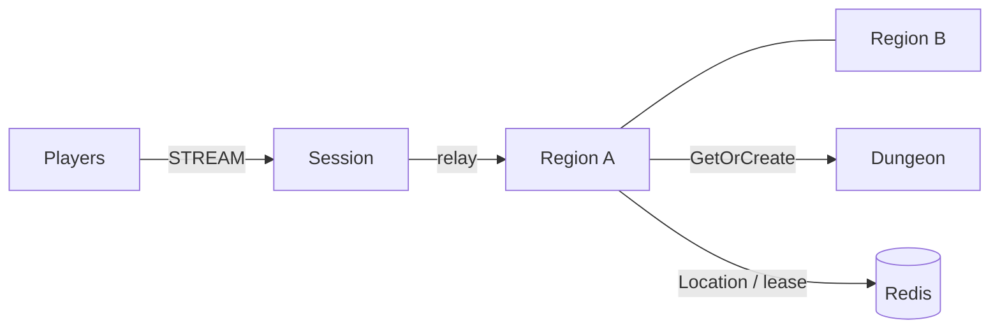

# MyGame megaserver

This template runs a single world with dynamically allocated Region User Spots. Each Region admits up to `Capacity` players (default 2); the Entry selects up to `MaxReplicasPerRegion` instances for an allowed region. `Positions` is the authority for movement: a player starts at X=0, the region covers X=0..100, the first move may be `MaxStep` (10), and later movement is limited to 50 units per second. Rejected input leaves position, sequence, and movement budget unchanged. Dungeon creation uses a separate Instance process.



## Prerequisites

Default execution requires Docker Linux containers; no host .NET SDK is needed.

Install Docker with Compose v2 (Linux containers), and PowerShell 7 on Windows. Restore the public NuGet packages pinned in `Directory.Packages.props`. This directory is independently copyable; it has no repository project references.

## Build

Run commands from this project root:

```sh
./run-e2e.sh --build-only
```

PowerShell builds the same Dockerfile targets:

```powershell
pwsh -NoProfile -File ./run-e2e.ps1 -BuildOnly
```

`Dockerfile` owns fixed `SDK_IMAGE`, `RUNTIME_IMAGE`, and `DOCKER_CLI_IMAGE` defaults. Replace the appropriate base ARG when adopting a ZLink base image. All node roles share the node image because their runtime dependencies match; each retains its own executable entry point. The ASP.NET Core runtime supplies shared hosting dependencies. The runner target adds Docker CLI and structure inputs without including the SDK.

Scripts remove unique image tags after each invocation. Docker retains build layers for subsequent runs.

## Local e2e

Both scripts build images and call the same C# orchestrator inside a runner container. A unique Compose project/network contains Redis and the runner. The runner checks structure before starting nodes. Nodes share its network namespace, preserving loopback listeners and OS-assigned ports without host port mappings. Redis publishes an ephemeral loopback port for local debugging.

The runner creates each node with interactive stdin, copies its configuration with `docker cp`, and attaches through `docker start -a -i`. `ManagedProcess` retains readiness, drain, shutdown, and replacement controls. `--check-domain` runs the domain boundary checks before any scenario node starts. Only the runner mounts the Docker socket; use a trusted local daemon. Scripts remove their labeled containers, Compose project, and image tags. Cleanup failure returns exit code 1.

Node stderr logs (`<node>.err.log`) include Framework message flow records because dispatch diagnostics use `Normal`. Inspect these logs from the first failing run.

On Unix sockets, Bash runs the runner with the caller's UID/GID and the socket's group so retained logs remain writable by the caller. Windows uses Docker Desktop's filesystem mapping. Build, Redis, and outer cleanup logs are in `.logs/docker-<project>/`; node settings and control logs are in `.logs/run-<id>/`.

For host process debugging, install the .NET 8 SDK and add `--local` or `-Local`. Redis remains in Docker. After a local build, `--no-build` or `-NoBuild` skips compilation:

```sh
./run-e2e.sh --local
./run-e2e.sh --local --no-build
```

```powershell
pwsh -NoProfile -File ./run-e2e.ps1 -Local
pwsh -NoProfile -File ./run-e2e.ps1 -Local -NoBuild
```

On Linux:

```sh
./run-e2e.sh
./run-e2e.sh --scenario region,movement,dungeon,reconnect,update
./run-e2e.sh --check-structure
./run-e2e.sh --check-domain
```

On PowerShell:

```powershell
pwsh -NoProfile -File ./run-e2e.ps1
pwsh -NoProfile -File ./run-e2e.ps1 -Scenario region,movement,dungeon,reconnect,update
pwsh -NoProfile -File ./run-e2e.ps1 -CheckStructure
pwsh -NoProfile -File ./run-e2e.ps1 -CheckDomain
```

| Scenario | Checks |
| --- | --- |
| `region` | Fills both Region replicas, verifies `capacity-exhausted` and `region-unknown`, checks that the Session stays connected, and confirms Region isolation. |
| `movement` | Checks the server-authoritative Delta and Sequence result, unchanged state after a movement-budget rejection, the server-provided retry time, one direct result for the caller, and one broadcast to other members. |
| `dungeon` | Checks that the Dungeon is created on the Instance host. |
| `reconnect` | Checks that Actor identity, Region membership, position, and sequence continue after reconnect. |
| `update` | Drains the current Region host, checks unchanged game state and Sessions, shuts down the drained process, and starts a replacement that accepts a new Region. |

`./run-e2e.sh --check-domain` runs position, sequence, budget, region-boundary, finite-number, and relocation-snapshot checks before any scenario node starts.

The runner validates `zlink.structure.json`, starts a uniquely named Redis Compose project, and launches each node separately. Framework binds ephemeral listener ports and publishes the endpoints. Each run writes configs, node stderr message-flow records, and process logs under `.logs/run-<id>/`. Cleanup affects only the run's processes and Compose project. Cleanup failure returns exit code 1.

## Known issues

Validated against the published Framework 0.30.2 packages.

With Framework 0.30.2, `update` fails when it runs after `region` in the same run. The `region` scenario fills both forest replicas, so a Region rejects one Actor Join. Framework 0.30.2 counts the stored rejection reply as an unfinished handoff, and the drain preflight waits until that reply expires. Relocation then exceeds its deadline (`Host relocation blocked: DeadlineExceeded`) and the Region process exits. `update` passes when it runs alone. Framework 0.30.3 fixes the drain check (zlink-systems/zlink#2682).

## Deployment sequence

Start Redis, then Region nodes and the Instance node, and finally Session. Supply each executable with `--config server/config/<node>.json`; production settings must use reachable listener endpoints, a shared Redis endpoint, and the same world key prefix. `RegionLimit` is the Framework stable-type limit per Region node and must allow the surviving node to receive the drained node's instances. `Capacity` is the application membership limit and must be identical across Region hosts.

Send `drain` to the Region process's stdin. Wait for `RELOCATION_REQUESTED`, `RELOCATED`, and `SAFE_TO_SHUTDOWN`, then send `shutdown` and verify `STOPPED` before starting the replacement with the same configuration. Game state relocation stores player positions, movement sequences, and remaining movement-budget milliseconds; it does not store process timestamps. Framework owns membership, routing, binding, and leases. `Contracts.cs` defines the allowed regions, `MaxReplicasPerRegion`, `MaxStep`, and `MaxSafeInteger`.

The example trusts player IDs sent on the first `EnterRegionRequest`. Add application authentication before deploying publicly. `PlayerSession` accepts only client packets in `AllowedPackets`; internal packets receive `ActionRejected` with reason `packet-not-allowed`, and the Session remains connected. Disconnected players retain membership, position, sequence, and movement budget for reconnect. Repeating `EnterRegionRequest` for an already joined Actor returns its current Region view.

The e2e fixture limits each Region node to two Region Spots and keeps forest-1 and forest-2 occupied before drain. After relocation the survivor is full. Once the replacement reports `READY`, a new desert Region must be served by that replacement. Existing Region state and Session identity checks remain required. Only Region nodes register the application Entry and its first admission handler, so only those nodes declare an Entry in `zlink.structure.json`.

Message Follow is explicitly set to 30 seconds. The `SAFE_TO_SHUTDOWN` observation budget is the follow duration plus the existing relocation budget; the relocation operation deadline is unchanged.

## 한국어 실행 안내

기본 실행은 Docker에서 node와 e2e runner를 함께 실행하므로 호스트 .NET SDK가 필요하지 않습니다. Docker Compose v2와 Linux container 환경을 준비합니다. `./run-e2e.sh --build-only`로 이미지를 빌드하고, `./run-e2e.sh` 또는 `pwsh -NoProfile -File ./run-e2e.ps1`로 전체 시나리오를 실행합니다. `./run-e2e.sh --check-domain` 또는 `-CheckDomain`은 scenario node를 시작하지 않고 domain 경계 검사를 실행합니다. 로컬 process 디버깅에는 .NET 8 SDK와 `--local` 또는 `-Local`을 사용합니다. 실행 로그는 `.logs/docker-<project>/`와 `.logs/run-<id>/`에 남습니다.

`region`은 두 replica의 정원 초과, `capacity-exhausted`, `region-unknown`, 연결 유지와 Region 간 격리를 확인합니다. `movement`는 Delta·Sequence 판정, 이동 예산 거부 뒤 상태 불변, 서버가 응답한 `RetryAfterMs` 뒤 재수락, 요청자 직접 응답과 구성원 broadcast를 확인합니다. `dungeon`, `reconnect`, `update`는 Dungeon host, 재접속 상태, host 교체 뒤 상태·연결 보존을 검사합니다.

각 Region의 `Capacity`는 `server/config/regionA.json`과 `regionB.json`에서 정합니다. 허용 region, `MaxReplicasPerRegion`, `MaxStep`은 `server/MyGame.Shared/Contracts.cs`에서 관리합니다. 실행마다 Redis key prefix와 Compose project 이름이 달라지고 실제 listener endpoint를 사용합니다. 실패 원인과 message flow는 `.logs/run-<id>/`의 node stderr 로그에서 확인합니다.
