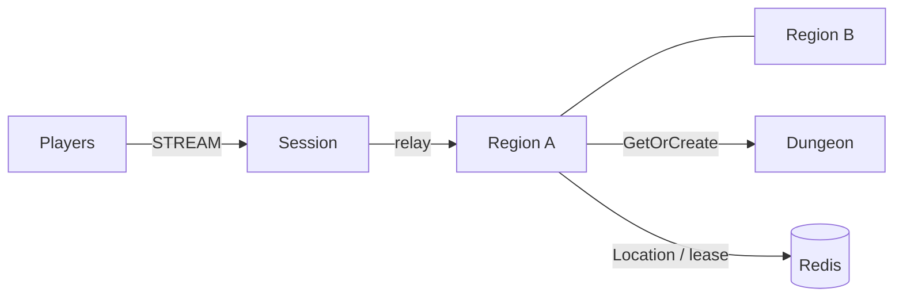

# MyGame megaserver

This template runs a single world with dynamically allocated Region User Spots. A Region admits up to `Capacity` players (default 2); its Entry selects `forest-1`, `forest-2`, and subsequent instances in order after an explicit `region-full` rejection. Each Region owns player positions and broadcasts only to its members. Dungeon creation uses a separate Instance process.



## Prerequisites

Install .NET SDK 8 or later, Docker with Compose v2, and PowerShell 7 on Windows. Restore the public NuGet packages pinned in `Directory.Packages.props`. Framework and connector 0.30.1 must be published before the unmodified template can restore. This directory is independently copyable; it has no repository project references.

## Build

```sh
dotnet build server/MyGame.sln
```

The solution includes the shared contracts, Session, Region, Instance, and e2e runner.

## Local e2e

On Linux:

```sh
./run-e2e.sh
./run-e2e.sh --scenario region,dungeon,reconnect,update
```

On PowerShell:

```powershell
./run-e2e.ps1
./run-e2e.ps1 -Scenario region,dungeon,reconnect,update
```

`region` checks capacity overflow, shared positions, and instance isolation. `dungeon` checks the hosting node. `reconnect` checks Actor identity, membership, and position. `update` drains the current Region host, checks unchanged game state and Sessions, shuts down the drained process, and starts a replacement that accepts a new Region.

The runner validates `zlink.structure.json`, starts a uniquely named Redis Compose project, and launches each node separately. Framework binds ephemeral listener ports and publishes the endpoints. Each run writes configs, node stderr message-flow records, and process logs under `.logs/run-<id>/`. Cleanup affects only the run's processes and Compose project. Cleanup failure returns exit code 1.

## Known issues

Public 0.30.0 validation stops at the first cross-node Actor join: a RegionView Actor send is accepted but its delivery handler does not run (#1723, fixed for 0.30.1). The remaining scenarios require 0.30.1 candidate or published packages for execution acceptance. The template retains its 0.30.1 pins and does not compensate for the package defect.

## Deployment sequence

Start Redis, then Region nodes and the Instance node, and finally Session. Supply each executable with `--config server/config/<node>.json`; production settings must use reachable listener endpoints, a shared Redis endpoint, and the same world key prefix. `RegionLimit` is the Framework stable-type limit per Region node and must allow the surviving node to receive the drained node's instances. `Capacity` is the application membership limit and must be identical across Region hosts.

Send `drain` to the Region process's stdin. Wait for `RELOCATION_REQUESTED`, `RELOCATED`, and `SAFE_TO_SHUTDOWN`, then send `shutdown` and verify `STOPPED` before starting the replacement with the same configuration. Game state relocation contains player positions and movement sequences only; Framework owns membership, routing, binding, and leases.

The demonstration trusts player IDs sent on the first packet. Add application authentication before deploying publicly. Disconnected players retain membership and position for reconnect; explicit lifecycle policies can extend the domain model. Repeating `EnterRegionRequest` for an already joined Actor returns its current Region view.

## 한국어 실행 안내

.NET SDK 8 이상과 Docker Compose v2를 설치한 뒤 이 디렉터리에서 `dotnet build server/MyGame.sln`을 실행합니다. Linux에서는 `./run-e2e.sh`, PowerShell 7에서는 `./run-e2e.ps1`로 전체 시나리오를 실행합니다. 공개 0.30.1 패키지가 게시되어야 원본 템플릿을 복원할 수 있습니다.

지역 정원은 `server/config/regionA.json`과 `regionB.json`의 `Capacity`로 지정합니다. 실행마다 Redis key prefix와 Compose project 이름을 새로 생성하고 실제 listener endpoint를 사용합니다. 실패 원인과 message flow는 `.logs/run-<id>/`의 node stderr 로그에서 확인합니다.
