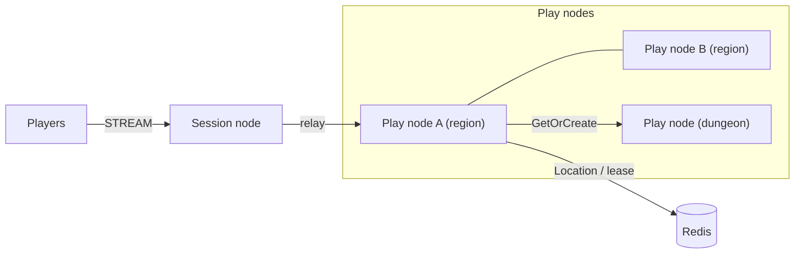

# MyGame megaserver

This template runs a single world with dynamically allocated Region User Spots. Each Region admits up to `Capacity` players (default 2); the Entry selects up to `MaxReplicasPerRegion` instances for an allowed region. `Positions` is the authority for movement: a player starts at X=0, the region covers X=0..100, the first move may be `MaxStep` (10), and later movement is limited to 50 units per second. Rejected input leaves position, sequence, and movement budget unchanged. Dungeon creation uses a separate play node (dungeon).



## Prerequisites

Default execution requires Docker Linux containers; no host .NET SDK is needed.

Install Docker with Compose v2 (Linux containers), and PowerShell 7 on Windows. Restore the public NuGet packages pinned in `Directory.Packages.props`. This directory is independently copyable; it has no repository project references.

## Build

Run commands from this project root:

```sh
./run-e2e.sh --build-only
```

PowerShell builds the same Dockerfile targets:

```powershell
pwsh -NoProfile -File ./run-e2e.ps1 -BuildOnly
```

`Dockerfile` owns fixed `SDK_IMAGE`, `RUNTIME_IMAGE`, and `DOCKER_CLI_IMAGE` defaults. Replace the appropriate base ARG when adopting a ZLink base image. All node roles share the node image because their runtime dependencies match; each retains its own executable entry point. The ASP.NET Core runtime supplies shared hosting dependencies. The runner target adds Docker CLI and structure inputs without including the SDK.

Scripts remove unique image tags after each invocation. Docker retains build layers for subsequent runs.

## Client connection

### Endpoint and first packet

The Session `players` STREAM listener uses `StreamEndpoint` in `server/config/session.json`, defaulting to `ws://127.0.0.1:0`: loopback WebSocket, OS-assigned port, root path `/`. Read `StreamEndpoint` from Session `READY` JSON, as `e2e/MyGame.E2E/WorldRun.cs` does. Region/Instance mesh listeners and Redis are internal endpoints.

Send `EnterRegionRequest(PlayerId, Region)` first. Allowed regions are `forest` and `desert`; successful Actor binding and entry produce a `RegionView` push. `RegionUnavailable` reports unknown regions or exhausted capacity, and `ActionRejected` reports rejected actions. Entry is send/push; `SessionInfoRequest` is request/reply after binding. There is no product authentication; validate identity before binding when adding it.

### Connector installation

The default loopback listener is reachable only within its host/network namespace. Docker e2e nodes share the runner network namespace and are removed at the end. External clients need a deployment kept running with a reachable listener and an exposed container port. Browser, Unity WebGL, and Cocos Creator web clients can use this WebSocket endpoint; HTTPS pages require a secure `wss://` deployment. HTTP entry points also need a browser-accessible origin/CORS policy when called from a web client.

Use the release pinned in `Directory.Packages.props`, at `PackageVersion Include="Zlink.Framework"` and `PackageVersion Include="Zlink.Stream.Connector"` (`Version` attributes). Replace `<version>` in the installation commands with that release. Check linked guides against that pin; engine adapters follow the linked repository READMEs. All clients use this template's packet contract.

| Client                             | Connector installation                                                                                                                                                                                                                                                                                                                                                                                                                                                          | Documentation guide                                                                                                                                                          |
| ---------------------------------- | ------------------------------------------------------------------------------------------------------------------------------------------------------------------------------------------------------------------------------------------------------------------------------------------------------------------------------------------------------------------------------------------------------------------------------------------------------------------------------- | ---------------------------------------------------------------------------------------------------------------------------------------------------------------------------- |
| Unity                              | Native/Editor: restore `Zlink.Stream.Connector` with NuGetForUnity. WebGL: add the `com.zlink.stream-connector.webgl` UPM Git package; include only the connector assembly for the active target. See the [Unity README](https://github.com/zlink-systems/zlink/blob/main/framework/languages/engines/Unity/README.md) and its package manifest.                                                                                                                                | [.NET engine integration](https://docs.zlink.systems/dotnet/guide/stream-connector/12-engine-integration/)                                                                   |
| Unreal                             | Copy `framework/languages/cpp/connector/engines/unreal` into `Plugins/ZLinkStreamConnector`, then package the native connector under `ThirdParty/ZLink` as described in the [Unreal README](https://github.com/zlink-systems/zlink/blob/main/framework/languages/engines/Unreal/README.md).                                                                                                                                                                                     | [C++ engine integration](https://docs.zlink.systems/cpp/guide/stream-connector/12-engine-integration/)                                                                       |
| Godot                              | .NET: add the NuGet package `Zlink.Stream.Connector` and run `dotnet restore`; see the [C# README](https://github.com/zlink-systems/zlink/blob/main/framework/languages/engines/Godot/csharp/README.md). GDExtension: build the C++ Godot adapter against the framework prebuilt and matching `godot-cpp`; see the [C++ README](https://github.com/zlink-systems/zlink/blob/main/framework/languages/engines/Godot/cpp/README.md). The .NET sample does not support Web export. | [.NET](https://docs.zlink.systems/dotnet/guide/stream-connector/12-engine-integration/), [C++](https://docs.zlink.systems/cpp/guide/stream-connector/12-engine-integration/) |
| Cocos Creator                      | Web target: `npm install @zlink-systems/stream-connector@<version>`; see the [Cocos Creator README](https://github.com/zlink-systems/zlink/blob/main/framework/languages/engines/CocosCreator/README.md). This package does not provide a Creator native adapter.                                                                                                                                                                                                                  | [TypeScript engine integration](https://docs.zlink.systems/node/guide/stream-connector/12-engine-integration/)                                                               |
| Axmol                              | Copy `framework/languages/cpp/connector/engines/axmol` into `third_party/zlink_axmol_connector` and link `zlink::stream_connector` from the installed C++ framework package; see the [Axmol README](https://github.com/zlink-systems/zlink/blob/main/framework/languages/engines/Axmol/README.md).                                                                                                                                                                              | [C++ engine integration](https://docs.zlink.systems/cpp/guide/stream-connector/12-engine-integration/)                                                                       |
| Web browser (TypeScript connector) | `npm install @zlink-systems/stream-connector@<version>`; import the package root in the browser build. Use `ws://` or `wss://`, subject to the page's security policy.                                                                                                                                                                                                                                                                                                             | [TypeScript connector](https://docs.zlink.systems/node/guide/stream-connector/)                                                                                              |
| C++                                | Install the C++ framework prebuilt containing the connector; use `find_package(zlink_stream_connector_cpp CONFIG REQUIRED)` and link `zlink::stream_connector`.                                                                                                                                                                                                                                                                                                                 | [C++ connector](https://docs.zlink.systems/cpp/guide/stream-connector/)                                                                                                      |
| C#/.NET                            | `dotnet add package Zlink.Stream.Connector --version <version>`                                                                                                                                                                                                                                                                                                                                                                                                                    | [.NET connector](https://docs.zlink.systems/dotnet/guide/stream-connector/)                                                                                                  |
| Java                               | Add Maven/Gradle dependency `systems.zlink:zlink-stream-connector:<version>`.                                                                                                                                                                                                                                                                                                                                                                                                      | [Java connector](https://docs.zlink.systems/java/guide/stream-connector/)                                                                                                    |
| Kotlin                             | Add `systems.zlink:zlink-stream-connector:<version>` and `systems.zlink:zlink-framework-kotlin:<version>` for the coroutine wrapper.                                                                                                                                                                                                                                                                                                                                                  | [Kotlin connector](https://docs.zlink.systems/kotlin/guide/stream-connector/)                                                                                                |
| Node                               | `npm install @zlink-systems/stream-connector@<version>`; use the package root and Node.js 22 or later.                                                                                                                                                                                                                                                                                                                                                     | [Node connector](https://docs.zlink.systems/node/guide/stream-connector/)                                                                                                    |

### First region example

Create a .NET 8 console project in a copy, reference `server/MyGame.Shared/MyGame.Shared.csproj`, and add `Zlink.Stream.Connector` using the pinned version described above. Save as `Program.cs`, then run `dotnet run --project <client-project> -- <actual-session-endpoint>` against separately running Session, Region/play nodes (dungeon), and Redis. Use a fresh player ID. E2E removes its temporary deployment; its `GameClient.cs` shows the complete flow.

```csharp
using MyGame.Shared;
using Systems.Zlink.Stream.Connector;
using Systems.Zlink.Stream.Connector.Contracts;

using var deadline = new CancellationTokenSource(TimeSpan.FromSeconds(10));
var ct = deadline.Token;
await using var client = ZlinkStreamConnectorFactory.Create(new ZlinkStreamConnectorOptions
{
    Endpoint = new Uri(args[0]),
    DispatchMode = ZlinkStreamDispatchMode.Immediate,
    Reconnect = new ZlinkStreamReconnectOptions { Enabled = false },
});
var received = new TaskCompletionSource<RegionView>(TaskCreationOptions.RunContinuationsAsynchronously);
using var view = client.On<RegionView>((message, _) =>
{
    received.TrySetResult(message.Payload!);
    return ValueTask.CompletedTask;
});
using var unavailable = client.On<RegionUnavailable>((message, _) =>
{
    received.TrySetException(new InvalidOperationException(message.Payload!.ToString()));
    return ValueTask.CompletedTask;
});
using var rejected = client.On<ActionRejected>((message, _) =>
{
    received.TrySetException(new InvalidOperationException(message.Payload!.ToString()));
    return ValueTask.CompletedTask;
});
using var error = client.OnErrorReceived((message, _) =>
{
    received.TrySetException(new IOException(message.Message));
    return ValueTask.CompletedTask;
});
using var disconnected = client.OnDisconnected((_, _) =>
{
    received.TrySetException(new IOException("Disconnected before RegionView"));
    return ValueTask.CompletedTask;
});
await client.Connect.Async(ct);
await client.Send(new EnterRegionRequest("guide-player", "forest")).Async(ct);
Console.WriteLine(await received.Task.WaitAsync(ct));
```

## Local e2e

Both scripts build images and call the same C# orchestrator inside a runner container. A unique Compose project/network contains Redis and the runner. The runner checks structure before starting nodes. Nodes share its network namespace, preserving loopback listeners and OS-assigned ports without host port mappings. Redis publishes an ephemeral loopback port for local debugging.

The runner creates each node with interactive stdin, copies its configuration with `docker cp`, and attaches through `docker start -a -i`. `ManagedProcess` retains readiness, drain, shutdown, and replacement controls. `--check-domain` runs the domain boundary checks before any scenario node starts. Only the runner mounts the Docker socket; use a trusted local daemon. Scripts remove their labeled containers, Compose project, and image tags. Cleanup failure returns exit code 1.

Node stderr logs (`<node>.err.log`) include Framework message flow records because dispatch diagnostics use `Normal`. Inspect these logs from the first failing run.

On Unix sockets, Bash runs the runner with the caller's UID/GID and the socket's group so retained logs remain writable by the caller. Windows uses Docker Desktop's filesystem mapping. Build, Redis, and outer cleanup logs are in `.logs/docker-<project>/`; node settings and control logs are in `.logs/run-<id>/`.

For host process debugging, install the .NET 8 SDK and add `--local` or `-Local`. Redis remains in Docker. After a local build, `--no-build` or `-NoBuild` skips compilation:

```sh
./run-e2e.sh --local
./run-e2e.sh --local --no-build
```

```powershell
pwsh -NoProfile -File ./run-e2e.ps1 -Local
pwsh -NoProfile -File ./run-e2e.ps1 -Local -NoBuild
```

On Linux:

```sh
./run-e2e.sh
./run-e2e.sh --scenario region,movement,dungeon,reconnect,update
./run-e2e.sh --check-structure
./run-e2e.sh --check-domain
```

On PowerShell:

```powershell
pwsh -NoProfile -File ./run-e2e.ps1
pwsh -NoProfile -File ./run-e2e.ps1 -Scenario region,movement,dungeon,reconnect,update
pwsh -NoProfile -File ./run-e2e.ps1 -CheckStructure
pwsh -NoProfile -File ./run-e2e.ps1 -CheckDomain
```

| Scenario | Checks |
| --- | --- |
| `region` | Fills both Region replicas, verifies `capacity-exhausted` and `region-unknown`, checks that the Session stays connected, and confirms Region isolation. |
| `movement` | Checks the server-authoritative Delta and Sequence result, unchanged state after a movement-budget rejection, the server-provided retry time, one direct result for the caller, and one broadcast to other members. |
| `dungeon` | Checks that the Dungeon is created on the play node (dungeon). |
| `reconnect` | Checks that Actor identity, Region membership, position, and sequence continue after reconnect. |
| `update` | Drains the current play node (region), checks unchanged game state and Sessions, shuts down the drained process, and starts a replacement that accepts a new Region. |

`./run-e2e.sh --check-domain` runs position, sequence, budget, region-boundary, finite-number, and relocation-snapshot checks before any scenario node starts.

The runner validates `zlink.structure.json`, starts a uniquely named Redis Compose project, and launches each node separately. Framework binds ephemeral listener ports and publishes the endpoints. Each run writes configs, node stderr message-flow records, and process logs under `.logs/run-<id>/`. Cleanup affects only the run's processes and Compose project. Cleanup failure returns exit code 1.

## Framework behavior to know

- **Waiting for DB or file I/O in a handler** — An ordinary async terminal holds the turn, while `Yield` lets other handlers on the same Spot proceed. [Guide](https://docs.zlink.systems/dotnet/guide/server/32-execution-model/#io-worker-wait).
- **Creation that misses its deadline** — `DeadlineExceeded` and caller cancellation have distinct outcomes. [Guide](https://docs.zlink.systems/dotnet/guide/server/22-actor/#creation-deadline). [server/MyGame.Region/Infrastructure/ZLink/RegionEntry.cs:51](server/MyGame.Region/Infrastructure/ZLink/RegionEntry.cs).
- **Many logins at once** — Each creation for a different ID requires a Location Store round trip, so measure expected load when setting the deadline. [Guide](https://docs.zlink.systems/dotnet/guide/server/25-location/#creation-load).
- **Sending under load** — A send waits for capacity and the application observes only its final result. [Guide](https://docs.zlink.systems/dotnet/guide/server/33-backpressure/#send-backpressure). [server/MyGame.Region/Infrastructure/ZLink/Handlers.cs:67](server/MyGame.Region/Infrastructure/ZLink/Handlers.cs).
- **Duplicate login** — Without a callback, binding a different Session is accepted; reject it in the Actor duplicate-bind callback to prevent it. [Guide](https://docs.zlink.systems/dotnet/guide/server/39-session-binding/#duplicate-session-bind). This template keeps the default (accepts the new Session).
- **ObjectGeneration** — `ObjectGeneration` identifies a logical incarnation of the same ID; it is neither a data version nor write authority. [Guide](https://docs.zlink.systems/dotnet/guide/server/34-activation-lifetime/#object-generation). [server/MyGame.Session/Infrastructure/ZLink/PlayerSession.cs:73](server/MyGame.Session/Infrastructure/ZLink/PlayerSession.cs).
- **READY and Serving** — Framework nodes print `READY` after observing runtime `Serving`. [Guide](https://docs.zlink.systems/dotnet/guide/server/12-operations/#wait-for-serving). [server/MyGame.Shared/Infrastructure/ZLink/NodeControl.cs:19](server/MyGame.Shared/Infrastructure/ZLink/NodeControl.cs); [server/MyGame.Shared/Infrastructure/ZLink/NodeControl.cs:40](server/MyGame.Shared/Infrastructure/ZLink/NodeControl.cs).

## Known issues

Validated against the published Framework 0.34.1 packages.

## Deployment sequence

Start Redis, then play nodes (region) and the play node (dungeon), and finally the session node. Supply each executable with `--config server/config/<node>.json`; production settings must use reachable listener endpoints, a shared Redis endpoint, and the same world key prefix. `RegionLimit` is the Framework stable-type limit per play node (region) and must allow the surviving node to receive the drained node's instances. `Capacity` is the application membership limit and must be identical across play nodes (region).

Send `drain` to the play node (region)'s stdin. Wait for `RELOCATION_REQUESTED`, `RELOCATED`, and `SAFE_TO_SHUTDOWN`, then send `shutdown` and verify `STOPPED` before starting the replacement with the same configuration. Game state relocation stores player positions, movement sequences, and remaining movement-budget milliseconds; it does not store process timestamps. Framework owns membership, routing, binding, and leases. `Contracts.cs` defines the allowed regions, `MaxReplicasPerRegion`, `MaxStep`, and `MaxSafeInteger`.

The example trusts player IDs sent on the first `EnterRegionRequest`. Add application authentication before deploying publicly. `PlayerSession` accepts only client packets in `AllowedPackets`; internal packets receive `ActionRejected` with reason `packet-not-allowed`, and the Session remains connected. Disconnected players retain membership, position, sequence, and movement budget for reconnect. Repeating `EnterRegionRequest` for an already joined Actor returns its current Region view.

The e2e fixture limits each play node (region) to two Region Spots and keeps forest-1 and forest-2 occupied before drain. After relocation the survivor is full. Once the replacement reports `READY`, a new desert Region must be served by that replacement. Existing Region state and Session identity checks remain required. Only play nodes (region) register the application Entry and its first admission handler, so only those nodes declare an Entry in `zlink.structure.json`.

Message Follow is explicitly set to 30 seconds. The `SAFE_TO_SHUTDOWN` observation budget is the follow duration plus the existing relocation budget; the relocation operation deadline is unchanged.
