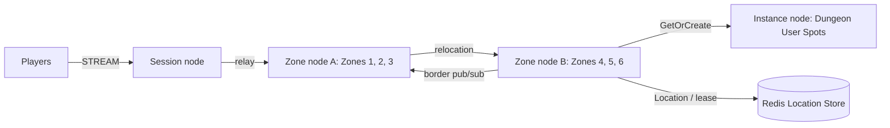

# MyGame MMORPG seamless world

This project runs a Session node, two Zone nodes, an Instance node, and a Redis Location Store. It includes a C# e2e client. Add server gameplay to the extension points in [AGENTS.md](AGENTS.md); no game engine project is included.



The initial `zlink.structure.json` uses the landing page's `mmo-seamless` composition. The structure checker accepts additional or reordered nodes, Spots and edges when identifiers, references, configuration paths and IDs, configured Zone IDs, and declared channel and Spot types agree with the format and server contracts. Runtime relocation can change the owner recorded in Redis without changing the initial structure definition.

## Prerequisites

- .NET SDK 8.0 or later with the .NET and ASP.NET Core 8 runtimes.
- Docker Engine with Docker Compose v2, reachable from the current shell.
- Bash for Linux, WSL, or macOS; PowerShell 7 for Windows.
- A platform supported by the published native `Zlink` package. The local verification targets Windows x64 and WSL Linux x64; macOS execution also requires native assets for the target architecture.

Packages come from public NuGet only. `Directory.Packages.props` pins the Framework package family to `0.30.0`. This project has no dependency on a ZLink source checkout or local package feed.

## Build

Run commands from this project root:

```sh
dotnet build server/MyGame.sln
```

On Windows, set `DOTNET_SYSTEM_NET_DISABLEIPV6=1` in the current PowerShell session before building:

```powershell
$env:DOTNET_SYSTEM_NET_DISABLEIPV6 = "1"
dotnet build server/MyGame.sln
```

The solution includes all server roles and the C# e2e client. It can also be opened directly in Visual Studio or Rider.

## Local e2e

```sh
./run-e2e.sh
```

```powershell
pwsh -NoProfile -File ./run-e2e.ps1
```

Both scripts build the solution and call the same C# orchestrator. It checks the structure, starts a uniquely named Compose project with an ephemeral Redis port, starts four server processes, waits for their explicit readiness responses, executes the scenarios, and cleans up its processes and container. Node endpoints and configuration overrides are generated per run under `.logs/`. Docker does not expose Redis beyond loopback.

Node stderr logs (`<node>.err.log`) include Framework message flow records because dispatch diagnostics use `Normal`. Inspect these logs from the first failing run.

The default runs all four scenarios. To select scenarios, use:

```sh
./run-e2e.sh --scenario cross,border,reconnect
```

```powershell
pwsh -NoProfile -File ./run-e2e.ps1 -Scenario cross,border,reconnect
```

Selection retains the canonical scenario order. Unknown or duplicate names fail before node startup. Exit status includes cleanup failures even when all selected scenarios pass.

After building, `--no-build` skips compilation on Bash; `-NoBuild` does the same on PowerShell:

```sh
./run-e2e.sh --no-build
```

```powershell
pwsh -NoProfile -File ./run-e2e.ps1 -NoBuild
```

| Scenario | Observable behavior |
| --- | --- |
| cross | A player moves from Zone 3 on A to Zone 4 on B. Actor ID, generation, and STREAM Session remain unchanged. A subsequent movement succeeds. |
| border | A player near the Zone 3/4 border becomes visible to a player in the neighboring Zone through real pub/sub delivery. |
| reconnect | The client disconnects and returns to the same Actor generation and authoritative coordinate through a new Session. |
| update | A drains while a player continues sending movements. Spots and Actors relocate to B, the Session remains connected, and acknowledged movement continues after A is replaced. |

The client also requests a Dungeon User Spot from the Instance node through `GetOrCreate`. Scenario results use `✓`/`✗` with a total and a nonzero exit code on failure. A failed run retains diagnostics; inspect that run before repeating it.

Structure validation can run without Docker:

```sh
dotnet e2e/MyGame.E2E/bin/Debug/net8.0/MyGame.E2E.dll --root . --check-structure
```

Every e2e run validates the composition before starting nodes. Only `--check-structure` also runs checker self-tests with valid extensions and deliberately inconsistent inputs. The checker does not require the initial preset's node counts, deployment IDs or edge indices.

## Known issues / 알려진 문제

The pinned public Framework `0.30.0` has the following defects. The template preserves the assertions and reports failures; it does not compensate with retries or delays. Fixes for #1690 and #1691 are scheduled for `0.30.1`.

- Zone startup is blocked: startup validation calls `ZoneSpot.Configure()` with an empty `Context.SpotId`. The public Spot contract requires an instance identity, which this application uses to select adjacent-zone subscription topics. This fails with `ArgumentOutOfRangeException` through `ZLinkSpotStartupValidator.ValidateAsync` before scenarios run. No fixed topic is registered to compensate; the Framework must provide the contracted Context.

- [#1690](https://github.com/zlink-systems/zlink/issues/1690): Session node `ShutdownAsync` with a bound connection can return `TeardownFailed` with native errno 110. Cleanup errors remain in the result and process logs, even if selected scenarios passed.
- [#1691](https://github.com/zlink-systems/zlink/issues/1691): After relocation admission seal, an already accepted handler's `BoundSession.Send` can fail with `application admission is sealed`. Once startup is available, the default `update` scenario also requires this fix; passing cross, border, and reconnect does not establish update continuity.

공개 Framework `0.30.0`의 시작 검사가 빈 `SpotId`로 `Configure()`를 호출하여 Zone 기동이 실패한다. 고정 topic으로 보상하지 않으며, Framework의 Context 계약 수정이 필요하다. `update`의 코드와 기대값은 유지하며 기본 실행에서도 제외하지 않는다. 기동 결함과 #1690·#1691을 수정한 package에서 전체 시나리오를 다시 검증해야 한다.

## Deployment sequence

The JSON files in `server/config/` are examples. Set a reachable Redis endpoint and a shared, isolated key prefix for each game environment. Set routable mesh endpoints and the public Session STREAM endpoint. Configure authentication before exposing this minimal example to players.

1. Start Redis. For local manual deployment, use `docker compose -p my-game-local up -d --wait` and obtain its chosen host port with `docker compose -p my-game-local port location 6379`.
2. Start Zone A using `server/config/zone-a.json`. Wait for its `READY` response after Zones 1–3 are created.
3. Start Zone B using `server/config/zone-b.json`. Wait for Zones 4–6. A's capacity is three; B's capacity is six so it can receive A's Zones during drain.
4. Start the Instance and Session processes using their configurations. Each process accepts `--config <path>`.
5. Connect clients to the Session endpoint. Requests bind a player Session to the player Actor and relay gameplay to its current Zone.

Example process invocation after updating the configuration's Redis port:

```sh
dotnet server/MyGame.Zone/bin/Debug/net8.0/MyGame.Zone.dll --config server/config/zone-a.json
```

For replacement, send `drain` to A's standard input. The application calls public host relocation in `PlannedMaintenance` mode, moving workload to the compatible remaining host. Wait for `RELOCATED` and `SAFE_TO_SHUTDOWN`, send `shutdown`, and wait for process exit. Start the replacement with the same logical node configuration and `Bootstrap` set to `false`. Existing Zones remain on B; replacement does not automatically redistribute them.

Use an external deployment orchestrator to control process lifetime in production. Planned maintenance here demonstrates drain and replacement at the same application version. A versioned rolling update requires a prepared compatible target and the Framework's `RollingUpdate` operation; changing a process binary alone does not migrate state.

Remove a manually started local Redis project with `docker compose -p my-game-local down --volumes`. The e2e runner removes only its own project automatically.

## 한국어 실행 안내

이 프로젝트는 Session, Zone A·B, Instance node와 Redis를 실행한다. `run-e2e.sh`와 `run-e2e.ps1`은 같은 C# 실행기를 사용하며, cross·border·reconnect·update의 실제 동작을 확인한 뒤 자신이 만든 process와 container를 정리한다. 로그는 `.logs/`에 남는다.

Zone A가 Zone 1–3을 만든 뒤 Zone B를 기동한다. A의 용량은 3이며 B의 용량은 6이다. Update 때 A의 workload를 B로 옮기고, 종료 가능한 상태를 확인한 뒤 A를 교체한다. 새 A의 `Bootstrap`은 `false`이며 기존 Zone은 B에 유지된다. 게임 로직을 추가할 위치와 공개 API 사용 규칙은 `AGENTS.md`를 따른다.
