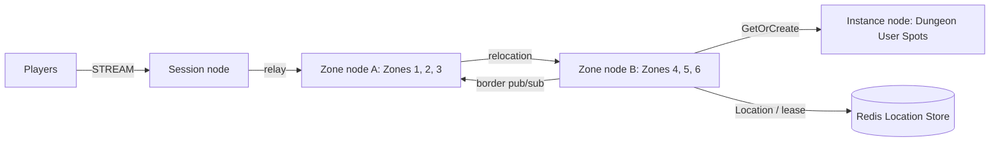

# MyGame MMORPG seamless world

This project runs a Session node, two Zone nodes, an Instance node, and a Redis Location Store. It includes a C# e2e client. Add server gameplay to the extension points in [AGENTS.md](AGENTS.md); no game engine project is included.



The initial `zlink.structure.json` uses the landing page's `mmo-seamless` composition. The structure checker accepts additional or reordered nodes, Spots and edges when identifiers, references, configuration paths and IDs, configured Zone IDs, and declared channel and Spot types agree with the format and server contracts. Runtime relocation can change the owner recorded in Redis without changing the initial structure definition.

## Prerequisites

- Docker Engine with Docker Compose v2, reachable from the current shell.
- Docker Desktop must use Linux containers; default execution needs no host .NET SDK.
- Bash for Linux, WSL, or macOS; PowerShell 7 for Windows.
- Linux native assets supported by the published `Zlink` package. Local process debugging additionally requires the .NET 8 SDK and ASP.NET Core 8 runtime.

Packages come from public NuGet only. `Directory.Packages.props` pins the Framework package family to `0.32.0`. This project has no dependency on a ZLink source checkout or local package feed.

## Build

Run commands from this project root:

```sh
./run-e2e.sh --build-only
```

PowerShell builds the same Dockerfile targets:

```powershell
pwsh -NoProfile -File ./run-e2e.ps1 -BuildOnly
```

`Dockerfile` owns fixed `SDK_IMAGE`, `RUNTIME_IMAGE`, and `DOCKER_CLI_IMAGE` defaults. Replace the appropriate base ARG when adopting a ZLink base image. Session, Zone, and Instance share the node image because their runtime dependencies match; each retains its own executable entry point. The ASP.NET Core runtime supplies shared hosting dependencies. The runner target adds Docker CLI and structure inputs without including the SDK.

Scripts remove unique image tags after each invocation. Docker retains build layers for subsequent runs.

## Client connection

### Endpoint and first packet

The Session `players` STREAM listener uses `StreamEndpoint` in `server/config/session.json`, defaulting to `ws://127.0.0.1:7200`: loopback WebSocket, fixed port 7200, root path `/`. Read `StreamEndpoint` from Session `READY` JSON, as `e2e/MyGame.E2E/WorldRun.cs` does; the runner overrides the port to `0` and uses the assigned address. Zone/Instance mesh listeners and Redis are internal endpoints.

Send `JoinWorldRequest(PlayerId, X)` first; `X: 0` starts in the first Zone. Successful Actor binding and entry produce a `WorldState` push. Rejoining can restore existing state instead of using the initial position. `ActionRejected` reports rejected actions. Entry is send/push; `SessionInfoRequest` is request/reply after binding. There is no product authentication; validate identity before binding when adding it.

### Connector installation

The default loopback listener is reachable only within its host/network namespace. Docker e2e nodes share the runner network namespace and are removed at the end. External clients need a deployment kept running with a reachable listener and an exposed container port. Browser, Unity WebGL, and Cocos Creator web clients can use this WebSocket endpoint; HTTPS pages require a secure `wss://` deployment. HTTP entry points also need a browser-accessible origin/CORS policy when called from a web client.

Use the release pinned in `Directory.Packages.props`, at `PackageVersion Include="Zlink.Framework"` and `PackageVersion Include="Zlink.Stream.Connector"` (`Version` attributes). Replace `<version>` in the installation commands with that release. Check linked guides against that pin; engine adapters follow the linked repository READMEs. All clients use this template's packet contract.

| Client                             | Connector installation                                                                                                                                                                                                                                                                                                                                                                                                                                                          | Documentation guide                                                                                                                                                          |
| ---------------------------------- | ------------------------------------------------------------------------------------------------------------------------------------------------------------------------------------------------------------------------------------------------------------------------------------------------------------------------------------------------------------------------------------------------------------------------------------------------------------------------------- | ---------------------------------------------------------------------------------------------------------------------------------------------------------------------------- |
| Unity                              | Native/Editor: restore `Zlink.Stream.Connector` with NuGetForUnity. WebGL: add the `com.zlink.stream-connector.webgl` UPM Git package; include only the connector assembly for the active target. See the [Unity README](https://github.com/zlink-systems/zlink/blob/main/framework/languages/engines/Unity/README.md) and its package manifest.                                                                                                                                | [.NET engine integration](https://docs.zlink.systems/dotnet/guide/stream-connector/12-engine-integration/)                                                                   |
| Unreal                             | Copy `framework/languages/cpp/connector/engines/unreal` into `Plugins/ZLinkStreamConnector`, then package the native connector under `ThirdParty/ZLink` as described in the [Unreal README](https://github.com/zlink-systems/zlink/blob/main/framework/languages/engines/Unreal/README.md).                                                                                                                                                                                     | [C++ engine integration](https://docs.zlink.systems/cpp/guide/stream-connector/12-engine-integration/)                                                                       |
| Godot                              | .NET: add the NuGet package `Zlink.Stream.Connector` and run `dotnet restore`; see the [C# README](https://github.com/zlink-systems/zlink/blob/main/framework/languages/engines/Godot/csharp/README.md). GDExtension: build the C++ Godot adapter against the framework prebuilt and matching `godot-cpp`; see the [C++ README](https://github.com/zlink-systems/zlink/blob/main/framework/languages/engines/Godot/cpp/README.md). The .NET sample does not support Web export. | [.NET](https://docs.zlink.systems/dotnet/guide/stream-connector/12-engine-integration/), [C++](https://docs.zlink.systems/cpp/guide/stream-connector/12-engine-integration/) |
| Cocos Creator                      | Web target: `npm install @zlink-systems/stream-connector@<version>`; see the [Cocos Creator README](https://github.com/zlink-systems/zlink/blob/main/framework/languages/engines/CocosCreator/README.md). This package does not provide a Creator native adapter.                                                                                                                                                                                                                  | [TypeScript engine integration](https://docs.zlink.systems/node/guide/stream-connector/12-engine-integration/)                                                               |
| Axmol                              | Copy `framework/languages/cpp/connector/engines/axmol` into `third_party/zlink_axmol_connector` and link `zlink::stream_connector` from the installed C++ framework package; see the [Axmol README](https://github.com/zlink-systems/zlink/blob/main/framework/languages/engines/Axmol/README.md).                                                                                                                                                                              | [C++ engine integration](https://docs.zlink.systems/cpp/guide/stream-connector/12-engine-integration/)                                                                       |
| Web browser (TypeScript connector) | `npm install @zlink-systems/stream-connector@<version>`; import the package root in the browser build. Use `ws://` or `wss://`, subject to the page's security policy.                                                                                                                                                                                                                                                                                                             | [TypeScript connector](https://docs.zlink.systems/node/guide/stream-connector/)                                                                                              |
| C++                                | Install the C++ framework prebuilt containing the connector; use `find_package(zlink_stream_connector_cpp CONFIG REQUIRED)` and link `zlink::stream_connector`.                                                                                                                                                                                                                                                                                                                 | [C++ connector](https://docs.zlink.systems/cpp/guide/stream-connector/)                                                                                                      |
| C#/.NET                            | `dotnet add package Zlink.Stream.Connector --version <version>`                                                                                                                                                                                                                                                                                                                                                                                                                    | [.NET connector](https://docs.zlink.systems/dotnet/guide/stream-connector/)                                                                                                  |
| Java                               | Add Maven/Gradle dependency `systems.zlink:zlink-stream-connector:<version>`.                                                                                                                                                                                                                                                                                                                                                                                                      | [Java connector](https://docs.zlink.systems/java/guide/stream-connector/)                                                                                                    |
| Kotlin                             | Add `systems.zlink:zlink-stream-connector:<version>` and `systems.zlink:zlink-framework-kotlin:<version>` for the coroutine wrapper.                                                                                                                                                                                                                                                                                                                                                  | [Kotlin connector](https://docs.zlink.systems/kotlin/guide/stream-connector/)                                                                                                |
| Node                               | `npm install @zlink-systems/stream-connector@<version>`; use the package root and Node.js 22 or later.                                                                                                                                                                                                                                                                                                                                                     | [Node connector](https://docs.zlink.systems/node/guide/stream-connector/)                                                                                                    |

### First world entry example

Create a .NET 8 console project in a copy, reference `server/MyGame.Shared/MyGame.Shared.csproj`, and add `Zlink.Stream.Connector` using the pinned version described above. Save as `Program.cs`, then run `dotnet run --project <client-project> -- <actual-session-endpoint>` against separately running Session, Zone/Instance nodes, and Redis. Use a fresh player ID. E2E removes its temporary deployment; its `GameClient.cs` shows the complete flow.

```csharp
using MyGame.Shared;
using Systems.Zlink.Stream.Connector;
using Systems.Zlink.Stream.Connector.Contracts;

using var deadline = new CancellationTokenSource(TimeSpan.FromSeconds(10));
var ct = deadline.Token;
await using var client = ZlinkStreamConnectorFactory.Create(new ZlinkStreamConnectorOptions
{
    Endpoint = new Uri(args[0]),
    DispatchMode = ZlinkStreamDispatchMode.Immediate,
    Reconnect = new ZlinkStreamReconnectOptions { Enabled = false },
});
var received = new TaskCompletionSource<WorldState>(TaskCreationOptions.RunContinuationsAsynchronously);
using var view = client.On<WorldState>((message, _) =>
{
    received.TrySetResult(message.Payload!);
    return ValueTask.CompletedTask;
});
using var rejected = client.On<ActionRejected>((message, _) =>
{
    received.TrySetException(new InvalidOperationException(message.Payload!.ToString()));
    return ValueTask.CompletedTask;
});
using var error = client.OnErrorReceived((message, _) =>
{
    received.TrySetException(new IOException(message.Message));
    return ValueTask.CompletedTask;
});
using var disconnected = client.OnDisconnected((_, _) =>
{
    received.TrySetException(new IOException("Disconnected before WorldState"));
    return ValueTask.CompletedTask;
});
await client.Connect.Async(ct);
await client.Send(new JoinWorldRequest("guide-player", 0)).Async(ct);
Console.WriteLine(await received.Task.WaitAsync(ct));
```

## Local e2e

```sh
./run-e2e.sh
```

```powershell
pwsh -NoProfile -File ./run-e2e.ps1
```

Both scripts build images and call the same C# orchestrator inside a runner container. A unique Compose project/network contains Redis and the runner. The runner checks structure before starting nodes. Nodes share its network namespace, preserving loopback listeners and OS-assigned ports without host port mappings. Redis publishes an ephemeral loopback port for local debugging.

The runner creates each node with interactive stdin, copies its configuration with `docker cp`, and attaches through `docker start -a -i`. `ManagedProcess` retains readiness, drain, shutdown, and replacement controls. Only the runner mounts the Docker socket; use a trusted local daemon. Scripts remove their labeled containers, Compose project, and image tags. Cleanup failure returns exit code 1.

Node stderr logs (`<node>.err.log`) include Framework message flow records because dispatch diagnostics use `Normal`. Inspect these logs from the first failing run.

On Unix sockets, Bash runs the runner with the caller's UID/GID and the socket's group so retained logs remain writable by the caller. Windows uses Docker Desktop's filesystem mapping. Build, Redis, and outer cleanup logs are in `.logs/docker-<project>/`; node settings and control logs are in `.logs/run-<id>/`.

The default runs all four scenarios. To select scenarios, use:

```sh
./run-e2e.sh --scenario cross,border,reconnect,update
./run-e2e.sh --check-structure
./run-e2e.sh --check-domain
```

```powershell
pwsh -NoProfile -File ./run-e2e.ps1 -Scenario cross,border,reconnect,update
pwsh -NoProfile -File ./run-e2e.ps1 -CheckStructure
pwsh -NoProfile -File ./run-e2e.ps1 -CheckDomain
```

Selection retains the canonical scenario order. Unknown or duplicate names fail before node startup. Exit status includes cleanup failures even when all selected scenarios pass.

For host process debugging, install the .NET 8 SDK and add `--local` or `-Local`. Redis remains in Docker. After a local build, `--no-build` or `-NoBuild` skips compilation:

```sh
./run-e2e.sh --local
./run-e2e.sh --local --no-build
```

```powershell
pwsh -NoProfile -File ./run-e2e.ps1 -Local
pwsh -NoProfile -File ./run-e2e.ps1 -Local -NoBuild
```

| Scenario | Observable behavior |
| --- | --- |
| cross | Server-checked Delta movement rejects an oversized step, an exhausted movement budget, and an outside-world result without changing state. After the server-provided retry delay, the player crosses from Zone 3 on A to Zone 4 on B; Actor identity and STREAM Session remain unchanged. |
| border | Same-Zone and adjacent-Zone players observe appearance and movement. Leaving the border band while moving into the Zone produces `out-of-range`; Zone departure and connection loss produce `left-zone` and `disconnected` events. |
| reconnect | The client reconnects to the same Actor identity and authoritative coordinate and sequence through a new Session. |
| update | A drains while a player continues sending movements. Zone snapshots preserve positions, sequences, and remaining movement-budget milliseconds. The Session remains connected and acknowledged movement continues after A is replaced. |

The client also requests a Dungeon User Spot from the Instance node through `GetOrCreate`. Scenario results use `✓`/`✗` with a total and a nonzero exit code on failure. A failed run retains diagnostics; inspect that run before repeating it.

Pass `--check-structure` or `--check-domain` to `run-e2e.sh`, or `-CheckStructure` or `-CheckDomain` to `run-e2e.ps1`, to check composition or domain boundaries without starting nodes. The domain check also runs before the default scenario nodes start. After a local build, structure validation can also run without Docker:

```sh
dotnet e2e/MyGame.E2E/bin/Debug/net8.0/MyGame.E2E.dll --root . --check-structure
```

Message Follow is explicitly configured to 30 seconds in shared hosting. The wait for `SAFE_TO_SHUTDOWN` is derived from that period plus the existing host relocation budget. Packet deadlines and the relocation operation budget remain unchanged.

Every e2e run validates the composition before starting nodes. `--check-structure` checks the supplied files without starting servers. Verify missing Entry and User Spot declarations with temporary input copies during development. The checker does not require the initial preset's node counts, deployment IDs or edge indices.

## Framework behavior to know

- **Waiting for DB or file I/O in a handler** — An ordinary async terminal holds the turn, while `Yield` lets other handlers on the same Spot proceed. [Guide](https://docs.zlink.systems/dotnet/guide/server/32-execution-model/#io-worker-wait).
- **Creation that misses its deadline** — `DeadlineExceeded` and caller cancellation have distinct outcomes. [Guide](https://docs.zlink.systems/dotnet/guide/server/22-actor/#creation-deadline). [server/MyGame.Session/PlayerSession.cs:81](server/MyGame.Session/PlayerSession.cs).
- **Many logins at once** — Each creation for a different ID requires a Location Store round trip, so measure expected load when setting the deadline. [Guide](https://docs.zlink.systems/dotnet/guide/server/25-location/#creation-load).
- **Sending under load** — A send waits for capacity and the application observes only its final result. [Guide](https://docs.zlink.systems/dotnet/guide/server/33-backpressure/#send-backpressure). [server/MyGame.Session/PlayerSession.cs:41](server/MyGame.Session/PlayerSession.cs).
- **Duplicate login** — Without a callback, binding a different Session is accepted; reject it in the Actor duplicate-bind callback to prevent it. [Guide](https://docs.zlink.systems/dotnet/guide/server/39-session-binding/#duplicate-session-bind). This template keeps the default (accepts the new Session).
- **ObjectGeneration** — `ObjectGeneration` identifies a logical incarnation of the same ID; it is neither a data version nor write authority. [Guide](https://docs.zlink.systems/dotnet/guide/server/34-activation-lifetime/#object-generation). [server/MyGame.Session/PlayerSession.cs:65](server/MyGame.Session/PlayerSession.cs).
- **READY and Serving** — Framework nodes print `READY` after observing runtime `Serving`. [Guide](https://docs.zlink.systems/dotnet/guide/server/12-operations/#wait-for-serving). [server/MyGame.Shared/NodeControl.cs:19](server/MyGame.Shared/NodeControl.cs); [server/MyGame.Shared/NodeControl.cs:46](server/MyGame.Shared/NodeControl.cs).

## Known issues

Validated against the published Framework 0.32.0 packages.

## Deployment sequence

The JSON files in `server/config/` are examples. Set a reachable Redis endpoint and a shared, isolated key prefix for each game environment. Set routable mesh endpoints and the public Session STREAM endpoint. Configure authentication before exposing this minimal example to players.

1. Start Redis. For local manual deployment, use `docker compose -p my-game-local up -d --wait location` and obtain its chosen host port with `docker compose -p my-game-local port location 6379`.
2. Start Zone A using `server/config/zone-a.json`. Wait for its `READY` response after Zones 1–3 are created.
3. Start Zone B using `server/config/zone-b.json`. Wait for Zones 4–6. A's capacity is three; B's capacity is six so it can receive A's Zones during drain.
4. Start the Instance and Session processes using their configurations. Each process accepts `--config <path>`.
5. Connect clients to the Session endpoint. Requests bind a player Session to the player Actor and relay gameplay to its current Zone.

Example process invocation after updating the configuration's Redis port:

```sh
dotnet server/MyGame.Zone/bin/Debug/net8.0/MyGame.Zone.dll --config server/config/zone-a.json
```

For replacement, send `drain` to A's standard input. The application calls public host relocation in `PlannedMaintenance` mode, moving workload to the compatible remaining host. Wait for `RELOCATED` and `SAFE_TO_SHUTDOWN`, send `shutdown`, and wait for process exit. Start the replacement with the same logical node configuration. Like every Zone node, it runs `GetOrCreate` for all configured Zones at startup: Zones already moved to B end as existing and remain on B, and only the closed first Zone is created on the replacement. Replacement does not automatically redistribute existing Zones.

Use an external deployment orchestrator to control process lifetime in production. Planned maintenance here demonstrates drain and replacement at the same application version. A versioned rolling update requires a prepared compatible target and the Framework's `RollingUpdate` operation; changing a process binary alone does not migrate state.

Remove a manually started local Redis project with `docker compose -p my-game-local down --volumes`. The e2e runner removes only its own project automatically.

Fixed Zones are bootstrapped serially: Zone A fills its three-Spot capacity before Zone B starts. This makes the declared initial owners deterministic through public stable-type capacity. During e2e, Zone B has capacity for all but one world Zone. Before update drains Zone A, `vacate-zone` closes the unused first Zone through the public Spot manager. The remaining Zones fill Zone B; the replacement Zone A recreates the first Zone through its startup `GetOrCreate`; a fresh player then joins it, and the test verifies its host and continued movement. Existing relocated players remain on Zone B.
